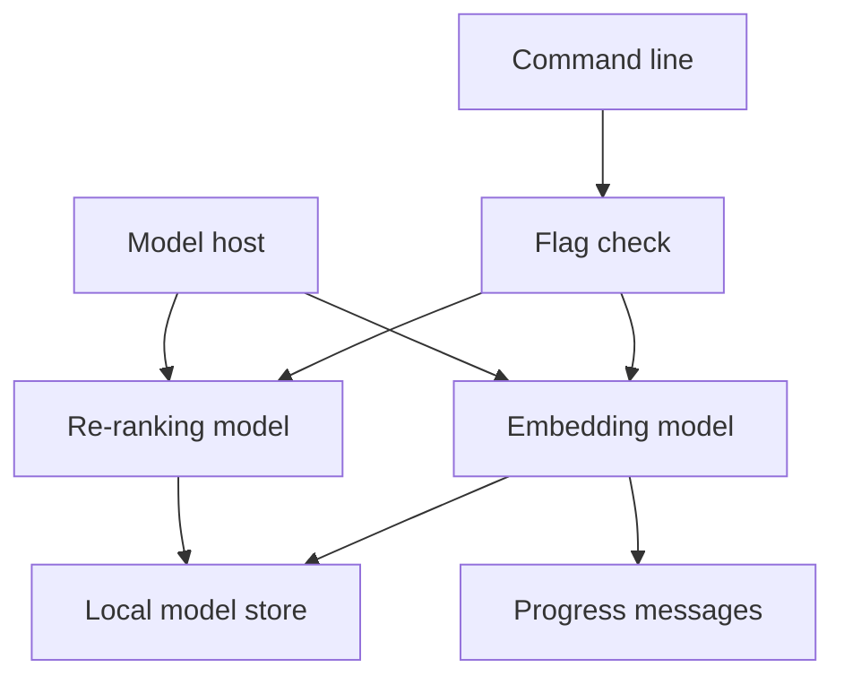
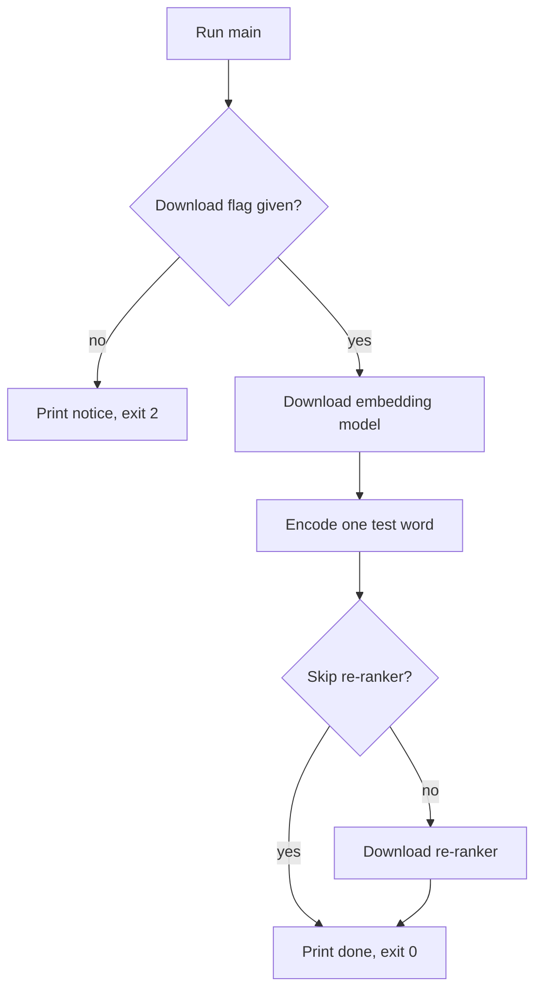

## Purpose

A one-time setup script that fetches the optional local models for search: a text embedding model and a re-ranking model. Search works without them, using the built-in hash embedder. The script touches the network only when started on purpose with an explicit flag, so nothing downloads by accident.

## Dependencies

**Depends on.**
- Repo files: [[config]] and [config](config.md) {src:scripts/search/download_model.py:18}; [[embedder]] and [embedder](embedder.md) {src:scripts/search/download_model.py:19}.
- Outside package: `sentence_transformers`, imported only after the flag check {src:scripts/search/download_model.py:31}.
- Network: the model host used by that package (not named in this file).
- Environment: `TOLLGATE_EMBED_TRUST_REMOTE_CODE` {src:scripts/search/download_model.py:33}, and the model names from `config` {src:scripts/search/download_model.py:32} {src:scripts/search/download_model.py:38}.

**Used by.**
- Product code: `install.sh` runs it with `--yes-download` after installing `sentence-transformers` {src:install.sh:1599-1600}, and prints a retry command that names it {src:install.sh:1604}.
- Tests: `tests/scripts/search/test_internals.py` (runs it with no flag), `tests/installer/test_lifecycle.sh`.
- Searched `git grep download_model` over the repo except `docs/` on 2026-11-20. No hook, command file or cron entry runs it.

## Behavior

**Flag gate.** Without `--yes-download` the script prints "Nothing downloaded" and returns 2 {src:scripts/search/download_model.py:27-29}. `--no-rerank` skips the re-ranker {src:scripts/search/download_model.py:25}.

**Embedding model.** It calls the private `_stub_backend` helper of `embedder` first {src:scripts/search/download_model.py:30}, which fills in missing optional backends so the import works {src:scripts/search/embedder.py:127-135}. It then builds `SentenceTransformer` for the configured model name, which downloads it if it is not already stored {src:scripts/search/download_model.py:34}. Remote model code is allowed only when the environment value is exactly "1" {src:scripts/search/download_model.py:33}. It encodes the word "test" once and prints the vector size {src:scripts/search/download_model.py:35-36}.

**Re-ranker.** Unless `--no-rerank`, it builds `CrossEncoder` for the configured re-ranker name, which downloads it, and prints "Reranker ready" {src:scripts/search/download_model.py:37-40}.

**End.** It prints "Models downloaded and verified." and returns 0 {src:scripts/search/download_model.py:41-42}.

**Where the files go.** The script gives no folder. The package decides where models are stored. The embedder later loads the same model with `local_files_only=True` {src:scripts/search/embedder.py:100}.

## Diagram: module level (L2, required)

## Diagram: function level (L3, optional)

The branches are in `main` {src:scripts/search/download_model.py:27-41}.

## Notes

**Code and description disagree.**
- The header says the script will "download and check" the models {src:scripts/search/download_model.py:4}, and the last line says "downloaded and verified" {src:scripts/search/download_model.py:41}. Only the embedding model is exercised, by one encode call {src:scripts/search/download_model.py:35}. The re-ranker is built and never run {src:scripts/search/download_model.py:39}, and the final message prints even with `--no-rerank` {src:scripts/search/download_model.py:41}.
- The change log says nothing else in Tollgate downloads a model {src:scripts/search/download_model.py:9}. The router can build the re-ranker too, but with the offline setting on by default {src:scripts/search/router.py:62-68}, and the embedder loads with `local_files_only=True` {src:scripts/search/embedder.py:100}. The installer also installs a package from the network, which is not a model {src:install.sh:1599}. The claim holds for model files.
- The header `date:` field is empty {src:scripts/search/download_model.py:6}.

**Behavior worth knowing (read from the code, not run).**
- No error handling: a missing package at the import {src:scripts/search/download_model.py:31} or a network failure at either download ends in a traceback. `install.sh` handles this by treating any failure as "continue with the built-in embedder" {src:install.sh:1599-1605}.
- Any offline setting already in the environment (`HF_HUB_OFFLINE`) is not cleared here, so it may block the download. This is the package's behavior {unverified}.
- The script does not record which embedder an index uses and does not change the embedder choice.

**Inputs reaching paths, commands, addresses or outbound text.**
- `TOLLGATE_EMBED_MODEL` and `TOLLGATE_RERANK_MODEL` are passed to the model loader as names with no check {src:scripts/search/config.py:56-57} {src:scripts/search/download_model.py:34} {src:scripts/search/download_model.py:39}. A name chooses what is fetched from the network, or a local path.
- With `TOLLGATE_EMBED_TRUST_REMOTE_CODE=1`, code that ships with the downloaded model is allowed to run {src:scripts/search/download_model.py:33-34}. It is off by default.
- No shell command is built from input and no outbound text carries user data.

**Writes to shared files.** The script writes no file itself. The package writes its own model store; whether that is atomic and whether two runs at once are stopped is not visible here {unverified}.
