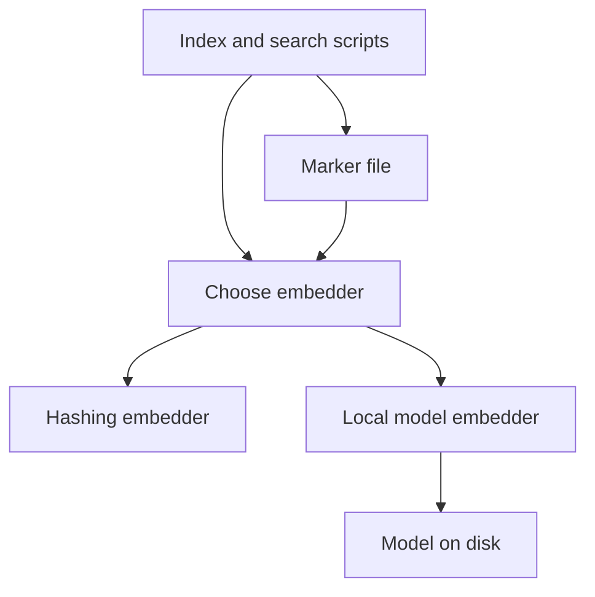
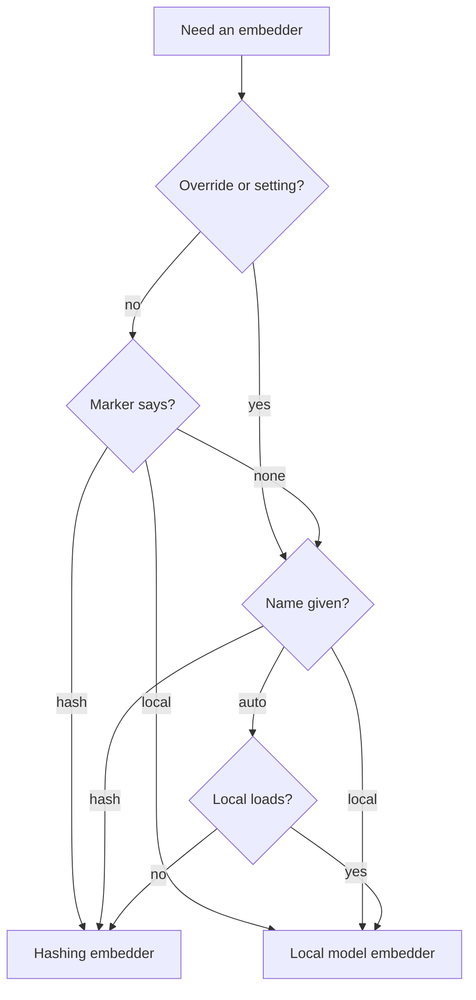

## Purpose

Turns text into vectors for search. It offers two interchangeable embedders: a built-in hashing one that needs no model and no network, and an optional wrapper around a local sentence-transformers model. It also keeps a small marker file in the index folder that records which embedder built the index, so that searches use the same one and two kinds of vectors are never mixed.

## Dependencies

**Depends on.**
- Repo file: [[config]] and [config](config.md) {src:scripts/search/embedder.py:22}, for the model name, the trust and query-prompt variable names, and the `TOLLGATE_EMBEDDER` name {src:scripts/search/embedder.py:98} {src:scripts/search/embedder.py:99} {src:scripts/search/embedder.py:103} {src:scripts/search/embedder.py:140}.
- Outside package: `sentence_transformers`, imported only when the local embedder is created {src:scripts/search/embedder.py:97}.
- Environment: `HF_HUB_OFFLINE` and `TRANSFORMERS_OFFLINE`, set to "1" if unset {src:scripts/search/embedder.py:94-95}; the variables named in `config` (`TOLLGATE_EMBEDDER`, `TOLLGATE_EMBED_QUERY_PROMPT`, `TOLLGATE_EMBED_TRUST_REMOTE_CODE`).
- File: `embedder.json` in the index folder {src:scripts/search/embedder.py:24}.

**Used by.**
- Product code: `scripts/search/build_index.py` {src:scripts/search/build_index.py:440} {src:scripts/search/build_index.py:442} {src:scripts/search/build_index.py:460}; `check_index_health.py` {src:scripts/search/check_index_health.py:70}; `download_model.py` {src:scripts/search/download_model.py:30}; `eval_judge.py` {src:scripts/search/eval_judge.py:79}; `eval_rag.py` {src:scripts/search/eval_rag.py:39}; `ground.py` {src:scripts/search/ground.py:43}; `query_index.py` {src:scripts/search/query_index.py:59}; `reference_add.py` {src:scripts/search/reference_add.py:52} {src:scripts/search/reference_add.py:53}; `reference_query.py` {src:scripts/search/reference_query.py:43}; `router.py` {src:scripts/search/router.py:66} {src:scripts/search/router.py:224}; and `scripts/sync/sweep` {src:scripts/sync/sweep:237}.
- Tests: `tests/scripts/search/test_embedder_profile.py`, `tests/scripts/search/test_internals.py`, `tests/scripts/search/test_review_fixes.py`.
- Searched `git grep` for the module and function names over `scripts/`, `tests/` and `install.sh` on 2026-11-20.

## Behavior

**Hashing embedder.** `HashEmbedder` (name `hash-v1`, 2048 dimensions, score floor 0.1) {src:scripts/search/embedder.py:43-45} lowercases the text and finds words made of letters and digits {src:scripts/search/embedder.py:52}, drops common stop words {src:scripts/search/embedder.py:25-29}, and strips one of the endings `ing`, `ed`, `es`, `s` when at least 3 letters remain {src:scripts/search/embedder.py:33-37}. Each word adds weight 1 to a slot chosen by a CRC32 hash {src:scripts/search/embedder.py:55-56}, and each three-letter piece of the word, padded with start and end marks, adds 0.25 {src:scripts/search/embedder.py:57-60}. The vector is divided by its length when normalizing is on and the length is not zero {src:scripts/search/embedder.py:71-73}. The same text gives the same vector on every run, since CRC32 is used and not Python's per-process hash. Questions are embedded the same way as documents {src:scripts/search/embedder.py:77-79}. A distance becomes a score of one minus the distance, never below 0 {src:scripts/search/embedder.py:83}.

**Local model embedder.** On creation it sets the two offline variables if unset {src:scripts/search/embedder.py:94-95}, calls the backend stub {src:scripts/search/embedder.py:96}, and loads the model with `local_files_only=True`, so it never downloads {src:scripts/search/embedder.py:100-101}. The name becomes `local:<model>` {src:scripts/search/embedder.py:102}. When a query prompt name is set but the model has no prompt of that name, it raises `ValueError` {src:scripts/search/embedder.py:103-108}. `encode_query` adds the prompt name when one is set {src:scripts/search/embedder.py:112-114}. Scores are one minus half the distance, never below 0 {src:scripts/search/embedder.py:124}; the floor is 0.3 {src:scripts/search/embedder.py:90}.

**Backend stub.** Some platforms lack optional backends that `sentence_transformers` imports at load time. `_stub_backend` puts a stand-in module with empty entries into the module table unless one is present {src:scripts/search/embedder.py:127-135}. It is private by name but called from `download_model.py` {src:scripts/search/download_model.py:30} and `router.py` {src:scripts/search/router.py:66}.

**Choosing.** `get_embedder` reads the name from the argument or `TOLLGATE_EMBEDDER`, default `auto` {src:scripts/search/embedder.py:140}. `hash` or `fake` gives the hashing embedder {src:scripts/search/embedder.py:141-142}. A name starting with `local` gives the local one and raises if it cannot load {src:scripts/search/embedder.py:143-144}. Anything else tries the local one and falls back to hashing on any error {src:scripts/search/embedder.py:145-148}.

**Marker.** `write_marker` writes `{"name": ...}` to `embedder.json` {src:scripts/search/embedder.py:151-153}. `read_marker` returns the name, or `None` when the file is missing or unreadable {src:scripts/search/embedder.py:156-160}. `embedder_for_index` returns `get_embedder(override)` when an override or the environment variable is set {src:scripts/search/embedder.py:165-166}; otherwise it follows the marker, hashing for `hash-v1` {src:scripts/search/embedder.py:168-169}, the named local model for a marker starting with `local` {src:scripts/search/embedder.py:170-173}, or the default choice when no marker exists {src:scripts/search/embedder.py:174}. `check_marker` raises `ValueError` when a marker exists and its name differs from the given embedder's name {src:scripts/search/embedder.py:183-187}.

## Diagram: module level (L2, required)

## Diagram: function level (L3, optional)

The gates are in `embedder_for_index` and `get_embedder` {src:scripts/search/embedder.py:165-174} {src:scripts/search/embedder.py:140-148}.

## Notes

**Code and description disagree.**
- The header says the index remembers its embedder "so queries use the same one" {src:scripts/search/embedder.py:8}, and a comment says questions must use the model that built the index, "not whatever the setting says now" {src:scripts/search/embedder.py:171}. That holds only when no override and no `TOLLGATE_EMBEDDER` value is set. When either is set, the marker is ignored {src:scripts/search/embedder.py:165-166}.
- The docstring lists the names `hash, local, auto` {src:scripts/search/embedder.py:139}. The code also accepts `fake` {src:scripts/search/embedder.py:141}, accepts any name that starts with `local` {src:scripts/search/embedder.py:143}, and treats every other value, such as a typo, as `auto` {src:scripts/search/embedder.py:145-148}.
- The `auto` path swallows every error from the local embedder {src:scripts/search/embedder.py:147}, including the `ValueError` from a wrong query prompt name {src:scripts/search/embedder.py:106}. A bad setting then gives hashing quietly, while the explicit `local` name raises.
- The `date:` header field is empty {src:scripts/search/embedder.py:5}.

**Behavior worth knowing (read from the code, not run).**
- The local class sets the class-level name `local-model` {src:scripts/search/embedder.py:89}, replaced by `local:<model>` on each instance {src:scripts/search/embedder.py:102}.
- Text with no letters or digits in `a-z0-9` (for example only accented or non-Latin letters) gives no features and an all-zero vector {src:scripts/search/embedder.py:30} {src:scripts/search/embedder.py:72}.
- `check_marker` compares names only. A different setting that keeps the same name (for example the trust flag) is not detected {src:scripts/search/embedder.py:184}.
- Creating a local embedder changes the process environment for the rest of the run {src:scripts/search/embedder.py:94-95}.
- No test covers `_stub_backend` directly (searched `git grep _stub_backend tests`, 2026-11-20).

**Inputs reaching paths, commands, addresses or outbound text.**
- The model name from `TOLLGATE_EMBED_MODEL` is passed to the model loader and may be a local path {src:scripts/search/embedder.py:98} {src:scripts/search/embedder.py:100}. No check.
- The model name inside `embedder.json` is passed to the loader as well {src:scripts/search/embedder.py:172-173}. A changed marker file chooses which model loads. With `TOLLGATE_EMBED_TRUST_REMOTE_CODE=1`, that model's own code runs {src:scripts/search/embedder.py:99-101}.
- Marker contents are otherwise parsed as JSON and unchecked {src:scripts/search/embedder.py:158}.
- No text leaves the machine from this file. No shell command or network address is built from input.

**Writes to shared files.** The marker is written with `write_text` in place, not atomic, with no lock {src:scripts/search/embedder.py:153}. It is written by `build_index`, except when the run is limited to one source and a marker already exists {src:scripts/search/build_index.py:459} {src:scripts/search/build_index.py:460}, and by `reference_add` {src:scripts/search/reference_add.py:53}, so two runs at once can write it together.
