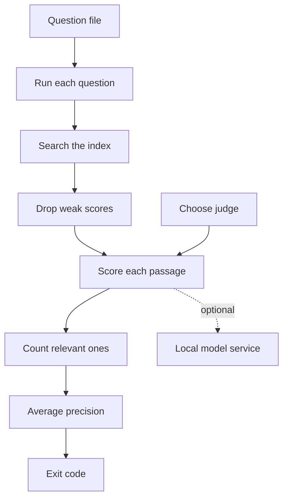

## Purpose

A command line check on search quality that asks a different question from the hit-rate eval: of the passages the search returns for each known question, how many actually look relevant to that question. The scoring step is a swappable function, so the same loop can use a free word-overlap rule or a local language model. It exists so a person can tell "the right file came back" apart from "the text that came back is on topic".

## Dependencies

**Depends on:**
- [[config]] (no doc yet): `config.index_root`, `config.OLLAMA_BASE_URL`, `config.OLLAMA_CONTEXT_MODEL`, `config.OLLAMA_CALL_TIMEOUT_SECONDS` {src:scripts/search/eval_judge.py:42} {src:scripts/search/eval_judge.py:50} {src:scripts/search/eval_judge.py:78}
- [[paths]] / [paths](../core/paths.md): `NotSetUp` exception class {src:scripts/search/eval_judge.py:25}
- [[embedder]] (no doc yet) and [[router]] (no doc yet), imported inside `_real_search` only {src:scripts/search/eval_judge.py:76-77}
- Standard library: `argparse`, `json`, `pathlib`, `re`, `sys`, `typing`, and `urllib.request` (imported inside `ollama_judge` only {src:scripts/search/eval_judge.py:41})
- Environment variables: `TOLLGATE_OLLAMA_URL` and `TOLLGATE_OLLAMA_MODEL`, read in `config.py` {src:scripts/search/config.py:113-114}

**Used by:**
- Product code: none. Searched with `git grep` for `eval_judge` across the repo excluding `docs/` (2026-11-20); the only hits are this file's own header lines and the test below. It is run by hand.
- Tests: [[test_golden]] (no doc yet), `tests/scripts/search/test_golden.py` {src:tests/scripts/search/test_golden.py:92-100}

## Behavior

**Judges.** A judge is any function taking `(question, passage)` and returning a number {src:scripts/search/eval_judge.py:27}.
- `lexical_judge` keeps question words of four or more letters {src:scripts/search/eval_judge.py:33}, returns 0.0 when there are none {src:scripts/search/eval_judge.py:34-35}, and otherwise returns the share of them found among the passage words {src:scripts/search/eval_judge.py:36-37}. It is the default {src:scripts/search/eval_judge.py:87} {src:scripts/search/eval_judge.py:93}.
- `ollama_judge` raises `RuntimeError` unless both the URL and model settings are non-empty {src:scripts/search/eval_judge.py:42-43}. It builds a prompt holding the question and passage {src:scripts/search/eval_judge.py:44-45}, posts it to `<url>/api/generate` with temperature 0 {src:scripts/search/eval_judge.py:46-49}, waits up to the configured timeout, 600 seconds {src:scripts/search/eval_judge.py:50} {src:scripts/search/config.py:119}, and takes the first number in the reply, capped at 1.0, or 0.0 when the reply has no number {src:scripts/search/eval_judge.py:52-53}.

**Scoring loop.** `evaluate` takes each question, calls the search function, keeps the first `top_k` passages {src:scripts/search/eval_judge.py:60}, scores each passage {src:scripts/search/eval_judge.py:61}, and counts the ones at or above the threshold {src:scripts/search/eval_judge.py:62}. It returns one row per question with `returned`, `relevant` and `expect_none` {src:scripts/search/eval_judge.py:63-64}.

**Precision.** `precision` averages `relevant / returned` over the questions that are not `expect_none` and returned at least one passage {src:scripts/search/eval_judge.py:69-72}. With no such question it returns 0.0 {src:scripts/search/eval_judge.py:70-71}.

**Real search.** `_real_search` opens the index, builds the embedder that made it {src:scripts/search/eval_judge.py:78-79}, asks the router for 10 results with an equal-weight intent {src:scripts/search/eval_judge.py:80}, and drops anything under the embedder's base floor {src:scripts/search/eval_judge.py:81}.

**Command line.** Options and defaults: `--judge lexical|ollama` default lexical {src:scripts/search/eval_judge.py:87}, `--threshold 0.3` {src:scripts/search/eval_judge.py:88}, `--top-k 3` {src:scripts/search/eval_judge.py:89}, `--min-precision 0.5` {src:scripts/search/eval_judge.py:90}. `main` reads the question file as JSON {src:scripts/search/eval_judge.py:92}, runs the loop, prints one line per question and the precision {src:scripts/search/eval_judge.py:100-102}, and exits 0 when precision meets `--min-precision`, else 1 {src:scripts/search/eval_judge.py:103}. A `NotSetUp` or `ImportError` prints `not set up` and exits 2 {src:scripts/search/eval_judge.py:96-98}.

## Diagram: module level (L2, required)

## Diagram: function level (L3, optional)

None: no function has branching that the signature does not show.

## Notes

**Code versus its own description.**
- The header says the exit codes are 0, 1 and 2 {src:scripts/search/eval_judge.py:12}. That matches the code {src:scripts/search/eval_judge.py:98} {src:scripts/search/eval_judge.py:103}. The header usage line omits `--min-precision` {src:scripts/search/eval_judge.py:10}, which the code defines {src:scripts/search/eval_judge.py:90}.
- The header says the model judge posts to "a local service you run" {src:scripts/search/eval_judge.py:11}. The code only requires a non-empty address and does not check that it is local {src:scripts/search/eval_judge.py:42} {src:scripts/search/eval_judge.py:48}.
- The description says the judge "reports how many are relevant" {src:scripts/search/eval_judge.py:4}. It does print the relevant count per question {src:scripts/search/eval_judge.py:101}. The header `date` field has no value {src:scripts/search/eval_judge.py:6}.

**Behavior worth knowing.**
- A normal question for which the search returns nothing is left out of the average {src:scripts/search/eval_judge.py:69}, so an empty search is not penalised. `expect_none` questions never count toward the score either {src:scripts/search/eval_judge.py:69}; they only appear as rows.
- The judge only ever sees up to 10 passages {src:scripts/search/eval_judge.py:80}, so `--top-k` above 10 behaves like 10.
- `--threshold` is not applied to the search floor; the floor comes from the embedder {src:scripts/search/eval_judge.py:81}.
- `from core.paths import NotSetUp` works only because importing `config` first puts the `scripts/` folder on the import path {src:scripts/search/config.py:21} {src:scripts/search/eval_judge.py:24-25}. Swapping those two lines would break the import.
- `ImportError` is reported as `not set up` {src:scripts/search/eval_judge.py:96-98}, so a missing package and a missing index look the same.
- Any other error (a bad JSON file {src:scripts/search/eval_judge.py:92}, a question row with no `id` or `question` {src:scripts/search/eval_judge.py:60} {src:scripts/search/eval_judge.py:63}, the `RuntimeError` from the model judge {src:scripts/search/eval_judge.py:43}, a reply with no `response` key {src:scripts/search/eval_judge.py:51}) is not caught and ends in a traceback.
- The number pattern `\d*\.?\d+` reads "10" as 10 and caps it to 1.0 {src:scripts/search/eval_judge.py:52-53}; it cannot read a negative number.

**Unchecked inputs.**
- `--golden` path is opened as given, with no check {src:scripts/search/eval_judge.py:92}.
- With `--judge ollama`, the question and the passage text from the index are sent to the address in `TOLLGATE_OLLAMA_URL` with no check on the address, no allow list and no filtering of the passage text {src:scripts/search/eval_judge.py:44-50}. Passages come from the user's own notes, so this is outbound text.
- No input reaches a shell command.

**Shared files.** This file writes no file. It reads the question file and the index only.
