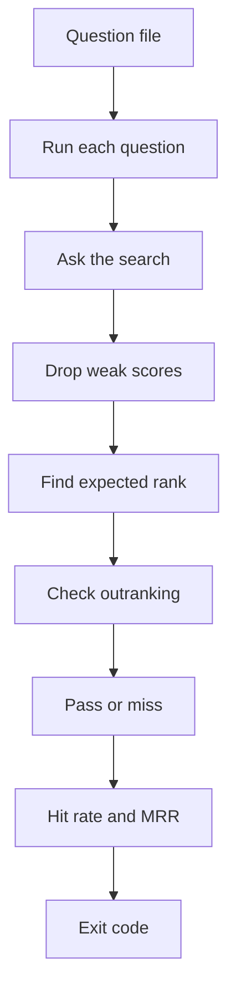
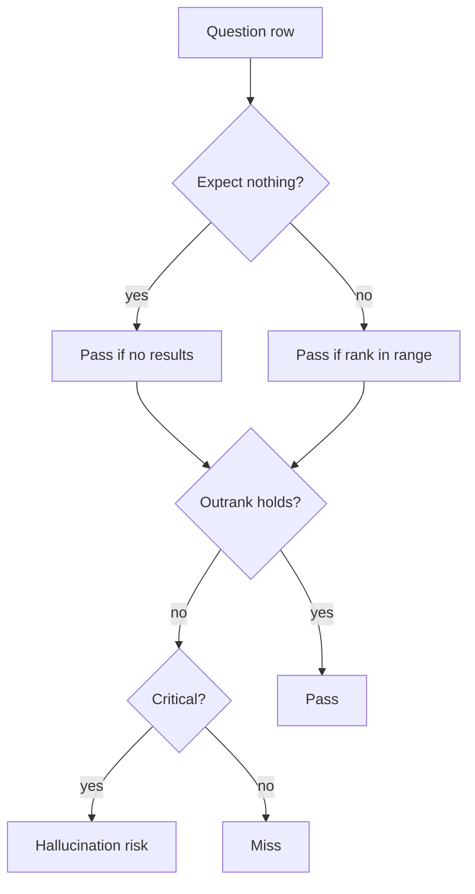

## Purpose

Scores the search index against a file of known questions, each with the files that should come back. It is meant to be run before and after any change to the index or the ranking, so a regression shows up as a lower hit rate or a flagged miss. The retrieval step can be swapped for a fake, which lets the scoring be tested without an index.

## Dependencies

**Depends on:**
- [[config]] (no doc yet): `config.index_root` {src:scripts/search/eval_rag.py:38}
- [[paths]] / [paths](../core/paths.md): `NotSetUp` {src:scripts/search/eval_rag.py:26}
- [[embedder]] (no doc yet) and [[router]] (no doc yet), imported inside `default_retrieve` only {src:scripts/search/eval_rag.py:36-37}
- Standard library: `argparse`, `json`, `os`, `pathlib`, `sys`, `typing`
- Environment variable `TOLLGATE_EVAL_CASES`, the default question file {src:scripts/search/eval_rag.py:28} {src:scripts/search/eval_rag.py:113}

**Used by:**
- Product code: [eval_retrieval](eval_retrieval.md) / [[eval_retrieval]] calls `eval_rag.evaluate` and `eval_rag.print_report` {src:scripts/search/eval_retrieval.py:39} {src:scripts/search/eval_retrieval.py:46}
- Tests: [[test_golden]] (no doc yet), `tests/scripts/search/test_golden.py`, which calls `evaluate`, `default_retrieve` and `summarize` and runs the command line {src:tests/scripts/search/test_golden.py:37} {src:tests/scripts/search/test_golden.py:58} {src:tests/scripts/search/test_golden.py:77} {src:tests/scripts/search/test_golden.py:89}
- No command file, hook or installer line names it (searched with `git grep` excluding `docs/`, 2026-11-20).

## Behavior

**Question file.** A JSON list. Each item needs `id` and `question` {src:scripts/search/eval_rag.py:72} {src:scripts/search/eval_rag.py:74}; it may carry `expected` (list of file keys) {src:scripts/search/eval_rag.py:75}, `must_outrank` {src:scripts/search/eval_rag.py:76}, `critical` {src:scripts/search/eval_rag.py:77} and `expect_none` {src:scripts/search/eval_rag.py:78}.

**Retrieval.** `default_retrieve` opens the index, builds the embedder that made it {src:scripts/search/eval_rag.py:38-39}, asks the router for at most `RETURN_LIMIT` (5) results with an equal-weight intent {src:scripts/search/eval_rag.py:29} {src:scripts/search/eval_rag.py:40}, and returns the file keys of those scoring at or above the embedder's base floor {src:scripts/search/eval_rag.py:41}.

**Ranking helpers.** `first_rank` returns the 1-based position of the first result that is in `expected`, or None {src:scripts/search/eval_rag.py:44-48}. `outranks` is true when no distractor is named or it is not in the results {src:scripts/search/eval_rag.py:52-53}; otherwise it is true only when an expected file appears strictly before the distractor {src:scripts/search/eval_rag.py:54-55}.

**Verdict.** For an `expect_none` question the test is "nothing returned"; for any other the test is "rank found and no worse than `top_k`" {src:scripts/search/eval_rag.py:59-62}. A question passes only if that test and the outrank test both hold {src:scripts/search/eval_rag.py:63-64}. A failure is labelled `HALLUCINATION_RISK` for a `critical` question and `MISS` otherwise {src:scripts/search/eval_rag.py:65}. So a failed outrank check on a critical question is also reported as a risk, not only a missing file.

**Summary.** `hit_rate` counts every question whose rank test holds, including `expect_none` ones, over all questions {src:scripts/search/eval_rag.py:87-90} {src:scripts/search/eval_rag.py:93}; it ignores the outrank test, so it can be higher than the pass count {src:scripts/search/eval_rag.py:89}. `hit_at_1` and `mrr` use only the non-`expect_none` questions {src:scripts/search/eval_rag.py:88} {src:scripts/search/eval_rag.py:94-95}. It also counts critical misses and outrank failures {src:scripts/search/eval_rag.py:97-98}. With no questions the hit rate is 0.0 {src:scripts/search/eval_rag.py:93}.

**Command line.** Options: `--golden` (default from the environment variable) {src:scripts/search/eval_rag.py:113}, `--top-k 3` {src:scripts/search/eval_rag.py:114}, `--min-hit-rate 0.8` {src:scripts/search/eval_rag.py:115}, `--json` {src:scripts/search/eval_rag.py:116}. No question file gives a message on standard error and exit 2 {src:scripts/search/eval_rag.py:118-120}. `NotSetUp` or `ImportError` prints `not set up` and exits 2 {src:scripts/search/eval_rag.py:122-126}. The exit is 0 only when the hit rate meets the minimum, there are no critical misses and no outrank failures {src:scripts/search/eval_rag.py:132-133}.

## Diagram: module level (L2, required)

## Diagram: function level (L3, optional)

## Notes

**Code versus its own description.**
- The header says the exit is 0 "when the hit rate meets --min-hit-rate and no critical question missed" {src:scripts/search/eval_rag.py:13}. The code also requires zero outrank failures {src:scripts/search/eval_rag.py:132}. A run with a good hit rate and one outrank failure exits 1.
- The header says a `critical` miss is flagged {src:scripts/search/eval_rag.py:12}. The code applies the flag to any failure of a critical question, including an outrank failure {src:scripts/search/eval_rag.py:63-65}.
- The header says retrieval is injectable {src:scripts/search/eval_rag.py:9}. That is true for `evaluate` {src:scripts/search/eval_rag.py:68-69} but the command line never passes a replacement {src:scripts/search/eval_rag.py:123}.

**Behavior worth knowing.**
- A result list is never longer than 5 {src:scripts/search/eval_rag.py:40}, so `--top-k` above 5 behaves like 5.
- File keys in `expected` must equal the router's `file` value exactly {src:scripts/search/eval_rag.py:45-47}.
- A malformed question row (no `id` or `question`) or a bad JSON file is not caught and ends in a traceback {src:scripts/search/eval_rag.py:72} {src:scripts/search/eval_rag.py:121}.
- `ImportError` is reported as `not set up` {src:scripts/search/eval_rag.py:124-126}.
- The question text is embedded and searched on the local machine; this file makes no network call.

**Unchecked inputs.** The `--golden` path (or the environment variable) is read as given {src:scripts/search/eval_rag.py:121}. The question text goes to the embedder and the index with no check {src:scripts/search/eval_rag.py:72}. No input reaches a shell command or network address.

**Shared files.** This file writes no file. With `--json` it prints rows to standard output {src:scripts/search/eval_rag.py:128}.
