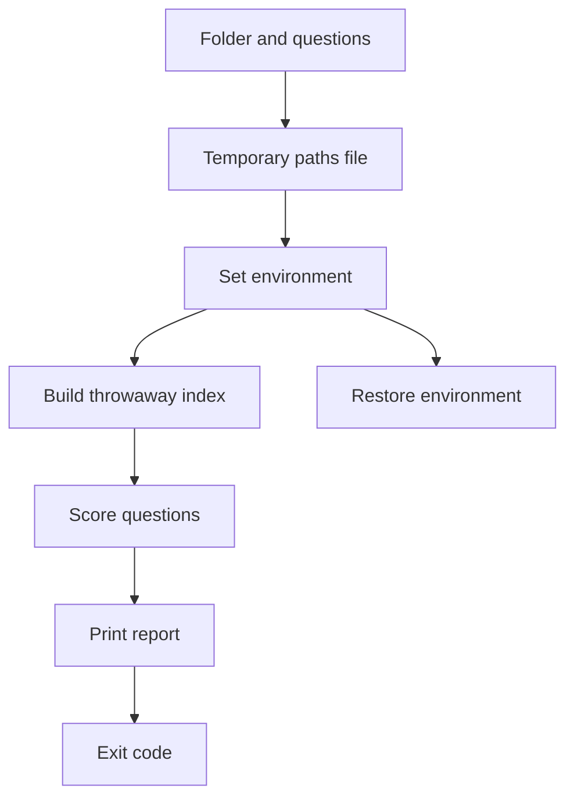

## Purpose

An end to end retrieval check that does not need a ready-made index. It builds a temporary index from a folder of notes, runs the question file from [eval_rag](eval_rag.md) against it, prints the report, and throws the index away. It exists so search quality can be measured on a small, known set of notes without touching the real index.

## Dependencies

**Depends on:**
- [eval_rag](eval_rag.md) / [[eval_rag]]: `evaluate` and `print_report` {src:scripts/search/eval_retrieval.py:39} {src:scripts/search/eval_retrieval.py:46}
- [[build_index]] (no doc yet): `build_index.build` {src:scripts/search/eval_retrieval.py:37-38}
- [[paths]] / [paths](../core/paths.md): indirectly, because the index and vault folders are resolved through the paths file this script writes {src:scripts/search/eval_retrieval.py:31-32} {src:scripts/core/paths.py:125-127}
- Standard library: `argparse`, `json`, `os`, `pathlib`, `sys`, `tempfile`
- Environment variables it sets and restores: `TOLLGATE_PATHS`, `TOLLGATE_KNOWLEDGE`, `TOLLGATE_EMBEDDER` {src:scripts/search/eval_retrieval.py:28}

**Used by:**
- Product code: none. Searched with `git grep` for `eval_retrieval` excluding `docs/` (2026-11-20); the only hits are this file and the test. It is run by hand.
- Tests: [[test_golden]] (no doc yet), `tests/scripts/search/test_golden.py` {src:tests/scripts/search/test_golden.py:81}

## Behavior

**Flow of `run`.**
1. Read the question file first, so a bad file fails before anything is built {src:scripts/search/eval_retrieval.py:27}.
2. Save the current values of the three environment variables {src:scripts/search/eval_retrieval.py:28}.
3. Make a temporary folder and write a paths file in it with two lines: `vault` set to the notes folder and `index` set to a folder inside the temporary one {src:scripts/search/eval_retrieval.py:29-31}.
4. Point `TOLLGATE_PATHS` at that file {src:scripts/search/eval_retrieval.py:32}, remove `TOLLGATE_KNOWLEDGE` {src:scripts/search/eval_retrieval.py:33}, and set `TOLLGATE_EMBEDDER` only when `--embedder` was given {src:scripts/search/eval_retrieval.py:34-35}.
5. Build the index in full {src:scripts/search/eval_retrieval.py:37-38}, then score the questions against it with `eval_rag.evaluate` {src:scripts/search/eval_retrieval.py:39}.
6. In a `finally` block, put the three variables back to their saved values, or remove them if they were unset {src:scripts/search/eval_retrieval.py:40-45}.
7. Print the report {src:scripts/search/eval_retrieval.py:46} and return 0 only if the hit rate meets the minimum and there are no critical misses and no outrank failures {src:scripts/search/eval_retrieval.py:47-48}.

**Why the real index is not touched.** The paths loader reads lines from the paths file before any default {src:scripts/core/paths.py:125-127}, so `index` resolves to the temporary folder {src:scripts/search/eval_retrieval.py:31}. The embedder used for questions is the one named in the temporary index's marker file, which the build wrote, since this build is a full run of all collections {src:scripts/search/eval_retrieval.py:38} {src:scripts/search/build_index.py:460}.

**Command line.** `--corpus` and `--golden` are required {src:scripts/search/eval_retrieval.py:53-54}; `--embedder` defaults to None {src:scripts/search/eval_retrieval.py:55}, which lets the build choose a local model if present, else the hash embedder {src:scripts/search/embedder.py:145-148}; `--top-k 3` {src:scripts/search/eval_retrieval.py:56}; `--min-hit-rate 0.8` {src:scripts/search/eval_retrieval.py:57}. The corpus path is expanded and resolved before use {src:scripts/search/eval_retrieval.py:59}.

## Diagram: module level (L2, required)

## Diagram: function level (L3, optional)

None: no function has branching that the signature does not show.

## Notes

**Code versus its own description.**
- The header says the exit codes are "same as eval_rag.py" {src:scripts/search/eval_retrieval.py:11}. `eval_rag.py` has an exit 2 for "not set up" {src:scripts/search/eval_rag.py:122-126}. This script has no such path: an `ImportError` from `import build_index` {src:scripts/search/eval_retrieval.py:37} or a `NotSetUp` is not caught, and ends in a traceback with exit 1. Only 0 and 1 come from its own code {src:scripts/search/eval_retrieval.py:48}.
- The header says "your real index is never touched" {src:scripts/search/eval_retrieval.py:9}. The index folder is indeed temporary {src:scripts/search/eval_retrieval.py:31}. But the script does not clear `TOLLGATE_CODE_DIR`. When that variable is set to a non-empty folder outside the corpus, the build adds it as a `code` collection {src:scripts/core/paths.py:108-111} {src:scripts/search/build_index.py:280-289}, so the user's code folder is read into the test index and can change the scores. The real index is still not written.

**Behavior worth knowing.**
- The result of `build_index.build` is ignored {src:scripts/search/eval_retrieval.py:38}. If files fail to read, the build records errors {src:scripts/search/build_index.py:517} but this script scores the half-built index anyway.
- The `--embedder` value is passed to the build, but only set in the environment for questions when given {src:scripts/search/eval_retrieval.py:34-35}. An unrecognised name falls back to automatic choice {src:scripts/search/embedder.py:140-148}, with no error.
- The hit-rate rule is a copy of the one in `eval_rag.main` {src:scripts/search/eval_retrieval.py:47} {src:scripts/search/eval_rag.py:132}. If one is changed the other will drift.

**Unchecked inputs.**
- `--corpus` is written into the paths file as plain text with no quoting {src:scripts/search/eval_retrieval.py:31}. The loader cuts a value at the first ` #` {src:scripts/core/paths.py:86}, so a folder name containing a space then a hash is truncated, and no check exists. The folder is then walked and every note read by the index build.
- `--golden` is read as given {src:scripts/search/eval_retrieval.py:27}.
- No input reaches a shell command or network address.

**Shared files and environment.** The script changes process environment variables for the length of the run and restores them in `finally` {src:scripts/search/eval_retrieval.py:32-35} {src:scripts/search/eval_retrieval.py:40-45}. It writes one paths file, plus the index, inside a temporary folder that is removed on exit {src:scripts/search/eval_retrieval.py:29-31}. Nothing guards against two runs at once, but each run has its own temporary folder, so they do not share files.
