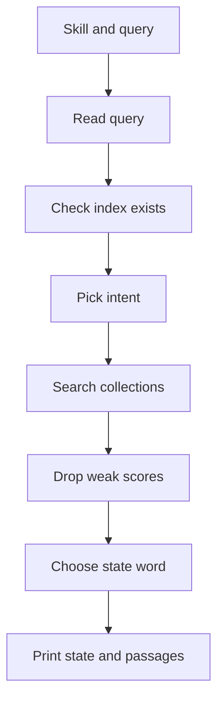
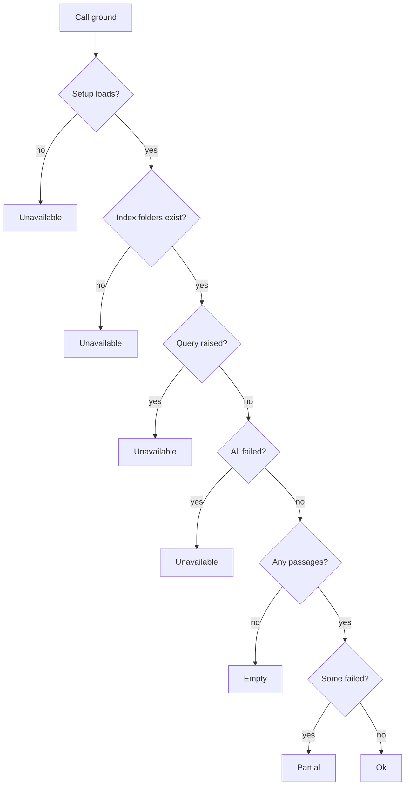

## Purpose

The search lookup that the dev and qa commands run before they start work. Given a command name and a question, it searches the index and prints a short, fixed-shape answer: a state word, which collections were searched, an optional reason, and the passages found. The fixed shape lets a calling command read the result without parsing JSON and without ever failing on a missing index.

## Dependencies

**Depends on:**
- [[config]] (no doc yet): `config.index_root`, `config.ALL_COLLECTION_NAMES`, `config.COLLECTION_NAMES` {src:scripts/search/ground.py:37} {src:scripts/search/ground.py:40} {src:scripts/search/ground.py:51-52}
- [[embedder]] (no doc yet): `embedder_for_index`, and the `base_floor` of the embedder {src:scripts/search/ground.py:43} {src:scripts/search/ground.py:53}
- [[router]] (no doc yet): `router.query_all` {src:scripts/search/ground.py:47-48}
- [intent](intent.md) / [[intent]]: `map_skill` {src:scripts/search/ground.py:46}
- The index folder on disk, and `routing.yaml` through `intent.map_skill` {src:scripts/search/intent.py:55}
- Standard library: `pathlib`, `sys`

**Used by:**
- Product code: `scripts/search/tg-search`, which runs it for the `ground` sub-command {src:scripts/search/tg-search:28}; see [tg-search](tg-search.md) / [[tg-search]]. The commands `commands/tg-dev.md` and `commands/tg-qa.md` call it through `tg-search ground '{skill}' -`, passing the query on standard input {src:commands/tg-dev.md:118} {src:commands/tg-qa.md:88}.
- Tests: [[test_ground]] (no doc yet) {src:tests/scripts/search/test_ground.py:39} {src:tests/scripts/search/test_ground.py:48} {src:tests/scripts/search/test_ground.py:56}; [test_tg_search](../../tests/scripts/search/test_tg_search.md) / [[test_tg_search]] {src:tests/scripts/search/test_tg_search.py:23}

## Behavior

**`ground(skill, query, top=5, emb=None, index_root=None)`** returns `(state, collections line, detail, passages)`, in this order of checks:
1. If importing the embedder and router, or finding the index folder, raises anything, the state is `unavailable` with detail `not set up (<ErrorName>)` {src:scripts/search/ground.py:34-39}.
2. If the index folder is missing, or none of the known collection folders exists inside it, the state is `unavailable` with detail `not set up (no index)` {src:scripts/search/ground.py:40-41}.
3. It builds the embedder that made the index (unless one was passed in), turns the skill name into an intent with `map_skill`, falling back to `ambiguous`, and queries all collections, recording which ones failed and how many chunks each holds {src:scripts/search/ground.py:43-48}. The skill name is cut at its last hyphen and the last part is looked up in `skill_map`, so `x-dev` and `dev` both resolve like `dev` {src:scripts/search/intent.py:56-58}. Any exception here gives `unavailable` with detail `index error (<ErrorName>)` {src:scripts/search/ground.py:49-50}.
4. The collections line is `name=count` for the three core collections, always, with `none` for one that was not opened, plus the optional ones only if they were opened {src:scripts/search/ground.py:51-52}.
5. Passages scoring under the embedder's base floor are dropped {src:scripts/search/ground.py:53}.
6. If every opened collection failed, the state is `unavailable`, detail `every collection failed` {src:scripts/search/ground.py:54-55}.
7. If no passage is left, the state is `empty`; the detail is `no passage above the score floor` when something was queried and `index has no chunks` otherwise {src:scripts/search/ground.py:56-57}.
8. If some collection failed but passages exist, the state is `partial` and the detail names the failed collections {src:scripts/search/ground.py:58-59}.
9. Otherwise the state is `ok` {src:scripts/search/ground.py:60}.

**`main`.** It needs exactly two arguments. With any other number it prints `STATE: unavailable`, `COLLECTIONS: none` and a usage detail, and returns 0 {src:scripts/search/ground.py:65-69}. A query of `-` is read from standard input with whitespace collapsed to single spaces {src:scripts/search/ground.py:70}. It prints the `STATE:` and `COLLECTIONS:` lines, a `DETAIL:` line only when the detail is non-empty, then for each passage a line `[n] file | heading | collection | score` followed by the excerpt and a blank line {src:scripts/search/ground.py:72-79}. It returns 0 {src:scripts/search/ground.py:80}.

## Diagram: module level (L2, required)

## Diagram: function level (L3, optional)

## Notes

**Code versus its own description.**
- The header says "Read only" {src:scripts/search/ground.py:11}. This file writes nothing itself. But the query path opens each collection with `get_or_create_collection` {src:scripts/search/router.py:57}, which can create a collection record, and the database files that go with it, inside an index folder that already exists. It does not create an index folder {src:scripts/search/router.py:53-55}.
- The header says "Always exits 0 so a caller never breaks on it" {src:scripts/search/ground.py:11}. Every path in `main` returns 0 {src:scripts/search/ground.py:69} {src:scripts/search/ground.py:80}, but three places sit outside any `try`: the index folder check {src:scripts/search/ground.py:40}, the result handling {src:scripts/search/ground.py:51-60} and the standard input read {src:scripts/search/ground.py:70}. An error raised in any of those (for example standard input that is not valid text) would not be caught here and would end in a traceback with a non-zero exit. [uncertain: not run]
- The header lists "missing package" under `unavailable` {src:scripts/search/ground.py:19}. A missing search package is reported as `unavailable`, but the detail depends on where it surfaces: from the imports at the top of `ground` it reads `not set up (ImportError)` {src:scripts/search/ground.py:38-39}; from inside the query it reads `index error (ImportError)` {src:scripts/search/ground.py:49-50}.
- The header says `partial` means passages found and a collection failed {src:scripts/search/ground.py:18}. That holds, but when a collection failed and no passage remains, the `empty` check runs first {src:scripts/search/ground.py:56-59}, so the failure is not mentioned in the output.
- The header says "No network" {src:scripts/search/ground.py:11}. The code in this file makes no network call. The model embedder is told to stay offline {src:scripts/search/embedder.py:94-95} and the vector store has telemetry switched off {src:scripts/search/config.py:241-244}.

**Behavior worth knowing.**
- The router is asked for at most 5 passages {src:scripts/search/ground.py:29} {src:scripts/search/ground.py:47-48} and the floor is applied afterwards {src:scripts/search/ground.py:53}, so fewer than 5 can come back even when more would pass.
- If the routing file or its YAML reader is missing, the skill map is empty and every skill resolves to `ambiguous` with no message {src:scripts/search/config.py:156-163} {src:scripts/search/intent.py:55-58}.
- Unlike `query_index.py`, the standard input query has no length cap {src:scripts/search/ground.py:70} {src:scripts/search/query_index.py:48}.

**Unchecked inputs.**
- The skill name is only lower-cased and used as a dictionary key {src:scripts/search/intent.py:56-57}. No check on its value, and it reaches no path, command or address.
- The query text goes to the local embedder and the index with no check on its value or length {src:scripts/search/ground.py:70-71}.
- Passage text (file path, heading, excerpt) from the index is printed as stored {src:scripts/search/ground.py:77-78}. This file does no filtering of that text. It lands in the calling command's context.
- No input reaches a shell command or network address.

**Shared files.** This file writes none directly (see the first note for the router side effect). Nothing stops two runs at once, and nothing needs to for a read.
