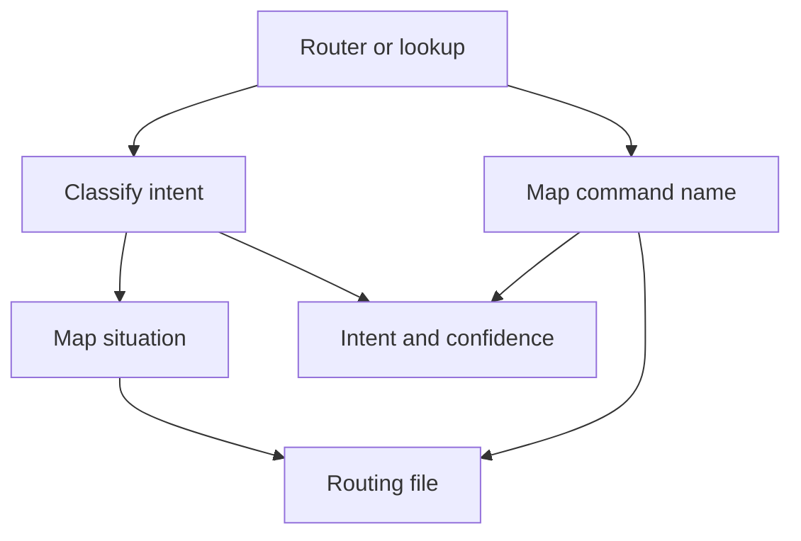
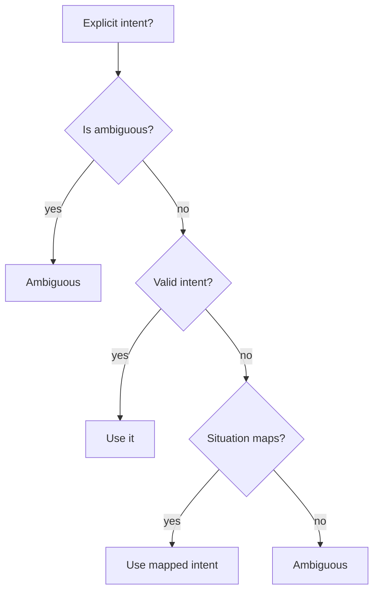

## Purpose

Decides what kind of help a search is for, so the router can lean slightly toward the collections that suit it (for example reference material for teaching, tickets for deciding). The answer comes only from something the caller states: an explicit intent word, a named situation, or a command name. When none is given, the search treats every collection alike.

## Dependencies

**Depends on:**
- [[config]] (no doc yet): `config.load_routing`, which reads `routing.yaml` {src:scripts/search/intent.py:46} {src:scripts/search/intent.py:55}
- `scripts/search/routing.yaml`: the `situation_map` and `skill_map` tables {src:scripts/search/routing.yaml:24-29} {src:scripts/search/routing.yaml:31-37}
- Standard library: `logging`, `pathlib`, `sys`
- Outside package: PyYAML, loaded inside `config.load_routing` {src:scripts/search/config.py:161}

**Used by:**
- Product code: [[router]] (no doc yet) imports `classify_intent` and calls it once per query {src:scripts/search/router.py:25} {src:scripts/search/router.py:223}; [ground](ground.md) / [[ground]] imports `map_skill` {src:scripts/search/ground.py:46}
- `map_situation` has no caller outside this file (searched with `git grep map_situation` excluding `docs/`, 2026-11-20); it is reached through `classify_intent` {src:scripts/search/intent.py:39}.
- Tests: [test_review_fixes](../../tests/scripts/search/test_review_fixes.md) / [[test_review_fixes]] {src:tests/scripts/search/test_review_fixes.py:132} {src:tests/scripts/search/test_review_fixes.py:133}; [[test_ground]] (no doc yet) {src:tests/scripts/search/test_ground.py:114-116}

## Behavior

**`classify_intent(query, explicit_intent=None, situation=None)`** returns `(intent, confidence)`, taking the first rule that applies:
1. An explicit intent of `ambiguous` returns `("ambiguous", 0.0)` {src:scripts/search/intent.py:34-35}.
2. An explicit intent in the valid set (`teach`, `verify`, `build`, `decide`, `draft`) returns it with confidence 1.0 {src:scripts/search/intent.py:23} {src:scripts/search/intent.py:36-37}.
3. If a situation is given and `map_situation` finds an intent for it, that intent is returned with 1.0 {src:scripts/search/intent.py:38-41}.
4. Otherwise `("ambiguous", 0.0)` {src:scripts/search/intent.py:42}.

The `query` argument is never read inside the function {src:scripts/search/intent.py:28-42}. The router drops the confidence value {src:scripts/search/router.py:223}.

**`map_situation(situation)`** looks the name up in `situation_map` {src:scripts/search/intent.py:46}. If the mapped value is not a valid intent it logs a warning and returns None {src:scripts/search/intent.py:47-49}; a missing name returns None {src:scripts/search/intent.py:50}.

**`map_skill(skill)`** takes the part of the command name after its last hyphen, lower-cased {src:scripts/search/intent.py:56}, looks it up in `skill_map` {src:scripts/search/intent.py:55} {src:scripts/search/intent.py:57}, and returns the intent only if it is valid, else None {src:scripts/search/intent.py:58}. A name with no hyphen is used whole {src:scripts/search/intent.py:56}.

**What the router does with the answer.** `ambiguous` means no collection is tilted; a named intent tilts each collection by up to 10 percent either way, and a weight of zero switches a collection off {src:scripts/search/router.py:101-116}.

## Diagram: module level (L2, required)

## Diagram: function level (L3, optional)

## Notes

**Code versus its own description.**
- The header says `version: 1.0.0` {src:scripts/search/intent.py:6}, but the change log below it lists a 1.1.0 entry {src:scripts/search/intent.py:9}. The version field is stale.
- The header says the classifier uses "explicit intent, situation map, then equal weight" {src:scripts/search/intent.py:3}. The command name map (`map_skill`) is a separate function, not part of that order {src:scripts/search/intent.py:53-58}; only `ground.py` calls it.
- The change log says intent comes "only from --intent, --situation or the skill map" {src:scripts/search/intent.py:10}. That matches the code; there is no keyword guessing left.

**Behavior worth knowing.**
- An explicit intent that is not valid and not `ambiguous` (a typo such as `teech`) is dropped without a message and the situation, if any, is tried next {src:scripts/search/intent.py:36-42}. `query_index.py` passes `--intent` through unchecked {src:scripts/search/query_index.py:43} {src:scripts/search/query_index.py:61}.
- `map_situation` warns about a bad table entry {src:scripts/search/intent.py:48}; `map_skill` returns None silently for the same problem {src:scripts/search/intent.py:58}.
- If `routing.yaml` or PyYAML is missing, `load_routing` returns an empty table, so both maps are empty and every call ends `ambiguous` with no message {src:scripts/search/config.py:158-163}. A routing file with broken YAML would raise from `yaml.safe_load` and is not caught {src:scripts/search/config.py:164}.
- The routing file is re-read on every call {src:scripts/search/intent.py:46} {src:scripts/search/intent.py:55}.

**Unchecked inputs.** The situation and skill strings are used only as dictionary keys {src:scripts/search/intent.py:46} {src:scripts/search/intent.py:57}. None reaches a file path, shell command, network address or outbound text.

**Shared files.** This module writes nothing. It reads `routing.yaml` only.
