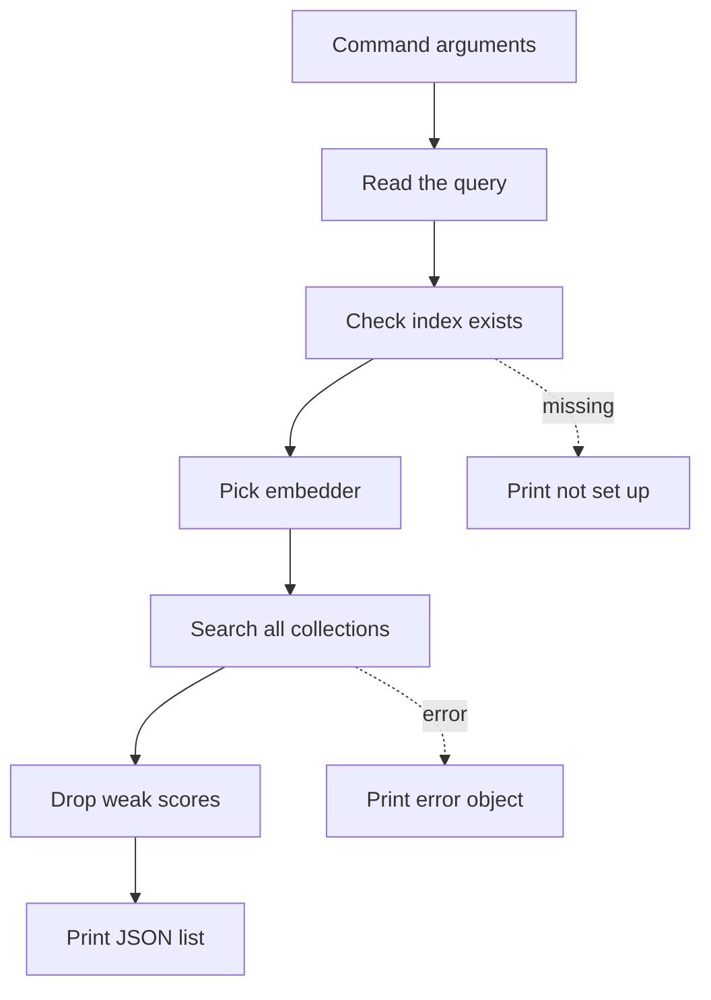

## Purpose

The main search command. It takes a question, searches every collection of the index, and prints the best passages as a JSON list. It is what the prompt hook and the retrieve, learn and ticket commands call to bring relevant notes into a session. It is a thin wrapper: the ranking itself lives in the router.

## Dependencies

**Depends on:**
- [[config]] (no doc yet): `config.index_root`, `config.ALL_COLLECTION_NAMES`, `config.TOP_K_RETURN`, `config.tier_for` {src:scripts/search/query_index.py:34} {src:scripts/search/query_index.py:41} {src:scripts/search/query_index.py:53-54}
- [[paths]] / [paths](../core/paths.md): `NotSetUp` {src:scripts/search/query_index.py:26}
- [[embedder]] (no doc yet): `embedder_for_index` and the embedder's `base_floor` {src:scripts/search/query_index.py:59-60}
- [[router]] (no doc yet): `router.query_all` {src:scripts/search/query_index.py:61-62}
- Standard library: `argparse`, `json`, `pathlib`, `sys`

**Used by:**
- Product code: the prompt hook `hooks/pre-submit-vault-inject.sh` runs it with `--stdin` {src:hooks/pre-submit-vault-inject.sh:17} {src:hooks/pre-submit-vault-inject.sh:55-57}; see [pre-submit-vault-inject](../../hooks/pre-submit-vault-inject.md) / [[pre-submit-vault-inject]]. `scripts/search/tg-search` runs it for the `query` sub-command {src:scripts/search/tg-search:27}; see [tg-search](tg-search.md) / [[tg-search]]. Commands call it through `tg-search query`: `commands/tg-retrieve.md` {src:commands/tg-retrieve.md:25}, `commands/tg-learn.md` {src:commands/tg-learn.md:76}, `commands/tg-ticket.md` {src:commands/tg-ticket.md:69}.
- Tests: [test_ticket_flags](../../tests/scripts/search/test_ticket_flags.md) / [[test_ticket_flags]] {src:tests/scripts/search/test_ticket_flags.py:44} {src:tests/scripts/search/test_ticket_flags.py:53} {src:tests/scripts/search/test_ticket_flags.py:57}; [test_review_fixes](../../tests/scripts/search/test_review_fixes.md) / [[test_review_fixes]] {src:tests/scripts/search/test_review_fixes.py:305} {src:tests/scripts/search/test_review_fixes.py:309}; [test_tg_search](../../tests/scripts/search/test_tg_search.md) / [[test_tg_search]] {src:tests/scripts/search/test_tg_search.py:23}
- `get_tier` has no caller in the repo (searched with `git grep get_tier` over `scripts`, `hooks`, `commands` and `tests`, 2026-11-20).

## Behavior

**Arguments.** A query (positional, optional) {src:scripts/search/query_index.py:39}, `--stdin` {src:scripts/search/query_index.py:40}, `--top` default `config.TOP_K_RETURN` (5) {src:scripts/search/query_index.py:41} {src:scripts/search/config.py:77}, `--min-score` {src:scripts/search/query_index.py:42}, `--intent` {src:scripts/search/query_index.py:43}, `--situation` {src:scripts/search/query_index.py:44}, `--embedder` {src:scripts/search/query_index.py:45}. There is no `--index` flag; the index folder always comes from the path loader {src:scripts/search/query_index.py:53}.

**Query input.** With `--stdin`, or a positional query of `-`, the query is read from standard input, whitespace is collapsed to single spaces, and it is cut to 4000 characters {src:scripts/search/query_index.py:29} {src:scripts/search/query_index.py:47-48}. A positional query is not cut. With no query at all, the parser stops with an error {src:scripts/search/query_index.py:49-50}.

**Not set up.** If the index folder is missing or holds no collection folder, it prints `not set up` and returns 2 {src:scripts/search/query_index.py:54-56}. The same output and code come from a `NotSetUp` or `ImportError` {src:scripts/search/query_index.py:63-65}.

**Search.** It builds the embedder that made the index, or the one named by `--embedder` {src:scripts/search/query_index.py:59}. The score floor is `--min-score` when given, else the embedder's base floor {src:scripts/search/query_index.py:60}. The base floor is 0.1 for the hash embedder and 0.3 for the local model {src:scripts/search/embedder.py:45} {src:scripts/search/embedder.py:90}. It then calls the router; the intent is `--intent` if given, else None when `--situation` is given (so the situation decides), else `ambiguous` {src:scripts/search/query_index.py:61-62}.

**Output.** Only results at or above the floor are kept, and only seven fields are printed: `file`, `heading`, `excerpt`, `score`, `tier`, `tier_label`, `collection` {src:scripts/search/query_index.py:70-71}. They print as indented JSON and the exit code is 0 {src:scripts/search/query_index.py:72-73}. The router is asked for `--top` results before the floor is applied {src:scripts/search/query_index.py:61-62} {src:scripts/search/query_index.py:71}, so fewer than `--top` can print.

**Failure.** Any other exception prints a one-key JSON object `{"error": ...}` to standard output and returns 1 {src:scripts/search/query_index.py:66-68}.

**`get_tier(file_path)`** returns `config.tier_for(file_path)` {src:scripts/search/query_index.py:34}.

## Diagram: module level (L2, required)

## Diagram: function level (L3, optional)

None: no function has branching that the signature does not show.

## Notes

**Code versus its own description.**
- The header usage shows `--min-score 0.3` {src:scripts/search/query_index.py:12}. The code has no default of 0.3: the default is the embedder's floor, 0.1 or 0.3 {src:scripts/search/query_index.py:60} {src:scripts/search/embedder.py:45} {src:scripts/search/embedder.py:90}. `config.MIN_SCORE` (0.3) {src:scripts/search/config.py:78} is not read here, nor anywhere else in `scripts` (searched with `git grep MIN_SCORE`, 2026-11-20).
- The header says `get_tier` is "kept for callers that import it" {src:scripts/search/query_index.py:33}. No caller exists in the repo (see "Used by").
- The header says it "prints `not set up` (exit 2) when there is no index" {src:scripts/search/query_index.py:4}. The code also prints it for any `ImportError` {src:scripts/search/query_index.py:63-65}, so a missing package such as the vector store looks the same as a missing index.
- The header says the output is a JSON array {src:scripts/search/query_index.py:14}. On failure the output is an object, not an array {src:scripts/search/query_index.py:67}. The hook treats a non-list as zero results {src:hooks/pre-submit-vault-inject.sh:69-70}.

**Behavior worth knowing.**
- `--intent` is not checked against the valid list; an unknown word falls back silently {src:scripts/search/query_index.py:61} {src:scripts/search/intent.py:36-42}. `--embedder` is also unchecked; an unknown name means automatic choice {src:scripts/search/embedder.py:140-148}.
- If both `--stdin` and a positional query are given, standard input wins without a message {src:scripts/search/query_index.py:47-48}.
- The query error text is printed with the exception message {src:scripts/search/query_index.py:67}, which may include a file path from the index.
- Opening a collection can create a collection record inside an existing index folder {src:scripts/search/router.py:57}.

**Unchecked inputs.**
- The query text goes to the local embedder and index with no check on content. The positional form has no length limit {src:scripts/search/query_index.py:48-50}.
- Result text (excerpts of notes) is printed as stored, with no filtering here {src:scripts/search/query_index.py:70}. The prompt hook runs its own scan on this output before using it {src:hooks/pre-submit-vault-inject.sh:101}.
- No input reaches a file path, shell command or network address in this file. The model embedder is set to offline mode {src:scripts/search/embedder.py:94-95}.

**Shared files.** This file writes none directly (see the router note above). Reads are safe for two runs at once as far as this file is concerned; the vector store's own locking is outside this file.
