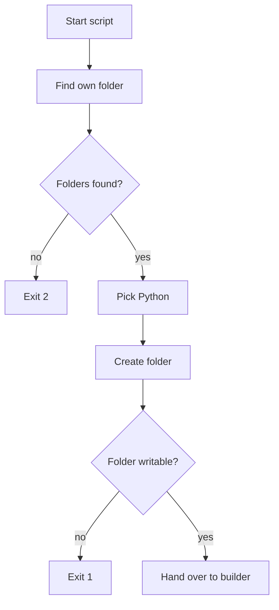

## Purpose

A short launcher that rebuilds the search index. It finds the index folder and the state folder, picks which Python to run, checks the index folder can be written, and then hands control to the Python index builder with whatever arguments it was given. It exists so the installer, the nightly job and a person at a terminal all start the build the same way.

## Dependencies

**Depends on:**
- `scripts/core/tg_path`: prints the folder for the names `index` and `state` {src:scripts/search/rebuild.sh:12} {src:scripts/search/rebuild.sh:13}; see [tg_path](../core/tg_path.md) / [[tg_path]]
- `scripts/search/build_index.py`: the program that does the work {src:scripts/search/rebuild.sh:22}; [[build_index]] (no doc yet)
- External commands: `bash` {src:scripts/search/rebuild.sh:1}, `dirname`, `cd` and `pwd` {src:scripts/search/rebuild.sh:11}, `mkdir` {src:scripts/search/rebuild.sh:17}, and the Python interpreter {src:scripts/search/rebuild.sh:14}
- Environment variable `TOLLGATE_PYTHON`: the interpreter to use when set and not empty {src:scripts/search/rebuild.sh:14}. When it is not set, the program `venv/bin/python3` inside the state folder is used if it is executable {src:scripts/search/rebuild.sh:15}; otherwise plain `python3` {src:scripts/search/rebuild.sh:16}
- Environment variables read by `tg_path` and the builder (`TOLLGATE_PATHS`, `TOLLGATE_KNOWLEDGE`) {src:scripts/core/paths.py:24-25}

**Used by:**
- Product code: the installer, which sets `TOLLGATE_PYTHON` first {src:install.sh:1630-1631}; the nightly job {src:scripts/cron/nightly_index.sh:142}; see [nightly_index](../cron/nightly_index.md) / [[nightly_index]]; the task launcher's `do_index` {src:scripts/cron/launchers/run_task.sh:30}; see [run_task](../cron/launchers/run_task.md) / [[run_task]]. The installer also prints the command as a manual retry hint {src:install.sh:1827}, and `CLAUDE.md` and `commands/tg-retrieve.md` tell a person to run it {src:CLAUDE.md:51} {src:commands/tg-retrieve.md:33}.
- Tests: [[test_internals]] [test_internals](../../tests/scripts/search/test_internals.md) {src:tests/scripts/search/test_internals.py:76} {src:tests/scripts/search/test_internals.py:177}; [[test_python_choice]] [test_python_choice](../../tests/scripts/search/test_python_choice.md), which checks the Python choice {src:tests/scripts/search/test_python_choice.py:40}

## Behavior

1. `set -u` makes an unset variable an error; there is no `set -e` {src:scripts/search/rebuild.sh:10}.
2. It works out its own folder, so it can be started from anywhere {src:scripts/search/rebuild.sh:11}.
3. It chooses the interpreter, in this order: `TOLLGATE_PYTHON` if set and not empty {src:scripts/search/rebuild.sh:14}; else `venv/bin/python3` in the state folder if executable {src:scripts/search/rebuild.sh:15}; else `python3`, and it then prints `rebuild: no venv found at <state>/venv, using python3` on standard error {src:scripts/search/rebuild.sh:16}. A value from `TOLLGATE_PYTHON` is not checked for existence or for being executable.
4. It asks `tg_path` for the index folder, and then for the state folder. If either fails for any reason it prints `not set up` on standard error and exits 2 {src:scripts/search/rebuild.sh:12} {src:scripts/search/rebuild.sh:13}. `tg_path` itself exits 1 and prints its own message first {src:scripts/core/tg_path:22-30}.
5. It creates the index folder if missing, with parents {src:scripts/search/rebuild.sh:17}.
6. If the folder is not writable it prints `Error: index folder is not writable` and exits 1 {src:scripts/search/rebuild.sh:18-21}.
7. It replaces itself with `<python> build_index.py <all arguments>` {src:scripts/search/rebuild.sh:22}. From here the exit code is the builder's: 0 on success, 1 if some files failed to read {src:scripts/search/build_index.py:543}, 2 when not set up, a package is missing, or an argument is refused {src:scripts/search/build_index.py:533-541}.

**Arguments.** They go to the builder unchanged {src:scripts/search/rebuild.sh:22}. The builder accepts `--full` {src:scripts/search/build_index.py:525}, `--source` {src:scripts/search/build_index.py:526}, `--embedder` {src:scripts/search/build_index.py:527} and `--context` {src:scripts/search/build_index.py:528}. A normal run skips files whose modified time matches the saved state {src:scripts/search/build_index.py:470}; `--full` first deletes the chunks the builder made {src:scripts/search/build_index.py:454-457}.

## Diagram

## Notes

**Code versus its own description.**
- The usage line lists `--source vault|tickets|references` {src:scripts/search/rebuild.sh:9}. The builder also accepts `code` and `standards` {src:scripts/search/build_index.py:526} {src:scripts/search/config.py:35}. The usage line also leaves out `--context` {src:scripts/search/build_index.py:528}.
- The header says "Folders come from the path loader" {src:scripts/search/rebuild.sh:8}. True for the index folder {src:scripts/search/rebuild.sh:12}; the notes folders are chosen later by the builder through the same loader.
- The change log says Python comes from `TOLLGATE_PYTHON`, else the state folder venv, else `python3` {src:scripts/search/rebuild.sh:8}. That is what the code does {src:scripts/search/rebuild.sh:14-16}. It matches `tg-search`, with one difference: `tg-search` also needs `TOLLGATE_PYTHON` to be executable before it uses it {src:scripts/search/tg-search:40}, while this script uses the value as given. The nightly job and task launcher call this script with whatever environment they hold {src:scripts/cron/nightly_index.sh:142} {src:scripts/cron/launchers/run_task.sh:30}; the nightly job makes the same venv choice for its own steps {src:scripts/cron/nightly_index.sh:44-46}.
- The header `date` field has no value {src:scripts/search/rebuild.sh:5}.

**Unchecked inputs.**
- `TOLLGATE_PYTHON`, or else the state folder venv program, is run with no check on a value taken from the variable {src:scripts/search/rebuild.sh:14} {src:scripts/search/rebuild.sh:22}. An unusable value ends in the shell's "command not found" or "permission denied" error. The venv program is tested only with `-x` {src:scripts/search/rebuild.sh:15}.
- All command line arguments are passed on without any check {src:scripts/search/rebuild.sh:22}; the builder's argument parser rejects unknown flags {src:scripts/search/build_index.py:529}.
- The index folder printed by `tg_path` is used in `mkdir` and the writable test, quoted, with no check on its value {src:scripts/search/rebuild.sh:17-18}. The state folder is used only to look for the venv program, quoted {src:scripts/search/rebuild.sh:15}.

**Shared files.** The script creates the index folder {src:scripts/search/rebuild.sh:17}; the builder then writes collection data, a state file per collection and, unless the run is limited to one source and a marker exists, the embedder marker inside it {src:scripts/search/build_index.py:449-460}. Those writes are not atomic as a set. Nothing stops two runs at once: the script has no lock and the builder has none either (searched `build_index.py` for lock words, 2026-11-20). A nightly run overlapping an install or a manual run would write the same index at the same time.

**Assumptions.** Needs `bash` (the shebang names it) {src:scripts/search/rebuild.sh:1}. Rerunning is safe for the script itself; an incremental rerun skips unchanged files {src:scripts/search/build_index.py:470}.
