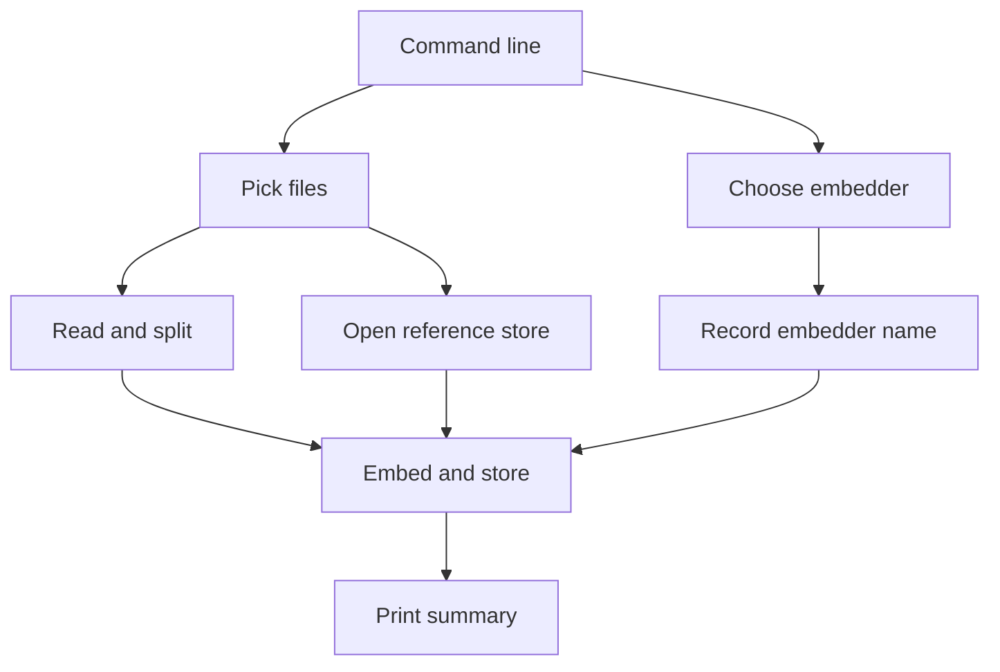
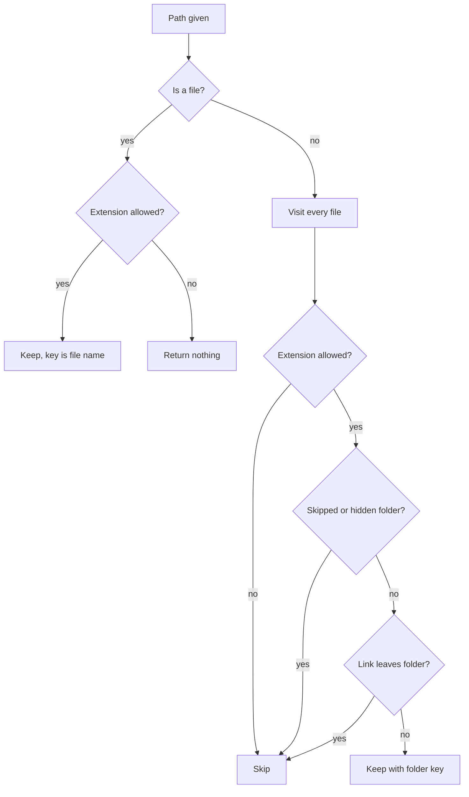

## Purpose

A command line tool that puts a file, or a folder of notes, into the reference store: the `references` collection of the local search index. Every chunk can carry tags the owner chooses, so that `reference_query.py` can later search only chunks with a given tag. It exists so the owner can feed their own books and notes to the search without rebuilding the whole index.

## Dependencies

**Depends on.**
- Repo modules in `scripts/search/`: `build_index` (extension list, file reading, embedding and state helpers) {src:scripts/search/reference_add.py:23}, `config` (index folders, skip list) {src:scripts/search/reference_add.py:24}, `embedder` (choose and record the embedder) {src:scripts/search/reference_add.py:25}, `refstore` (open the collection, clean tags) {src:scripts/search/reference_add.py:26}. Pages: [[build_index]] and [build_index](build_index.md), [[config]] and [config](config.md), [[embedder]] and [embedder](embedder.md), [[refstore]] and [refstore](refstore.md).
- `core.paths.NotSetUp`, the error for a missing setup {src:scripts/search/reference_add.py:27}. Page: [[paths]] and [paths](../core/paths.md).
- Standard library: `argparse`, `pathlib`, `sys`. Outside package at run time: `chromadb`, imported inside `config.chroma_client` {src:scripts/search/config.py:242}.

**Used by.**
- Product code: no script, command file or installer line runs it. A search of the repo for `reference_add` outside `docs/` and `tests/` (git grep, 2026-11-20) found only comments in `scripts/search/build_index.py` {src:scripts/search/build_index.py:10} and {src:scripts/search/build_index.py:17}, the module's own header, and a changelog line in `scripts/search/refstore.py` {src:scripts/search/refstore.py:8}. It is a tool the owner runs by hand.
- Tests: `tests/scripts/search/test_reference.py` runs it as a script {src:tests/scripts/search/test_reference.py:40} and imports `collect` and `add` in `tests/scripts/search/test_review_fixes.py` {src:tests/scripts/search/test_review_fixes.py:204} and {src:tests/scripts/search/test_review_fixes.py:210}.

## Behavior

**Picking files (`collect`).** The allowed extensions are the `references` entry of `build_index.EXTENSIONS` {src:scripts/search/reference_add.py:32}, which is `.md`, `.txt`, `.rst` and `.epub` {src:scripts/search/build_index.py:52}. A single file is returned as given when its extension is allowed, with its own name as the key {src:scripts/search/reference_add.py:33-34}. For a folder, every file below it is visited in sorted order {src:scripts/search/reference_add.py:37}. A file is skipped when it is not a regular file or has another extension {src:scripts/search/reference_add.py:39-40}, when any part of its path under the folder is in the skip list or starts with a dot {src:scripts/search/reference_add.py:41-42}, or when it is a link whose real target lies outside the folder {src:scripts/search/reference_add.py:43-44}. The skip list is the default set (`.git`, `.obsidian`, `node_modules` and others) plus the comma list in the environment variable `TOLLGATE_INDEX_SKIP` {src:scripts/search/config.py:37-39} {src:scripts/search/config.py:147-153}. Each key is the folder name plus the path below it {src:scripts/search/reference_add.py:45}.

**Adding (`add`).** It collects the files {src:scripts/search/reference_add.py:50}, opens the references collection and creates its folder when missing {src:scripts/search/reference_add.py:51} {src:scripts/search/refstore.py:76-81}, and takes the embedder, which is the one that built the index unless one is passed in {src:scripts/search/reference_add.py:52} {src:scripts/search/embedder.py:163-174}. It then writes the embedder name to the marker file {src:scripts/search/reference_add.py:53} {src:scripts/search/embedder.py:151-153}. Each file is read and split into chunks; a file that raises any error is counted and skipped {src:scripts/search/reference_add.py:57-62}. Only files that gave at least one chunk become records {src:scripts/search/reference_add.py:63-64}. Tags are cleaned to lower case with hyphens and stored as one string like `|a|b|` {src:scripts/search/reference_add.py:65} {src:scripts/search/refstore.py:60-66}. `embed_records` is called with origin `add` {src:scripts/search/reference_add.py:66}: for each file it first deletes that file's earlier chunks of the same origin {src:scripts/search/build_index.py:383}, then embeds file name, heading and text together {src:scripts/search/build_index.py:394-396} and stores the chunk with its tags {src:scripts/search/build_index.py:388-392}. The result is a dict with file count, chunk count, error count and cleaned tags {src:scripts/search/reference_add.py:67}.

**Command line (`main`).** It takes a path, repeatable `--tag` and `--embedder` {src:scripts/search/reference_add.py:72-74}. A missing path prints `path not found` to standard error and exits 1 {src:scripts/search/reference_add.py:77-79}. `NotSetUp` or `ImportError` prints `not set up` and exits 2 {src:scripts/search/reference_add.py:84-86}. Zero chunks added prints `nothing to add` and exits 1 {src:scripts/search/reference_add.py:87-89}. Otherwise it prints the chunk count, file count and tags and exits 0 {src:scripts/search/reference_add.py:90-92}.

## Diagram: module level (L2, required)

## Diagram: function level (L3, optional)

## Notes

**Code and its own description disagree.**
- The header says exit 2 means "not set up (no index folder or missing package)" {src:scripts/search/reference_add.py:14}. A missing index folder does not cause exit 2: the folder is created {src:scripts/search/refstore.py:79} {src:scripts/search/embedder.py:152}, and `config.index_root()` never raises `NotSetUp` because the index path has a default under the home folder {src:scripts/core/paths.py:106-107}. In practice exit 2 comes only from a missing package (`ImportError`) {src:scripts/search/reference_add.py:84-86}.
- The header says `version: 1.0.0` {src:scripts/search/reference_add.py:7} while the change log lists `1.1.0` {src:scripts/search/reference_add.py:10}.
- The docstring of `collect` says keys start with the folder or file name "so two sources do not collide" {src:scripts/search/reference_add.py:31}. Two different folders, or two files, with the same base name get identical keys {src:scripts/search/reference_add.py:34} {src:scripts/search/reference_add.py:45}, and adding the second deletes the chunks of the first because the delete matches on key and origin {src:scripts/search/build_index.py:383}.

**Other things a reader should know.**
- No embedder check. `add` overwrites the marker file with the current embedder name {src:scripts/search/reference_add.py:53} and never calls `check_marker`, which `build_index` calls to refuse mixing embedders {src:scripts/search/build_index.py:442}. Running with `--embedder hash` on an index built with a local model mixes two vector spaces and changes the marker for later queries.
- Side effects before the empty check. The store folder and the marker are created or rewritten {src:scripts/search/reference_add.py:51-53} before `main` finds that nothing was added and exits 1 {src:scripts/search/reference_add.py:87-89}.
- `add_state.json` is write-only here. It is loaded {src:scripts/search/reference_add.py:55} and saved by `embed_records` {src:scripts/search/build_index.py:398-400}, but no code compares it to skip a file (search of `add_state` across `scripts/`, 2026-11-20, found only line 54 of this file). Every run re-embeds everything it is given.
- Read errors are counted {src:scripts/search/reference_add.py:61} and returned {src:scripts/search/reference_add.py:67}, but `main` prints only chunks, files and tags {src:scripts/search/reference_add.py:91}, so a skipped file is silent.
- Errors other than `NotSetUp` and `ImportError` end in a traceback {src:scripts/search/reference_add.py:84-86}, for example the `ValueError` the local embedder raises for an unknown query prompt {src:scripts/search/embedder.py:105-108}.

**Inputs that reach a file path, command, network address or outbound text without a check.**
- `PATH` is expanded and tested only for existence {src:scripts/search/reference_add.py:76-77}. After that it is walked and read {src:scripts/search/reference_add.py:37} {src:scripts/search/reference_add.py:59}, so any readable folder with matching file types is copied into the local index. No check limits it to a safe folder.
- `--embedder` goes to `get_embedder` without a check; an unknown name behaves as `auto` {src:scripts/search/reference_add.py:82} {src:scripts/search/embedder.py:140-148}.
- `--tag` is cleaned {src:scripts/search/refstore.py:60-61}. No shell command is run and no network address is used; the local embedder sets offline mode {src:scripts/search/embedder.py:94}. The only outbound text is standard output and standard error.

**Writes to shared files.** None is atomic and nothing stops two writers at once. `add_state.json` is written by `Path.write_text` {src:scripts/search/build_index.py:360-361}, the marker by `write_text` {src:scripts/search/embedder.py:153}, and the chunks go into the Chroma store. A run of this tool at the same time as `build_index.py` or another add can interleave writes, and the marker is also written by `build_index` {src:scripts/search/build_index.py:460}, except in a run limited to one source when a marker already exists {src:scripts/search/build_index.py:459}.
