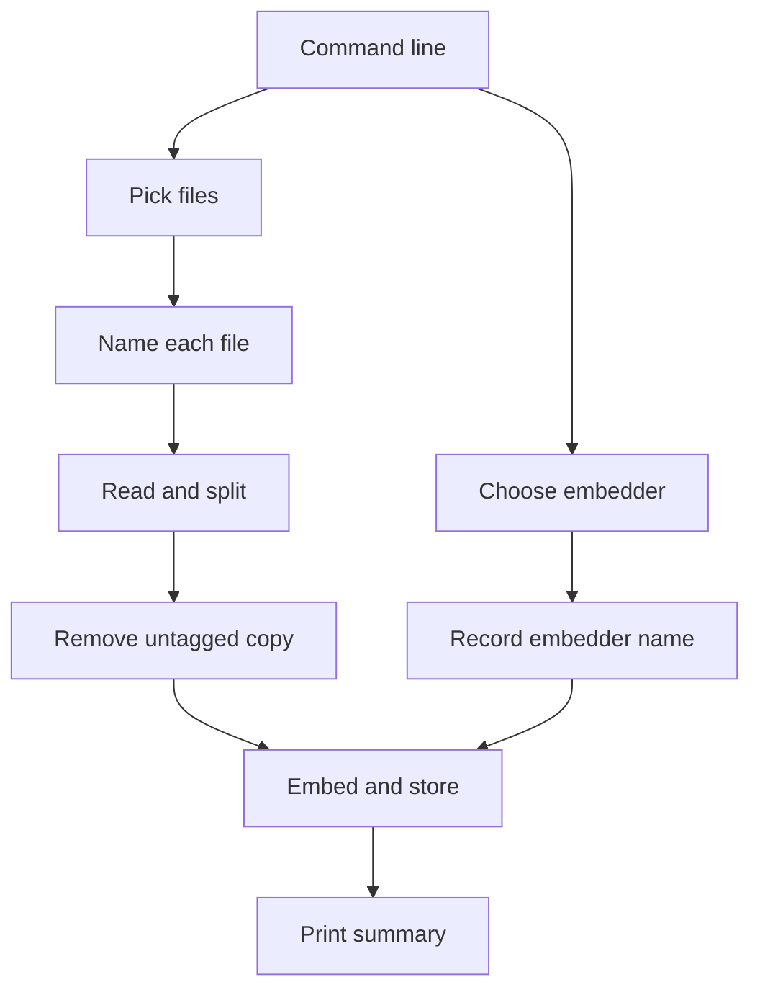
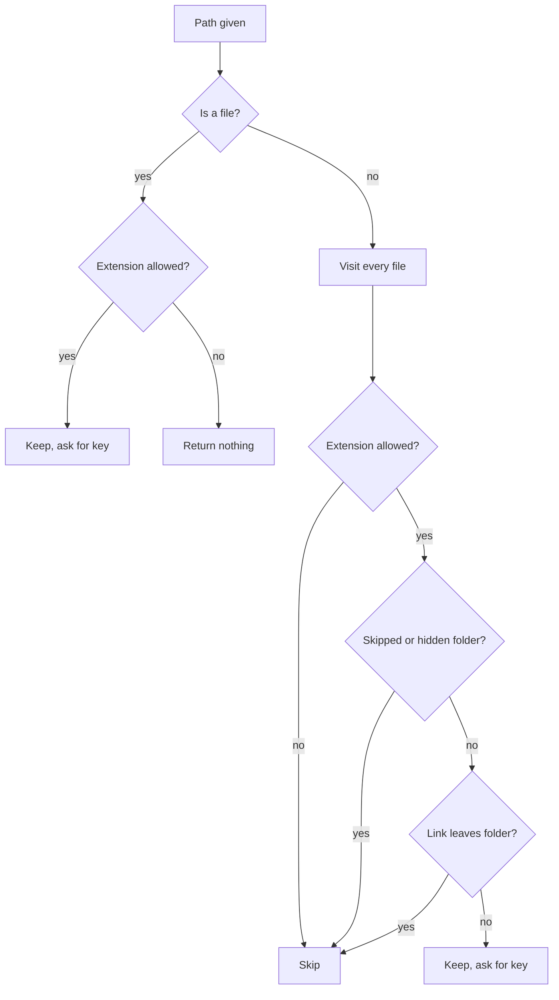

## Purpose

A command line tool that puts a file, or a folder of notes, into the reference store: the `references` collection of the local search index. Every chunk can carry tags the owner chooses, so that `reference_query.py` can later search only chunks with a given tag. It exists so the owner can feed their own books and notes to the search without rebuilding the whole index. Since TG-1 (version note 1.2.0), a file that lives inside the references folder is stored under the same name the index rebuild uses, so the same passage is not kept twice.

## Dependencies

**Depends on.**
- Repo modules in `scripts/search/`: `build_index` (extension list, key naming, file reading, embedding and state helpers) {src:scripts/search/reference_add.py:25}, `config` (index folders, skip list) {src:scripts/search/reference_add.py:26}, `embedder` (choose and record the embedder) {src:scripts/search/reference_add.py:27}, `refstore` (open the collection, clean tags) {src:scripts/search/reference_add.py:28}. Pages: [[build_index]] and [build_index](build_index.md), [[config]] and [config](config.md), [[embedder]] and [embedder](embedder.md), [[refstore]] and [refstore](refstore.md).
- `core.paths.NotSetUp`, the error for a missing setup {src:scripts/search/reference_add.py:29}. Page: [[paths]] and [paths](../core/paths.md).
- Standard library: `argparse`, `pathlib`, `sys`. Outside package at run time: `chromadb`, imported inside `config.chroma_client` {src:scripts/search/config.py:242}.

**Used by.**
- Product code: the wrapper `scripts/search/tg-search` runs it when called as `tg-search add` {src:scripts/search/tg-search:32}, and ends with `exec` of the chosen script {src:scripts/search/tg-search:53}. Page: [[tg-search]] and [tg-search](tg-search.md). The command `commands/tg-reference-import.md` calls `tg-search add` after the owner confirms the plan {src:commands/tg-reference-import.md:91}; it is the only command file that does (git grep for `tg-search add` and `reference_add` outside `docs/` and `tests/`, 2026-11-22). The other mentions are comments in `scripts/search/build_index.py` {src:scripts/search/build_index.py:314} and a changelog line in `scripts/search/refstore.py` {src:scripts/search/refstore.py:8}.
- Tests: `tests/scripts/search/test_reference.py` runs it as a script {src:tests/scripts/search/test_reference.py:40} and imports it {src:tests/scripts/search/test_reference.py:168}. `tests/scripts/search/test_review_fixes.py` imports it and calls `collect` {src:tests/scripts/search/test_review_fixes.py:204} {src:tests/scripts/search/test_review_fixes.py:210}. `tests/scripts/search/test_tg_search.py` checks the wrapper maps `add` to this file {src:tests/scripts/search/test_tg_search.py:24}.

## Behavior

**Picking files (`collect`).** The allowed extensions are the `references` entry of `build_index.EXTENSIONS` {src:scripts/search/reference_add.py:34}, which is `.md`, `.txt`, `.rst` and `.epub` {src:scripts/search/build_index.py:55}. A single file is returned when its extension is allowed {src:scripts/search/reference_add.py:35-36}. No skip list, hidden-name or link check applies to a single file named on the command line {src:scripts/search/reference_add.py:36}. For a folder, every path below it is visited in sorted order {src:scripts/search/reference_add.py:39}. A path is skipped when it is not a regular file or has another extension {src:scripts/search/reference_add.py:41-42}, when any part of its path under the folder is in the skip list or starts with a dot {src:scripts/search/reference_add.py:43-44}, or when it is a link whose real target lies outside the folder {src:scripts/search/reference_add.py:45-46}. The skip list is the default set (`.git`, `.obsidian`, `node_modules` and others) plus the comma list in the environment variable `TOLLGATE_INDEX_SKIP` {src:scripts/search/config.py:37-39} {src:scripts/search/config.py:147-153}.

**Naming each file (the key).** Both branches ask `build_index.reference_key` first {src:scripts/search/reference_add.py:36} {src:scripts/search/reference_add.py:47}. For a file whose real location is inside the references folder, that function returns the folder prefix plus the path below the folder {src:scripts/search/build_index.py:316-325}. The prefix is the path of the references folder relative to the vault when it lives inside the vault, otherwise the label `references` {src:scripts/search/build_index.py:226-233}. The rebuild builds its keys the same way {src:scripts/search/build_index.py:367-368}, so an added file and the rebuild agree on one name. For a file outside the references folder, `reference_key` returns nothing {src:scripts/search/build_index.py:326} and the fallback key is used: the bare file name for a single file {src:scripts/search/reference_add.py:36}, or the folder name plus the path below it for a folder {src:scripts/search/reference_add.py:47}. If no references folder can be resolved, `source_roots` skips it and the function also returns nothing {src:scripts/search/build_index.py:277-282}.

**Adding (`add`).** It collects the files {src:scripts/search/reference_add.py:52}, opens the references collection and creates its folder when missing {src:scripts/search/reference_add.py:53} {src:scripts/search/refstore.py:76-81}, and takes the embedder, which is the one that built the index unless one is passed in {src:scripts/search/reference_add.py:54} {src:scripts/search/embedder.py:163-174}. It then writes the embedder name to the marker file {src:scripts/search/reference_add.py:55} {src:scripts/search/embedder.py:151-153}. Each file is read and split into chunks; a file that raises any error is counted and skipped {src:scripts/search/reference_add.py:59-64}. Only files that gave at least one chunk become records {src:scripts/search/reference_add.py:65-66}. Tags are cleaned to lower case with hyphens, sorted, and stored as one string like `|a|b|` {src:scripts/search/reference_add.py:67} {src:scripts/search/refstore.py:60-66}.

**Removing the untagged copy.** For every record, `add` deletes the chunks of that key that the rebuild made (origin `build`, the default of `_delete_file`) {src:scripts/search/reference_add.py:68-69} {src:scripts/search/build_index.py:385-389}. This is what stops a passage being stored twice. The rebuild does the other half: it reads the keys of all chunks with origin `add` {src:scripts/search/build_index.py:486-487}, and for a file whose key is in that set it deletes any build chunks and the build state entry and skips the file {src:scripts/search/build_index.py:496-500}.

**Embedding.** `embed_records` is then called with origin `add` {src:scripts/search/reference_add.py:70}. For each file it deletes that key's earlier chunks of the same origin {src:scripts/search/build_index.py:404}, embeds file name, heading and text together {src:scripts/search/build_index.py:415-417}, and stores each chunk with its tags {src:scripts/search/build_index.py:409-413} {src:scripts/search/build_index.py:418}. The result is a dict with file count, chunk count, error count and cleaned tags {src:scripts/search/reference_add.py:71}.

**Command line (`main`).** It takes a path, repeatable `--tag` and `--embedder` {src:scripts/search/reference_add.py:75-78}. A missing path prints `path not found` to standard error and exits 1 {src:scripts/search/reference_add.py:81-83}. `NotSetUp` or `ImportError` prints `not set up` and exits 2 {src:scripts/search/reference_add.py:88-90}. Zero chunks added prints `nothing to add` and exits 1 {src:scripts/search/reference_add.py:91-93}. Otherwise it prints the chunk count, file count and tags and exits 0 {src:scripts/search/reference_add.py:94-96}.

## Diagram: module level (L2, required)

## Diagram: function level (L3, optional)

## Notes

**Code and its own description disagree.**
- The header says exit 2 means "not set up (no index folder or missing package)" {src:scripts/search/reference_add.py:16}. A missing index folder does not cause exit 2: the folder is created {src:scripts/search/refstore.py:79} {src:scripts/search/embedder.py:152}, and `config.index_root()` resolves the index path from a default under the Tollgate home folder {src:scripts/search/config.py:135-136} {src:scripts/core/paths.py:106-107}. A missing references or vault folder does not raise either, because `source_roots` catches `NotSetUp` {src:scripts/search/build_index.py:277-281}. In practice exit 2 comes from a missing package (`ImportError`) {src:scripts/search/reference_add.py:88-90}.
- The header says `version: 1.0.0` {src:scripts/search/reference_add.py:6} while the change log lists `1.2.0` {src:scripts/search/reference_add.py:11}.
- The docstring of `collect` says keys start with the folder (or file) name "so two sources do not collide" {src:scripts/search/reference_add.py:33}. This is only half true now. For a file inside the references folder the key is the folder prefix plus the path below it, so two such files cannot collide {src:scripts/search/build_index.py:325}. For a file or folder outside that folder the old collision remains: two single files with the same base name get the same key {src:scripts/search/reference_add.py:36}, and two folders with the same name and a file at the same relative path get the same key {src:scripts/search/reference_add.py:47}. Adding the second deletes the first one's chunks, because the delete of earlier chunks matches on key and origin {src:scripts/search/build_index.py:404}. A key from an outside file can also equal a build key only by chance of naming; no check compares them.

**Other things a reader should know.**
- A path with `..` in it gets the same key as the rebuild. `reference_key` first tries `os.path.abspath(path)`, which collapses `..` {src:scripts/search/build_index.py:320}. A first version used `path.absolute()`, which keeps `..`, so `references/sub/../sub/a.md` was stored under that odd name and the untagged copy was not removed. The test `test_a_path_with_dots_gets_the_same_key_as_the_rebuild` covers it {src:tests/scripts/search/test_reference.py:183}.
- Deletes happen before embedding. Untagged build chunks are removed for all records {src:scripts/search/reference_add.py:68-69} before any new chunk is stored {src:scripts/search/reference_add.py:70}. If embedding fails part way, those files have no chunks until the next rebuild reads them again (the rebuild skips a key only when chunks with origin `add` exist {src:scripts/search/build_index.py:486-487}).
- A file that now gives zero chunks is not a record {src:scripts/search/reference_add.py:65-66}, so its old tagged and untagged chunks stay as they are.
- No embedder check. `add` overwrites the marker file with the current embedder name {src:scripts/search/reference_add.py:55} and never calls `check_marker`, which `build_index` calls to refuse mixing embedders {src:scripts/search/build_index.py:462-463}. Running with `--embedder hash` on an index built with a local model mixes two vector spaces and changes the marker for later queries.
- Side effects before the empty check. The store folder and the marker are created or rewritten {src:scripts/search/reference_add.py:53-55} before `main` finds that nothing was added and exits 1 {src:scripts/search/reference_add.py:91-93}.
- `add_state.json` is write-only here. It is loaded {src:scripts/search/reference_add.py:57} and saved by `embed_records` {src:scripts/search/build_index.py:419-421}, but no code compares it to skip a file (search of `add_state` under `scripts/`, 2026-11-22, found only line 56 of this file). Every run re-embeds everything it is given.
- Read errors are counted {src:scripts/search/reference_add.py:63} and returned {src:scripts/search/reference_add.py:71}, but `main` prints only chunks, files and tags {src:scripts/search/reference_add.py:95}, so a skipped file is silent. If every file fails to read, the output is the "nothing to add" message {src:scripts/search/reference_add.py:91-93}.
- Errors other than `NotSetUp` and `ImportError` end in a traceback {src:scripts/search/reference_add.py:88-90}, for example the `ValueError` the local embedder raises for an unknown query prompt {src:scripts/search/embedder.py:105-108}.

**Inputs that reach a file path, command, network address or outbound text without a check.**
- `PATH` is expanded and tested only for existence {src:scripts/search/reference_add.py:80-81}. After that it is walked and read {src:scripts/search/reference_add.py:39} {src:scripts/search/reference_add.py:61}, so any readable folder with matching file types is copied into the local index. No check limits it to a safe folder. A single file named on the command line skips the hidden-name, skip-list and link checks {src:scripts/search/reference_add.py:36}.
- `--embedder` goes to `get_embedder` without a check; an unknown name behaves as `auto` {src:scripts/search/reference_add.py:86} {src:scripts/search/embedder.py:140-148}.
- `--tag` is cleaned {src:scripts/search/refstore.py:60-61}. No shell command is run and no network address is used; the local embedder sets offline mode {src:scripts/search/embedder.py:94-95} and the store client turns telemetry off {src:scripts/search/config.py:241} {src:scripts/search/config.py:244}. The only outbound text is standard output and standard error.

**Writes to shared files.** None is atomic and nothing stops two writers at once. `add_state.json` is written by `Path.write_text` {src:scripts/search/build_index.py:382}, the marker by `write_text` {src:scripts/search/embedder.py:153}, and the chunks go into the Chroma store {src:scripts/search/build_index.py:418}. A run of this tool at the same time as `build_index.py` or another add can interleave writes. The marker is also written by `build_index` {src:scripts/search/build_index.py:480-481}, except in a run limited to one source when a marker already exists {src:scripts/search/build_index.py:480}.
