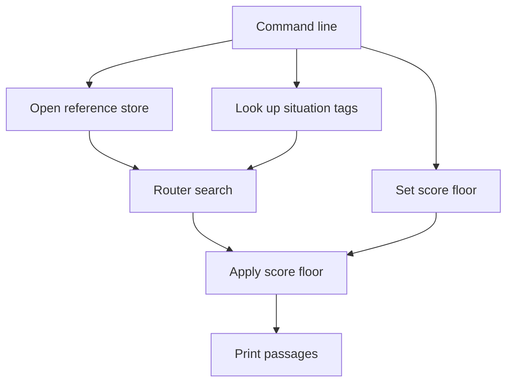

## Purpose

A command line tool that searches the reference store, the owner's own books and notes added with `reference_add.py`, and prints the best passages with their source file and tags. The planning commands call it to ground their work in the owner's material. A "situation" name can narrow the search to chunks with certain tags, and a "stakes" level sets how strong a match must be.

## Dependencies

**Depends on.**
- Repo modules in `scripts/search/`: `config` (stakes table, index folder) {src:scripts/search/reference_query.py:27}, `refstore` (open the store, read the situation file, tag helpers) {src:scripts/search/reference_query.py:28}. Loaded inside `search`: `embedder` {src:scripts/search/reference_query.py:34} and `router` {src:scripts/search/reference_query.py:35}. Pages: [[refstore]] and [refstore](refstore.md), [[router]] and [router](router.md), [[config]] and [config](config.md), [[embedder]] and [embedder](embedder.md).
- `core.paths.NotSetUp` {src:scripts/search/reference_query.py:29}. Page: [[paths]] and [paths](../core/paths.md).
- Standard library: `argparse`, `pathlib`, `sys`. Outside package at run time: `chromadb` {src:scripts/search/config.py:242}.
- Optional file `references.yaml` next to the paths file {src:scripts/search/refstore.py:24-29}.

**Used by.**
- Product code: `scripts/search/tg-search` runs it for the `reference` tool name {src:scripts/search/tg-search:29}. The command files call `tg-search reference`: {src:commands/tg-spec.md:83}, {src:commands/tg-arch.md:93}, {src:commands/tg-dev.md:158}, {src:commands/tg-qa.md:120}, {src:commands/tg-start.md:84} and {src:commands/tg-whiteboard.md:62}.
- Tests: `tests/scripts/search/test_reference.py` runs it as a script {src:tests/scripts/search/test_reference.py:36} and calls `search` {src:tests/scripts/search/test_reference.py:121}. `tests/scripts/search/test_tg_search.py` checks the `tg-search` name mapping {src:tests/scripts/search/test_tg_search.py:24}.

## Behavior

**`search(query, situation, stakes, top)`.** It returns a list of passages, or `None` when there is no store {src:scripts/search/reference_query.py:32-33}.
1. It opens the references collection. An `ImportError` (no `chromadb`) gives `None` {src:scripts/search/reference_query.py:37-39}. A missing folder or an empty collection also gives `None` {src:scripts/search/reference_query.py:40-41} {src:scripts/search/refstore.py:75-78}.
2. It takes the embedder that built the index {src:scripts/search/reference_query.py:43}.
3. It looks up the tags for the situation name in `references.yaml`; a missing name or file gives an empty list {src:scripts/search/reference_query.py:44} {src:scripts/search/refstore.py:39-47}.
4. The score floor is the embedder's base floor plus a shift by stakes (low +0.1, medium 0, high -0.05), never below 0 {src:scripts/search/reference_query.py:45} {src:scripts/search/config.py:130}.
5. It calls `router.query_all` over the references collection only, with intent `ambiguous`, a candidate count of `max(top * 4, 12)`, and the tags as a filter, or no filter when the list is empty {src:scripts/search/reference_query.py:46-47}.
6. It keeps results at or above the floor and returns the first `top` {src:scripts/search/reference_query.py:48}.

**`main`.** Options: `--situation`, `--stakes` (low, medium or high, default medium), `--skill`, `--query` (required), `--top` (default 3) {src:scripts/search/reference_query.py:53-57}. `NotSetUp` or `ImportError` prints `not set up` and exits 2 {src:scripts/search/reference_query.py:61-63}. Any other exception prints `not set up (ExceptionName)` and exits 2 {src:scripts/search/reference_query.py:64-66}. A `None` result prints `not set up` and exits 2 {src:scripts/search/reference_query.py:67-69}. An empty list prints `no match` and exits 0 {src:scripts/search/reference_query.py:70-72}. Otherwise each passage prints as a header line `[n] source: FILE | HEADING | tag: TAGS | score N` and then its excerpt {src:scripts/search/reference_query.py:73-77}.

**What the router adds.** The tag filter is applied after the router has taken its candidate pool of 60 per collection, not inside the database query {src:scripts/search/router.py:242-245} {src:scripts/search/router.py:232} {src:scripts/search/config.py:75}. A tagged chunk that ranks below that pool never appears, whatever its tag.

## Diagram: module level (L2, required)

## Diagram: function level (L3, optional)

None: no function has branching that the signature does not show.

## Notes

**Code and its own description disagree.**
- The header says `--skill` is "recorded in the header line only" {src:scripts/search/reference_query.py:14}. The option is defined {src:scripts/search/reference_query.py:55} but `main` never reads it, and the header line printed for each passage carries no skill name {src:scripts/search/reference_query.py:75}.
- The header shows the output line as `[n] source | heading | tag: a,b | score` {src:scripts/search/reference_query.py:17}. The code prints `source: FILE` and `score N`, with those two labels {src:scripts/search/reference_query.py:75}.
- The header says `not set up` (exit 2) appears "when there is no store" {src:scripts/search/reference_query.py:18}. The code also gives exit 2 for any unexpected failure, such as a `ValueError`, labelled `not set up (ValueError)` {src:scripts/search/reference_query.py:64-66}, which hides real errors behind a setup message.
- The header says situations map to tags in `references.yaml` {src:scripts/search/reference_query.py:9}. Tags in that file are used as written {src:scripts/search/refstore.py:36}, but stored tags are cleaned to lower case with hyphens {src:scripts/search/refstore.py:61} and the router only lower-cases the wanted tags {src:scripts/search/router.py:243}. A tag such as `Security Basics` in `references.yaml` never matches the stored `security-basics`. Write tags in cleaned form.
- The `situation` name is used only for tags: it is not passed to the router {src:scripts/search/reference_query.py:46}, so the `situation_map` in `routing.yaml` has no effect on this tool, and the intent is always `ambiguous`.

**Inputs that reach a file path, command, network address or outbound text without a check.**
- `--query` goes only to the embedder and the ID matcher {src:scripts/search/reference_query.py:46}. It reaches no path, command or address.
- `--top` has no range check {src:scripts/search/reference_query.py:57}. Zero returns `no match`; a negative number slices from the end of the list {src:scripts/search/reference_query.py:48}.
- `--situation` is a dictionary key only {src:scripts/search/reference_query.py:44}. The location of `references.yaml` comes from the environment variable `TOLLGATE_PATHS`, read without a check {src:scripts/search/refstore.py:26-29}; its contents are parsed into tags only {src:scripts/search/refstore.py:49-57}. No network is used by this file; the optional re-ranker sets offline mode {src:scripts/search/router.py:65}.

**Writes to shared files.** None by this file. Opening the collection uses `get_or_create_collection` {src:scripts/search/refstore.py:81}, so opening a store folder that holds no collection creates an empty one; that is a Chroma write with no lock.
