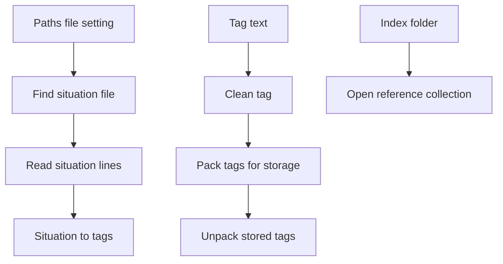

## Purpose

Small shared helpers for the reference store, so that the tool that adds documents and the tool that searches them agree on three things: where the references collection lives, how tags are written into and read out of chunk metadata, and how a situation name maps to tags in an optional text file.

## Dependencies

**Depends on.**
- Repo module `config` for the index folder and the Chroma client {src:scripts/search/refstore.py:18} {src:scripts/search/refstore.py:75} {src:scripts/search/refstore.py:80}. Page: [[config]] and [config](config.md).
- Environment variable `TOLLGATE_PATHS`, which names the paths file; `references.yaml` is read from the same folder {src:scripts/search/refstore.py:21} {src:scripts/search/refstore.py:26-29}.
- Standard library: `os`, `pathlib`, `re`, `sys`. Outside package at run time: `chromadb`, imported by `config.chroma_client` {src:scripts/search/config.py:242}.

**Used by.**
- Product code: `scripts/search/reference_add.py` {src:scripts/search/reference_add.py:26} {src:scripts/search/reference_add.py:51} {src:scripts/search/reference_add.py:65}; `scripts/search/reference_query.py` {src:scripts/search/reference_query.py:28} {src:scripts/search/reference_query.py:37} {src:scripts/search/reference_query.py:44} {src:scripts/search/reference_query.py:74}; `scripts/search/check_index_health.py` {src:scripts/search/check_index_health.py:26} {src:scripts/search/check_index_health.py:35}. Pages: [[reference_add]] and [reference_add](reference_add.md), [[reference_query]] and [reference_query](reference_query.md), [[check_index_health]] and [check_index_health](check_index_health.md).
- Tests: `tests/scripts/search/test_reference.py` {src:tests/scripts/search/test_reference.py:91} {src:tests/scripts/search/test_reference.py:109} {src:tests/scripts/search/test_reference.py:129}.

## Behavior

**`situations_file()`** reads `TOLLGATE_PATHS`; when it is empty or unset it returns `None` {src:scripts/search/refstore.py:26-28}. Otherwise it expands `~` and variables and returns `references.yaml` in the same folder as that paths file {src:scripts/search/refstore.py:29}.

**`load_situation_tags(path=None)`** returns a dict of situation name to list of tags. No file named, or a file that cannot be read, gives `{}`, which callers read as "search everything" {src:scripts/search/refstore.py:41-47}. It is not a YAML parser. It reads line by line, drops everything after a space and `#`, skips blank lines, `#` lines and lines without a colon {src:scripts/search/refstore.py:49-52}, splits at the first colon {src:scripts/search/refstore.py:53}, and takes the right side as a comma list, with optional square brackets and quotes stripped {src:scripts/search/refstore.py:34-36}. A situation with no tags is left out {src:scripts/search/refstore.py:55-56}. A key whose tags sit on following `- item` lines gets no tags, because the key line has an empty right side.

**`clean_tag(tag)`** lower-cases, replaces every run of characters outside `a-z 0-9 _ . -` with one hyphen, and trims hyphens at both ends {src:scripts/search/refstore.py:61}.

**`tags_to_meta(tags)`** cleans, removes duplicates, sorts, and joins into one string with a bar on each side, for example `|design|security|`; no tags gives an empty string {src:scripts/search/refstore.py:65-66}. **`meta_to_tags(value)`** splits on the bar and drops empty parts {src:scripts/search/refstore.py:70}.

**`open_references(create=False)`** finds the references folder under the index {src:scripts/search/refstore.py:75}. When the folder is missing it returns `None`, or with `create=True` makes it {src:scripts/search/refstore.py:76-79}. It then opens a local Chroma client and returns the collection `references`, using cosine distance {src:scripts/search/refstore.py:80-81}.

## Diagram: module level (L2, required)

## Diagram: function level (L3, optional)

None: no function has branching that the signature does not show.

## Notes

**Code and its own description disagree.**
- The change log says the module was made "for reference_add.py, reference_query.py and ground.py" {src:scripts/search/refstore.py:8}. `ground.py` does not import it: the imports in `scripts/search/ground.py` are `config`, `embedder`, `router` and `intent` {src:scripts/search/ground.py:27} {src:scripts/search/ground.py:35} {src:scripts/search/ground.py:36} {src:scripts/search/ground.py:46}, and a search of that file for `refstore` found nothing (2026-11-20). `check_index_health.py` does import it and is not named.
- The description says the module will "format passages" {src:scripts/search/refstore.py:3}. No function here formats passages; the output format is written in `reference_query.py` {src:scripts/search/reference_query.py:73-77}.
- Tags read from `references.yaml` are not cleaned, only trimmed of quotes and spaces at the ends {src:scripts/search/refstore.py:36}, while stored tags always are {src:scripts/search/refstore.py:61}. A tag written with capitals or spaces in the situation file cannot match any stored tag.

**Inputs that reach a file path, command, network address or outbound text without a check.**
- `TOLLGATE_PATHS` (environment) decides which file is read as `references.yaml` {src:scripts/search/refstore.py:26-29} {src:scripts/search/refstore.py:45}. There is no check that the path is sensible; the file's content is only parsed into tag lists.
- Tags passed to `clean_tag` are sanitized {src:scripts/search/refstore.py:61}. No shell command and no network address is used in this file.

**Writes to shared files.** The only write is creating the references folder with `mkdir(parents=True, exist_ok=True)` when `create=True` {src:scripts/search/refstore.py:79}. Opening the collection with `get_or_create_collection` can create it in the Chroma store {src:scripts/search/refstore.py:81}. Neither is guarded against two processes at once; `mkdir` with `exist_ok` is safe to repeat.
