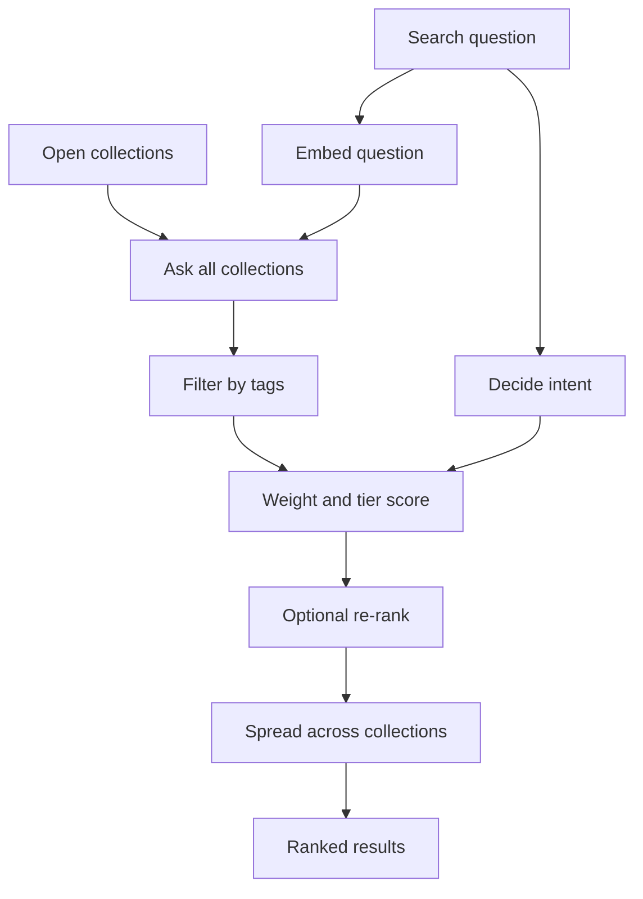
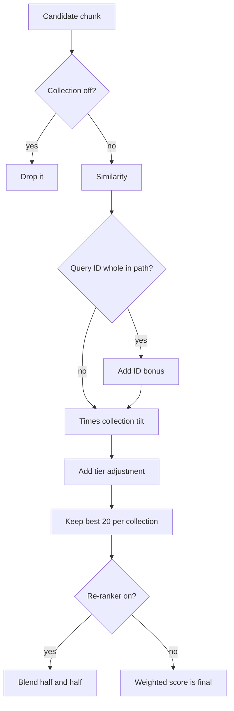

## Purpose

The search engine core. Given a question, it asks every enabled index collection for its closest chunks at the same time, nudges the scores a little by the kind of question and by how trustworthy a file's folder is, optionally re-scores with a local model, and returns one ranked list. Every search tool in the repo goes through it, so the ranking rules live in one place.

## Dependencies

**Depends on.**
- Repo modules in `scripts/search/`: `config` (collection names, tuning numbers, tier rules, Chroma client) {src:scripts/search/router.py:23}, `embedder` {src:scripts/search/router.py:24}, `intent` (`classify_intent`) {src:scripts/search/router.py:25}. Loaded inside functions: `build_index` {src:scripts/search/router.py:36}, `sentence_transformers` {src:scripts/search/router.py:67}. Pages: [[config]] and [config](config.md), [[embedder]] and [embedder](embedder.md), [[intent]] and [intent](intent.md), [[build_index]] and [build_index](build_index.md).
- Config file `routing.yaml`, read through `config.load_routing` {src:scripts/search/router.py:222} {src:scripts/search/config.py:156-165}. Page: [[routing]] and [routing](routing.md).
- Environment variable `TOLLGATE_RERANK` (set to 1 to turn the re-ranker on) {src:scripts/search/router.py:62}.
- Standard library: `logging`, `math`, `os`, `pathlib`, `re`, `sys`, `concurrent.futures`, `typing`. Outside packages: `chromadb` (through `config.chroma_client`) {src:scripts/search/config.py:242}, and `sentence_transformers` only when the re-ranker is on {src:scripts/search/router.py:67}.

**Used by.**
- Product code: `scripts/search/query_index.py` {src:scripts/search/query_index.py:58} {src:scripts/search/query_index.py:61}; `scripts/search/ground.py` {src:scripts/search/ground.py:36} {src:scripts/search/ground.py:47}; `scripts/search/reference_query.py` {src:scripts/search/reference_query.py:35} {src:scripts/search/reference_query.py:46}; `scripts/search/check_index_health.py` (opens the collections to count them) {src:scripts/search/check_index_health.py:63} {src:scripts/search/check_index_health.py:71}; the evaluation scripts `scripts/search/eval_judge.py` {src:scripts/search/eval_judge.py:80} and `scripts/search/eval_rag.py` {src:scripts/search/eval_rag.py:40}. Pages: [[reference_query]] and [reference_query](reference_query.md), [[query_index]] and [query_index](query_index.md), [[ground]] and [ground](ground.md), [[check_index_health]] and [check_index_health](check_index_health.md), [[eval_judge]] and [eval_judge](eval_judge.md), [[eval_rag]] and [eval_rag](eval_rag.md).
- Tests: `tests/scripts/search/test_internals.py` {src:tests/scripts/search/test_internals.py:56} {src:tests/scripts/search/test_internals.py:325}; `tests/scripts/search/test_review_fixes.py` {src:tests/scripts/search/test_review_fixes.py:68} {src:tests/scripts/search/test_review_fixes.py:88} {src:tests/scripts/search/test_review_fixes.py:158}; `tests/scripts/search/test_ground.py` {src:tests/scripts/search/test_ground.py:64}.

## Behavior

**Which collections are searched.** `open_collections(index_root, names=None)` opens each enabled collection whose folder exists and skips the rest {src:scripts/search/router.py:48-58}. Enabled means the three core names, the query-only `knowledge` collection, and any optional collection that `build_index` reports active {src:scripts/search/router.py:34-37}. If `build_index` cannot be imported, any error is swallowed and only the fixed names remain {src:scripts/search/router.py:35-39}. When `names` is given, exactly those are opened and the enabled check is skipped {src:scripts/search/router.py:49}.

**Asking one collection.** `_query_one` returns nothing for an empty collection {src:scripts/search/router.py:75-77}, otherwise asks for `min(top_k, count)` closest chunks {src:scripts/search/router.py:78}. A chunk is dropped when its cosine similarity is below the embedder's `min_cosine` {src:scripts/search/router.py:82}. Any exception is returned instead of raised, so one broken collection does not hide the others {src:scripts/search/router.py:87-88}.

**Weights and tilt.** For intent `ambiguous` the weights come from `equal_weights`, else all 1.0; for a named intent from `intents`, falling back to `equal_weights` when the intent has none or all zeros {src:scripts/search/router.py:92-98}. `_tilts` turns weights into a multiplier per collection: a weight of 0 or less switches the collection off {src:scripts/search/router.py:110-111}; an ambiguous query gets 1.0 for every other collection {src:scripts/search/router.py:112-113}; otherwise the multiplier is `1 - 0.1 + 0.2 * min(1, weight / top weight)` {src:scripts/search/router.py:115} {src:scripts/search/config.py:90}, so between 0.9 and 1.1. A collection missing from the weights gets the top weight {src:scripts/search/router.py:107-109}.

**Scoring.** For each candidate the base is the similarity, plus 0.1 when the query contains an ID like `PROJ-312` {src:scripts/search/router.py:119-120} that appears in the file path as a whole token {src:scripts/search/router.py:139} {src:scripts/search/config.py:91}. A whole token means the ID is not directly after a letter or digit and not directly before a digit {src:scripts/search/router.py:123-125}. The weighted score is `base * tilt + tier adjustment` {src:scripts/search/router.py:141}, where files in the observed tier lose 0.05 and others get 0 {src:scripts/search/config.py:89}. Candidates are sorted and the best 20 of each collection are kept, so a large collection cannot crowd out a small one {src:scripts/search/router.py:143-146} {src:scripts/search/config.py:76}.

**Re-ranking.** The re-ranker loads only when `TOLLGATE_RERANK` is `1` and the model can be loaded {src:scripts/search/router.py:62-68}; any failure returns no re-ranker {src:scripts/search/router.py:69-70}. With one, the final score is half the re-ranker score (squeezed into 0 to 1) plus half the weighted score {src:scripts/search/router.py:159-164} {src:scripts/search/router.py:151-155} {src:scripts/search/config.py:92}. Without one, the final score is the weighted score {src:scripts/search/router.py:165-168}. Each result carries file, heading, excerpt (first 300 characters), score, tier, collection and tags {src:scripts/search/router.py:170-180} {src:scripts/search/config.py:79}.

**Spreading results.** For an ambiguous query, no collection may hold more than `max(2, ceil(total / number of collections present))` results; the gap is filled from the overflow in score order {src:scripts/search/router.py:183-199} {src:scripts/search/router.py:250-251}. Named intents return the plain top list {src:scripts/search/router.py:252}.

**Entry point.** `query_all` loads the routing file, decides the intent, picks the embedder and opens the collections {src:scripts/search/router.py:221-225}. It fills `queried` with chunk counts when asked {src:scripts/search/router.py:226-227}, returns `[]` when no collection is open {src:scripts/search/router.py:228-229}, embeds the question once {src:scripts/search/router.py:230}, and asks all collections in parallel, with each failing collection logged and named in `failed` {src:scripts/search/router.py:231-241}. When `where_tags` is given, only chunks that carry at least one of the tags are kept {src:scripts/search/router.py:242-245}. Then weights, tilt, scoring and finishing run in that order {src:scripts/search/router.py:246-249}.

## Diagram: module level (L2, required)

## Diagram: function level (L3, optional)

## Notes

**Code and its own description disagree.**
- The description and change log call the tier "an additive tie-breaker" {src:scripts/search/router.py:3} {src:scripts/search/router.py:9}. The code adds a flat penalty of 0.05 to every observed-tier result and nothing to the others {src:scripts/search/router.py:141} {src:scripts/search/config.py:89}. That can reorder results whose scores differ by up to 0.05, so it is a demotion, not only a tie-break.
- The `open_collections` docstring says it "raises ImportError without chromadb" {src:scripts/search/router.py:46}. The Chroma client is made only for a folder that exists {src:scripts/search/router.py:53-56}, so with no index folders at all it returns `{}` and raises nothing.
- The numbers in the `equal_weights` section of `routing.yaml` have no effect on ranking for ambiguous queries: only whether a weight is above zero is read {src:scripts/search/router.py:93} {src:scripts/search/router.py:110-113}. They matter only when a named intent has no entry {src:scripts/search/router.py:96-97}.

**Limits and costs.**
- The tag filter runs after retrieval, on a pool of 60 chunks per collection {src:scripts/search/router.py:232} {src:scripts/search/config.py:75} {src:scripts/search/router.py:242-245}. A matching chunk ranked lower than 60 in its collection is never returned.
- The ID bonus tests whether the lower-case ID appears in the lower-case path as a whole token {src:scripts/search/router.py:125}, so a query for `PROJ-34` boosts `PROJ-34-state.md` but no longer a file under `PROJ-340` {src:tests/scripts/search/test_review_fixes.py:73} {src:tests/scripts/search/test_review_fixes.py:74}. A letter or digit right before the ID, such as `XPROJ-34`, also blocks the match {src:scripts/search/router.py:125}. The test is a regex over the whole path, so the ID may sit in a folder name or a file name {src:scripts/search/router.py:137} {src:scripts/search/router.py:139}.
- The routing file is parsed again on every call: here {src:scripts/search/router.py:222}, in `intent.map_situation` {src:scripts/search/intent.py:46}, and in tier rules {src:scripts/search/config.py:170}. A syntax error in `routing.yaml` raises out of `safe_load` and stops every search {src:scripts/search/config.py:164}.
- A new `CrossEncoder` model is built on every `query_all` call when the re-ranker is on {src:scripts/search/router.py:249} {src:scripts/search/router.py:68}, with no reuse.
- `_get_reranker` sets `HF_HUB_OFFLINE` in the process environment {src:scripts/search/router.py:65} and calls the private `_stub_backend` of the embedder module {src:scripts/search/router.py:66}.
- A collection that fails is logged as a warning {src:scripts/search/router.py:237}; the caller learns of it only by passing `failed` {src:scripts/search/router.py:238-239}.

**Inputs that reach a file path, command, network address or outbound text without a check.**
- `names` and `index_root` are joined into a folder path {src:scripts/search/router.py:53}. No check exists; the callers in this repo pass fixed collection names {src:scripts/search/router.py:50} (tests pass their own).
- The question text goes to the embedder and a regex only {src:scripts/search/router.py:120} {src:scripts/search/router.py:230}. An unknown `intent` string is not rejected; it falls to `ambiguous` {src:scripts/search/intent.py:34-42}. No shell command is run and no network address is used; the embedder loads local files only {src:scripts/search/embedder.py:100}.

**Writes to shared files.** None by this file. `get_or_create_collection` can create an empty collection in a folder that exists {src:scripts/search/router.py:57}; nothing prevents two processes doing so at once.
