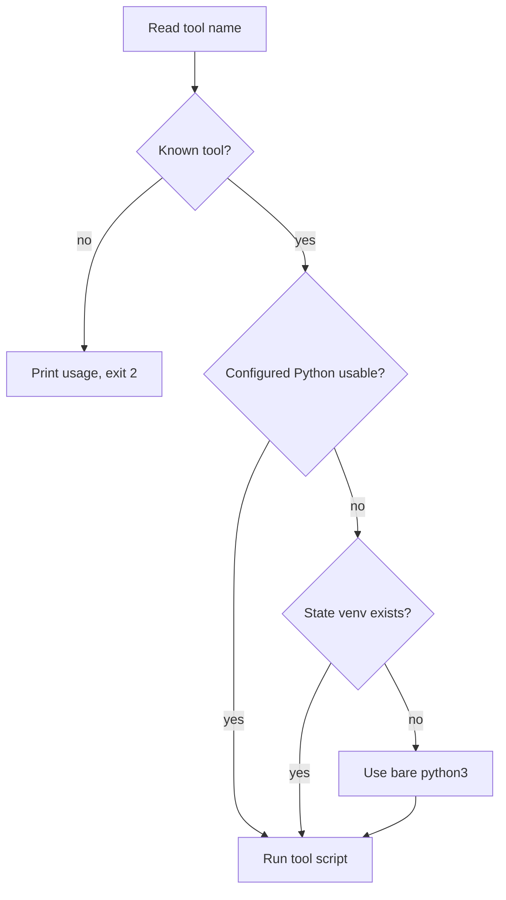

## Purpose

`tg-search` is one fixed command that fronts four Python search tools (query, ground, reference, health). The point is that a single permission rule in the settings file covers all four, so a command file can run a search without a permission prompt. The file has no `.sh` extension, so the doc-gen extension map does not match it; this page was written with the `shell` template on purpose.

## Dependencies

**Depends on.**
- `bash` (shebang `#!/usr/bin/env bash`) {src:scripts/search/tg-search:1}
- `dirname`, to find its own folder {src:scripts/search/tg-search:20}
- `scripts/core/tg_path`, a Python helper that prints the state folder: [[tg_path]] (no doc yet) {src:scripts/search/tg-search:43}
- Four sibling Python scripts, one per tool: `query_index.py`, `ground.py`, `reference_query.py`, `vault_health.py` {src:scripts/search/tg-search:27-30}. They are [[query_index]], [[ground]], [[reference_query]] and [[vault_health]] (no doc yet for any of them).
- Environment variable `TOLLGATE_PYTHON`, the Python to use {src:scripts/search/tg-search:40}
- The venv under the state folder, `<state>/venv/bin/python3`, built by `scripts/core/setup_venv.sh` {src:scripts/search/tg-search:44} {src:scripts/core/setup_venv.sh:32}
- `python3` from the path, as the last choice {src:scripts/search/tg-search:48}

**Used by.** Product code. The command files in the repo hold the text `$TOLLGATE_HOME/scripts/search/tg-search`. The installer rewrites every `$TOLLGATE_HOME/` in each command file it installs, this one included, to the absolute path of the repo copy {src:install.sh:1155}, because Claude Code refuses any command that holds an unresolved variable ("A variable in this command can't be checked before it runs"), and that refusal comes before any permission rule is read (sandbox session, 2026-11-19: a rule with the literal `$TOLLGATE_HOME` text did not stop the prompt, a rule with the absolute path did, also with a heredoc and `2>/dev/null`) {unverified}. The command files that call it:
- `commands/tg-ticket.md`: query {src:commands/tg-ticket.md:69}, health {src:commands/tg-ticket.md:80}
- `commands/tg-start.md`: health {src:commands/tg-start.md:40}, reference {src:commands/tg-start.md:84}
- `commands/tg-retrieve.md`: query with stdin {src:commands/tg-retrieve.md:25}
- `commands/tg-spec.md`: reference {src:commands/tg-spec.md:83} and {src:commands/tg-spec.md:242}
- `commands/tg-dev.md`: ground {src:commands/tg-dev.md:118}, reference {src:commands/tg-dev.md:158} and {src:commands/tg-dev.md:284}
- `commands/tg-whiteboard.md`: reference {src:commands/tg-whiteboard.md:62}
- `commands/tg-arch.md`: reference {src:commands/tg-arch.md:93} and {src:commands/tg-arch.md:188}
- `commands/tg-qa.md`: ground {src:commands/tg-qa.md:88}, reference {src:commands/tg-qa.md:120} and {src:commands/tg-qa.md:302}
- `commands/tg-learn.md`: query {src:commands/tg-learn.md:76}
- `settings.json`, the permission rule that lets the command run without a prompt: `Bash($TOLLGATE_HOME/scripts/search/tg-search:*)` {src:settings.json:274}, which the installer writes with the absolute repo path. A second rule with a doubled dollar sign sits next to it {src:settings.json:275}; the installer turns `$$` into one literal `$` {src:tests/installer/test_merge_settings.py:182-184}, so the doubled form becomes a rule that keeps the text `$TOLLGATE_HOME` unexpanded. That literal rule no longer matches any command, because the installed commands hold the absolute path; it is kept only because the merge tests expect it.

`commands/tg-dev.md` and `commands/tg-qa.md` also mention `tg-search reference` in prose rules, which is not a call {src:commands/tg-dev.md:612} {src:commands/tg-qa.md:878}. `install.sh` does not name this script at all: its rewrite covers every `$TOLLGATE_HOME/` in the command text {src:install.sh:1155} (searched `install.sh` for `tg-search`, 2026-11-20); the permission rule reaches the user's settings through the settings template (searched `scripts/` and `hooks/` for `tg-search`, 2026-11-19). The checks that prove both are INS-01 and INS-11 in `tests/installer/test_ins.sh`.

Tests, on their own line: `tests/scripts/search/test_tg_search.py` {src:tests/scripts/search/test_tg_search.py:21}, `tests/commands/test_commands.py` {src:tests/commands/test_commands.py:330}, `tests/scripts/search/test_ticket_flags.py` {src:tests/scripts/search/test_ticket_flags.py:37}, `tests/installer/test_merge_settings.py` {src:tests/installer/test_merge_settings.py:164}.

## Behavior

1. The script sets `set -u`, so an unset variable is an error, but not `set -e` {src:scripts/search/tg-search:18}. It records its own folder as `HERE` {src:scripts/search/tg-search:20}.
2. The first argument picks a script from a fixed list: `query` to `query_index.py`, `ground` to `ground.py`, `reference` to `reference_query.py`, `health` to `vault_health.py` {src:scripts/search/tg-search:27-30}.
3. Anything else, including no argument, prints the usage line on stderr and exits 2 {src:scripts/search/tg-search:23} {src:scripts/search/tg-search:34}. A non-empty unknown word also prints `tg-search: unknown tool: <word>` first {src:scripts/search/tg-search:32}. With no argument only the usage line prints.
4. It removes the tool word from the arguments {src:scripts/search/tg-search:37}.
5. It picks the Python. If `TOLLGATE_PYTHON` is set and executable, that wins {src:scripts/search/tg-search:40} {src:scripts/search/tg-search:41}. Otherwise it asks `tg_path state` for the state folder, discarding the error text and treating a failure as empty {src:scripts/search/tg-search:43}. If that folder holds an executable `venv/bin/python3`, that is used {src:scripts/search/tg-search:44} {src:scripts/search/tg-search:45}. If still empty, it falls back to bare `python3` {src:scripts/search/tg-search:48}.
6. It replaces itself with the chosen Python running the sibling script and the remaining arguments {src:scripts/search/tg-search:50}. Because of `exec`, stdin, stdout and stderr go straight to the tool and its exit code is the exit code of `tg-search`.

Exit codes: 2 for a bad or missing tool name {src:scripts/search/tg-search:34}; anything else is whatever the Python tool returns {src:scripts/search/tg-search:50}.

## Diagram

## Notes

**Code versus its header comment.**
- The header says it uses "$TOLLGATE_PYTHON if it is set and executable, else the venv ... if it exists, else python3" {src:scripts/search/tg-search:12} {src:scripts/search/tg-search:13}. The order matches the code. The header does not say that finding the venv itself runs `tg_path`, whose first line is `#!/usr/bin/env python3` {src:scripts/core/tg_path:1}. So bare `python3` is used for the state lookup even when a venv is the goal, and bare `python3` is also the last fallback {src:scripts/search/tg-search:48}. The tool is not guaranteed to run on the configured Python; that holds only when `TOLLGATE_PYTHON` or the venv exists.
- The header says an unknown tool prints the usage on stderr and exits 2 {src:scripts/search/tg-search:14}. True, but a missing tool name prints only the usage, without the `unknown tool` line {src:scripts/search/tg-search:32}.
- The header `Date:` line is empty {src:scripts/search/tg-search:4}.

**Inputs that reach a command or path with no check on the value.**
- All arguments after the tool name go to the Python script unchanged {src:scripts/search/tg-search:50}. They are quoted, so they are not run as shell code, but the script does not check them; the Python tools own that.
- `TOLLGATE_PYTHON` is run as a program {src:scripts/search/tg-search:50}. The only check is that it is an executable file {src:scripts/search/tg-search:40}; nothing checks that it is a Python.
- The state folder printed by `tg_path` is used to build the path of a program that is then run {src:scripts/search/tg-search:44} {src:scripts/search/tg-search:45}. The only check is that the file is executable. That folder comes from the paths file or environment that `tg_path` reads.
- The first argument is checked: only four exact words are accepted {src:scripts/search/tg-search:26-30}.

**Shared files.** The script writes no file, so there is no write to guard.

**Platform.** It needs only bash and `dirname`; it is not tied to one operating system.
