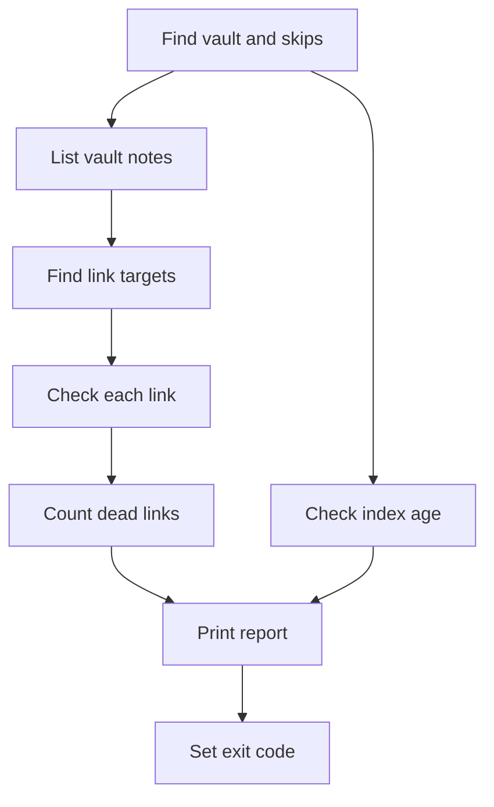
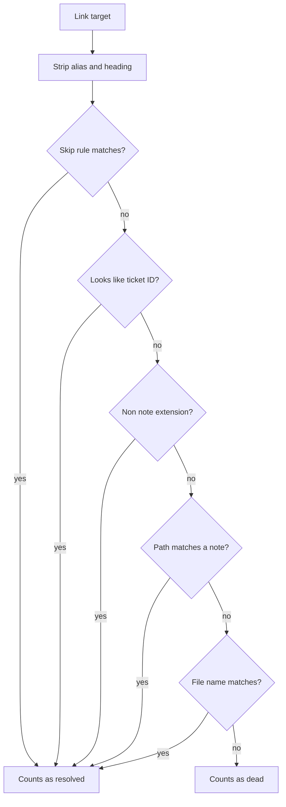

## Purpose

A health check for the notes vault and its search index. It counts links of the form `[[target]]` that point to no note, and it checks whether the vault search index was rebuilt recently. The session start and ticket commands run it so that a broken index or many dead links is noticed early.

## Dependencies

**Depends on.**
- Repo modules: `config` (index folder, folder names, extra skip list) {src:scripts/search/vault_health.py:23}, and `core.paths` for `NotSetUp` and `get_path` {src:scripts/search/vault_health.py:24}. Pages: [[config]] and [config](config.md), [[paths]] and [paths](../core/paths.md).
- The vault folder, found through the path loader {src:scripts/search/vault_health.py:53}; the vault index folder with `build_state.json` and `chroma.sqlite3` {src:scripts/search/vault_health.py:192-194}.
- Environment variable `TOLLGATE_INDEX_SKIP`, a comma list of extra folder names to leave out {src:scripts/search/vault_health.py:60} {src:scripts/search/config.py:52} {src:scripts/search/config.py:147-149}.
- Standard library only: `argparse`, `json`, `os`, `pathlib`, `re`, `sys`, `datetime`. `os` is imported but not used in this file (search of `os.` in the file, 2026-11-20).

**Used by.**
- Product code: `scripts/search/tg-search` runs it for the `health` tool name {src:scripts/search/tg-search:30}. The command files call `tg-search health`: {src:commands/tg-start.md:40} and {src:commands/tg-ticket.md:80}.
- Tests: `tests/scripts/search/test_ticket_flags.py` runs the script {src:tests/scripts/search/test_ticket_flags.py:68} {src:tests/scripts/search/test_ticket_flags.py:76} {src:tests/scripts/search/test_ticket_flags.py:89} and calls `_resolve_wikilink` {src:tests/scripts/search/test_ticket_flags.py:94}; `tests/scripts/search/test_tg_search.py` {src:tests/scripts/search/test_tg_search.py:24} {src:tests/scripts/search/test_tg_search.py:109}.

## Behavior

**Setup.** `_setup` finds the vault {src:scripts/search/vault_health.py:53}, sets the "outside the vault" prefix to the memory folder name plus a slash {src:scripts/search/vault_health.py:54}, adds the first path piece of the conversations and chat threads folders to the leave-out set {src:scripts/search/vault_health.py:55-57}, ignoring a layout key that is missing {src:scripts/search/vault_health.py:58-59}, and adds the folders from `TOLLGATE_INDEX_SKIP` {src:scripts/search/vault_health.py:60}. The set starts as `worktrees` and `.git` {src:scripts/search/vault_health.py:27}.

**Which notes are scanned.** Every `.md` file under the vault, except any whose path holds a leave-out name {src:scripts/search/vault_health.py:65-68} or any part that starts with a dot {src:scripts/search/vault_health.py:69-70}.

**Dead links.** `check_dead_links` reads each note, ignoring undecodable bytes and skipping a note that cannot be read {src:scripts/search/vault_health.py:173-176}. It finds every `[[...]]` {src:scripts/search/vault_health.py:177} and asks `_resolve_wikilink` whether it resolves {src:scripts/search/vault_health.py:178}. A missing target is counted by name, with any alias or heading removed {src:scripts/search/vault_health.py:179-180}. The result holds the count of distinct missing targets, a degraded flag, and the top N by reference count {src:scripts/search/vault_health.py:182-187}. Degraded means more than 10 distinct missing targets {src:scripts/search/vault_health.py:29} {src:scripts/search/vault_health.py:185}.

**What counts as resolved.** In order, a link resolves when: it is empty after removing `|` and `#` parts {src:scripts/search/vault_health.py:89-91}; it points into a leave-out folder {src:scripts/search/vault_health.py:95-96}; it is in the placeholder list {src:scripts/search/vault_health.py:98-99}; it holds `$` (shell test syntax) {src:scripts/search/vault_health.py:103-104}; it looks like a diagram label {src:scripts/search/vault_health.py:108-109}; it ends with a slash {src:scripts/search/vault_health.py:112-113}; it starts with a dash {src:scripts/search/vault_health.py:116-117}; it holds a space {src:scripts/search/vault_health.py:120-121}; it holds a date template {src:scripts/search/vault_health.py:124-125}; it starts with the memory prefix or a slash {src:scripts/search/vault_health.py:127-128}; it looks like a memory file name {src:scripts/search/vault_health.py:130-131}; it looks like a ticket ID such as `PROJ-312` {src:scripts/search/vault_health.py:136-137}; it ends in a non-note extension such as `.py` or `.json` {src:scripts/search/vault_health.py:139-141}. Only then are real notes checked: the vault-relative path, with or without `.md` {src:scripts/search/vault_health.py:146-150}, then the bare file name anywhere in the vault {src:scripts/search/vault_health.py:155-160}. Anything left is dead {src:scripts/search/vault_health.py:162}.

**Index health.** It looks at the vault collection folder only {src:scripts/search/vault_health.py:192}. It records whether that folder and `chroma.sqlite3` exist {src:scripts/search/vault_health.py:195-196}. The reference time is the modified time of `build_state.json`, else of `chroma.sqlite3` {src:scripts/search/vault_health.py:197}; `build_index` rewrites `build_state.json` on every run for each collection {src:scripts/search/build_index.py:501-505}. The index is stale when that time is more than 25 hours old {src:scripts/search/vault_health.py:28} {src:scripts/search/vault_health.py:201-203}, or when neither file exists {src:scripts/search/vault_health.py:204-206}.

**Output and exit code.** `--json` prints both results as JSON {src:scripts/search/vault_health.py:239-240}; otherwise a short text report with a degraded flag, the top dead links, the last run time, and warnings for a stale index or a missing store {src:scripts/search/vault_health.py:210-221} {src:scripts/search/vault_health.py:241-242}. Exit 2 with `not set up` when the vault cannot be found or is not a folder {src:scripts/search/vault_health.py:229-236}. Exit 1 when links are degraded, the index is stale, or the store file is missing; else 0 {src:scripts/search/vault_health.py:243}.

## Diagram: module level (L2, required)

## Diagram: function level (L3, optional)

## Notes

**Code and its own description disagree.**
- The description says it exits 1 "when links are degraded or the index is stale" {src:scripts/search/vault_health.py:4}. The code also exits 1 when the Chroma store file is missing {src:scripts/search/vault_health.py:243}.
- The header says `version: 1.0.0` {src:scripts/search/vault_health.py:7} while the change log lists `1.1.0` {src:scripts/search/vault_health.py:10}.
- `_collect_ticket_dirs` walks the whole vault {src:scripts/search/vault_health.py:77} and its result is passed to `_resolve_wikilink` {src:scripts/search/vault_health.py:169} {src:scripts/search/vault_health.py:178}, but that function never reads the argument; the ticket rule uses a pattern only {src:scripts/search/vault_health.py:136}. The comment says folder existence does not matter {src:scripts/search/vault_health.py:133-135}. The scan is dead work.
- The comment on the leave-out check calls the folders "directories this checker deliberately does not index" {src:scripts/search/vault_health.py:93-94}, but the match is made on absolute path pieces, see next list.

**Limits that can hide problems.**
- The leave-out and dot-folder tests use every part of the absolute path {src:scripts/search/vault_health.py:66-70}, not the part below the vault. A vault stored under a folder named `worktrees`, or under any folder whose name starts with a dot, has every note skipped. The scan then finds zero notes, reports zero dead links and looks healthy.
- `_setup` keeps only the first path piece of the conversations and chat threads folders {src:scripts/search/vault_health.py:57}. A layout folder with a nested path would leave out its parent folder everywhere.
- A link such as `[[wrong-folder/Real-Note]]` resolves when `Real-Note` exists anywhere, because only the file name is compared {src:scripts/search/vault_health.py:139} {src:scripts/search/vault_health.py:155-157}.
- Every well-formed ticket ID resolves, even for a ticket that does not exist {src:scripts/search/vault_health.py:136-137}. Links inside code blocks are counted like any other {src:scripts/search/vault_health.py:177}.
- The index check covers only the vault collection {src:scripts/search/vault_health.py:192}, not tickets or references.
- `--top` has no range check {src:scripts/search/vault_health.py:227}; a negative value slices from the end {src:scripts/search/vault_health.py:182}.

**Inputs that reach a file path, command, network address or outbound text without a check.**
- Link text from notes is never used to open a file: it is only compared with sets of known paths {src:scripts/search/vault_health.py:146} {src:scripts/search/vault_health.py:156}.
- Link targets are printed as they are, in text {src:scripts/search/vault_health.py:215} and in JSON {src:scripts/search/vault_health.py:240}, with no cleaning of control characters. A note can put text of its choice into the report that the start commands show.
- `TOLLGATE_INDEX_SKIP` is split and used as folder names to compare against {src:scripts/search/vault_health.py:60}; it is not used as a path. No shell command and no network address is used.

**Writes to shared files.** None. The script only reads notes and index files {src:scripts/search/vault_health.py:174} {src:scripts/search/vault_health.py:199}.
