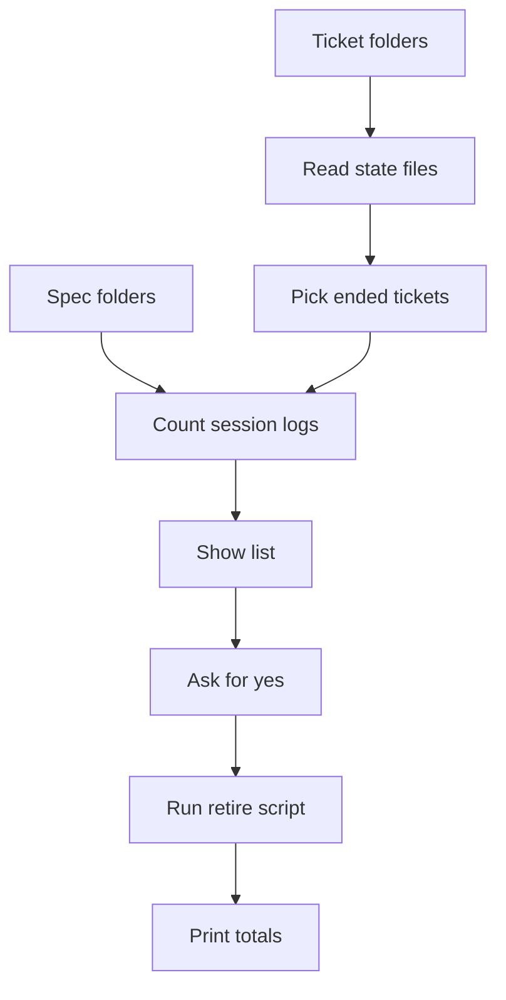
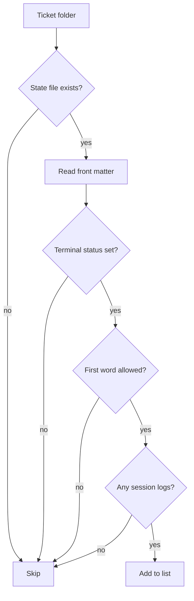

## Purpose

A one-time clean-up tool. Tickets that have ended keep piles of session log notes next to their state file. This script finds every ended ticket that still has loose session logs, shows the list, and after a yes hands each ticket to `retire_session_logs.py`, which moves the logs into an `archive` folder and writes a short archive summary.

## Dependencies

**Depends on.**
- Repo module `core.paths` for `get_path`, `NotSetUp`, `folder_name` and `iter_ticket_folders` {src:scripts/state/backfill_session_logs.py:22}. Page: [[paths]] and [paths](../core/paths.md).
- Repo script `scripts/state/retire_session_logs.py`, run as a separate process {src:scripts/state/backfill_session_logs.py:35} {src:scripts/state/backfill_session_logs.py:135-145}. Page: [[retire_session_logs]] and [retire_session_logs](retire_session_logs.md).
- Ticket state files named `KEY-state.md` with YAML front matter holding `ticket` and `terminal_status` {src:scripts/state/backfill_session_logs.py:90} {src:scripts/state/backfill_session_logs.py:95} {src:scripts/state/backfill_session_logs.py:101}.
- Standard library: `argparse`, `re`, `sys`, `subprocess`, `dataclasses`, `datetime`, `pathlib`. Outside package: `yaml` (PyYAML) {src:scripts/state/backfill_session_logs.py:19}.

**Used by.**
- Product code: no script, command file or installer line runs it. A search of the repo for `backfill_session_logs` outside `docs/` and `tests/` (git grep, 2026-11-20) found the module itself and a note in the scripts readme that it imports `pyyaml` {src:scripts/README.md:27}. It is run by hand.
- Tests: `tests/scripts/state/test_state_tools.py` runs it with `--yes` on a ticket stored under a prefix folder and checks the log moved to `archive` {src:tests/scripts/state/test_state_tools.py:274} {src:tests/scripts/state/test_state_tools.py:276}.

## Behavior

**Finding candidates (`_build_candidates`).** It walks every ticket folder, flat or under a prefix folder {src:scripts/state/backfill_session_logs.py:89} {src:scripts/core/paths.py:265-291}. For each folder it reads `FOLDER-state.md` if that file exists {src:scripts/state/backfill_session_logs.py:90-92}. The front matter is the text between the first two `---` lines, parsed as YAML; no front matter, or a YAML error, gives an empty dict {src:scripts/state/backfill_session_logs.py:61-67}. The ticket is skipped when `terminal_status` is empty {src:scripts/state/backfill_session_logs.py:95-97}. It is also skipped when the first word of the status is not one of three values held in the constant `TERMINAL_STATUSES` (source: scripts/state/backfill_session_logs.py:37) {src:scripts/state/backfill_session_logs.py:98-100}; the comparison is exact, so capitals matter. The key is the `ticket` field, else the folder name {src:scripts/state/backfill_session_logs.py:101}. Session logs are counted in the ticket folder and in `<vault>/<knowledge folder>/specs/<key>` {src:scripts/state/backfill_session_logs.py:34} {src:scripts/state/backfill_session_logs.py:54-55} {src:scripts/state/backfill_session_logs.py:103-105}, by the pattern `*-session-*.md` in that folder only, not below it {src:scripts/state/backfill_session_logs.py:33} {src:scripts/state/backfill_session_logs.py:74}. A ticket with no logs in either place is skipped {src:scripts/state/backfill_session_logs.py:106-107}.

**Confirming.** It prints the list with the status and the two counts {src:scripts/state/backfill_session_logs.py:121-129}. Without `--yes` it asks to type `yes`; any other answer prints `Aborted. No files moved.` and returns 0 {src:scripts/state/backfill_session_logs.py:168-172}.

**Retiring one ticket (`_retire_ticket`).** The close date is the first `YYYY-MM-DD` found in the status text, else today {src:scripts/state/backfill_session_logs.py:77-82}. It runs `retire_session_logs.py` with the current Python, the key, the status, the date, a fixed outcome sentence, and the ticket folder and specs folder as two `--tree` options {src:scripts/state/backfill_session_logs.py:135-144}. The command is a list, run without a shell {src:scripts/state/backfill_session_logs.py:145}. Success is exit code 0 {src:scripts/state/backfill_session_logs.py:146}. The retire script moves each matching log into an `archive` folder in its tree {src:scripts/state/retire_session_logs.py:55-57} {src:scripts/state/retire_session_logs.py:67}, and writes one summary file in the first tree's `archive` folder unless it exists {src:scripts/state/retire_session_logs.py:86-87} {src:scripts/state/retire_session_logs.py:99} {src:scripts/state/retire_session_logs.py:124}.

**Result (`main`).** It counts retired and failed tickets, prints `FAILED: key` for each failure {src:scripts/state/backfill_session_logs.py:174-181}, prints the totals {src:scripts/state/backfill_session_logs.py:183}, and returns 1 when any failed, else 0 {src:scripts/state/backfill_session_logs.py:184-187}. An unset vault prints `not set up` to standard error and returns 2 {src:scripts/state/backfill_session_logs.py:155-160}. No candidates prints a message and returns 0 {src:scripts/state/backfill_session_logs.py:163-165}.

## Diagram: module level (L2, required)

## Diagram: function level (L3, optional)

## Notes

**Code and its own description disagree.**
- The description says it retires session logs "for all terminal tickets" {src:scripts/state/backfill_session_logs.py:2}. The code matches only the three capitalised values in `TERMINAL_STATUSES` (source: scripts/state/backfill_session_logs.py:37) {src:scripts/state/backfill_session_logs.py:99}. A state file that writes the status in lower case is skipped, while `backfill_vault_frontmatter.py` lower-cases the status before it compares {src:scripts/state/backfill_vault_frontmatter.py:821}.
- `_parse_frontmatter` says it returns an empty dict when front matter is absent {src:scripts/state/backfill_session_logs.py:59}. It does for no front matter and for a YAML error {src:scripts/state/backfill_session_logs.py:62-67}. It does not guard a file that is not valid UTF-8 {src:scripts/state/backfill_session_logs.py:60}, and front matter that is a YAML list or a plain string comes back unchanged and breaks the next `.get` call {src:scripts/state/backfill_session_logs.py:65} {src:scripts/state/backfill_session_logs.py:95}.
- Seven folder names are read from the paths file at import {src:scripts/state/backfill_session_logs.py:25-31} but only the knowledge one is used {src:scripts/state/backfill_session_logs.py:34}; the other six are never read again in this file. The file defines 12 module constants and no other file imports any of them (git grep, 2026-11-20).
- The `--yes` help says that without it "the list is shown and you are asked" {src:scripts/state/backfill_session_logs.py:151}. When standard input is closed, `input()` raises an error that nothing catches {src:scripts/state/backfill_session_logs.py:169}.

**Inputs that reach a file path, command, network address or outbound text without a check.**
- The `ticket` field of a state file is joined to the specs folder with no check on its value {src:scripts/state/backfill_session_logs.py:101} {src:scripts/state/backfill_session_logs.py:103}. A value such as `../x` or an absolute path points the scan, and then the log move, at another folder. The same value is passed as `--ticket` {src:scripts/state/backfill_session_logs.py:138} and becomes part of the summary file name {src:scripts/state/retire_session_logs.py:124}.
- The `terminal_status` text is passed as an argument {src:scripts/state/backfill_session_logs.py:139} and written into the summary file {src:scripts/state/retire_session_logs.py:95}. It is not passed through a shell.
- `--tickets-dir` and `--specs-dir` are used as the roots of the scan and the moves with no check {src:scripts/state/backfill_session_logs.py:152-153} {src:scripts/state/backfill_session_logs.py:156-157}. They are typed by the person running the tool.
- No network address is used.

**Writes to shared files.** This file writes nothing itself. The moves and the summary file are written by the retire script: `shutil.move` for the logs {src:scripts/state/retire_session_logs.py:67} and `write_text` for the summary {src:scripts/state/retire_session_logs.py:99}. Neither is atomic as a group, and nothing stops two runs at once. A same-named file already in `archive` can be replaced on the same disk {src:docs:python-shutil-move}. A failure part-way leaves some logs moved; the retire script prints the counts and stops with an error for that ticket {src:scripts/state/retire_session_logs.py:69-73}, and this script then lists the key as failed {src:scripts/state/backfill_session_logs.py:179-181}.
