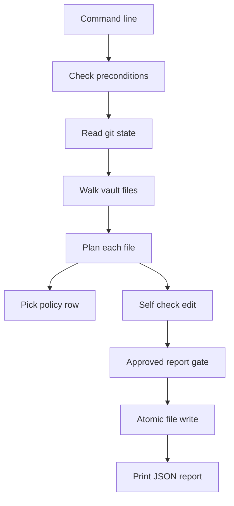
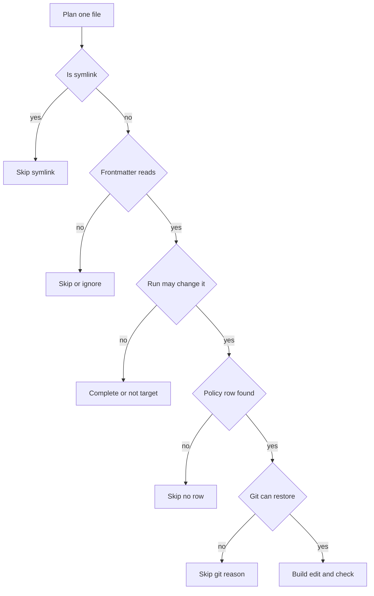

## Purpose

A one-shot maintenance tool that labels vault markdown files with four retrieval fields (`catalog_type`, `doc_role`, `indexable`, `indexed`) by inserting lines in the file's frontmatter, creating a frontmatter block, or replacing a few exact lines. It exists so the search index can tell ticket files, notes and reference pages apart without anyone editing hundreds of files by hand. It previews by default, and it will only write files that git can restore.

## Dependencies

**Depends on.**
- `core.paths`: `folder_name`, `ticket_prefix_depth` and `subdir_prefixes` supply the vault folder names, the ticket prefix level and the layout subfolders {src:scripts/state/backfill_vault_frontmatter.py:54}. Page: [[paths]] and [paths](../core/paths.md).
- `core.paths.get_path("vault")`, imported late inside `default_vault_root`, gives the default vault folder {src:scripts/state/backfill_vault_frontmatter.py:2055}.
- `yaml` (PyYAML), used with `safe_load` to read frontmatter {src:scripts/state/backfill_vault_frontmatter.py:409}.
- The `git` program, run with fixed argument lists inside the vault folder {src:scripts/state/backfill_vault_frontmatter.py:1131-1137}.
- Standard library: `argparse`, `json`, `logging`, `os`, `re`, `shutil`, `subprocess`, `sys`, `tempfile`, `dataclasses`, `pathlib`, `typing`.
- Environment: none read directly. The vault folder comes from the loader, which reads `TOLLGATE_KNOWLEDGE` and `TOLLGATE_PATHS` {src:scripts/core/paths.py:24-25}.

**Used by.**
- Product code: no file under `scripts/`, `hooks/`, `commands/` or `installer/` imports or calls it (searched with `git grep` on the file name, excluding `docs/`, 2026-11-20). It is run by hand. The only product mention is the dependency note in {src:scripts/README.md:27}.
- Tests: `tests/scripts/state/test_backfill_vault_frontmatter.py` {src:tests/scripts/state/test_backfill_vault_frontmatter.py:43}, `tests/scripts/state/test_backfill_ticket_policy.py` {src:tests/scripts/state/test_backfill_ticket_policy.py:45}, `tests/scripts/state/test_backfill_nonticket_policy.py` {src:tests/scripts/state/test_backfill_nonticket_policy.py:33}, `tests/scripts/state/test_state_tools.py` {src:tests/scripts/state/test_state_tools.py:30}, and a runner list in `tests/scripts/state/test_pytest_bridge.py` {src:tests/scripts/state/test_pytest_bridge.py:18}.

## Behavior

**Command line.** `--vault-root`, `--apply`, `--report-path`, `--run {1,2,3,4}` and `--approved-report`; abbreviations are refused {src:scripts/state/backfill_vault_frontmatter.py:2013-2041}. `main` returns 0, 2 or 3 {src:scripts/state/backfill_vault_frontmatter.py:2154-2171}. It returns 2 when a precondition fails or git cannot be read, and nothing is written in that case {src:scripts/state/backfill_vault_frontmatter.py:2168-2170}. It returns 3 when at least one write failed {src:scripts/state/backfill_vault_frontmatter.py:2136-2137}. It also returns 2 when only the report file could not be saved {src:scripts/state/backfill_vault_frontmatter.py:2138}.

**Flag rules.** `--approved-report` is valid only with `--run` and `--apply`, and `--run` with `--apply` requires it {src:scripts/state/backfill_vault_frontmatter.py:2067-2070}. The vault folder must exist, and a report path must not be a folder and must sit in an existing folder {src:scripts/state/backfill_vault_frontmatter.py:2082-2087}. The default vault folder comes from the path loader; any failure there becomes a precondition error {src:scripts/state/backfill_vault_frontmatter.py:2054-2058}.

**Two modes.** Without `--run`, the older flow runs: plan every file, write the eligible ones when `--apply` is given, report {src:scripts/state/backfill_vault_frontmatter.py:1640-1659}. It does not require a clean tree or an approved report; its only safety check is per file (see git checks below). With `--run N`, `run_policy` checks the tree, takes the git snapshot, plans every file, and only in apply mode checks the approved report and then writes {src:scripts/state/backfill_vault_frontmatter.py:1810-1820}. A dirty tree is refused only in apply mode; preview reports it {src:scripts/state/backfill_vault_frontmatter.py:1812-1814}.

**Finding files.** The walk is `os.walk` without following folder links; it yields every `.md` file {src:scripts/state/backfill_vault_frontmatter.py:1114-1121}. Hidden folders are skipped at the vault root only {src:scripts/state/backfill_vault_frontmatter.py:1096-1097}. The memory folder is skipped because the folder path is tested with `startswith` on the memory prefix, so only the top level memory folder matches {src:scripts/state/backfill_vault_frontmatter.py:94-96} {src:scripts/state/backfill_vault_frontmatter.py:1080} {src:scripts/state/backfill_vault_frontmatter.py:1098-1099}. File symlinks are yielded by the walk {src:scripts/state/backfill_vault_frontmatter.py:1119-1121}, and the planner then skips them as `SYMLINK` {src:scripts/state/backfill_vault_frontmatter.py:1235-1236}.

**Reading frontmatter.** A block exists only when line one is exactly `---` with LF or CRLF, no BOM and no blank line before it {src:scripts/state/backfill_vault_frontmatter.py:358-364}. The first later line that is exactly `---` closes it {src:scripts/state/backfill_vault_frontmatter.py:376-377}. The block is read with `yaml.safe_load`; any exception, or a result that is not a mapping, means "unreadable" {src:scripts/state/backfill_vault_frontmatter.py:409-417}.

**Older flow classification (five rows).** A ticket state file path wins first {src:scripts/state/backfill_vault_frontmatter.py:453-454}. Then `doc_type` is looked up in a 37 row table by exact string {src:scripts/state/backfill_vault_frontmatter.py:310-348} {src:scripts/state/backfill_vault_frontmatter.py:457-459}; an unknown `doc_type` gets the placeholder `unknown/unknown/false` and a safe label {src:scripts/state/backfill_vault_frontmatter.py:461-462}. Then `type` is tried the same way {src:scripts/state/backfill_vault_frontmatter.py:463-466}. Everything else is "not a target" {src:scripts/state/backfill_vault_frontmatter.py:467}.

**Which lines are added.** Only fields that are missing are added, in the order `catalog_type`, `doc_role`, `indexable`, `indexed` {src:scripts/state/backfill_vault_frontmatter.py:481-487}. `indexed` is always written as `null` {src:scripts/state/backfill_vault_frontmatter.py:476}. If a present field disagrees with the derived value (compared by type and value, so `1` is not `true`), the file is skipped with `CONFLICT_<FIELD>` and left alone {src:scripts/state/backfill_vault_frontmatter.py:496-503}. New lines go directly above the closing `---` using the file's own line ending {src:scripts/state/backfill_vault_frontmatter.py:515-526}.

**Run policy classes.** Run 1 adds missing lines to ticket files that have frontmatter and flips `indexable: true` to `false` on terminal tickets; run 2 creates a block where there is none; run 3 rewrites the exact `unknown/unknown/false` placeholder; run 4 labels non-ticket notes by folder {src:scripts/state/backfill_vault_frontmatter.py:1328-1350} {src:scripts/state/backfill_vault_frontmatter.py:1310-1325}. A terminal status is one of `cancelled`, `superseded`, `dropped`, `archived`, `absorbed`, trimmed and lower-cased; it forces `indexable` to false {src:scripts/state/backfill_vault_frontmatter.py:153-155} {src:scripts/state/backfill_vault_frontmatter.py:821} {src:scripts/state/backfill_vault_frontmatter.py:826-830}.

**Ticket rows (K1 to K13).** The row is chosen from the file name after a leading `<folder>-` is removed and the name is lower-cased {src:scripts/state/backfill_vault_frontmatter.py:739-745}. A file below an `archive` or `history` subfolder takes K1, with the role the name would give {src:scripts/state/backfill_vault_frontmatter.py:803-804}. A ticket state path takes K2 {src:scripts/state/backfill_vault_frontmatter.py:805-806}. Otherwise the first of K3 to K13 whose pattern fits wins, and a name matching no pattern has no row (this is "K14") {src:scripts/state/backfill_vault_frontmatter.py:591-608} {src:scripts/state/backfill_vault_frontmatter.py:762-773}.

**Folder rows (run 4).** Only paths under scope A (system map, education, and the knowledge decisions, learnings and patterns folders) are targets {src:scripts/state/backfill_vault_frontmatter.py:671-674} {src:scripts/state/backfill_vault_frontmatter.py:690-697}. The first folder row whose prefix matches supplies the values; `doc_type` is not read {src:scripts/state/backfill_vault_frontmatter.py:709-711}. A scope A file under no row is skipped as `NO_KIND_ROW` when it needs a row {src:scripts/state/backfill_vault_frontmatter.py:1564-1565}.

**Git checks.** Three snapshots are taken once: tracked files, files differing from HEAD, and ignored untracked files {src:scripts/state/backfill_vault_frontmatter.py:1147-1153}. A planned change is skipped as `UNCOMMITTED`, `UNTRACKED` or `GITIGNORED` when git could not restore the file {src:scripts/state/backfill_vault_frontmatter.py:1163-1166}. Any git failure (non-zero exit, timeout after 30 seconds, git missing) ends the run with a closed code {src:scripts/state/backfill_vault_frontmatter.py:1138-1143}.

**Self check before any write.** Each edit is rebuilt and checked: the new bytes must equal the old bytes with only the planned change, and the new frontmatter must parse to the old mapping plus the change, compared by type and value {src:scripts/state/backfill_vault_frontmatter.py:540-567} {src:scripts/state/backfill_vault_frontmatter.py:1048-1073} {src:scripts/state/backfill_vault_frontmatter.py:903-919}. A failed check skips the file as `VERIFY_FAILED` {src:scripts/state/backfill_vault_frontmatter.py:1203-1205}. A create is refused when the file is empty or starts with a BOM or `---` {src:scripts/state/backfill_vault_frontmatter.py:866-873}.

**Approval gate.** In run mode with `--apply`, every planned write must equal an entry (path, class, kind, added fields, changes) in a preview report of the same run, else `NOT_APPROVED` {src:scripts/state/backfill_vault_frontmatter.py:1726-1744} {src:scripts/state/backfill_vault_frontmatter.py:1750-1758}. The approved report must be valid JSON with unique write paths, `mode` equal to preview, and an integer `run` equal to this run {src:scripts/state/backfill_vault_frontmatter.py:1683-1706}.

**Writing.** `apply_edit` re-reads the file and refuses if it changed since planning (`CHANGED_DURING_RUN`) or is not writable {src:scripts/state/backfill_vault_frontmatter.py:1596-1603}. It writes a temp file in the same folder, copies the mode, syncs it, and swaps it in with `os.replace` {src:scripts/state/backfill_vault_frontmatter.py:1606-1614}. On error it removes the temp file and returns `WRITE_FAILED` {src:scripts/state/backfill_vault_frontmatter.py:1615-1617}.

**Report.** The JSON report goes to stdout, sorted by key {src:scripts/state/backfill_vault_frontmatter.py:2132-2133}, and to `--report-path` when given {src:scripts/state/backfill_vault_frontmatter.py:2134}. It holds only paths, codes, field values and counts {src:scripts/state/backfill_vault_frontmatter.py:1890-1903}.

## Diagram: module level (L2, required)

## Diagram: function level (L3, optional)

This follows `plan_run_file` {src:scripts/state/backfill_vault_frontmatter.py:1546-1571}.

## Notes

**Code and description disagree.**
- The header and several comments say there are ten folder rows, N1 to N10 {src:scripts/state/backfill_vault_frontmatter.py:17} {src:scripts/state/backfill_vault_frontmatter.py:22} {src:scripts/state/backfill_vault_frontmatter.py:701}. The table holds seven: N1 to N6 and N10 {src:scripts/state/backfill_vault_frontmatter.py:657-667}. No N7, N8 or N9 exists (searched the file, 2026-11-20).
- The header says "14 kind rows" {src:scripts/state/backfill_vault_frontmatter.py:21}. The table holds 13 rows, K1 to K13, and the comment above it says K14 is not a row {src:scripts/state/backfill_vault_frontmatter.py:589-608}.
- The `iter_vault_files` docstring says run 4 "passes its own" exclusion list {src:scripts/state/backfill_vault_frontmatter.py:1110-1111}. The run 4 list is the same object as the default list {src:scripts/state/backfill_vault_frontmatter.py:225}.
- The header says preview is the default and `--apply` writes {src:scripts/state/backfill_vault_frontmatter.py:8}. With `--run` that holds, but `--apply` also needs a clean tree and an approved report {src:scripts/state/backfill_vault_frontmatter.py:1812-1818}. Without `--run`, `--apply` needs neither {src:scripts/state/backfill_vault_frontmatter.py:1647-1659}.
- The header and the `--run` help text say "the earlier change" where a name should be {src:scripts/state/backfill_vault_frontmatter.py:9} {src:scripts/state/backfill_vault_frontmatter.py:2032}. That wording cannot be checked against anything, so this page describes only what the code does.

**Inputs without a value check.**
- `--vault-root` is used as the folder to walk and the working folder for git. Only "is a folder" is checked {src:scripts/state/backfill_vault_frontmatter.py:2082-2083} {src:scripts/state/backfill_vault_frontmatter.py:1133}.
- `--report-path` is written with `write_text`. Only "not a folder, parent exists" is checked {src:scripts/state/backfill_vault_frontmatter.py:2086-2087} {src:scripts/state/backfill_vault_frontmatter.py:2093}. It can overwrite any existing file the user can write.
- `--approved-report` is read as JSON with no location check {src:scripts/state/backfill_vault_frontmatter.py:1700}.
- No input reaches a shell command or network address: git arguments are fixed constants {src:scripts/state/backfill_vault_frontmatter.py:117-123} {src:scripts/state/backfill_vault_frontmatter.py:208-210}, and the process is started without a shell {src:scripts/state/backfill_vault_frontmatter.py:1131-1133}.
- File paths inside the vault are walked, not typed, and are joined to the vault root without a containment check {src:scripts/state/backfill_vault_frontmatter.py:1234}. Folder links are not followed {src:scripts/state/backfill_vault_frontmatter.py:1114}, and file links are skipped {src:scripts/state/backfill_vault_frontmatter.py:1235-1236}.
- Outbound text: the report on stdout carries file paths and closed codes, and unknown `doc_type` values only when they match a safe pattern {src:scripts/state/backfill_vault_frontmatter.py:442-448}.

**Shared file writes.**
- Vault markdown files: atomic (temp file in the same folder, then `os.replace`) {src:scripts/state/backfill_vault_frontmatter.py:1606-1614}. Two guards run first: a re-read must equal the planned bytes {src:scripts/state/backfill_vault_frontmatter.py:1600-1601}, and the file must be writable {src:scripts/state/backfill_vault_frontmatter.py:1602-1603}. There is no lock, so a writer that changes the file between that re-read and the swap loses its edit.
- Two copies of this tool on one vault are not stopped. The only guard is the dirty tree check, which applies to run mode and runs once at the start {src:scripts/state/backfill_vault_frontmatter.py:1810-1814}.
- The report file: not atomic, plain overwrite, no lock {src:scripts/state/backfill_vault_frontmatter.py:2093}.

**Other points.**
- A fresh repo with no commit makes the `git diff HEAD` listing fail, which ends the run with a closed code {src:scripts/state/backfill_vault_frontmatter.py:118-120} {src:scripts/state/backfill_vault_frontmatter.py:1142-1143}.
- A scope A file under the system map folder but outside the five listed subfolders has no folder row and is skipped with `NO_KIND_ROW` {src:scripts/state/backfill_vault_frontmatter.py:671-674} {src:scripts/state/backfill_vault_frontmatter.py:657-667} {src:scripts/state/backfill_vault_frontmatter.py:1564-1565}.
- The file has 141 top-level ALL_CAPS assignments by `grep` (2026-11-20); the `exports` list names only those that other files read by attribute (searched `tests/scripts/state` and `scripts/state`, 2026-11-20).
- One test asserts the default layout names, `01-system-map/platform-learning/`, `03-knowledge-base/decisions/` and an exclusion list equal to `("memory/",)`, so it fails if the layout table changes {src:tests/scripts/state/test_state_tools.py:303-309}.
- Test coverage lives in four test files. Counting `def test_` lines gives 245 in `test_backfill_vault_frontmatter.py` {src:tests/scripts/state/test_backfill_vault_frontmatter.py:43}; the other three were not counted.
