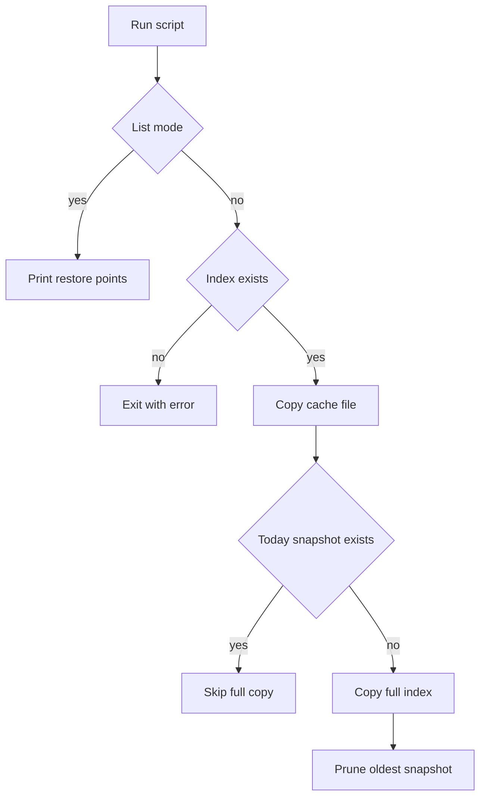

## Purpose

Takes a dated snapshot of the search index so a bad rebuild can be undone. It keeps two tracks: a small copy of `context_cache.json` kept 30 days, and a full copy of the index folder kept for about 7 days. `--list` prints what restore points exist.

## Dependencies

**Depends on.**
- `scripts/core/tg_path`, called twice to find the index folder and the output folder; either failure prints "not set up" and exits 2 {src:scripts/state/backup_index.sh:19-22}. Page: [[tg_path]] and [tg_path](../core/tg_path.md).
- The logical names `index` and `output` come from the path loader {src:scripts/core/paths.py:42} {src:scripts/core/paths.py:54}. By default `output` sits inside the vault and `index` inside `~/.tollgate` {src:scripts/core/paths.py:101-102} {src:scripts/core/paths.py:106-107}.
- Commands: `date`, `mkdir`, `cp`, `du`, `cut`, `find`, `ls`, `wc`, `tr`, `sort`, `head`, `rm`, `basename`, `python3` (used to count cache entries) {src:scripts/state/backup_index.sh:74}.
- Files: `$INDEX_DIR/context_cache.json` {src:scripts/state/backup_index.sh:70} and any `chroma.sqlite3` under the index folder {src:scripts/state/backup_index.sh:59}.

**Used by.**
- Product code: the nightly index job runs it as a step after the rebuild, [[nightly_index]] and [nightly_index](../cron/nightly_index.md) {src:scripts/cron/nightly_index.sh:143}. `restore_index.sh` calls it with `--list` {src:scripts/state/restore_index.sh:36}.
- Tests: `tests/scripts/state/test_state_tools.py` {src:tests/scripts/state/test_state_tools.py:167} {src:tests/scripts/state/test_state_tools.py:184}.

## Behavior

**Setup.** `set -e` ends the script at the first failing command {src:scripts/state/backup_index.sh:17}. Snapshots live under `<output>/index-snapshots`, split into `cache` and `full` {src:scripts/state/backup_index.sh:23-26}. Retention is 30 days for the cache and 7 snapshots for the full index {src:scripts/state/backup_index.sh:27-28}.

**`--list`.** Prints the folders under `full` with their size, then the files under `cache`, then a restore hint, and exits 0 {src:scripts/state/backup_index.sh:32-55}. A missing folder prints "none" {src:scripts/state/backup_index.sh:42} {src:scripts/state/backup_index.sh:51}. Any other argument is ignored, so a snapshot is made {src:scripts/state/backup_index.sh:32}.

**Index check.** If the index folder is missing or holds no `chroma.sqlite3`, it prints an error and exits 1 {src:scripts/state/backup_index.sh:59-62}.

**Cache track.** Copies `context_cache.json` to `cache/<today>.json`, counts entries with `python3` (prints `?` when that fails), then deletes any `*.json` in the cache folder older than 30 days by file time {src:scripts/state/backup_index.sh:70-79}. If the source file is absent it prints a warning and goes on {src:scripts/state/backup_index.sh:80-82}. A second run on the same day overwrites today's cache copy {src:scripts/state/backup_index.sh:73}.

**Full track.** If `full/<today>` already exists it skips, with no refresh {src:scripts/state/backup_index.sh:87-89}. Otherwise it copies the whole index folder there {src:scripts/state/backup_index.sh:91}. Then, when the folder count is above 7, it deletes the single oldest entry by name sort {src:scripts/state/backup_index.sh:94-99}. It always ends by listing the full snapshots and exiting 0 {src:scripts/state/backup_index.sh:103-107}.

## Diagram

## Notes

**Code and description disagree.**
- The header says the full index is kept for 7 days {src:scripts/state/backup_index.sh:4}. The code keeps up to 7 folders and removes one oldest folder per run, so the window is 7 snapshots, not 7 days {src:scripts/state/backup_index.sh:95-98}. If the count ever exceeds 8, one run does not catch up.
- The header says snapshots are written "under the output folder only" {src:scripts/state/backup_index.sh:6-7}. That holds for writes, but the output folder is inside the vault by default {src:scripts/core/paths.py:102}, so snapshots live in the vault tree.
- Pre-restore copies made by `restore_index.sh` are folders in the same `full` folder {src:scripts/state/restore_index.sh:80}. They count toward the 7, show in `--list` as restore points, and sort after the dated names, so the prune step does not pick them while a dated folder exists {src:scripts/state/backup_index.sh:94-97}.

**Inputs without a check.**
- Paths come only from `tg_path` and today's date; no command line text reaches a path or command. The only argument read is `--list` {src:scripts/state/backup_index.sh:32}. No network address and no outbound text.
- `rm -rf` runs on `${FULL_BACKUP_DIR:?}/$oldest`, where `oldest` comes from `ls` of the snapshot folder; the `:?` stops an empty base {src:scripts/state/backup_index.sh:96-97}. The name is not checked, so any directory placed there can be removed.
- `find ... -delete` removes every `*.json` older than 30 days in the cache folder, not only files this script made {src:scripts/state/backup_index.sh:77}.

**Shared file writes.**
- `cp` to `cache/<today>.json` is not atomic and no lock exists {src:scripts/state/backup_index.sh:73}.
- `cp -R` of the index into `full/<today>` is not atomic. If it fails part way, `set -e` stops the script and a half copy stays; the next run sees the folder and prints SKIP, so a partial snapshot is treated as good {src:scripts/state/backup_index.sh:87-91}.
- The index is copied while it may be in use; nothing stops a rebuild from writing at the same time (searched the script for lock handling, 2026-11-20).

**Other.** Idempotency: a repeat run on the same day refreshes only the cache copy {src:scripts/state/backup_index.sh:73} {src:scripts/state/backup_index.sh:87-88}. The script needs bash for `BASH_SOURCE` {src:scripts/state/backup_index.sh:19}.

**Tests.** Two cases: one makes a fake index and checks one dated snapshot, a cache folder, the list output and a restore round trip; the other checks exit 1 and the "nothing to back up" message with no index {src:tests/scripts/state/test_state_tools.py:163-186}. They do not cover pruning, the 30 day delete, the partial copy case, or the same day skip. Both build their index under a throwaway home via `HOME`, so they do not depend on a machine path {src:tests/scripts/state/test_state_tools.py:157}.
