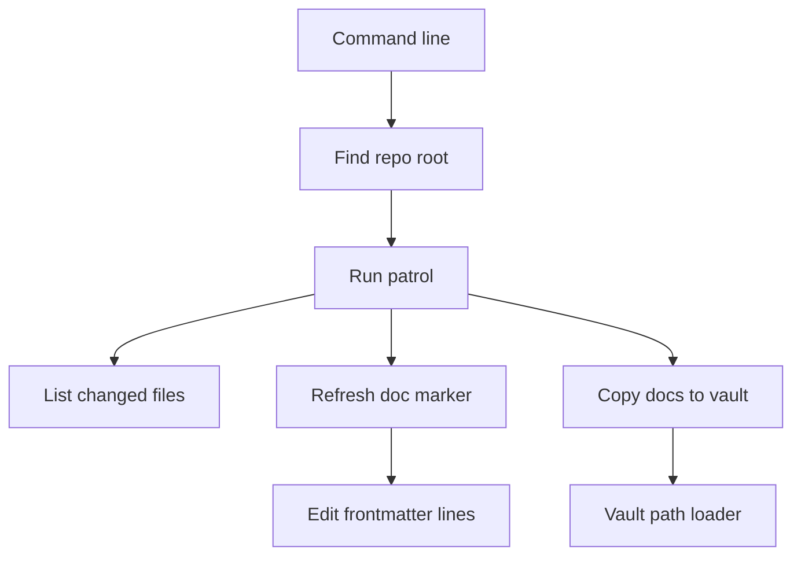
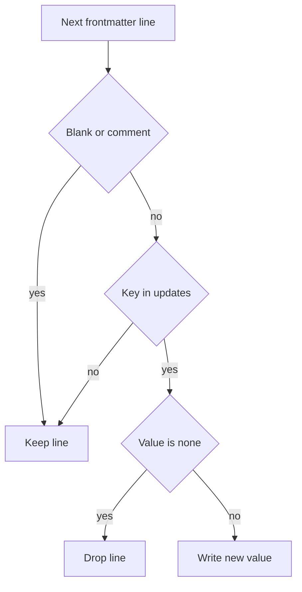

## Purpose

For one git repo, finds code documentation pages whose source file changed in the last 24 hours and that carry an `update_needed` marker, clears the marker and stamps today's date, then copies the repo's `docs/` folder into the vault. It exists so a doc that is flagged as stale gets its metadata refreshed by a scheduled job; it does not rewrite the prose.

## Dependencies

**Depends on.**
- `core.paths`: `get_path`, `NotSetUp` and `folder_name` {src:scripts/state/doc_drift_patrol.py:25}. Page: [[paths]] and [paths](../core/paths.md).
- `yaml` (PyYAML) to read frontmatter {src:scripts/state/doc_drift_patrol.py:80}.
- The `git` program: `git log` and `git rev-parse` {src:scripts/state/doc_drift_patrol.py:44} {src:scripts/state/doc_drift_patrol.py:160}.
- Standard library: `argparse`, `logging`, `shutil`, `subprocess`, `sys`, `datetime`, `pathlib`, `typing`.
- Files: `<repo>/docs/<source path>.md` for each changed source file {src:scripts/state/doc_drift_patrol.py:67-69}.

**Used by.**
- Product code: none. No file under `scripts/`, `hooks/`, `commands/` or `installer/` calls it, and nothing in them sets an `update_needed` marker (searched with `git grep` for `doc_drift`, `drift_patrol` and `update_needed`, 2026-11-20). The only product text is a dependency note {src:scripts/README.md:27}.
- Tests: `tests/scripts/state/test_state_tools.py` {src:tests/scripts/state/test_state_tools.py:28} {src:tests/scripts/state/test_state_tools.py:194} {src:tests/scripts/state/test_state_tools.py:208}.

## Behavior

**Command line.** `--repo-path` (default the current folder) and `--log-level` {src:scripts/state/doc_drift_patrol.py:176-179}. It exits 1 if the path does not exist or is not inside a git repo {src:scripts/state/doc_drift_patrol.py:185-192}, and 2 when the path loader is not set up {src:scripts/state/doc_drift_patrol.py:196-198}. Otherwise it exits 0 whatever the number of docs refreshed, because the return value of `patrol` is dropped {src:scripts/state/doc_drift_patrol.py:195}.

**Changed files.** Runs `git log --since="24 hours ago" --name-only` in the repo root, with a 30 second limit {src:scripts/state/doc_drift_patrol.py:43-49}. A timeout or non-zero exit logs an error and returns an empty list {src:scripts/state/doc_drift_patrol.py:50-55}. Each listed name is resolved against the repo root and kept only if it is a file that still exists {src:scripts/state/doc_drift_patrol.py:61-63}.

**Doc path.** For a source file, the doc is `<repo>/docs/<same path with .md>` {src:scripts/state/doc_drift_patrol.py:67-69}.

**Reading frontmatter.** The file must start with `---`; the text is split on `---` at most twice, and the middle part is read with `yaml.safe_load` {src:scripts/state/doc_drift_patrol.py:75-81}. No frontmatter gives an empty mapping {src:scripts/state/doc_drift_patrol.py:76} {src:scripts/state/doc_drift_patrol.py:78}.

**Refreshing.** `refresh_doc` returns False unless `update_needed` is truthy {src:scripts/state/doc_drift_patrol.py:108-109}. When it is, it sets `last_updated` to today's date and removes the `update_needed` line, and returns True {src:scripts/state/doc_drift_patrol.py:110-116}. `write_frontmatter` edits line by line: comments and blank lines are kept {src:scripts/state/doc_drift_patrol.py:90-92}, a line whose key is in the updates is replaced or dropped when the value is None {src:scripts/state/doc_drift_patrol.py:95-100}, and the file is rewritten with the body unchanged {src:scripts/state/doc_drift_patrol.py:103}.

**Patrol.** For each changed file whose doc exists, it calls `refresh_doc` and counts the refreshes {src:scripts/state/doc_drift_patrol.py:137-147}. If at least one doc was refreshed and the `docs` folder exists, it copies the whole `docs` tree to the vault {src:scripts/state/doc_drift_patrol.py:152-153}.

**Vault copy.** Target is `<vault>/<reference folder>/repos/<repo name>/`; every `*.md` under `docs/` is copied with `shutil.copy2`, overwriting, missing folders created {src:scripts/state/doc_drift_patrol.py:36} {src:scripts/state/doc_drift_patrol.py:119-127}. The repo name is the name of the repo root folder {src:scripts/state/doc_drift_patrol.py:131}. The reference folder name is `08-reference` in the default layout {src:scripts/core/paths.py:39}.

## Diagram: module level (L2, required)

## Diagram: function level (L3, optional)

This follows the loop in `write_frontmatter` {src:scripts/state/doc_drift_patrol.py:88-102}.

## Notes

**Code and description disagree.**
- The header calls it a "Nightly" patrol {src:scripts/state/doc_drift_patrol.py:4}. Nothing schedules it: no cron, launch or installer file names it (same search as above, 2026-11-20).
- The log line says prose regeneration is deferred because "/doc-gen not yet available" {src:scripts/state/doc_drift_patrol.py:144}. A doc-gen command file exists in this repo at `commands/tg-doc-gen.md` (found with `ls commands`, 2026-11-20). The message is out of date.
- Refreshing writes today's date as `last_updated` while the prose is left as it was {src:scripts/state/doc_drift_patrol.py:114}. The page then looks fresh but is not. The step is a metadata stamp only.
- The repo's doc-gen command writes the vault copy only when `{reference}/repos` already exists and never creates that root {src:commands/tg-doc-gen.md:237}. This script creates the folder with `mkdir(parents=True)` {src:scripts/state/doc_drift_patrol.py:121}. Both use the loader's reference folder, so the destination is the same but the creation rule differs.
- Six folder constants are set and never read: `SYSTEM_MAP_DIR`, `TICKETS_DIR`, `KNOWLEDGE_DIR`, `EDUCATION_DIR`, `CONVERSATIONS_DIR_NAME`, `THREADS_DIR_NAME` {src:scripts/state/doc_drift_patrol.py:28} {src:scripts/state/doc_drift_patrol.py:30-34}. Only `REFERENCE_DIR` is used (searched the file, 2026-11-20).

**Edge cases and limits.**
- A bad frontmatter block in one doc raises from `yaml.safe_load` and no handler exists, so the whole patrol stops at that doc {src:scripts/state/doc_drift_patrol.py:80} {src:scripts/state/doc_drift_patrol.py:194-198}.
- `doc_path_for` calls `relative_to` on a resolved path; a changed file that is a link pointing outside the repo makes it raise `ValueError`, which nothing catches {src:scripts/state/doc_drift_patrol.py:61} {src:scripts/state/doc_drift_patrol.py:68}.
- `write_frontmatter` matches a key by name on any line, whatever its indent, so a nested key named `last_updated` would also be rewritten {src:scripts/state/doc_drift_patrol.py:93-100}.
- `last_updated` is only replaced if the line already exists; it is not added {src:scripts/state/doc_drift_patrol.py:95-102}.
- `read_text` converts Windows line endings and `write_text` writes the platform default, so a CRLF doc is rewritten with LF {src:scripts/state/doc_drift_patrol.py:74} {src:scripts/state/doc_drift_patrol.py:103}.
- A quoted `update_needed: "false"` is a non-empty string, so it counts as true {src:scripts/state/doc_drift_patrol.py:108}.
- A vault copy failure (not set up) happens after the repo docs were already changed, so the run can leave the repo updated and the vault not {src:scripts/state/doc_drift_patrol.py:142} {src:scripts/state/doc_drift_patrol.py:153} {src:scripts/state/doc_drift_patrol.py:120}.
- For a work tree the repo name is the work tree folder name, not the main checkout name {src:scripts/state/doc_drift_patrol.py:131}.

**Inputs without a check.**
- `--repo-path` is checked only for existence and for being in a git repo {src:scripts/state/doc_drift_patrol.py:185-192}. It becomes the working folder of the two git calls {src:scripts/state/doc_drift_patrol.py:45} {src:scripts/state/doc_drift_patrol.py:161}.
- File names from `git log` are joined to the repo root with no containment check beyond `relative_to` later {src:scripts/state/doc_drift_patrol.py:61} {src:scripts/state/doc_drift_patrol.py:68}.
- Git arguments are fixed; no value reaches a shell or a network address {src:scripts/state/doc_drift_patrol.py:44} {src:scripts/state/doc_drift_patrol.py:160}. The only outbound text is the log on standard error, which includes file paths {src:scripts/state/doc_drift_patrol.py:182}.

**Shared file writes.**
- Doc files in the repo: `write_text` overwrites in place, not atomic, no lock {src:scripts/state/doc_drift_patrol.py:103}.
- Vault copy: `copy2` over each file, not atomic, no lock, and it copies every doc page, not only refreshed ones {src:scripts/state/doc_drift_patrol.py:122-126}.

**Tests.** `test_refresh_doc_clears_the_marker` writes a doc with the marker and an old date, then checks the marker and the old date are gone and that a second call returns False {src:tests/scripts/state/test_state_tools.py:190-198}. `test_vault_mirror_goes_to_the_loader_vault` checks one file lands under `08-reference/repos/repo/` {src:tests/scripts/state/test_state_tools.py:200-213}. That test changes `os.environ` and restores it. Not covered: the git calls, `patrol`, bad frontmatter, and the CRLF case.
