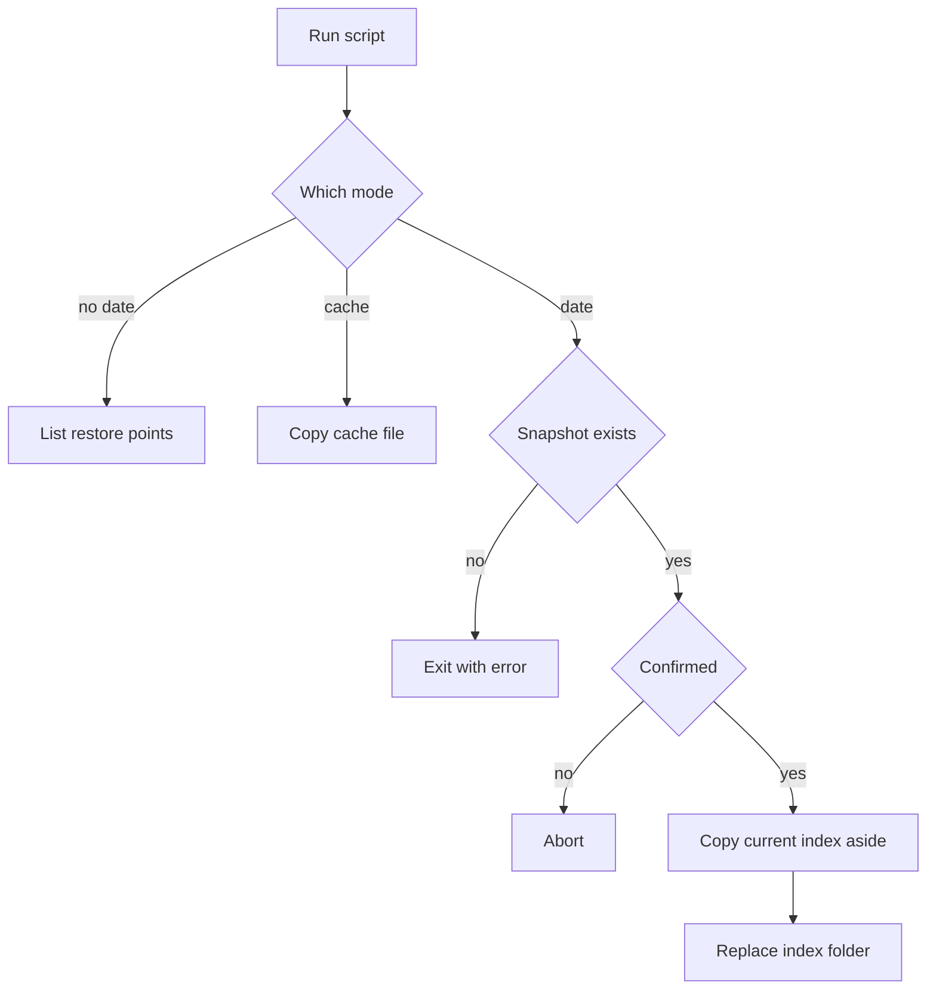

## Purpose

Puts the search index back from a snapshot that `backup_index.sh` made. It can restore the whole index folder, or only the `context_cache.json` file, and with no date it lists the restore points.

## Dependencies

**Depends on.**
- `scripts/core/tg_path` for the index and output folders; a failure prints "not set up" and exits 2 {src:scripts/state/restore_index.sh:19-21}. Page: [[tg_path]] and [tg_path](../core/tg_path.md).
- `backup_index.sh` in the same folder, called with `--list` {src:scripts/state/restore_index.sh:36}. Page: [[backup_index]] and [backup_index](backup_index.md).
- Commands: `mkdir`, `cp`, `rm`, `du`, `cut`, `date`, and the shell built-in `read`.
- Snapshot folders `<output>/index-snapshots/full` and `.../cache` {src:scripts/state/restore_index.sh:22-24}.

**Used by.**
- Product code: none. No file under `scripts/`, `hooks/`, `commands/` or `installer/` calls it (searched with `git grep restore_index`, excluding `docs/`, 2026-11-20). `backup_index.sh` prints its name as a hint {src:scripts/state/backup_index.sh:53}.
- Tests: `tests/scripts/state/test_state_tools.py` {src:tests/scripts/state/test_state_tools.py:175} {src:tests/scripts/state/test_state_tools.py:178}.

## Behavior

**Arguments.** `--yes` is pulled out of the arguments wherever it appears; the rest are kept in order {src:scripts/state/restore_index.sh:26-31}.

**List mode.** No argument, or `--list`, runs `backup_index.sh --list` and exits 0 {src:scripts/state/restore_index.sh:35-38}.

**Cache only.** `cache YYYY-MM-DD` needs a date (else usage message, exit 1) and an existing `cache/<date>.json` (else exit 1). It then makes sure the index folder exists and copies the file over `context_cache.json` {src:scripts/state/restore_index.sh:42-56}. There is no confirmation prompt and no copy of the file it overwrites {src:scripts/state/restore_index.sh:53-54}.

**Full restore.** Needs `full/<date>` to exist, else exit 1 {src:scripts/state/restore_index.sh:61-67}. Without `--yes` it asks, and anything other than the word `yes` prints "Aborted." and exits 1 {src:scripts/state/restore_index.sh:72-77}. Then, if the index folder exists, it copies it to `full/pre-restore-<timestamp>` and deletes it {src:scripts/state/restore_index.sh:80-85}. Finally it copies the snapshot to the index folder, prints the size and exits 0 {src:scripts/state/restore_index.sh:88-92}.

## Diagram

## Notes

**Code and description disagree.**
- The header says a full restore "keeps a copy of the current index" {src:scripts/state/restore_index.sh:5}. That holds only when the index folder exists {src:scripts/state/restore_index.sh:81}, and it does not apply to the cache only mode {src:scripts/state/restore_index.sh:53-54}.
- The header says `restore_index.sh` with no date lists restore points {src:scripts/state/restore_index.sh:10}. The listing also shows the `pre-restore-*` folders, since they sit in `full` {src:scripts/state/restore_index.sh:80} {src:scripts/state/backup_index.sh:37-41}.

**Inputs without a check.**
- The date argument goes straight into a path: `$FULL_BACKUP_DIR/$DATE` {src:scripts/state/restore_index.sh:62} and `$CACHE_BACKUP_DIR/$DATE.json` {src:scripts/state/restore_index.sh:48}. Only existence is tested. A value such as `..` is an existing folder, so it would pass the check and be copied over the index. This was read from the code and was not run.
- No input reaches a network address or outbound text. No input reaches a shell command except as a path argument to `cp`, `rm` and `du` (quoted) {src:scripts/state/restore_index.sh:83-90}.
- Standard input: `read` takes the answer. With no terminal and no input, `read` fails and `set -e` stops the script with status 1 and no "Aborted." message {src:scripts/state/restore_index.sh:16} {src:scripts/state/restore_index.sh:73}.

**Shared file writes.**
- The restore deletes the live index folder with `rm -rf` and then copies; the two steps are not atomic {src:scripts/state/restore_index.sh:84} {src:scripts/state/restore_index.sh:88}. If the copy fails, the index is gone and only the `pre-restore` copy remains.
- The cache copy overwrites `context_cache.json` in place and is not atomic {src:scripts/state/restore_index.sh:54}.
- No lock stops a rebuild or a search from using the index during a restore (searched the script for lock handling, 2026-11-20).

**Tests.** The one test that touches this script declines with `no` and checks exit 1 and that the index file is unchanged, then restores with `--yes` and checks the old content came back {src:tests/scripts/state/test_state_tools.py:175-180}. It proves the confirm and restore paths only. Not covered: cache only mode, the pre-restore copy, a missing snapshot, a bad date value, and closed standard input.
