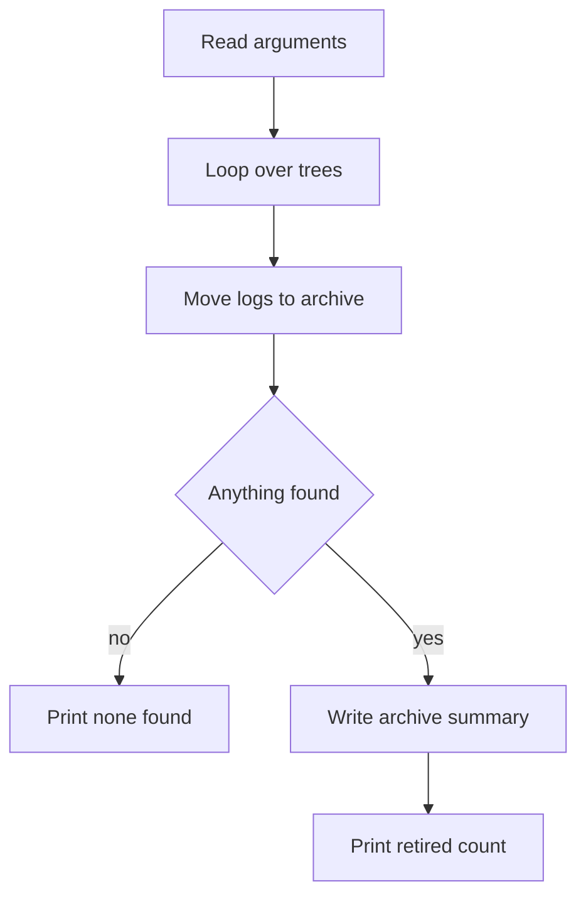

## Purpose

When a ticket is finished, its session log files are no longer needed in the working folder. This script moves them into an `archive` subfolder and writes one short summary file next to them, so the ticket folder stays readable and the outcome is still recorded.

## Dependencies

**Depends on.**
- Standard library only: `argparse`, `shutil`, `sys`, `pathlib` {src:scripts/state/retire_session_logs.py:9-12}.
- No other repo file and no environment variable. It does not use the path loader, so every folder comes from `--tree` (searched the file for `core.paths` and `environ`, 2026-11-20).

**Used by.**
- Product code: the batch session log backfill runs it as a child process, once per finished ticket {src:scripts/state/backfill_session_logs.py:132-146}. The path of the script is set at {src:scripts/state/backfill_session_logs.py:35}. Page: [[backfill_session_logs]] (no doc yet).
- Tests: `tests/scripts/state/test_state_tools.py` {src:tests/scripts/state/test_state_tools.py:133}.

## Behavior

**Arguments.** `--ticket`, `--terminal-status`, `--close-date` and `--outcome-sentence` are required; `--tree` may repeat {src:scripts/state/retire_session_logs.py:21-46}. With no `--tree` it prints an error and exits 1 {src:scripts/state/retire_session_logs.py:105-107}.

**Moving logs.** For each tree it looks for `*-session-*.md` directly in that folder (not below it) {src:scripts/state/retire_session_logs.py:14} {src:scripts/state/retire_session_logs.py:57}. A tree that does not exist counts as zero moved and zero archived, with no message {src:scripts/state/retire_session_logs.py:52-53}. Otherwise it creates `archive` and moves each file into it with `shutil.move` {src:scripts/state/retire_session_logs.py:62-67}. If a move fails it prints which file failed and the moved and unmoved counts, then re-raises {src:scripts/state/retire_session_logs.py:69-73}. `main` turns that into exit 1 without more output {src:scripts/state/retire_session_logs.py:117-118}.

**Nothing to do.** If no files moved and none were already in any `archive`, it prints "No session logs found" and exits 0 {src:scripts/state/retire_session_logs.py:120-122}.

**Summary file.** Written to `<first tree>/archive/<ticket>-archive-summary.md` {src:scripts/state/retire_session_logs.py:124}. If that file already exists, nothing is written {src:scripts/state/retire_session_logs.py:86-87}. If the outcome sentence is empty or blank, nothing is written and the script exits 1 {src:scripts/state/retire_session_logs.py:89-90} {src:scripts/state/retire_session_logs.py:134-136}. The content is a heading, the terminal status, the close date and the sentence {src:scripts/state/retire_session_logs.py:93-99}.

**Output.** It prints "Retired N session log(s)" only when something moved {src:scripts/state/retire_session_logs.py:138-139}.

## Diagram: module level (L2, required)

## Diagram: function level (L3, optional)

None: no function has branching that the signature does not show.

## Notes

**Code and description disagree.**
- The `--outcome-sentence` help says "No patient identifiers" {src:scripts/state/retire_session_logs.py:38}. Nothing checks the text; it is written as given {src:scripts/state/retire_session_logs.py:97}.
- The header says it writes "one archive summary" {src:scripts/state/retire_session_logs.py:2}. That holds: the summary goes only to the first tree's archive folder, and the `--tree` help says so {src:scripts/state/retire_session_logs.py:45} {src:scripts/state/retire_session_logs.py:124}. No other disagreement found between the header and the code.

**Inputs without a check.**
- `--ticket` is placed in the summary file name with no check on its value {src:scripts/state/retire_session_logs.py:124}. A value containing `/` or `..` would write outside the archive folder.
- `--tree` paths are used as given: every `*-session-*.md` file directly inside any folder named is moved {src:scripts/state/retire_session_logs.py:114} {src:scripts/state/retire_session_logs.py:57}.
- `--terminal-status`, `--close-date` and `--outcome-sentence` go into the summary text with no format check; a value with a newline adds lines to the file {src:scripts/state/retire_session_logs.py:93-98}.
- No input reaches a shell command or a network address (searched the file for `subprocess`, `os.system` and `socket`, 2026-11-20).

**Shared file writes.**
- Moves use `shutil.move`. If a file of the same name is already in `archive`, a move on the same disk replaces it silently on Linux and macOS, so an older archived log can be lost {src:scripts/state/retire_session_logs.py:67}. This follows how `shutil.move` and `os.rename` behave; it was not run here.
- The summary is checked with `exists` and then written with `write_text`: not atomic, and nothing stops two runs from writing together {src:scripts/state/retire_session_logs.py:86} {src:scripts/state/retire_session_logs.py:99}.
- A failure on `mkdir` for the archive folder is not caught inside `_retire_tree`; `main` catches the `OSError` and exits 1 with no message {src:scripts/state/retire_session_logs.py:62} {src:scripts/state/retire_session_logs.py:117-118}.
- A failure part way leaves some logs moved and no summary written; a rerun finishes the rest {src:scripts/state/retire_session_logs.py:70-73}.
- If the summary already exists, a later run that moves new logs does not update it {src:scripts/state/retire_session_logs.py:86-87}.

**Tests.** `test_retire_moves_logs_into_archive` makes one session log, runs the script with all arguments, and checks exit 0, that the log exists in `archive`, and that the summary file exists {src:tests/scripts/state/test_state_tools.py:128-138}. It does not check that the original was removed from the tree, or the summary text. A second test reaches it only through the batch backfill script and checks that a log landed in `archive` {src:tests/scripts/state/test_state_tools.py:150-152}. Neither covers a name clash in `archive`, a missing `--tree`, or an empty sentence.
