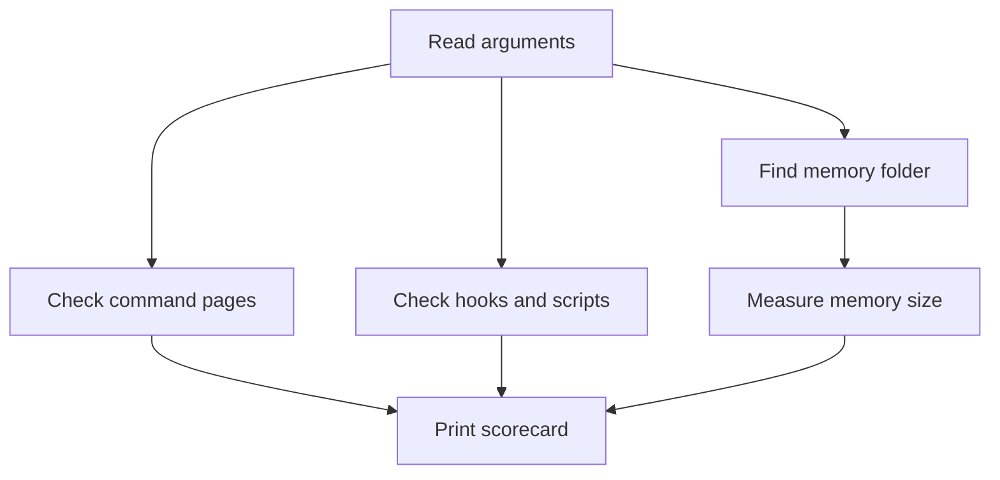

## Purpose

Prints a three part scorecard for a Tollgate install: whether the command pages are in place, whether the hooks and scripts are in place, and how large the memory folder has grown. It only reads. It exists so one command tells the owner if an install has lost something or if memory is getting too big.

## Dependencies

**Depends on.**
- `core.paths`: `get_path` and `NotSetUp`, used to find the memory folder {src:scripts/state/system_progress.py:27} {src:scripts/state/system_progress.py:176}. Page: [[paths]] and [paths](../core/paths.md).
- Standard library: `argparse`, `json`, `pathlib`, `sys`, `dataclasses` {src:scripts/state/system_progress.py:20-24}.
- Files under the install root: `commands/tg-*.md`, `docs/gate-lines.md`, `docs/variables.md`, `hooks/*.py`, `settings.json`, `scripts/core/paths.py`, `scripts/search`, `scripts/sync/sweep`, `scripts/state`, `scripts/cron` {src:scripts/state/system_progress.py:63-74} {src:scripts/state/system_progress.py:80-92}.
- The memory folder and its `MEMORY.md` index {src:scripts/state/system_progress.py:98}.

**Used by.**
- Product code: none. No file under `scripts/`, `hooks/`, `commands/` or `installer/` calls it (searched with `git grep` on the file name, excluding `docs/`, 2026-11-20).
- Tests: `tests/scripts/state/test_state_tools.py` ([[test_state_tools]], [test_state_tools](../../tests/scripts/state/test_state_tools.md)) {src:tests/scripts/state/test_state_tools.py:217} {src:tests/scripts/state/test_state_tools.py:316}.

## Behavior

**Command line.** `--root` (default two levels above the script's folder), `--memory-dir` and `--json` {src:scripts/state/system_progress.py:171-173}. The memory folder defaults to the loader's `memory` path; if the loader is not set up, it prints "not set up" and exits 2 {src:scripts/state/system_progress.py:175-179}. Passing `--memory-dir` skips the loader {src:scripts/state/system_progress.py:176}. Otherwise it prints the scorecard and exits 0, whatever the scores {src:scripts/state/system_progress.py:180-184}.

**Layer 1, rulebook.** Nine checks: six files `commands/tg-{arch,dev,qa,spec,close,handoff}.md` exist, `commands/tg-dev.md` contains both `DOCUMENTED` and `VALIDATED`, and `docs/gate-lines.md` and `docs/variables.md` exist {src:scripts/state/system_progress.py:63-74}. Target 95 {src:scripts/state/system_progress.py:29}. A file that cannot be read counts as "does not contain" {src:scripts/state/system_progress.py:47-51}.

**Layer 2, mechanisms.** Ten checks for files and folders: three named hooks, `settings.json`, whether `settings.json` contains the word `hooks`, `scripts/core/paths.py`, and the `search`, `sweep`, `state` and `cron` entries {src:scripts/state/system_progress.py:82-92}. Target 85 {src:scripts/state/system_progress.py:30}.

**Layer 3, memory bloat.** Reads the size of `MEMORY.md` and counts `.md` files by prefix `feedback_`, `project_`, `reference_` and `user_` {src:scripts/state/system_progress.py:36-37} {src:scripts/state/system_progress.py:98-106}. The score is the average of two ratios, size against a 60 KB cap and feedback file count against 150, each capped at five times, as a percent {src:scripts/state/system_progress.py:108-109} {src:scripts/state/system_progress.py:119}. Lower is better, and the target is 40 or below {src:scripts/state/system_progress.py:31} {src:scripts/state/system_progress.py:147}. A missing memory folder gives zeros {src:scripts/state/system_progress.py:100} {src:scripts/state/system_progress.py:54-58}.

**Output.** Layers 1 and 2 give the percent of passing checks {src:scripts/state/system_progress.py:129-130}. Text mode draws a 20 character bar capped at 100 percent {src:scripts/state/system_progress.py:123-126}; JSON mode prints the same numbers {src:scripts/state/system_progress.py:161-166}.

## Diagram: module level (L2, required)

## Diagram: function level (L3, optional)

None: no function has branching that the signature does not show.

## Notes

**Code and description disagree.**
- The header says layer 1 checks that the command files "carry their gates" {src:scripts/state/system_progress.py:3}. The code checks that six files exist and that only `tg-dev.md` holds two words {src:scripts/state/system_progress.py:65-72}. The other five files are not opened.
- The check looks for the commands by their installed names, `commands/tg-arch.md` and the other five {src:scripts/state/system_progress.py:65-70}. The installer ships commands as `tg-*.md` {src:install.sh:1145}, and the repo folder holds `tg-arch.md` and so on (`ls commands`, 2026-11-20). I ran the script read only against this work tree on 2026-11-20 with a scratch memory folder: layer 1 printed 100 percent with all nine checks passing, and layer 2 printed 100 percent. An earlier version looked for `arch.md` and the other plain names, so on a real install layer 1 failed seven checks; that is fixed here.
- The header says layer 2 checks that "hooks" are wired {src:scripts/state/system_progress.py:4}. The check "hooks wired in settings" only tests that the text `hooks` occurs anywhere in `settings.json` {src:scripts/state/system_progress.py:87}.
- `MEMORY_KB_TARGET` is only printed; no score uses it {src:scripts/state/system_progress.py:33} {src:scripts/state/system_progress.py:151} (searched the file, 2026-11-20).
- Memory files whose names start with other prefixes (for example `cluster_`) are not counted at all {src:scripts/state/system_progress.py:37} {src:scripts/state/system_progress.py:104-106}.

**Inputs without a check.**
- `--root` and `--memory-dir` are used as given to test for files and list a folder; no check on their value {src:scripts/state/system_progress.py:63} {src:scripts/state/system_progress.py:101}.
- `file_contains` reads whole files, but only the two named ones {src:scripts/state/system_progress.py:49} {src:scripts/state/system_progress.py:72}.
- No input reaches a shell command, a network address or outbound text beyond the printed report.

**Shared file writes.** None. The script writes nothing; it prints to standard output {src:scripts/state/system_progress.py:183}.

**Tests.** `test_system_progress_json` runs with `--json --root` on the real repo and checks only that the keys `layer_1` and `bloat_pct` exist {src:tests/scripts/state/test_state_tools.py:215-221}. It does not check the layer 1 numbers. `test_system_progress_layer_1_counts_the_real_command_files` does: it calls `layer_1_checks` on the repo root and requires the six command checks and the `DOCUMENTED and VALIDATED` check to pass {src:tests/scripts/state/test_state_tools.py:223-228}. `test_system_progress_reads_the_memory_folder_of_the_layout` writes a 2 KB `MEMORY.md` in the loader's memory folder and checks the reported size is at least 2 {src:tests/scripts/state/test_state_tools.py:311-317}. Both run against the repo root `ROOT`, computed from the test file's own location {src:tests/scripts/state/test_state_tools.py:20}, so they do not use a fixed machine path.
