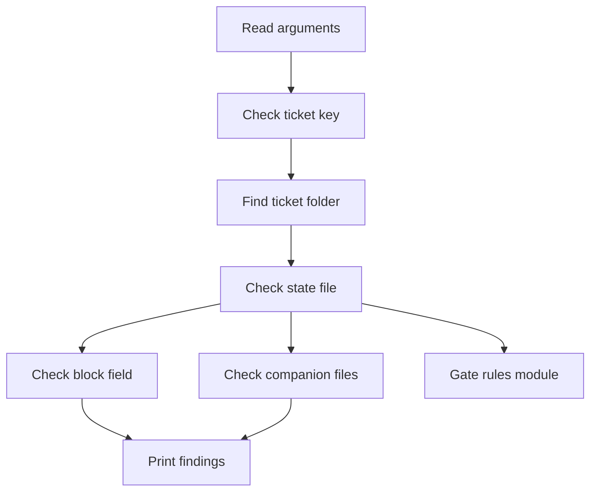
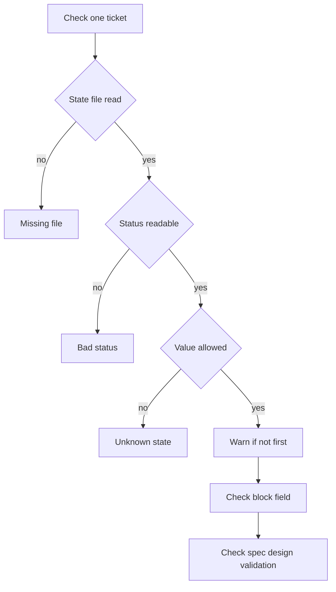

## Purpose

Checks one ticket folder before work continues on it. It reads the ticket's state file and, depending on the state, its spec, design and validation files, and reports a missing file, a bad `Status:` line, or a missing `last_block_applied` field. It shares its rules with the gate hook so the two do not drift apart. It only reads.

## Dependencies

**Depends on.**
- `core.paths`: `get_path`, `NotSetUp` and `ticket_folder` {src:scripts/state/ticket_state_check.py:28}. Page: [[paths]] and [paths](../core/paths.md).
- `gate_rules` from the `hooks` folder, added to the import path at run time {src:scripts/state/ticket_state_check.py:26} {src:scripts/state/ticket_state_check.py:29}. Page: [[gate_rules]] and [gate_rules](../../hooks/gate_rules.md). It supplies the four gate state names {src:scripts/state/ticket_state_check.py:38-41}, the approved status words {src:scripts/state/ticket_state_check.py:137-142}, and the text helpers `read_status`, `decode_text`, `split_lines`, `lines_outside_fences` {src:scripts/state/ticket_state_check.py:74} {src:scripts/state/ticket_state_check.py:90} {src:scripts/state/ticket_state_check.py:103} {src:scripts/state/ticket_state_check.py:118}.
- Standard library: `argparse`, `json`, `pathlib`, `re`, `sys`.
- Files in the ticket folder: `<KEY>-state.md`, `<KEY>-spec.md`, `<KEY>-design.md`, `<KEY>-edge-case-validation.md` {src:scripts/state/ticket_state_check.py:98} {src:scripts/state/ticket_state_check.py:113}.

**Used by.**
- Product code: the start command tells the model to run it for each flagged ticket {src:commands/tg-start.md:60}.
- Tests: `tests/scripts/state/test_state_tools.py` {src:tests/scripts/state/test_state_tools.py:27} {src:tests/scripts/state/test_state_tools.py:60} and `tests/system/test_e2e.py` {src:tests/system/test_e2e.py:153}.

## Behavior

**Command line.** `KEY`, `--tickets-dir`, `--json` {src:scripts/state/ticket_state_check.py:146-152}. A key that is not letters, a hyphen and digits prints a message and exits 2 {src:scripts/state/ticket_state_check.py:157-159}. A loader that is not set up gives "not set up" and 2 {src:scripts/state/ticket_state_check.py:160-164}. A ticket folder that cannot be found gives 2 {src:scripts/state/ticket_state_check.py:165-168}. Exit is 1 when at least one finding is an error and 0 otherwise; warnings alone do not fail {src:scripts/state/ticket_state_check.py:170} {src:scripts/state/ticket_state_check.py:180}.

**Output.** JSON mode prints `ticket`, `ok` and a list of `level`, `code`, `message` {src:scripts/state/ticket_state_check.py:171-174}. Text mode prints `<key>: ok` for no findings, else one line per finding {src:scripts/state/ticket_state_check.py:175-179}.

**State file checks.** In order: file missing is `MISSING_FILE`, and the check stops {src:scripts/state/ticket_state_check.py:115-117}. A malformed `Status:` (none, empty value, or two different values) is `BAD_STATUS` and stops {src:scripts/state/ticket_state_check.py:119-122}. A value not in the allowed list is `UNKNOWN_STATE` and stops {src:scripts/state/ticket_state_check.py:123-125}. The allowed list has 11 values, four of them taken from `gate_rules` {src:scripts/state/ticket_state_check.py:33-45}. If the first line of content (after front matter and headings) is not a `Status:` line or a `## Skill Handoff` heading, it adds the warning `STATUS_NOT_FIRST` {src:scripts/state/ticket_state_check.py:126-128}.

**Block field.** For the states from in-development onward, a `last_block_applied:` line outside code fences must exist, `MISSING_FIELD` otherwise, and its value must be `none` or `B-` and two digits, `BAD_FIELD` otherwise {src:scripts/state/ticket_state_check.py:56-58} {src:scripts/state/ticket_state_check.py:130-135}. The first matching line wins, and backticks around the value are stripped {src:scripts/state/ticket_state_check.py:91-93}.

**Companion files.** From the approved spec state onward the spec file must exist and have `Status:` equal to the gate's spec word; from the approved design state onward the design file; from the dev-finished state onward the validation file with one of the gate's two validation words {src:scripts/state/ticket_state_check.py:47-55} {src:scripts/state/ticket_state_check.py:136-142}. A missing file is `MISSING_FILE`; a malformed status is `BAD_STATUS`; a good but different value is `WRONG_STATUS` {src:scripts/state/ticket_state_check.py:100-107}.

## Diagram: module level (L2, required)

## Diagram: function level (L3, optional)

This follows `check_ticket` {src:scripts/state/ticket_state_check.py:110-143}.

## Notes

**Code and description disagree.**
- The header says it flags "a single first Status line in each file" {src:scripts/state/ticket_state_check.py:4-5}. Only the state file gets a "first line" test, and only as a warning {src:scripts/state/ticket_state_check.py:126-128}. The spec, design and validation files are checked with `read_status`, which takes a `Status:` line anywhere outside code fences {src:scripts/state/ticket_state_check.py:103} {src:scripts/state/ticket_state_check.py:97-107}.
- The header says it imports the gate rules "so the two never disagree" {src:scripts/state/ticket_state_check.py:7}. Only the four gate states and the approved words come from `gate_rules`; seven allowed states are written out in this file {src:scripts/state/ticket_state_check.py:34-37} {src:scripts/state/ticket_state_check.py:39} {src:scripts/state/ticket_state_check.py:43-44}. The comment says they match `docs/gate-lines.md` {src:scripts/state/ticket_state_check.py:31}. Compared on 2026-11-20, the names ROUTED, SUPPORT_COMPLETE, RESOLVED_TIER_1, ENHANCEMENT_PROPOSED, DESIGN_COMPLETE, QA_BLOCKED and QA_APPROVED all appear in that page {src:docs/gate-lines.md:26-36}.
- The usage text says exit 2 means "not set up or ticket folder missing" {src:scripts/state/ticket_state_check.py:17}. Exit 2 also covers a malformed key {src:scripts/state/ticket_state_check.py:157-159}.

**Inputs without a check.**
- `KEY` is checked against `^[A-Za-z]+-\d+$` before any path is built {src:scripts/state/ticket_state_check.py:59} {src:scripts/state/ticket_state_check.py:157}. `ticket_folder` checks it again and refuses a folder whose real location is outside the tickets folder {src:scripts/core/paths.py:245-249}.
- `--tickets-dir` is used as given, with no check beyond the folder lookup {src:scripts/state/ticket_state_check.py:161} {src:scripts/state/ticket_state_check.py:165}.
- File content is read and compared, never run or sent anywhere. No input reaches a shell command or network address. The finding messages contain only fixed text and the key {src:scripts/state/ticket_state_check.py:101} {src:scripts/state/ticket_state_check.py:179}.

**Shared file writes.** None. The script only reads and prints {src:scripts/state/ticket_state_check.py:64-68}.

**Other.**
- A read error of any kind (permissions, or a folder in place of a file) is reported as a missing file {src:scripts/state/ticket_state_check.py:64-68}.
- Eleven top-level constants exist; only `VALID_STATES` is read by another file (a test) {src:tests/scripts/state/test_state_tools.py:100}.
- The `ok` field in JSON ignores warnings {src:scripts/state/ticket_state_check.py:170} {src:scripts/state/ticket_state_check.py:172}.

**Tests.** Cases in `test_state_tools.py`: a full ticket in the dev-finished state returns 0 {src:tests/scripts/state/test_state_tools.py:53-62}; an in-development ticket with a status-less spec returns 1 with `MISSING_FIELD`, `BAD_STATUS` and `MISSING_FILE` {src:tests/scripts/state/test_state_tools.py:64-74}; a missing state file returns 1, a made-up state gives `UNKNOWN_STATE`, and two different statuses give `BAD_STATUS` {src:tests/scripts/state/test_state_tools.py:76-87}; a note above the `Status:` line is a warning with exit 0 {src:tests/scripts/state/test_state_tools.py:89-95}; the four gate names are in the allowed list {src:tests/scripts/state/test_state_tools.py:97-100}; no loader gives exit 2 and an unknown ticket gives exit 2 {src:tests/scripts/state/test_state_tools.py:102-110}; nested prefix folders are found, including a lowercase prefix {src:tests/scripts/state/test_state_tools.py:238-250}. The end to end test accepts either exit 0 or 1 and only rules out a traceback, so it proves little about the result {src:tests/system/test_e2e.py:154-156}. None of these depend on a machine path; they run in a throwaway home.
