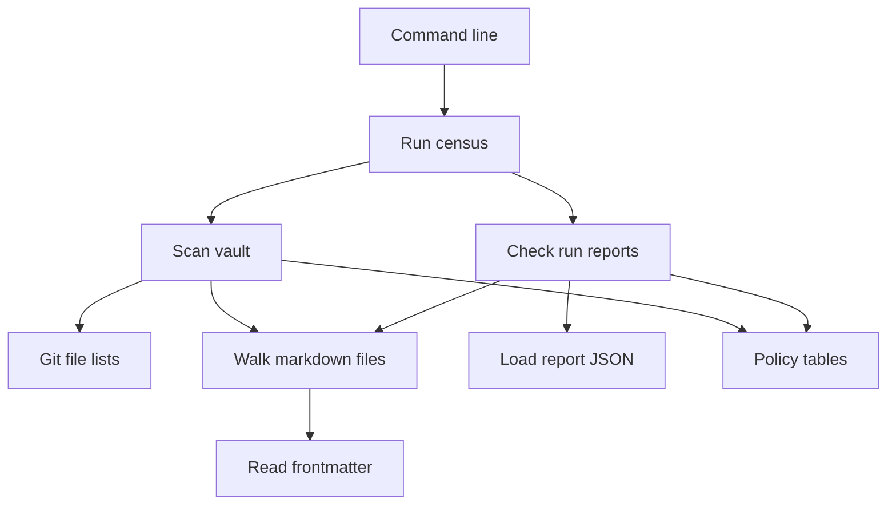

## Purpose

A read-only census of a vault of markdown notes. It counts how many notes carry the four retrieval fields in their frontmatter, and it can check the report of an earlier backfill run against its own copy of the folder rules. The module exists so that the count is made by code that is independent of the backfill tool that writes the fields. Constants in this file: 114 top-level ALL_CAPS names, of which only `KIND_ROWS` and `RUN4_EXCLUDED_PATH_PREFIXES` are read by another file (the tests); the other 112 are internal.

## Dependencies

**Depends on.**
- Standard library: `argparse`, `json`, `logging`, `os`, `re`, `subprocess`, `sys`, `dataclasses`, `pathlib`, `typing` {src:scripts/state/vault_census.py:25-34}.
- Outside package: `yaml` (PyYAML) {src:scripts/state/vault_census.py:36}.
- Repo module `core.paths`, imported after the `scripts/` folder is put first on `sys.path` {src:scripts/state/vault_census.py:41} {src:scripts/state/vault_census.py:42}. Page: [[paths]] and [paths](../core/paths.md). It supplies `folder_name`, `ticket_prefix_depth` and `subdir_prefixes` {src:scripts/core/paths.py:185} {src:scripts/core/paths.py:221} {src:scripts/core/paths.py:294}.
- The `git` program, called with fixed argument lists {src:scripts/state/vault_census.py:124-130}.
- Environment: the whole environment is copied and `GIT_OPTIONAL_LOCKS` is set to `0` {src:scripts/state/vault_census.py:513-514}.

**Used by.**
- Product code: no script under `scripts/` imports or runs it. Searched 2026-11-20 with `git grep vault_census` and `git grep census` outside `tests/` and `docs/`: the only hit besides the file itself is the install note in `scripts/README.md`, which lists it among the scripts that need `pyyaml` {src:scripts/README.md:27}.
- Tests: `tests/scripts/state/test_vault_census.py` {src:tests/scripts/state/test_vault_census.py:34}, `tests/scripts/state/test_backfill_nonticket_policy.py` {src:tests/scripts/state/test_backfill_nonticket_policy.py:34}, `tests/scripts/state/test_state_tools.py` {src:tests/scripts/state/test_state_tools.py:29}. A bridge file lists `test_vault_census` by name {src:tests/scripts/state/test_pytest_bridge.py:17}.

## Behavior

**Command line.** `--vault-root` is required; `--check-writes REPORT...` is optional and switches from scanning to checking reports {src:scripts/state/vault_census.py:797-803}. `allow_abbrev` is off {src:scripts/state/vault_census.py:795}. `main` stops with code 2 when the vault root is not a folder {src:scripts/state/vault_census.py:816-817}, and also when any fatal precondition fails, logging one closed code and printing no result {src:scripts/state/vault_census.py:822-824}. On success it prints sorted, indented JSON to stdout and returns 0 {src:scripts/state/vault_census.py:825-826}. Logs go to stderr {src:scripts/state/vault_census.py:813}.

**Walking the vault.** `iter_vault_files` walks with `followlinks=False` and yields only names ending in `.md` {src:scripts/state/vault_census.py:497} {src:scripts/state/vault_census.py:503-504}. `kept_dirs` skips hidden folders at the vault root only, and skips any folder whose path starts with an excluded prefix {src:scripts/state/vault_census.py:484-487}. The only excluded prefix is the memory folder {src:scripts/state/vault_census.py:77-78}.

**Reading one file.** `read_facts` counts a symlink as `symlinks` without reading it {src:scripts/state/vault_census.py:449-450}, counts a read error as `unreadable` {src:scripts/state/vault_census.py:452-454}, otherwise classifies the bytes. A block exists only when line one is `---` (LF or CRLF, no BOM) and a later line is exactly `---`; an opening with no closing line is no block {src:scripts/state/vault_census.py:402-414}. The block is read with `yaml.safe_load`; any exception means unparseable, and only the exception class name is logged {src:scripts/state/vault_census.py:424-427}. An empty block is an empty mapping; a non-mapping is unparseable {src:scripts/state/vault_census.py:428-430}. The kind is `with_all_four` when all four fields (`catalog_type`, `doc_role`, `indexable`, `indexed`) are present, `with_none` when none is, else `with_some` {src:scripts/state/vault_census.py:441-444}.

**Ticket rule table.** `KIND_ROWS` holds rows K1 to K13, first match wins {src:scripts/state/vault_census.py:250-282}. `split_ticket_path` returns nothing for a path outside the tickets folder or fewer than three parts {src:scripts/state/vault_census.py:320-321}. It skips one prefix folder level (`tickets/PROJ/PROJ-312/...`) using `ticket_prefix_depth` {src:scripts/state/vault_census.py:325-326}, lowercases the parts, and removes a leading `<folder>-` from the file name before matching {src:scripts/state/vault_census.py:327-329}. The archive row matches any middle folder named `archive` or `history` {src:scripts/state/vault_census.py:347-348}. The state row needs depth 3 and the name `<folder>-state.md` {src:scripts/state/vault_census.py:349-350}. For an archive file the role comes from the first of K3 to K13 that fits, and any name ending `-state.md` is a state file there {src:scripts/state/vault_census.py:361-366}. `expected_triple` returns (catalog_type, doc_role, indexable) from the first matching row, or nothing when no row fits (row K14) {src:scripts/state/vault_census.py:388-393}. A terminal status (`cancelled`, `superseded`, `dropped`, `archived`, `absorbed`, trimmed, any case) forces indexable false {src:scripts/state/vault_census.py:62-64} {src:scripts/state/vault_census.py:376} {src:scripts/state/vault_census.py:391}.

**Folder rule table.** `FOLDER_ROWS` has rows N1 to N6 and N10, built from the layout table in `core.paths` {src:scripts/state/vault_census.py:297-308}. Import fails with `ValueError` if two row ids repeat {src:scripts/state/vault_census.py:313-314}. `folder_triple` answers only for paths under the scope A prefixes and ignores `doc_type` {src:scripts/state/vault_census.py:464-469}.

**Scan.** `scan_vault` first takes a git snapshot {src:scripts/state/vault_census.py:629}: tracked paths from `git ls-files -z` and differing paths from `git diff ... HEAD`, run in the vault folder with a 30 second limit; a timeout, a missing git or a non-zero exit becomes a closed-code `PreconditionError` {src:scripts/state/vault_census.py:516-530}. A file counts as "in scope and missing" when it is not all-four, is readable, is tracked, matches HEAD, and has a ticket row {src:scripts/state/vault_census.py:546-550} {src:scripts/state/vault_census.py:634}. Counts are kept for the whole vault and per top-level folder {src:scripts/state/vault_census.py:635-637}. Field values are reported only as short plain words (`[A-Za-z0-9_.-]{1,64}`); anything else prints as `<unsafe>`, `<non-string>` or `<non-bool>` {src:scripts/state/vault_census.py:98-100} {src:scripts/state/vault_census.py:567-569} {src:scripts/state/vault_census.py:574-578}. Tickets with `catalog_type` equal to `unknown` and terminal-status files with `indexable` true are counted {src:scripts/state/vault_census.py:601-605}.

**Checking reports.** `check_writes` loads every report before reading any vault file, so a bad report ends the check with no result {src:scripts/state/vault_census.py:761-765}. A report must be a JSON object whose `writes` is a list {src:scripts/state/vault_census.py:663-666}. Entries of class `flip` are counted and skipped {src:scripts/state/vault_census.py:771-773}; all others are judged. A report is a Run 4 report only when `run` is exactly the integer 4 (a boolean does not count) {src:scripts/state/vault_census.py:676-677}. `judge_entry` returns `MALFORMED_ENTRY` unless the class is add, create or rewrite {src:scripts/state/vault_census.py:730-731}, and `PATH_UNSAFE` unless the path passes `usable_rel_path` {src:scripts/state/vault_census.py:732-733}. That check refuses non-strings, empty strings, backslashes, NUL bytes, absolute paths and any `..` part {src:scripts/state/vault_census.py:682-686}. `entry_mismatch` then re-reads the file and returns one closed code: no row, a missing field, `indexed` not null, or a triple that differs by type or value {src:scripts/state/vault_census.py:703-714} {src:scripts/state/vault_census.py:692-695}. When any report is a Run 4 report, the result also holds `scope_a_missing_fields` {src:scripts/state/vault_census.py:782-783}. That count walks the vault again, counts scope A notes that are not all-four, and skips unparseable, symlinked and unreadable files; it does not read git state {src:scripts/state/vault_census.py:745-752}.

## Diagram: module level (L2, required)

## Diagram: function level (L3, optional)

None: no function has branching that the signature does not show. The longest chain, `entry_mismatch`, is a short list of early returns that the Behavior section already gives in order {src:scripts/state/vault_census.py:703-714}.

## Notes

**Code and description disagree.**
- The docstring of `count_scope_a_missing` says the walk skips "hidden folders, memory, and sql" {src:scripts/state/vault_census.py:740}. The walk uses `RUN4_EXCLUDED_PATH_PREFIXES` {src:scripts/state/vault_census.py:745}, which is only an alias {src:scripts/state/vault_census.py:146} of `EXCLUDED_PATH_PREFIXES`, where the value is defined as the memory prefix alone {src:scripts/state/vault_census.py:78}. Nothing in the file mentions `sql` other than that docstring line (searched 2026-11-20). Hidden folders are skipped only at the vault root {src:scripts/state/vault_census.py:484}.
- The comment above the memory constant says "Nothing else is skipped by name" {src:scripts/state/vault_census.py:76}. Root-level hidden folders are also skipped by name {src:scripts/state/vault_census.py:484-485}.
- The header says the census "prints counts, paths, and closed codes only" {src:scripts/state/vault_census.py:11-12}. That holds, and the paths are the `mismatch_paths` list {src:scripts/state/vault_census.py:779-780}. A path is printed only if it passed `usable_rel_path` {src:scripts/state/vault_census.py:732-734}.
- The header `Date:` line is empty {src:scripts/state/vault_census.py:16}. The header says the module "never imports the backfill tool" {src:scripts/state/vault_census.py:11}; no import of it exists in the import block {src:scripts/state/vault_census.py:25-42}.

**Inputs that reach a path, command or network address with no value check.**
- `--vault-root` is used as the walk root and as the working folder of the `git` calls; only "is a folder" is checked {src:scripts/state/vault_census.py:816-817} {src:scripts/state/vault_census.py:518}. No network address or outbound text is built from input.
- Each `--check-writes` report path is read with no limit on size or location {src:scripts/state/vault_census.py:649-656}.
- A report entry path passes `usable_rel_path`, but a symlinked parent folder inside the vault is not checked. `read_facts` tests only the final path with `islink` {src:scripts/state/vault_census.py:682-686} {src:scripts/state/vault_census.py:449}, so a symlinked folder could lead the read outside the vault. The file read is read-only and its content is never printed, only a closed code.
- Because the whole environment is passed to `git` {src:scripts/state/vault_census.py:513}, a `GIT_DIR` style variable in the caller's environment would change which repository is listed. No check exists.

**Writes to shared files.** None. The only output is stdout and stderr {src:scripts/state/vault_census.py:813} {src:scripts/state/vault_census.py:825}. Git runs with optional locks off so it does not refresh the index file {src:scripts/state/vault_census.py:513-514}.

**Other.** The vault walk and the git snapshot are taken at different moments, so a file edited between them can be counted from mixed state; no lock prevents it. An uncaught error (for example PyYAML missing) gives a Python traceback and exit code 1, not 2; `argparse` errors exit 2 as well.
