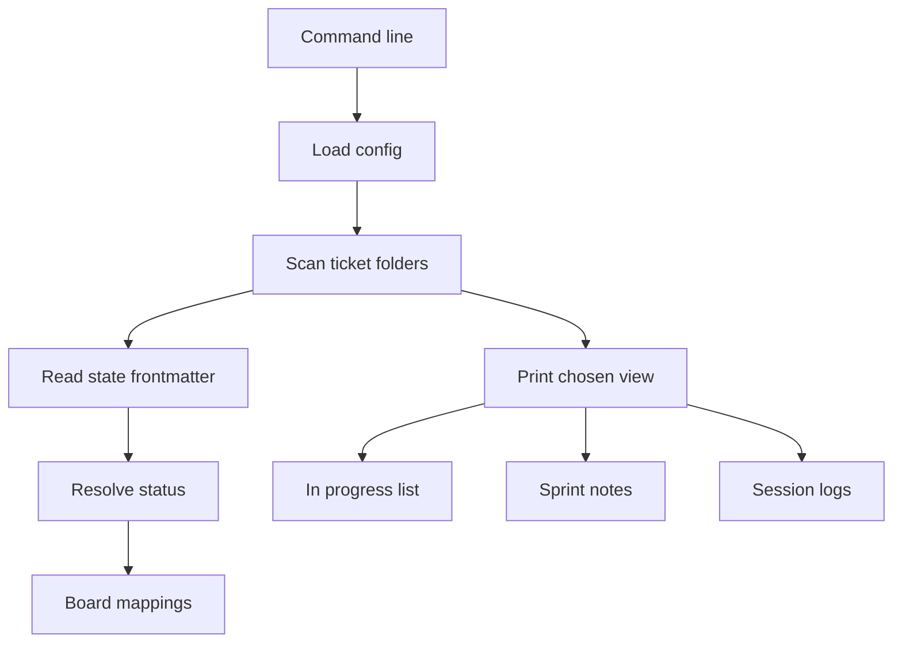
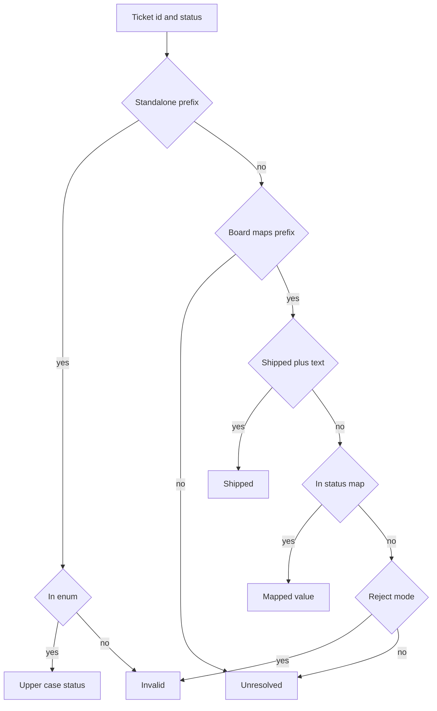

## Purpose

A command line tool that reads the ticket state files of a vault and prints a board of tickets by status, a sprint view, a list of active work, a list of blocked tickets, or the state and latest session log of one ticket. It exists so ticket status can be read quickly from the files, without opening Jira or Plane. The file holds 12 top-level ALL_CAPS constants; no other file imports any of them (searched 2026-11-20), so none are listed under exports.

## Dependencies

**Depends on.**
- Standard library: `pathlib`, `re`, `os`, `sys`, `argparse`, `datetime`, `typing` {src:scripts/state/vault_query.py:9-15}. `os` and `datetime` are imported but no line of the file uses them (searched 2026-11-20 for `os.` and `datetime.`).
- Repo module `core.paths`, imported after `scripts/` is put first on `sys.path` {src:scripts/state/vault_query.py:17} {src:scripts/state/vault_query.py:18}. Page: [[paths]] and [paths](../core/paths.md). It supplies `get_path`, `NotSetUp`, `ticket_folder` and `iter_ticket_folders` {src:scripts/core/paths.py:119} {src:scripts/core/paths.py:20} {src:scripts/core/paths.py:237} {src:scripts/core/paths.py:265}.
- Files read at run time: `vault-config.yaml` and the `board-mappings/*.yaml` files in the tickets folder, `<ticket>/<KEY>-state.md`, `sprints/*.md`, `<vault root>/tickets-in-progress.md`, and the session logs of one ticket {src:scripts/state/vault_query.py:36} {src:scripts/state/vault_query.py:37} {src:scripts/state/vault_query.py:237} {src:scripts/state/vault_query.py:328} {src:scripts/state/vault_query.py:280} {src:scripts/state/vault_query.py:405}.

**Used by.**
- Product code: none. Searched 2026-11-20 with `git grep vault_query` outside `docs/`: the only non-test hits are the file's own header lines and its argparse description {src:scripts/state/vault_query.py:440}. It is a command line tool run by hand.
- Tests: `tests/scripts/state/test_state_tools.py` runs it as a subprocess with the `board` and `ticket` commands {src:tests/scripts/state/test_state_tools.py:118} {src:tests/scripts/state/test_state_tools.py:258}.

## Behavior

**Command line.** The commands are `board`, `sprint`, `wip`, `blocked` and `ticket KEY` {src:scripts/state/vault_query.py:445-450}. `--tickets-dir` overrides the tickets folder; otherwise `get_path("tickets")` is used {src:scripts/state/vault_query.py:441} {src:scripts/state/vault_query.py:456}. `--vault-root` defaults to the parent of the tickets folder {src:scripts/state/vault_query.py:460}. With no command the help text is printed and the exit code is 0 {src:scripts/state/vault_query.py:482-483}. Exit code 2 means the paths are not set up {src:scripts/state/vault_query.py:457-459}; exit code 1 means the tickets folder does not exist {src:scripts/state/vault_query.py:461-463}. Every other outcome, including every "ERROR:" line a command prints, exits 0 {src:scripts/state/vault_query.py:330-331} {src:scripts/state/vault_query.py:423-424}.

**Reading frontmatter.** The file does not use a YAML library. `parse_frontmatter` takes the lines between the first two lines that equal `---` after trimming, anywhere in the file; with fewer than two such lines it returns an empty mapping {src:scripts/state/vault_query.py:109-113}. `_parse_yaml_lines` skips blank lines, comment lines and indented lines at top level {src:scripts/state/vault_query.py:86-91}, raises `ValueError` for a top-level line with no colon {src:scripts/state/vault_query.py:92-93}, stores `key: value` as a string with surrounding quotes removed {src:scripts/state/vault_query.py:97-98}, and for an empty value reads the indented lines below it as either a list (first line starts `- `) or a one-level mapping {src:scripts/state/vault_query.py:100-103} {src:scripts/state/vault_query.py:65-77}. An empty value with nothing indented below becomes an empty string {src:scripts/state/vault_query.py:62-63}.

**Config and mappings.** A missing `vault-config.yaml` is a warning on stderr, and the run goes on with no config {src:scripts/state/vault_query.py:124-128} {src:scripts/state/vault_query.py:465-466}. A malformed one gives the same result with a different message {src:scripts/state/vault_query.py:131-133}. Standalone prefixes are `T` plus the config's `local_prefix` when set {src:scripts/state/vault_query.py:38} {src:scripts/state/vault_query.py:467-470}. A board mapping file that fails to parse is skipped without any message {src:scripts/state/vault_query.py:142-147}.

**Resolving a status.** The prefix is the part of the ticket id before the first hyphen {src:scripts/state/vault_query.py:193}. For a standalone prefix the status is upper-cased and must be one of the 12 internal values listed in the file, else it becomes invalid {src:scripts/state/vault_query.py:21-25} {src:scripts/state/vault_query.py:152-157}. For another prefix the first board mapping that lists the prefix in `prefix_patterns` is used {src:scripts/state/vault_query.py:196-199}: a raw status whose first word is the shipped value followed by more text becomes the shipped status {src:scripts/state/vault_query.py:166-171}; a status found in `status_map` is translated {src:scripts/state/vault_query.py:174-175}; an unmapped one becomes invalid when `on_absent` is `reject`, else unresolved {src:scripts/state/vault_query.py:176-184}. A prefix with no mapping becomes unresolved {src:scripts/state/vault_query.py:200-203}. The ticket id comes from the `ticket_id` field when present, else from the folder name {src:scripts/state/vault_query.py:249}.

**Rules between status and terminal_status.** `validate_invariants` makes a message when a terminal-status ticket (shipped, superseded or cancelled) has an empty `terminal_status` field, when a non-terminal ticket has one, or when the first word of `terminal_status` differs from the status {src:scripts/state/vault_query.py:26} {src:scripts/state/vault_query.py:213-227}. It compares the raw `status` text, not the resolved one {src:scripts/state/vault_query.py:208}.

**Scan.** `scan_tickets` visits each folder from `iter_ticket_folders`; a folder with no `<folder>-state.md` is recorded as an `absent` error, and one whose frontmatter raises `ValueError` as `malformed` {src:scripts/state/vault_query.py:270-275} {src:scripts/state/vault_query.py:237-248}.

**Commands.**
- `board` prints one block per status in a fixed order, then a drift block, then an errors block {src:scripts/state/vault_query.py:307-320}. Drift means a ticket with the shipped status whose id appears in `tickets-in-progress.md` {src:scripts/state/vault_query.py:290-294}. Ids are found in that file with a regular expression over the whole text {src:scripts/state/vault_query.py:284}.
- `sprint` reads each `sprints/*.md` and prints its dates and each listed ticket with its status, or `UNKNOWN` {src:scripts/state/vault_query.py:332} {src:scripts/state/vault_query.py:344-347}. A sprint file missing `sprint_id`, `start_date`, `end_date` or `tickets` gets an error line and is skipped {src:scripts/state/vault_query.py:340-343}.
- `wip` lists tickets in the seven active statuses (open, spec-approved, design-complete, dev-complete, support-complete, qa-blocked, qa-approved), grouped by `type` {src:scripts/state/vault_query.py:27-30} {src:scripts/state/vault_query.py:356} {src:scripts/state/vault_query.py:362}.
- `blocked` lists a ticket as blocked when a `depends_on` id exists and its status is not terminal; ids with no state file go under a dependency-unknown block {src:scripts/state/vault_query.py:380-393}.
- `ticket KEY` finds the folder with `ticket_folder`, prints every frontmatter field, then prints the whole newest session log by date in its file name, or "no session log found" {src:scripts/state/vault_query.py:421} {src:scripts/state/vault_query.py:429-436} {src:scripts/state/vault_query.py:403-412}. The newest-log pattern is `*-session-YYYY-MM-DD.md` {src:scripts/state/vault_query.py:405}.

## Diagram: module level (L2, required)

## Diagram: function level (L3, optional)

Source of the branches: {src:scripts/state/vault_query.py:151-203}.

## Notes

**Code and description disagree.** None found in the header or comments: the header says the tool is read only {src:scripts/state/vault_query.py:6} and no line of the file writes or opens a file for writing (searched 2026-11-20 for `.write`, `open(`). The header's `Date:` line is empty {src:scripts/state/vault_query.py:5}. The description says it "reads the tickets folder" {src:scripts/state/vault_query.py:3}; it also reads `tickets-in-progress.md` in the vault root {src:scripts/state/vault_query.py:280}.

**Behaviors a reader might not expect.**
- Each ticket gets an `errors` list (resolve messages and rule violations) {src:scripts/state/vault_query.py:259}, but no command prints it. Searched 2026-11-20: the key `errors` of a ticket is read nowhere. So the rule-violation messages never reach the screen.
- `board` only prints tickets whose resolved status is one of the 12 listed; a ticket resolved to invalid or unresolved appears nowhere in the board {src:scripts/state/vault_query.py:307-310}.
- The rule check uses the raw status text {src:scripts/state/vault_query.py:208} while the board uses the upper-cased one {src:scripts/state/vault_query.py:152}, so a lower-case shipped value shows as shipped on the board yet is not treated as terminal by the rule check.
- Frontmatter delimiters are the first two `---` lines anywhere, not line one {src:scripts/state/vault_query.py:109-112}. A top-level value with a trailing comment keeps the comment {src:scripts/state/vault_query.py:94-98}. An inline list such as `[a, b]` is read as one string {src:scripts/state/vault_query.py:98}; for `depends_on` that string becomes one unknown dependency {src:scripts/state/vault_query.py:383-384}, and for a sprint `tickets` field the string is looped over character by character {src:scripts/state/vault_query.py:346}.
- `prefix in patterns` {src:scripts/state/vault_query.py:198} is a substring test when `prefix_patterns` was written as a plain string.
- `sprint` and `ticket` call `parse_frontmatter` without catching `ValueError`, so a bad file ends the run with a traceback and exit code 1 {src:scripts/state/vault_query.py:339} {src:scripts/state/vault_query.py:429}.
- Two dated session logs with the same date: the file order from `glob` decides, and it is not sorted {src:scripts/state/vault_query.py:405} {src:scripts/state/vault_query.py:411-412}.
- `cmd_ticket` takes the prefix and mapping arguments but never uses them {src:scripts/state/vault_query.py:415-420}.

**Inputs that reach a file path, command or address with no check on value.**
- `--tickets-dir` and `--vault-root` become folders that are read; only existence of the tickets folder is checked {src:scripts/state/vault_query.py:441} {src:scripts/state/vault_query.py:443} {src:scripts/state/vault_query.py:461}.
- The ticket key of `ticket KEY` is checked: `ticket_folder` refuses anything that is not letters, a hyphen and digits, and refuses folders whose real location is outside the tickets folder {src:scripts/core/paths.py:245-246} {src:scripts/core/paths.py:249}. The state file path is then built from the same key {src:scripts/state/vault_query.py:425}.
- File text (state fields, sprint fields, session logs) is printed to the terminal without cleaning {src:scripts/state/vault_query.py:431} {src:scripts/state/vault_query.py:436}. No input reaches a shell command or a network address; the file runs no subprocess and opens no connection (searched 2026-11-20 for `subprocess`, `socket`, `urllib`, `requests`).

**Writes to shared files.** None. All output goes to standard output and standard error.
