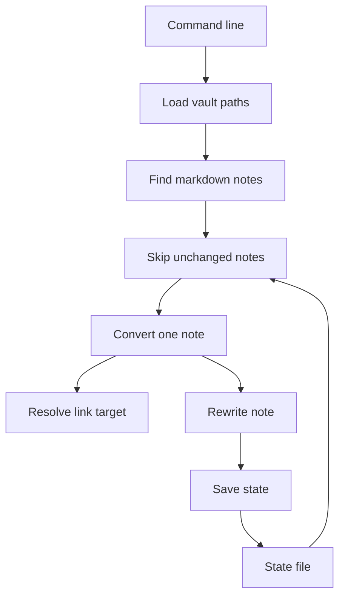
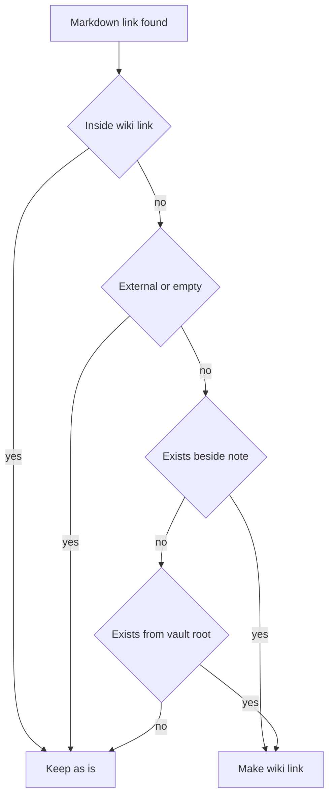

## Purpose

A tidy-up script for a vault of markdown notes. It finds ordinary markdown links such as `[text](folder/note.md)` that point at another file inside the vault and rewrites them as Obsidian wiki links such as `[[note|text]]`. It keeps a small state file of file modification times so later runs only look at notes that changed.

## Dependencies

**Depends on.**
- Standard library: `os`, `re`, `sys`, `time`, `argparse`, `pathlib` {src:scripts/sync/lint_wikilinks.py:24-29}. `from __future__ import annotations` is also present {src:scripts/sync/lint_wikilinks.py:22}.
- Repo module `core.paths`: `get_path` and `NotSetUp` {src:scripts/sync/lint_wikilinks.py:31} {src:scripts/sync/lint_wikilinks.py:32}. Page: [[paths]] and [paths](../core/paths.md).
- Repo module `vault_write_scan` from the same folder, for `load_json_state` and `write_json_atomic` {src:scripts/sync/lint_wikilinks.py:34} {src:scripts/sync/lint_wikilinks.py:35} {src:scripts/sync/lint_wikilinks.py:202} {src:scripts/sync/lint_wikilinks.py:206}. Page: [[vault_write_scan]] and [vault_write_scan](vault_write_scan.md).
- Paths from the loader: `vault` and `state` {src:scripts/sync/lint_wikilinks.py:49} {src:scripts/sync/lint_wikilinks.py:50}. State file name `lint_wikilinks_state.json` {src:scripts/sync/lint_wikilinks.py:41}.

**Used by.**
- Product code: the `lint` step of `scripts/core/run.sh` {src:scripts/core/run.sh:48}, the `do_lint` step of `scripts/cron/launchers/run_task.sh` {src:scripts/cron/launchers/run_task.sh:29}, and the nightly index script, which runs it as a step {src:scripts/cron/nightly_index.sh:131}.
- Tests: `tests/scripts/sync/test_sync_tools.py` runs it with and without `--dry-run` {src:tests/scripts/sync/test_sync_tools.py:226} {src:tests/scripts/sync/test_sync_tools.py:229}; `tests/scripts/cron/test_cron_tools.py` only checks the step name in the nightly step list and its recorded result {src:tests/scripts/cron/test_cron_tools.py:252} {src:tests/scripts/cron/test_cron_tools.py:266}.

## Behavior

**Command line.** Flags: `--dry-run`, `--full` and a repeatable `--skip-dir` {src:scripts/sync/lint_wikilinks.py:213-215}. If the path loader is not set up, it prints "not set up" to stderr and exits 2 {src:scripts/sync/lint_wikilinks.py:217-221}. Each `--skip-dir` name is added to the built-in skip set {src:scripts/sync/lint_wikilinks.py:222} {src:scripts/sync/lint_wikilinks.py:43}. Every other outcome exits 0, including a run where some files raised errors {src:scripts/sync/lint_wikilinks.py:252-257} {src:scripts/sync/lint_wikilinks.py:278}.

**Finding files.** `find_vault_files` walks the vault, drops any folder whose name is in the skip set (at any depth), and keeps names that end in `.md` and do not start with a dot {src:scripts/sync/lint_wikilinks.py:191-195}. `os.walk` is used with its default, so folder symlinks are not followed.

**Skipping unchanged files.** The state file maps a vault-relative path to the modification time as text. A file is skipped when not in `--full` and not in `--dry-run` mode and its time equals the stored one {src:scripts/sync/lint_wikilinks.py:245-250}. After a real run the time is read again, so the file's own rewrite is recorded {src:scripts/sync/lint_wikilinks.py:265-267}. `--full` starts from an empty state {src:scripts/sync/lint_wikilinks.py:224}. The state is saved at the end of a real run, never in a dry run {src:scripts/sync/lint_wikilinks.py:269-270}. A missing or unreadable state file gives an empty state and a warning on stderr {src:scripts/sync/vault_write_scan.py:85-94}.

**Converting one line.** `convert_line` first marks every character inside `[[...]]` as protected {src:scripts/sync/lint_wikilinks.py:128-131}. For each `[text](target)` match, not preceded by `!` {src:scripts/sync/lint_wikilinks.py:57}, it leaves the match alone if it overlaps a protected span {src:scripts/sync/lint_wikilinks.py:138-141}, or if the target does not resolve {src:scripts/sync/lint_wikilinks.py:148-152}. Otherwise it swaps in the wiki link and counts one change {src:scripts/sync/lint_wikilinks.py:154-158}.

**Resolving a target.** `resolve_target` splits off a `#anchor` {src:scripts/sync/lint_wikilinks.py:72-75}, returns nothing for an empty target {src:scripts/sync/lint_wikilinks.py:77-78}, and for targets starting `http://`, `https://`, `mailto:` or `ftp://` {src:scripts/sync/lint_wikilinks.py:81-82}. Otherwise it tries the target relative to the note's own folder, then relative to the vault root {src:scripts/sync/lint_wikilinks.py:85-89} {src:scripts/sync/lint_wikilinks.py:94-98}. Each candidate is fully resolved (symlinks followed) and must sit inside the vault and exist {src:scripts/sync/lint_wikilinks.py:87-89} {src:scripts/sync/lint_wikilinks.py:96-98}.

**Building the wiki link.** Only the file stem is used, with the anchor appended after `#` {src:scripts/sync/lint_wikilinks.py:110-111}. If the link text equals the stem ignoring case and outer spaces, the alias is dropped {src:scripts/sync/lint_wikilinks.py:114-115}; otherwise the text becomes the alias {src:scripts/sync/lint_wikilinks.py:117}.

**Writing.** `convert_file` reads the file as UTF-8 with `errors="ignore"` {src:scripts/sync/lint_wikilinks.py:171}, converts each line, and writes the whole file back only when at least one link changed and it is not a dry run {src:scripts/sync/lint_wikilinks.py:182-183}. Errors raised while converting one file are printed and counted, and the run goes on {src:scripts/sync/lint_wikilinks.py:254-257}.

**Duplicate stems.** Before converting, the script prints a warning for every stem used by more than one file in the vault {src:scripts/sync/lint_wikilinks.py:229-236}. It still converts links to those stems.

**Summary.** The run ends by printing the time taken and the counts of files changed, links converted, files skipped and errors {src:scripts/sync/lint_wikilinks.py:272-278}.

## Diagram: module level (L2, required)

## Diagram: function level (L3, optional)

Source of the branches: {src:scripts/sync/lint_wikilinks.py:136-158} {src:scripts/sync/lint_wikilinks.py:64-102}.

## Notes

**Code and description disagree.**
- The header says it converts links "pointing to vault files" and shows `.md` examples {src:scripts/sync/lint_wikilinks.py:5} {src:scripts/sync/lint_wikilinks.py:16-18}. The code accepts any existing file or folder inside the vault, not only `.md`: it checks `exists()` and nothing about the extension {src:scripts/sync/lint_wikilinks.py:88}. A link to `report.pdf` or to a folder becomes a wiki link to the bare stem, which drops the extension {src:scripts/sync/lint_wikilinks.py:110}.
- The header lists skipped links as "http/https URLs, anchor-only links (#), already-wiki links" {src:scripts/sync/lint_wikilinks.py:19}. The code also skips `mailto:` and `ftp://` {src:scripts/sync/lint_wikilinks.py:81}. It does not skip links inside code blocks or inline code, and it does not treat frontmatter differently; any matching text in any line is changed {src:scripts/sync/lint_wikilinks.py:177-180}.
- The header says state load and save are "atomic write, corrupt file safe" {src:scripts/sync/lint_wikilinks.py:9}. That is true of the state file {src:scripts/sync/vault_write_scan.py:87-95} {src:scripts/sync/vault_write_scan.py:101-105}, but not of the notes themselves (see below).
- The header `Date:` line is empty {src:scripts/sync/lint_wikilinks.py:4}.
- The comment on duplicate stems says Obsidian "picks first alphabetical match" {src:scripts/sync/lint_wikilinks.py:228}. That is a claim about Obsidian, not about this code; it was not checked {unverified}.

**Risks in rewriting notes.**
- The note is read with `errors="ignore"`, then written back {src:scripts/sync/lint_wikilinks.py:171} {src:scripts/sync/lint_wikilinks.py:183}. Any byte that is not valid UTF-8 is dropped from the file on the rewrite, with no message.
- `read_text` converts `\r\n` to `\n` when reading and `write_text` does not convert back on macOS, so a note with Windows line endings changes to Unix line endings when one of its links is converted {src:scripts/sync/lint_wikilinks.py:171} {src:scripts/sync/lint_wikilinks.py:183}.
- A `.md` file that is a symlink is read and written through the link, so its target outside the vault could be rewritten. The inside-the-vault check applies to link targets, not to the files scanned {src:scripts/sync/lint_wikilinks.py:87} {src:scripts/sync/lint_wikilinks.py:191-195}.
- Link text containing `|` is copied into the alias unchanged, and an empty link text gives an alias that is empty {src:scripts/sync/lint_wikilinks.py:114-117}. Targets with percent-encoded spaces are not decoded, so they do not resolve and stay as they are {src:scripts/sync/lint_wikilinks.py:85}.
- `path.stat()` is called outside the `try` block, so a file that disappears during the walk ends the run with a traceback {src:scripts/sync/lint_wikilinks.py:246} {src:scripts/sync/lint_wikilinks.py:267}.
- State entries for deleted or renamed notes are never removed; the state file only grows {src:scripts/sync/lint_wikilinks.py:224} {src:scripts/sync/lint_wikilinks.py:267}.

**Inputs that reach a file path, command or address with no check on value.**
- Link targets come from note text and are joined onto the note's folder and the vault root {src:scripts/sync/lint_wikilinks.py:85} {src:scripts/sync/lint_wikilinks.py:94}. They are checked after resolving: a result outside the vault is refused {src:scripts/sync/lint_wikilinks.py:87} {src:scripts/sync/lint_wikilinks.py:96}. The only effect on a target is an existence test; it is never opened.
- `--skip-dir` names are compared with folder names only and never used as a path {src:scripts/sync/lint_wikilinks.py:192}. The vault and state folders come from the path loader, with no check beyond what the loader does {src:scripts/sync/lint_wikilinks.py:49} {src:scripts/sync/lint_wikilinks.py:50}. No input reaches a shell command or a network address: the file imports no subprocess or network module {src:scripts/sync/lint_wikilinks.py:24-35}.
- Note and file names are printed to standard output in the progress lines {src:scripts/sync/lint_wikilinks.py:234} {src:scripts/sync/lint_wikilinks.py:261}.

**Writes to shared files.**
- Each changed note is overwritten in place with `write_text`, which is not atomic: a crash part-way can leave a short file {src:scripts/sync/lint_wikilinks.py:183}. Nothing stops an editor, or another run of this script, from writing the same note between the read and the write; the later writer wins {src:scripts/sync/lint_wikilinks.py:171} {src:scripts/sync/lint_wikilinks.py:183}. The nightly script and the cron launcher both run it {src:scripts/cron/nightly_index.sh:131} {src:scripts/cron/launchers/run_task.sh:29}; no lock file is taken in this script (searched 2026-11-20 for `lock`).
- The state file is written atomically through a temp file in the same folder and `os.replace` {src:scripts/sync/vault_write_scan.py:101-105}. Two runs at once would each write a full file and the last one wins; nothing stops that.
