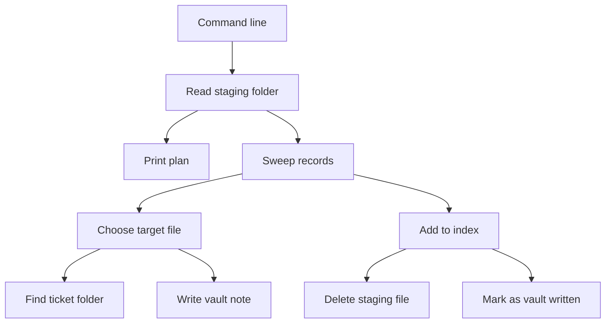
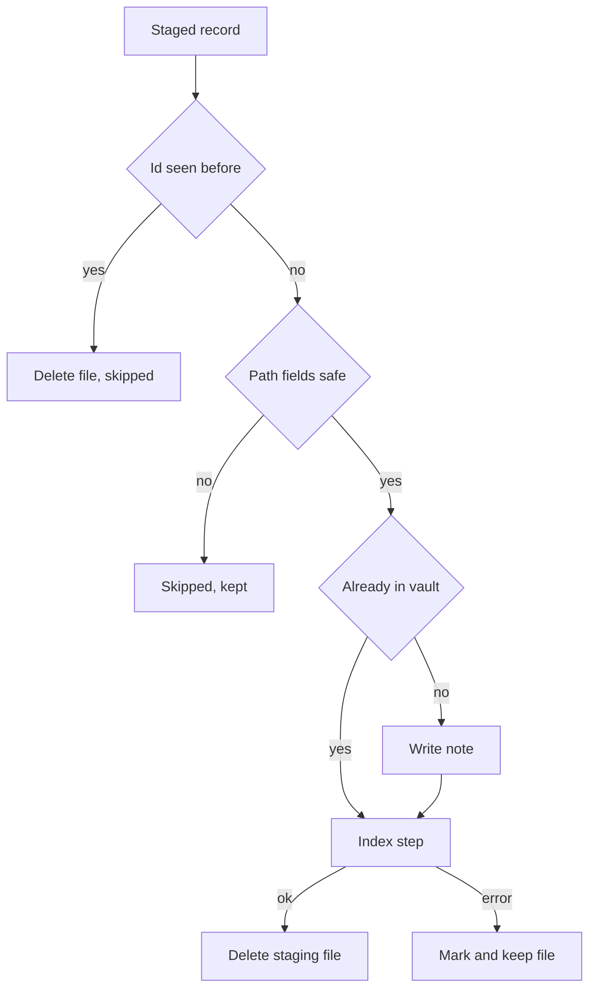
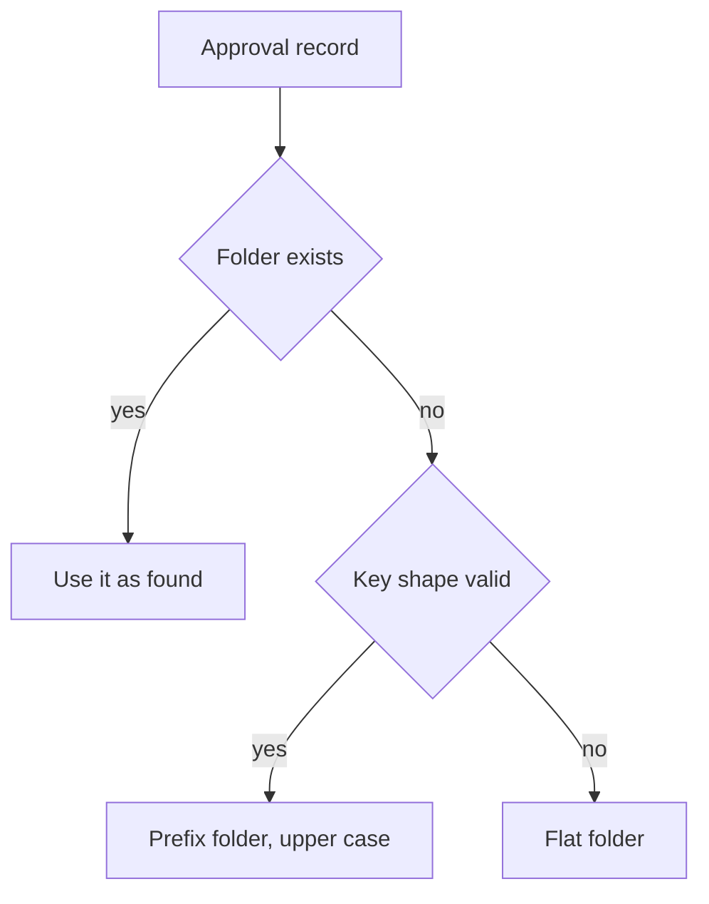

## Purpose

The knowledge sweep. Other tools drop small JSON records (a decision, a correction, an approval, a pattern, a repo note) into a staging folder. This script turns each record into a note in the vault and adds it to the knowledge part of the search index, so the knowledge can be searched later. The file has no `.py` extension; it is run as a program through its python shebang {src:scripts/sync/sweep:1}. The file holds 18 top-level ALL_CAPS constants; only `REPOS_DIR`, `KNOWLEDGE_DIR` and `PATTERNS_DIR` are read by another file (a test), the other 15 are internal. Four of those 15 are never read at all (see Notes).

## Dependencies

**Depends on.**
- Standard library: `argparse`, `json`, `os`, `pathlib`, `re`, `sys`, `tempfile` {src:scripts/sync/sweep:27-33}.
- Repo module `core.paths`: `get_path`, `NotSetUp`, `folder_name` and `ticket_folder` {src:scripts/sync/sweep:36}. Page: [[paths]] and [paths](../core/paths.md).
- Loaded only inside `ChromaIndex.__init__`: the outside package `chromadb`, then `config` and `embedder` from `scripts/search` {src:scripts/sync/sweep:229-232}. Pages: [[config]] and [config](../search/config.md); [[embedder]] and [embedder](../search/embedder.md). It uses `NORMALIZE_EMBEDDINGS`, `chroma_client` and `embedder_for_index` {src:scripts/search/config.py:58} {src:scripts/search/config.py:239} {src:scripts/search/embedder.py:163}.
- Paths from the loader: `vault`, `tickets`, `output` and `index` {src:scripts/sync/sweep:341-343} {src:scripts/sync/sweep:234}. The staging folder is `output/knowledge-staging` {src:scripts/sync/sweep:47} {src:scripts/sync/sweep:343}.

**Used by.**
- Product code: the `/tg-sweep` command runs it, first as a preview and then with `--yes` after the owner confirms {src:commands/tg-sweep.md:11} {src:commands/tg-sweep.md:17}; `scripts/core/run.sh` runs it as the `sweep` step {src:scripts/core/run.sh:41} {src:scripts/core/run.sh:44}; `scripts/state/system_progress.py` only checks that the file exists {src:scripts/state/system_progress.py:90}. Documentation of the command: `docs/commands/sweep.md`.
- Tests: `tests/scripts/sync/test_sync_tools.py` loads it by file path {src:tests/scripts/sync/test_sync_tools.py:36}, `tests/scripts/sync/test_sweep_path_safety.py` {src:tests/scripts/sync/test_sweep_path_safety.py:22}, and `tests/scripts/core/test_bootstrap.py` uses a fake copy through `run.sh` {src:tests/scripts/core/test_bootstrap.py:118}.

## Behavior

**Command line.** Flags: `--yes`, `--staging-dir`, `--vault` {src:scripts/sync/sweep:336-338}. Exit code 2 means the path loader is not set up {src:scripts/sync/sweep:344-346}; every other normal outcome returns 0 {src:scripts/sync/sweep:351} {src:scripts/sync/sweep:359} {src:scripts/sync/sweep:362}. With `--vault`, the tickets folder is taken as `<vault>/<tickets folder name>` {src:scripts/sync/sweep:342}.

**Reading staging.** `read_staging` takes every `*.json` file in the staging folder in sorted order and checks it with `validate` {src:scripts/sync/sweep:96-98}. A file that fails with a read error, `ValueError` or `KeyError` is reported on stderr and left in place {src:scripts/sync/sweep:99-100}. A record needs the fields `id`, `date`, `ticket`, `record_type`, `source_repo`, `source_ref`, `summary` and `detail` {src:scripts/sync/sweep:52} {src:scripts/sync/sweep:74-76}; its type must be one of the five record types {src:scripts/sync/sweep:49} {src:scripts/sync/sweep:77-78}; `summary` and `detail` must not be blank and `summary` must be at most 200 characters {src:scripts/sync/sweep:83-87}.

**Preview (default).** With no records it prints "nothing staged" and a zero summary line {src:scripts/sync/sweep:348-351}. Otherwise it prints one "plan:" line per record and, without `--yes`, a "preview only" line and a summary with only `processed` filled in {src:scripts/sync/sweep:352-358}. The preview never opens the index and writes nothing: the planning code only reads files and resolves paths {src:scripts/sync/sweep:261-280}. That includes the ticket folder lookup for approvals, which only lists and tests folders {src:scripts/sync/sweep:138} {src:scripts/core/paths.py:248-261}.

**Choosing the target file.** `route` first checks that `id`, `ticket`, `source_repo` and `date` are strings made only of letters, digits, dot, underscore and hyphen, and not made only of dots {src:scripts/sync/sweep:104-105} {src:scripts/sync/sweep:117-118} {src:scripts/sync/sweep:150}. Then: decisions and corrections go to `<knowledge>/decisions/<date>-<ticket>.md` {src:scripts/sync/sweep:153-154}; patterns to `<knowledge>/patterns/<date>-<ticket>.md` {src:scripts/sync/sweep:158-159}; approvals to `approval-<id>.md` inside the folder that `_ticket_dir` returns for the ticket, with the tickets folder as the base that the path must stay inside {src:scripts/sync/sweep:155-157}; repo notes to `<system map>/repos/<source_repo>.md` {src:scripts/sync/sweep:160-161}. The result must stay inside its base folder after symlinks are resolved, else the record is refused {src:scripts/sync/sweep:121-129} {src:scripts/sync/sweep:162-163}.

**Choosing the ticket folder (`_ticket_dir`).** It asks the shared lookup `ticket_folder` first and uses the answer when there is one {src:scripts/sync/sweep:138-140}. That lookup tries the flat folder `<tickets>/KEY` first {src:scripts/core/paths.py:248-250}, then a folder named like the prefix (the letters before the hyphen, compared without regard to case) holding `KEY` {src:scripts/core/paths.py:251-261}. It gives nothing for a key that is not letters, a hyphen and digits {src:scripts/core/paths.py:245-246}, and nothing when the folder found resolves outside the tickets folder {src:scripts/core/paths.py:249} {src:scripts/core/paths.py:260}. When the lookup finds nothing and the key is letters, a hyphen and digits, the approval goes to `<tickets>/PREFIX/KEY` with the prefix in upper case {src:scripts/sync/sweep:141-143}. Any other key keeps the old flat path `<tickets>/KEY` {src:scripts/sync/sweep:144}. The folder is created on write, parents included {src:scripts/sync/sweep:180}.

**Writing the note.** A decision, correction or pattern appends a block (heading, source, summary, detail) to the day's file, marked with `<!-- id:ID -->` {src:scripts/sync/sweep:167-168} {src:scripts/sync/sweep:196-204}. An approval is written as its own file with frontmatter {src:scripts/sync/sweep:205-212}. A repo note is written only if its file does not exist yet {src:scripts/sync/sweep:213-216}. Every write goes to a temporary file in the target folder and is renamed over the target {src:scripts/sync/sweep:179-189}.

**Skipping what is already there.** A record is not written when its staging file says `vault_written` {src:scripts/sync/sweep:311}, or when the target exists and, for decision, correction and pattern, already holds the record's marker {src:scripts/sync/sweep:171-176}. For approvals and repo notes, an existing target counts as already written whatever it holds {src:scripts/sync/sweep:176}.
**Sweep loop (`--yes`).** For each record in order {src:scripts/sync/sweep:299}:
1. A second file with an id already seen is deleted from staging and counted as skipped {src:scripts/sync/sweep:300-303}.
2. An unsafe record is counted as skipped and left in staging {src:scripts/sync/sweep:305-310}.
3. The vault note is written when needed {src:scripts/sync/sweep:311-313}.
4. The index object is made on first use, once only; if making it fails, no second try is made and later records fail with "index not available" {src:scripts/sync/sweep:314-318} {src:scripts/sync/sweep:323}.
5. On index success the staging file is deleted and `synced` goes up {src:scripts/sync/sweep:319-321}. On any index error the staging file is rewritten atomically with `vault_status` set to `vault_written`, an error line with only the exception class name goes to stderr, and `partial` goes up {src:scripts/sync/sweep:322-326} {src:scripts/sync/sweep:219-222}.

The last stdout line is `processed=N written=N synced=N partial=N skipped=N` {src:scripts/sync/sweep:67-69} {src:scripts/sync/sweep:361}.

**The index step.** `ChromaIndex` opens the `knowledge` collection under the index folder (created if missing) with the embedder that built the index {src:scripts/sync/sweep:234-239}. `sync` looks up existing entries with the same `source_ref`, upserts the record under its own id, then deletes the other entries that had that `source_ref` {src:scripts/sync/sweep:242} {src:scripts/sync/sweep:252-258}. The text embedded is the cleaned `source_ref`, the first 80 characters of the summary, and the detail {src:scripts/sync/sweep:244-247}; the stored document is the detail {src:scripts/sync/sweep:253}. The metadata keys `file`, `heading`, `source`, `embedding_model`, `truncated`, `origin` and `tags` match the keys the index builder writes {src:scripts/sync/sweep:249-251} {src:scripts/search/build_index.py:389-391}.

## Diagram: module level (L2, required)

## Diagram: function level (L3, optional)

Source of the branches: {src:scripts/sync/sweep:299-327}.

Source of the branches: {src:scripts/sync/sweep:138-144}.

## Notes

**Code and description disagree.**
- The header and usage say exit code 0 means "done or preview" {src:scripts/sync/sweep:25}. The code also returns 0 when records failed to index or were refused (`partial` and `skipped` above zero) {src:scripts/sync/sweep:361-362}. A caller cannot tell a clean run from a partly failed one by the exit code.
- The usage says the plan is printed "first", then written with `--yes` {src:scripts/sync/sweep:23}. True {src:scripts/sync/sweep:352-360}. But the `processed` number differs: in a preview it counts every distinct id, refused records included {src:scripts/sync/sweep:357}; in a real run refused records are not counted as processed {src:scripts/sync/sweep:305-310} {src:scripts/sync/sweep:327}.
- The `run_sweep` docstring says the index factory is called once {src:scripts/sync/sweep:291-292}. That holds: a failed attempt sets `index_error` so it is not tried again {src:scripts/sync/sweep:315} {src:scripts/sync/sweep:323}.
- The comment in `sync` says the metadata fields are the same as the index builder's {src:scripts/sync/sweep:243}. Checked for the seven keys only {src:scripts/search/build_index.py:389-391}; `truncated` is always false here {src:scripts/sync/sweep:250}.
- The `route` docstring says a path that "would land outside the vault" is refused {src:scripts/sync/sweep:148-149}. For approvals the base is the tickets folder, not the vault folder {src:scripts/sync/sweep:157} {src:scripts/sync/sweep:162}.
- The header description says notes go "into the vault" {src:scripts/sync/sweep:11}, and the change log has no entry for the ticket folder lookup that `_ticket_dir` added {src:scripts/sync/sweep:16-19}. The code does the lookup {src:scripts/sync/sweep:138-144}.
- Four constants are defined and never read (searched 2026-11-20): `REFERENCE_DIR`, `EDUCATION_DIR`, `CONVERSATIONS_DIR_NAME`, `THREADS_DIR_NAME` {src:scripts/sync/sweep:40} {src:scripts/sync/sweep:43} {src:scripts/sync/sweep:44} {src:scripts/sync/sweep:45}. The `session_type` of a record is validated but used nowhere else {src:scripts/sync/sweep:79-80}. The status value `indexed` is accepted {src:scripts/sync/sweep:51} but the script never sets it (searched 2026-11-20).
- The header `Date:` line is empty {src:scripts/sync/sweep:13}.

**Behaviors a reader might not expect.**
- `validate` is called on whatever `json.loads` returns. A file holding a bare number or `null` makes `f not in record` raise `TypeError`, which `read_staging` does not catch {src:scripts/sync/sweep:74} {src:scripts/sync/sweep:98-99}. One such file ends the preview and the real run with a traceback (exit code 1).
- A second staging file with the same id is deleted without being written anywhere, so if its content differs it is lost {src:scripts/sync/sweep:300-303}. Which file wins depends on file name order {src:scripts/sync/sweep:96}.
- An approval or repo note whose target file already exists is not written again, but its staging file is still deleted after the index step {src:scripts/sync/sweep:176} {src:scripts/sync/sweep:311} {src:scripts/sync/sweep:320}. Its detail then lives only in the index.
- In the index, a new record deletes every other entry with the same `source_ref` {src:scripts/sync/sweep:256-258}. Two different records that cite the same source leave only the later one in the index, while the vault keeps both.
- Approvals now follow the ticket: a ticket kept flat gets its approval in the flat folder, a ticket kept under a prefix folder gets it there, and a new ticket gets a prefix folder {src:scripts/sync/sweep:138-144}. A ticket whose folder has a different case than the upper-case prefix (for example `s/` holding other tickets, but not this one) is found only when the ticket folder is already inside it {src:scripts/core/paths.py:257-261}; a new ticket then gets a separate upper-case `PREFIX/` folder {src:scripts/sync/sweep:143}. On a file system that ignores case these are the same folder; on one that does not, there would be two. Not tested here.
- If a flat ticket folder is a symlink that leads outside the tickets folder, the lookup ignores it and goes on to the prefix folder {src:scripts/core/paths.py:249-251}; when nothing is found there either, the approval goes to the prefix path {src:scripts/sync/sweep:141-143}.
- `--vault` changes where notes go, but the index is still `get_path("index")` {src:scripts/sync/sweep:234} {src:scripts/sync/sweep:341}. A run with `--vault` on a scratch folder and `--yes` still writes to the real index.
- The record text goes into notes as written. A `detail` that contains another record's `<!-- id:X -->` marker makes that record look already written, so its note is skipped {src:scripts/sync/sweep:168} {src:scripts/sync/sweep:175}.
- A failure while writing the vault note (for example a full disk) is not inside the `try` around the index step, so it ends the whole run before the summary line {src:scripts/sync/sweep:311-313} {src:scripts/sync/sweep:314-326}.
- Refused and unreadable staging files stay in staging and are reported again on every run {src:scripts/sync/sweep:100} {src:scripts/sync/sweep:305-310}.
- The `--yes` run writes to the shared search index; it is opened only after `--yes` {src:scripts/sync/sweep:360}.

**Inputs that reach a file path, command or address.**
- Checked: `id`, `ticket`, `source_repo` and `date` (letters, digits, `.`, `_`, `-`; not all dots) and the final path must stay inside the vault or tickets folder {src:scripts/sync/sweep:104-118} {src:scripts/sync/sweep:162}. The check runs again before a write {src:scripts/sync/sweep:193}. `_ticket_dir` does no check of its own on the key {src:scripts/sync/sweep:132-144}; it is called only after the field check in `route` {src:scripts/sync/sweep:150} {src:scripts/sync/sweep:156}.
- Not checked: `--staging-dir` and `--vault` are used as given {src:scripts/sync/sweep:337-338} {src:scripts/sync/sweep:341-343}.
- Not checked, written as outbound text: `source_ref`, `summary` and `detail` go into note bodies as is {src:scripts/sync/sweep:196-202}. For approvals and repo notes `source_ref` is put on a frontmatter line, so a value with a line break could add frontmatter keys {src:scripts/sync/sweep:208} {src:scripts/sync/sweep:211}. The same values are stored in the index metadata and document {src:scripts/sync/sweep:248} {src:scripts/sync/sweep:253}.
- `id` is used as a set member before its type is checked {src:scripts/sync/sweep:265} {src:scripts/sync/sweep:300}, so a list or object as `id` raises `TypeError` in the plan or sweep.
- No shell command and no network address is built from input; the index is a local folder {src:scripts/sync/sweep:234} {src:scripts/sync/sweep:238}.

**Writes to shared files.**
- Vault notes: atomic (temporary file then rename) {src:scripts/sync/sweep:179-189}. For decision, correction and pattern files the script reads the whole file, adds a block and writes it all back {src:scripts/sync/sweep:203-204}. Nothing stops a second sweep, or an editor, from changing the file between the read and the write; the later writer's version wins and the other append is lost.
- The approval file and a new ticket folder are created the same way {src:scripts/sync/sweep:180}. The ticket folder lookup and the write are separate steps, so a second writer could create the ticket folder in between; the write still succeeds because the folder is created with `exist_ok` {src:scripts/sync/sweep:132-144} {src:scripts/sync/sweep:180}.
- Staging files: rewritten atomically on index failure {src:scripts/sync/sweep:219-222}, deleted on success {src:scripts/sync/sweep:320}. No lock keeps two sweeps from handling the same staging file.
- Search index: upsert and delete on a shared store {src:scripts/sync/sweep:252-258}; no lock in this file.
- A crash between the index step and the delete of the staging file is safe to retry: the note check and the upsert by id both repeat without harm {src:scripts/sync/sweep:171-176} {src:scripts/sync/sweep:252}.
