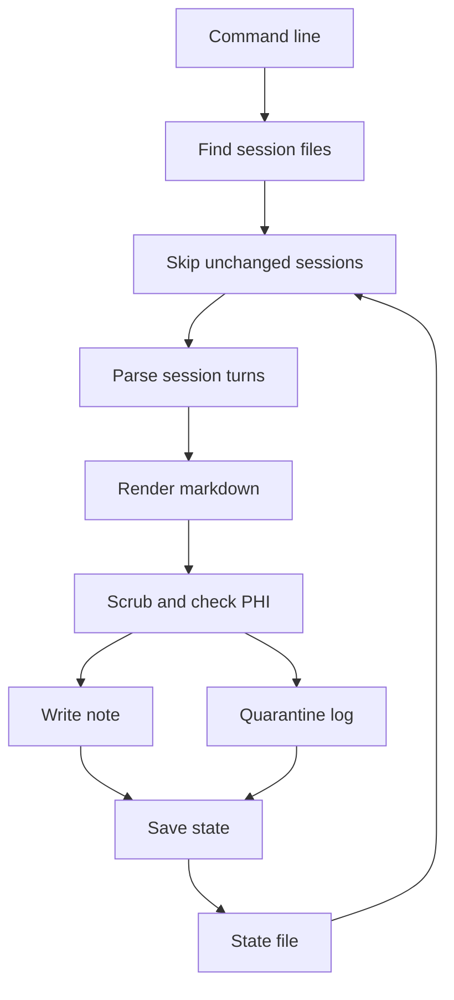
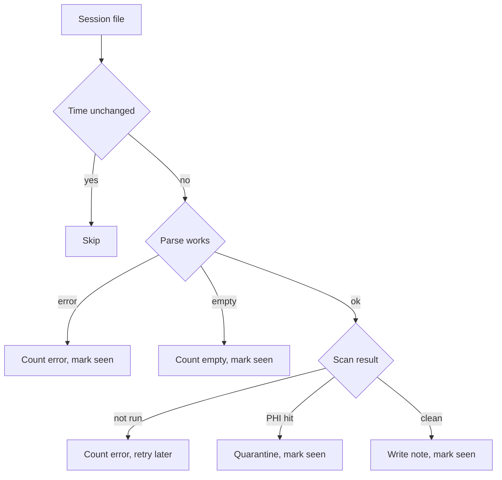

## Purpose

Turns Claude Code session logs (JSONL files, one JSON object per line) into readable markdown notes in the vault's conversations folder, one note per session, sorted by year and month. It keeps a state file of file modification times so unchanged sessions are skipped. Before a note is written the text is cleaned of credentials and checked for protected health information.

## Dependencies

**Depends on.**
- Standard library: `json`, `os`, `re`, `sys`, `time`, `argparse`, `datetime`, `pathlib` {src:scripts/sync/sync_conversations.py:22-29}. `from __future__ import annotations` is present {src:scripts/sync/sync_conversations.py:20}.
- Repo module `core.paths`: `get_path`, `file_value`, `NotSetUp` {src:scripts/sync/sync_conversations.py:32}. Page: [[paths]] and [paths](../core/paths.md).
- Repo module `vault_write_scan` (same folder): `load_json_state`, `write_json_atomic`, `scan_or_none`, `record_quarantine` {src:scripts/sync/sync_conversations.py:34} {src:scripts/sync/sync_conversations.py:259} {src:scripts/sync/sync_conversations.py:263} {src:scripts/sync/sync_conversations.py:317} {src:scripts/sync/sync_conversations.py:323}. Page: [[vault_write_scan]] and [vault_write_scan](vault_write_scan.md). That module loads the hook files `phi_patterns` and `scrub_secrets` {src:scripts/sync/vault_write_scan.py:59-60}.
- Folders: conversations, state, and the session folder {src:scripts/sync/sync_conversations.py:63-71}. Environment variable `CLAUDE_CONFIG_DIR` {src:scripts/sync/sync_conversations.py:60}.

**Used by.**
- Product code: the nightly index script runs it as a step {src:scripts/cron/nightly_index.sh:130}; the cron task launcher runs it as `do_conv` {src:scripts/cron/launchers/run_task.sh:28}.
- Tests: `tests/scripts/sync/test_sync_tools.py` {src:tests/scripts/sync/test_sync_tools.py:252}, `tests/scripts/sync/test_sync_vault_scan.py` (runs it and also imports it) {src:tests/scripts/sync/test_sync_vault_scan.py:98} {src:tests/scripts/sync/test_sync_vault_scan.py:165}, and `tests/scripts/cron/test_cron_tools.py` for the step name and result {src:tests/scripts/cron/test_cron_tools.py:265}.

## Behavior

**Command line and exit codes.** Flags: `--full` and `--sessions-dir` {src:scripts/sync/sync_conversations.py:273-274}. Exit 2 when the loader or the session folder setting is not set up {src:scripts/sync/sync_conversations.py:278-280} {src:scripts/sync/sync_conversations.py:62}. Exit 1 when the session folder does not exist {src:scripts/sync/sync_conversations.py:282-284}. Every other outcome exits 0, including runs with errors or quarantined sessions {src:scripts/sync/sync_conversations.py:339-345}.

**Finding the session folder.** `--sessions-dir` wins. Otherwise a `sessions` line in the paths file is used {src:scripts/sync/sync_conversations.py:57-59}; otherwise `CLAUDE_CONFIG_DIR/projects/<vault path with each non letter or digit turned into a dash>` {src:scripts/sync/sync_conversations.py:60-63} {src:scripts/sync/sync_conversations.py:46-48}.

**Parsing a session.** The file is read as UTF-8 with `errors="ignore"` {src:scripts/sync/sync_conversations.py:168}. Blank lines and lines that are not valid JSON are skipped {src:scripts/sync/sync_conversations.py:171-176}. Records of type `ai-title` set the title (the last one wins) {src:scripts/sync/sync_conversations.py:191-192}; `user` and `assistant` records become turns, but only if they have a readable timestamp and enough text {src:scripts/sync/sync_conversations.py:194-204}. A session with no turns, or no timestamp, gives nothing {src:scripts/sync/sync_conversations.py:206-207}.

**What counts as text.** User text is dropped when it is a slash-command tag or a continuation summary {src:scripts/sync/sync_conversations.py:95-97} {src:scripts/sync/sync_conversations.py:90-92}. Blocks of skill content are dropped only in list-form messages {src:scripts/sync/sync_conversations.py:85-87} {src:scripts/sync/sync_conversations.py:130}. The tags `ide_opened_file`, `system-reminder` and `ide_selection` are removed {src:scripts/sync/sync_conversations.py:103-107}. A message needs at least 10 characters after cleaning {src:scripts/sync/sync_conversations.py:81} {src:scripts/sync/sync_conversations.py:118} {src:scripts/sync/sync_conversations.py:136}. Assistant text keeps only `text` blocks, so thinking and tool calls are left out {src:scripts/sync/sync_conversations.py:149-153}.

**Making the note.** The note starts with a heading of the local date and title, the first 8 characters of the session id, then one block per turn with the local time, a label (`U` or `C`) and the text {src:scripts/sync/sync_conversations.py:220-244} {src:scripts/sync/sync_conversations.py:42-43}. The path is `<conversations>/<year>/<NN-Month>/<date>-auto-<id8>.md` {src:scripts/sync/sync_conversations.py:247-253}.

**Scan before writing.** The whole note text is passed to `scan_or_none`, which first redacts secrets, then scans for protected health information {src:scripts/sync/sync_conversations.py:317} {src:scripts/sync/vault_write_scan.py:66-71}. If the scan cannot run, no file is written, an error is counted, and the session is not marked done, so the next run tries again {src:scripts/sync/sync_conversations.py:318-321} {src:scripts/sync/vault_write_scan.py:116-119}. If it finds a hit at the `deny` or `ask` level, nothing is written, one line (time, file name, reason, no content) is appended to `quarantine.log` in the state folder, and the session is marked done {src:scripts/sync/sync_conversations.py:322-327} {src:scripts/sync/vault_write_scan.py:27} {src:scripts/sync/vault_write_scan.py:69} {src:scripts/sync/vault_write_scan.py:78-80}. Otherwise the scrubbed text (not the original) is written {src:scripts/sync/sync_conversations.py:331}.

**State.** Keys are session file names, values are the modification time as text {src:scripts/sync/sync_conversations.py:297-298}. A session is skipped when not in `--full` mode and its time matches {src:scripts/sync/sync_conversations.py:300-302}. Sessions that raised an error while parsing, came out empty, or were quarantined are all recorded as seen {src:scripts/sync/sync_conversations.py:306-315} {src:scripts/sync/sync_conversations.py:326}. The state is saved once at the end {src:scripts/sync/sync_conversations.py:337}. A corrupt state file prints a warning and starts empty {src:scripts/sync/vault_write_scan.py:87-94}.

## Diagram: module level (L2, required)

## Diagram: function level (L3, optional)

Source of the branches: {src:scripts/sync/sync_conversations.py:296-335}.

## Notes

**Code and description disagree.**
- The header says a PHI hit means nothing is written {src:scripts/sync/sync_conversations.py:11}. Only findings at the `deny` and `ask` level count; weaker findings are kept in `weak` and the note is still written {src:scripts/sync/vault_write_scan.py:69-70} {src:scripts/sync/sync_conversations.py:322-331}.
- The usage line gives the default session folder as `CLAUDE_CONFIG_DIR/projects/<this vault>` {src:scripts/sync/sync_conversations.py:17}. A `sessions` paths-file line takes priority over it {src:scripts/sync/sync_conversations.py:57-59}.
- The header says the state write is atomic {src:scripts/sync/sync_conversations.py:13}. True for the state file {src:scripts/sync/vault_write_scan.py:101-105}. The notes themselves are not written atomically {src:scripts/sync/sync_conversations.py:331}.
- The header says "A corrupt state file is reported and replaced by an empty one" {src:scripts/sync/sync_conversations.py:12-13}. It is replaced only when the run reaches the final save {src:scripts/sync/sync_conversations.py:337}.
- `is_skill_content` has a skip rule for injected skill text {src:scripts/sync/sync_conversations.py:85-87}; the string-message path never calls it {src:scripts/sync/sync_conversations.py:113-118}.
- The header `Date:` line is empty {src:scripts/sync/sync_conversations.py:4}. The "not found" message has no values and prints on standard output, not standard error {src:scripts/sync/sync_conversations.py:283}.

**Behaviors a reader might not expect.**
- A JSON line that is valid but not an object (a number or a list), or a record whose `message` is not an object, raises `AttributeError` {src:scripts/sync/sync_conversations.py:178} {src:scripts/sync/sync_conversations.py:195}. `parse_session` does not catch it; `main` does, counts an error, and marks the whole session as seen, so it is not retried until the file changes {src:scripts/sync/sync_conversations.py:306-310}.
- `jsonl_path.stat()` runs outside the `try` block, so a session file that disappears mid-run ends the run {src:scripts/sync/sync_conversations.py:298}.
- Output names use only the first 8 characters of the session id. Two sessions that share the date and those 8 characters would write the same file; the later one overwrites the earlier {src:scripts/sync/sync_conversations.py:252} {src:scripts/sync/sync_conversations.py:331}.
- Dates and times in notes use the machine's local time zone {src:scripts/sync/sync_conversations.py:220} {src:scripts/sync/sync_conversations.py:234}.
- A session written once is re-written whenever its file time changes, replacing the note in place {src:scripts/sync/sync_conversations.py:300} {src:scripts/sync/sync_conversations.py:331}. Any hand edit of that note is lost.
- State entries for session files that have been deleted are never removed {src:scripts/sync/sync_conversations.py:286} {src:scripts/sync/sync_conversations.py:337}.

**Inputs that reach a file path, command or address with no check on value.**
- `--sessions-dir`, `CLAUDE_CONFIG_DIR` and the `sessions` paths-file line are used as given {src:scripts/sync/sync_conversations.py:57-63} {src:scripts/sync/sync_conversations.py:69}. They are only read from.
- The output path is built from a parsed timestamp, a fixed month table and the first 8 characters of the session file's stem {src:scripts/sync/sync_conversations.py:249-253}. A file name cannot hold a slash, so the part cannot leave the folder, but its characters are otherwise not checked. The session id also appears in the note text {src:scripts/sync/sync_conversations.py:227}.
- Transcript text, title and timestamps go into the note after the secret and PHI scan {src:scripts/sync/sync_conversations.py:317-331}; the scan is the only check on that outbound text. No shell command and no network address is built from input.

**Writes to shared files.**
- Notes in the conversations folder: `write_text`, not atomic, and no lock {src:scripts/sync/sync_conversations.py:330-331}. Two runs at once (the nightly step and the cron launcher both exist) could write the same note at the same time {src:scripts/cron/nightly_index.sh:130} {src:scripts/cron/launchers/run_task.sh:28}.
- State file: atomic (temporary file, then rename) {src:scripts/sync/vault_write_scan.py:101-105}. Two runs each save their full state and the last one wins; nothing stops that, and a session handled by the first run only could be converted again.
- `quarantine.log`: opened in append mode {src:scripts/sync/vault_write_scan.py:79}. One short line per write, no lock.
- The session folder is only read {src:scripts/sync/sync_conversations.py:168} {src:scripts/sync/sync_conversations.py:287}.
