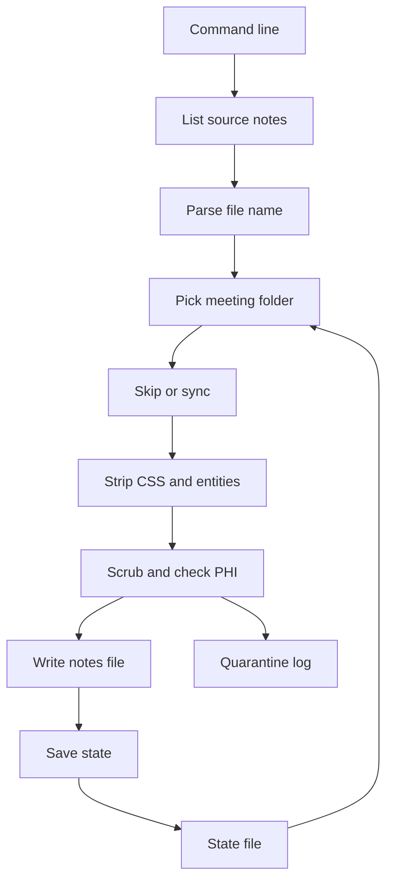
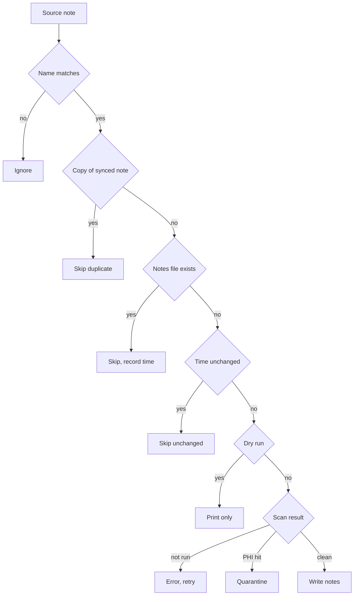

## Purpose

Copies meeting notes exported as markdown files (the file names follow the pattern of Google Meet notes made by Gemini) from a source folder into the vault's meetings folder, one folder per meeting, laid out by year and month. It cleans the export, never overwrites a note that is already there, and checks each note for credentials and protected health information before writing it. It is the point where any meeting connector can plug in: anything that drops matching files into a folder works.

## Dependencies

**Depends on.**
- Standard library: `re`, `sys`, `html`, `argparse`, `pathlib` {src:scripts/sync/sync_meetings.py:31-35}. `from __future__ import annotations` is present {src:scripts/sync/sync_meetings.py:29}.
- Repo module `core.paths`: `get_path` and `NotSetUp` {src:scripts/sync/sync_meetings.py:38}. Page: [[paths]] and [paths](../core/paths.md). Only the `meetings` path is asked for {src:scripts/sync/sync_meetings.py:53}.
- Repo module `vault_write_scan` (same folder): `load_json_state`, `write_json_atomic`, `scan_or_none`, `record_quarantine` {src:scripts/sync/sync_meetings.py:40} {src:scripts/sync/sync_meetings.py:154} {src:scripts/sync/sync_meetings.py:225} {src:scripts/sync/sync_meetings.py:231} {src:scripts/sync/sync_meetings.py:247}. Page: [[vault_write_scan]] and [vault_write_scan](vault_write_scan.md).
- A source folder given with `--source` {src:scripts/sync/sync_meetings.py:137}.

**Used by.**
- Product code: the `/tg-pull-notes` command runs it, first with `--dry-run` {src:commands/tg-pull-notes.md:34} {src:commands/tg-pull-notes.md:59}; the cron task launcher reads the source folder from the first line of a `meetings-source` file in the state folder {src:scripts/cron/launchers/run_task.sh:40}; the nightly index script runs it when a meetings source is set, with a retry {src:scripts/cron/nightly_index.sh:128}. Documentation of the command: `docs/commands/pull-notes.md`.
- Tests: `tests/scripts/sync/test_sync_tools.py` {src:tests/scripts/sync/test_sync_tools.py:278} {src:tests/scripts/sync/test_sync_tools.py:289} and `tests/scripts/sync/test_sync_vault_scan.py` {src:tests/scripts/sync/test_sync_vault_scan.py:207}.

## Behavior

**Command line and exit codes.** Flags: `--source`, `--dry-run`, `--full` {src:scripts/sync/sync_meetings.py:137-139}. `--source` is optional to argparse but required by the code: without it the script prints a message and exits 1 {src:scripts/sync/sync_meetings.py:141-143}. Exit 2 when the meetings path is not set up {src:scripts/sync/sync_meetings.py:146-148}. A source folder that does not exist prints "Source folder not found" and returns with exit code 0 {src:scripts/sync/sync_meetings.py:150-152}.

**Which files count.** Only direct entries of the source folder whose name ends in `.md` are listed {src:scripts/sync/sync_meetings.py:163}. A name must match the Gemini pattern (date, title, start time, `Notes by Gemini`, optional `(n)` copy marker); others are skipped without any message {src:scripts/sync/sync_meetings.py:59-61} {src:scripts/sync/sync_meetings.py:173-176}.

**Choosing the folder.** The meeting folder is `<meetings>/<year>/<month>/<date>_<slug>` {src:scripts/sync/sync_meetings.py:99} {src:scripts/sync/sync_meetings.py:180-181}. The slug is the lower-cased title with every character other than letters, digits, spaces and hyphens removed, joined with hyphens and cut at 60 characters; an empty result becomes `untitled-meeting` {src:scripts/sync/sync_meetings.py:67-72} {src:scripts/sync/sync_meetings.py:62}. `pick_folder` tries the plain name, then the name plus start time, then the name plus start time and a number from 2 to 99 {src:scripts/sync/sync_meetings.py:100}. It takes a folder this meeting already owns, or a free one {src:scripts/sync/sync_meetings.py:102-106}. An unowned folder at the plain name is treated as hand-curated and returned as is {src:scripts/sync/sync_meetings.py:107-108}. If all candidates are taken it returns the last one {src:scripts/sync/sync_meetings.py:109}. Ownership is read from the `_targets` entry of the state file {src:scripts/sync/sync_meetings.py:63} {src:scripts/sync/sync_meetings.py:155} {src:scripts/sync/sync_meetings.py:160-161}.

**Deciding what to do with a file, in this order.**
1. A copy marker file (`... (1).md`) is skipped when the original name is already in the state {src:scripts/sync/sync_meetings.py:194-197}.
2. If the target `notes.md` exists (or was created earlier in this run), the file is skipped and its time is recorded in the state {src:scripts/sync/sync_meetings.py:200-203}.
3. If not in `--full` mode and the recorded time equals the source time, the file is skipped {src:scripts/sync/sync_meetings.py:206-208}.
4. In `--dry-run` mode, print "Would create" and count it; nothing is written {src:scripts/sync/sync_meetings.py:210-215}.
5. Otherwise read, clean, scan and write.

**Cleaning.** `strip_css_and_clean` drops everything before the first heading line (1 to 3 `#`); with no heading and more than one line it drops the first line; then it converts HTML entities and trims {src:scripts/sync/sync_meetings.py:118-131}. A one-line file with no heading is only entity-converted {src:scripts/sync/sync_meetings.py:123-130}.

**Scan and write.** The cleaned text goes to `scan_or_none` (secrets redacted, then protected health information scan) {src:scripts/sync/sync_meetings.py:225} {src:scripts/sync/vault_write_scan.py:66-71}. If the scan cannot run, nothing is written, an error is counted and the file is retried next run {src:scripts/sync/sync_meetings.py:226-229}. If it finds a hit at `deny` or `ask` level, nothing is written, a line with the file name and reason goes to `.quarantine.log` in the meetings folder, and the file is recorded as seen {src:scripts/sync/sync_meetings.py:230-235} {src:scripts/sync/vault_write_scan.py:69}. Otherwise the scrubbed text is written to `notes.md`, the state is updated, and the folder is recorded as owned by this meeting {src:scripts/sync/sync_meetings.py:237-241} {src:scripts/sync/sync_meetings.py:238}.

**State.** The state file `.sync-state.json` sits in the meetings folder {src:scripts/sync/sync_meetings.py:54}. In a real run it is written once at the end, atomically, together with the `_targets` map {src:scripts/sync/sync_meetings.py:246-247}. A dry run never saves it {src:scripts/sync/sync_meetings.py:246}.

## Diagram: module level (L2, required)

## Diagram: function level (L3, optional)

Source of the branches: {src:scripts/sync/sync_meetings.py:172-244}.

## Notes

**Code and description disagree.**
- The header says it tracks synced files "by source mtime" {src:scripts/sync/sync_meetings.py:18}. The mtime test is reached only when the target `notes.md` does not exist, because the existence check comes first {src:scripts/sync/sync_meetings.py:200-208}. For every note already synced, the file is counted as "Curated skip (file exists)" and the "Mtime skip" count stays at zero in practice {src:scripts/sync/sync_meetings.py:202} {src:scripts/sync/sync_meetings.py:207}. The recorded time matters only if someone deletes a `notes.md`: the note is then not re-created while the source is unchanged.
- The header says a PHI hit means the note is not written {src:scripts/sync/sync_meetings.py:24-25}. Only `deny` and `ask` level findings block it; weaker ones are written {src:scripts/sync/vault_write_scan.py:69-70} {src:scripts/sync/sync_meetings.py:230-238}.
- The header says "Never overwrites an existing notes.md" {src:scripts/sync/sync_meetings.py:15}. The check is a test-then-write with no lock: a file created between the check and the write would be overwritten {src:scripts/sync/sync_meetings.py:200} {src:scripts/sync/sync_meetings.py:238}.
- The usage line shows `--source DIR` as plain required {src:scripts/sync/sync_meetings.py:9}; the code enforces it itself, not argparse {src:scripts/sync/sync_meetings.py:137} {src:scripts/sync/sync_meetings.py:141}.
- A missing source folder exits 0 {src:scripts/sync/sync_meetings.py:150-152}, while the sibling conversation sync exits 1 for a missing session folder.
- The header `Date:` line is empty {src:scripts/sync/sync_meetings.py:4}.

**Behaviors a reader might not expect.**
- The state and the `_targets` map are saved only at the end {src:scripts/sync/sync_meetings.py:247}. The write of a folder or `notes.md` is not inside a `try` block {src:scripts/sync/sync_meetings.py:237-238}. If the run stops part-way (an `OSError`, a kill), notes already written are not in the saved ownership map. On the next run such a folder looks hand-curated (unowned, notes present, plain name) {src:scripts/sync/sync_meetings.py:107-108}, so a different meeting with the same date and title would be skipped as "curated" and not synced.
- Only the cleaned note body is written; the meeting title survives only in the folder slug {src:scripts/sync/sync_meetings.py:238} {src:scripts/sync/sync_meetings.py:179}. Titles with no ASCII letters or digits all become `untitled-meeting` {src:scripts/sync/sync_meetings.py:69} {src:scripts/sync/sync_meetings.py:72}.
- `f.stat()` is called outside any `try` {src:scripts/sync/sync_meetings.py:191}; an unreadable or vanished source file ends the run.
- The pattern uses `\d`, which in Python also matches non-ASCII digits {src:scripts/sync/sync_meetings.py:60}; such characters would go into the date part of a folder name.
- The `.md` filter {src:scripts/sync/sync_meetings.py:163} also lists a folder whose name ends in `.md`; reading it fails and is counted as an error {src:scripts/sync/sync_meetings.py:218-223}.
- Unlike the conversations sync, the quarantine log and the state file live in the meetings folder inside the vault, not in the state folder {src:scripts/sync/sync_meetings.py:54} {src:scripts/sync/sync_meetings.py:157}.

**Inputs that reach a file path, command or address with no check on value.**
- `--source` is used as given and only read from {src:scripts/sync/sync_meetings.py:145} {src:scripts/sync/sync_meetings.py:163}.
- The output folder is built from the date digits, the slug and the start time from the file name {src:scripts/sync/sync_meetings.py:178-181} {src:scripts/sync/sync_meetings.py:99-100}. The slug keeps only lower-case letters, digits and hyphens {src:scripts/sync/sync_meetings.py:69-71}; a file name cannot contain a slash, so the path cannot leave the meetings folder. That is a property of the pattern, not an explicit path check.
- Note text is written after the secret and PHI scan; that scan is the only check on it {src:scripts/sync/sync_meetings.py:225} {src:scripts/sync/sync_meetings.py:238}. No shell command and no network address is built from input.

**Writes to shared files.**
- `notes.md` files: `write_text`, not atomic, no lock {src:scripts/sync/sync_meetings.py:238}. The nightly script and the cron launcher both run this script {src:scripts/cron/nightly_index.sh:128} {src:scripts/cron/launchers/run_task.sh:40}; nothing stops two runs from writing at once.
- `.sync-state.json`: atomic (temporary file then rename) {src:scripts/sync/vault_write_scan.py:101-105}. Each run saves its whole view of the state, so with two runs at once the last save wins and the other run's records are lost; nothing prevents that.
- `.quarantine.log`: opened in append mode, one short line {src:scripts/sync/vault_write_scan.py:79-80}.
- The source folder is only read {src:scripts/sync/sync_meetings.py:163} {src:scripts/sync/sync_meetings.py:218}.
