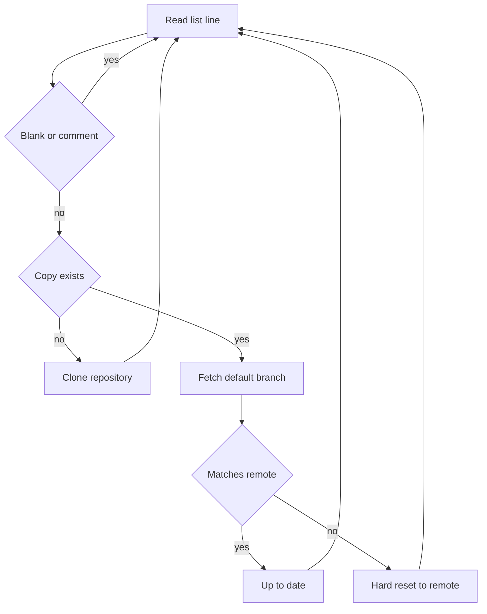

## Purpose

Keeps a folder of local copies of git repositories up to date. It reads a list file naming the repositories, clones any that are missing, and for the ones already cloned fetches the default branch and moves the copy to match it exactly. The copies are meant as a read-only mirror that other tools read from; nobody edits them. It has no `.py` extension; it is a bash script {src:scripts/sync/sync_repos.sh:1}.

## Dependencies

External commands: `bash` (it uses arrays and `BASH_SOURCE`) {src:scripts/sync/sync_repos.sh:16} {src:scripts/sync/sync_repos.sh:30}, `git` {src:scripts/sync/sync_repos.sh:46}, `sed` {src:scripts/sync/sync_repos.sh:56}, `basename` {src:scripts/sync/sync_repos.sh:40}, `dirname`, `mkdir`, `date` {src:scripts/sync/sync_repos.sh:16} {src:scripts/sync/sync_repos.sh:31} {src:scripts/sync/sync_repos.sh:34}.

Repo file: `scripts/core/tg_path`, which prints the folder for a name and exits 1 when it cannot {src:scripts/sync/sync_repos.sh:17} {src:scripts/core/tg_path:23-26}. Page: [[tg_path]] and [tg_path](../core/tg_path.md). It is asked for `repos` and `state` {src:scripts/sync/sync_repos.sh:18} {src:scripts/sync/sync_repos.sh:19}.

Files and variables: the list file is the first argument, or `repos.list` in the state folder {src:scripts/sync/sync_repos.sh:20}. `GIT_TERMINAL_PROMPT` is set to 0 for git {src:scripts/sync/sync_repos.sh:23}.

**Used by.**
- Product code: the cron task launcher runs it for the `repos` task with the state folder's `repos.list` {src:scripts/cron/launchers/run_task.sh:34}; the nightly index script runs it, with a retry, when the list file exists {src:scripts/cron/nightly_index.sh:125} {src:scripts/cron/nightly_index.sh:65}.
- Tests: `tests/scripts/sync/test_sync_tools.py` clones and updates a local repo, and checks the no-list case {src:tests/scripts/sync/test_sync_tools.py:304} {src:tests/scripts/sync/test_sync_tools.py:310} {src:tests/scripts/sync/test_sync_tools.py:316}.

## Behavior

**Exit codes.** 2 when `tg_path` fails for `repos` or `state` ("not set up" on stderr) {src:scripts/sync/sync_repos.sh:18-19}. 0 with a message when the list file is missing {src:scripts/sync/sync_repos.sh:25-28}. 1 when at least one repository failed, after printing the list of failures {src:scripts/sync/sync_repos.sh:85-92}. 0 otherwise {src:scripts/sync/sync_repos.sh:93}. The script has no `set -e`, so a failing step does not stop it; each step is tested by hand.

**Reading the list.** The file is read line by line, including a last line with no newline {src:scripts/sync/sync_repos.sh:37}. Empty lines and lines whose first character is `#` are skipped {src:scripts/sync/sync_repos.sh:38}. The line is split on whitespace {src:scripts/sync/sync_repos.sh:39}. With two or more words, the first is the folder name and the second the address; with one word it is the address, and the folder name is the last part of the address without a `.git` ending {src:scripts/sync/sync_repos.sh:40}. The copy goes to `<repos folder>/<name>` {src:scripts/sync/sync_repos.sh:41}.

**New repository.** If `<dest>/.git` does not exist, it runs `git clone <address> <dest> --quiet`, hiding git's error text {src:scripts/sync/sync_repos.sh:45-46}. Success prints "Cloned." and failure records `name (clone)` {src:scripts/sync/sync_repos.sh:47-50}. Either way it moves to the next line {src:scripts/sync/sync_repos.sh:52}.

**Existing repository.** The default branch name is read from local git data (`origin/HEAD`) with no network call, and falls back to `main` when that is not set {src:scripts/sync/sync_repos.sh:55-57}. It then fetches that branch from `origin`; a failed fetch records `name (fetch)` {src:scripts/sync/sync_repos.sh:59-63}. If the local HEAD equals `origin/<branch>`, it prints "Up to date." {src:scripts/sync/sync_repos.sh:65-68}. Otherwise it counts the commits ahead and runs `git reset --hard origin/<branch>`, which discards anything local; a failed reset records `name (reset)` {src:scripts/sync/sync_repos.sh:70-75}. It then prints "Pulled N new commit(s)." {src:scripts/sync/sync_repos.sh:76}.

**Output.** A banner with the date, one block per repository, and a closing line that says the folder is a read-only mirror {src:scripts/sync/sync_repos.sh:33-35} {src:scripts/sync/sync_repos.sh:80-83}.

## Diagram

Source of the branches: {src:scripts/sync/sync_repos.sh:37-78}.

## Notes

**Code and description disagree.**
- The header says lines "starting with #" are skipped {src:scripts/sync/sync_repos.sh:6}. Only a `#` in the first column is skipped {src:scripts/sync/sync_repos.sh:38}. An indented comment such as `  # note here` is split into words and read as folder name `#` and address `note`, so a clone is tried and fails, and the run ends with exit 1 {src:scripts/sync/sync_repos.sh:39-40} {src:scripts/sync/sync_repos.sh:49-50}. A line of spaces only gives an empty address and fails the same way {src:scripts/sync/sync_repos.sh:40} {src:scripts/sync/sync_repos.sh:46}.
- The header says the folder name is "preceded by a folder name and a space" {src:scripts/sync/sync_repos.sh:6}. Any whitespace works, and words after the second are ignored without a message {src:scripts/sync/sync_repos.sh:39-40}.
- The header calls the folder a "read only mirror" {src:scripts/sync/sync_repos.sh:4}. Nothing in the script makes it read only; it is a convention, and the script itself rewrites the working tree with a hard reset {src:scripts/sync/sync_repos.sh:71}.
- The comment at line 22 says "Never block on a credential prompt" {src:scripts/sync/sync_repos.sh:22}. The variable set controls git's own prompts {src:scripts/sync/sync_repos.sh:23}; whether an ssh passphrase prompt can still appear was not checked here {unverified}.
- The header `Date:` line is empty {src:scripts/sync/sync_repos.sh:10}.

**Inputs that reach a file path, command or address with no check on value.**
- The folder name (first word, or the last part of the address) is joined to the repos folder and used as the clone target and as the folder for `git -C` {src:scripts/sync/sync_repos.sh:40} {src:scripts/sync/sync_repos.sh:41} {src:scripts/sync/sync_repos.sh:56} {src:scripts/sync/sync_repos.sh:71}. No check refuses `..` or a name with a slash. A list line such as `.. <address>` makes the destination the parent of the repos folder; if that folder holds a `.git`, the script would run fetch and `reset --hard` inside that repository {src:scripts/sync/sync_repos.sh:45} {src:scripts/sync/sync_repos.sh:59} {src:scripts/sync/sync_repos.sh:71}.
- The address goes straight to `git clone` after the `clone` word, with no `--` before it {src:scripts/sync/sync_repos.sh:46}. An address that starts with a hyphen would be read by git as an option. No check exists.
- The line is split with `set -- $LINE`, unquoted, so characters such as `*` or `?` in a word are expanded against the current folder before use {src:scripts/sync/sync_repos.sh:39}.
- The list file path is the first argument, used as given {src:scripts/sync/sync_repos.sh:20} {src:scripts/sync/sync_repos.sh:78}.
- The list file lives in the state folder and is trusted input; the script does not verify who can write to it.

**Other behaviors.**
- `git reset --hard origin/<branch>` runs on whatever branch is checked out in the copy, and also when the copy has local commits that the remote does not have; those commits are dropped, and the message can read "Pulled 0 new commit(s)" {src:scripts/sync/sync_repos.sh:65-76}.
- Git error text is thrown away for clone, fetch and reset {src:scripts/sync/sync_repos.sh:46} {src:scripts/sync/sync_repos.sh:59} {src:scripts/sync/sync_repos.sh:71}, so the failure list says which step failed but not why.
- Submodules are not touched; only the repository itself is cloned and reset {src:scripts/sync/sync_repos.sh:46} {src:scripts/sync/sync_repos.sh:71}.
- Needs `bash` (arrays, `BASH_SOURCE`); it is not plain `sh` compatible {src:scripts/sync/sync_repos.sh:1} {src:scripts/sync/sync_repos.sh:30}.

**Writes to shared files.** The script writes only inside the repos folder: `mkdir -p` on it {src:scripts/sync/sync_repos.sh:31}, then clone, fetch and reset in each copy. None of that is atomic, and no lock stops two runs from working in the same copy at once. The nightly script and the cron launcher both run it {src:scripts/cron/nightly_index.sh:125} {src:scripts/cron/launchers/run_task.sh:34}; git's own lock files may make the second operation fail, in which case the script records a failure for that repository {src:scripts/sync/sync_repos.sh:71-74}; that git behavior was not tested here {unverified}. Nothing in this script writes to the list file or the state folder.
