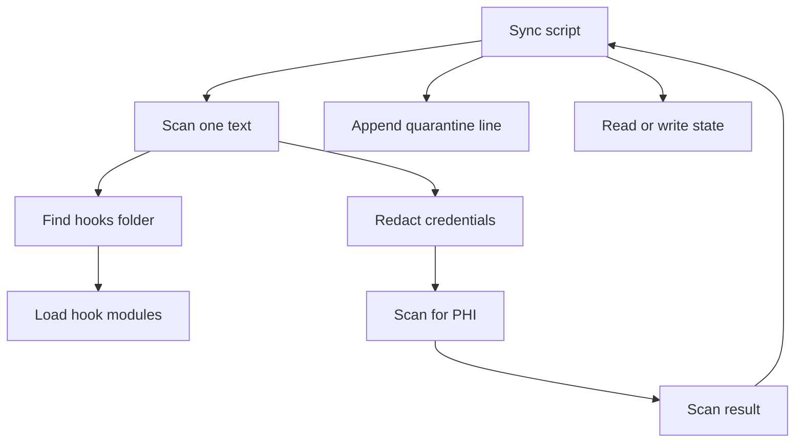

## Purpose

A shared helper for the scripts that copy conversation transcripts and meeting notes into the vault. Before a file is written, the helper removes credentials from the text and checks it for patient-style identifiers. It also holds two small state-file helpers, one that reads a JSON state file without crashing on a bad one and one that writes it by replacing the old file in a single step. It exists so the two sync scripts apply the same safety rules and neither writes a file the scan could not vouch for.

## Dependencies

**Depends on.**
- `hooks/phi_patterns.py`, loaded at run time by folder path {src:scripts/sync/vault_write_scan.py:59}. Page: [[phi_patterns]] / [phi_patterns](../../hooks/phi_patterns.md).
- `hooks/scrub_secrets.py`, loaded the same way {src:scripts/sync/vault_write_scan.py:60}. Page: [[scrub_secrets]] / [scrub_secrets](../../hooks/scrub_secrets.md).
- Environment variable `TOLLGATE_HOME`, used only when the hooks folder is not next to `scripts/` {src:scripts/sync/vault_write_scan.py:26} {src:scripts/sync/vault_write_scan.py:52}.
- Standard library: datetime, json, os, sys, tempfile, pathlib, typing.

**Used by.**
- Product code: `scripts/sync/sync_conversations.py` (scan and quarantine at {src:scripts/sync/sync_conversations.py:317}, {src:scripts/sync/sync_conversations.py:323}; state helpers at {src:scripts/sync/sync_conversations.py:259}, {src:scripts/sync/sync_conversations.py:263}). Page: [[sync_conversations]] (no doc yet).
- Product code: `scripts/sync/sync_meetings.py` (scan and quarantine at {src:scripts/sync/sync_meetings.py:225}, {src:scripts/sync/sync_meetings.py:231}; state helpers at {src:scripts/sync/sync_meetings.py:154}, {src:scripts/sync/sync_meetings.py:247}). Page: [[sync_meetings]] (no doc yet).
- Product code: `scripts/sync/lint_wikilinks.py`, state helpers only {src:scripts/sync/lint_wikilinks.py:202} {src:scripts/sync/lint_wikilinks.py:206}. Page: [[lint_wikilinks]] (no doc yet).
- Tests: `tests/scripts/sync/test_sync_vault_scan.py` {src:tests/scripts/sync/test_sync_vault_scan.py:31}.
- Searched with `git grep` for the module name and each public function across the repo, excluding `docs/` (2026-11-20).

## Behavior

**Finding the hooks folder.** `hooks_dir()` first looks for `hooks/phi_patterns.py` two folders above this file {src:scripts/sync/vault_write_scan.py:49} {src:scripts/sync/vault_write_scan.py:50}. If it is there, that folder is used. Otherwise it returns `TOLLGATE_HOME/hooks` {src:scripts/sync/vault_write_scan.py:52}.

**Loading the hooks.** `_load()` puts the hooks folder at the front of `sys.path` if it is not already there, then imports both hook modules {src:scripts/sync/vault_write_scan.py:57} {src:scripts/sync/vault_write_scan.py:58} {src:scripts/sync/vault_write_scan.py:59} {src:scripts/sync/vault_write_scan.py:60}.

**Scanning text.** `scan_text()` first redacts credentials with the hook's `scrub_text` {src:scripts/sync/vault_write_scan.py:67}, then runs the PHI scan on the redacted text only {src:scripts/sync/vault_write_scan.py:68}. `scrub_text` replaces each match with a `[REDACTED:LABEL]` marker and returns the labels, never the values {src:hooks/scrub_secrets.py:283} {src:hooks/scrub_secrets.py:287}. Findings whose level is `deny` or `ask` go into the `phi` list; any other level goes into `weak` {src:scripts/sync/vault_write_scan.py:27} {src:scripts/sync/vault_write_scan.py:69} {src:scripts/sync/vault_write_scan.py:70}. The levels come from the hook's `Level` enum {src:hooks/phi_patterns.py:193} {src:hooks/phi_patterns.py:194} {src:hooks/phi_patterns.py:195}. If the hook modules cannot be imported, the import error is not caught here, so `scan_text` raises {src:scripts/sync/vault_write_scan.py:66}.

**The result object.** `ScanResult.quarantine` is true when `phi` is not empty, so only `deny` and `ask` findings quarantine a text {src:scripts/sync/vault_write_scan.py:41}. `reason()` returns `PHI scan:` plus the labels with their levels, no matched text {src:scripts/sync/vault_write_scan.py:44}.

**Failing closed.** `scan_or_none()` wraps `scan_text` and returns `None` on any exception {src:scripts/sync/vault_write_scan.py:117} {src:scripts/sync/vault_write_scan.py:118} {src:scripts/sync/vault_write_scan.py:119}. Both callers treat `None` as "do not write" and count an error {src:scripts/sync/sync_conversations.py:318} {src:scripts/sync/sync_conversations.py:319} {src:scripts/sync/sync_meetings.py:226} {src:scripts/sync/sync_meetings.py:227}.

**What the callers do with the result.** On a quarantine they call `record_quarantine`, print a line and skip the write, but still mark the file as seen in the state {src:scripts/sync/sync_conversations.py:322} {src:scripts/sync/sync_conversations.py:323} {src:scripts/sync/sync_conversations.py:326}. Otherwise they write the redacted text, not the original {src:scripts/sync/sync_conversations.py:331} {src:scripts/sync/sync_meetings.py:238}. This module itself writes no transcript.

**Quarantine log.** `record_quarantine` creates the log's folder, then appends one line: a timestamp, the source name (newlines turned into spaces, cut to 200 characters), the fixed phrase "not written to the vault" and the reason {src:scripts/sync/vault_write_scan.py:76} {src:scripts/sync/vault_write_scan.py:77} {src:scripts/sync/vault_write_scan.py:78} {src:scripts/sync/vault_write_scan.py:79} {src:scripts/sync/vault_write_scan.py:80}.

**Reading state.** `load_json_state` returns `{}` when the file is missing {src:scripts/sync/vault_write_scan.py:85} {src:scripts/sync/vault_write_scan.py:86}. When the file cannot be read or is not valid JSON, it calls the warning function and returns `{}` {src:scripts/sync/vault_write_scan.py:89} {src:scripts/sync/vault_write_scan.py:90} {src:scripts/sync/vault_write_scan.py:91}. When the JSON is valid but not an object it warns and returns `{}` {src:scripts/sync/vault_write_scan.py:92} {src:scripts/sync/vault_write_scan.py:93} {src:scripts/sync/vault_write_scan.py:94}. The default warning prints to standard error {src:scripts/sync/vault_write_scan.py:83}.

**Writing state.** `write_json_atomic` creates the folder, writes to a temporary file in the same folder, then renames it over the target {src:scripts/sync/vault_write_scan.py:100} {src:scripts/sync/vault_write_scan.py:101} {src:scripts/sync/vault_write_scan.py:104} {src:scripts/sync/vault_write_scan.py:105}. On any error, including a keyboard interrupt, it deletes the temporary file and re-raises {src:scripts/sync/vault_write_scan.py:106} {src:scripts/sync/vault_write_scan.py:108} {src:scripts/sync/vault_write_scan.py:111}.

## Diagram: module level (L2, required)

## Diagram: function level (L3, optional)

None: no function has branching that the signature does not show.

## Notes

**Code and description disagree.**
- The header says the file is "NOT written" on a PHI hit {src:scripts/sync/vault_write_scan.py:8}. This module writes no transcript; the decision to skip the write is in the callers {src:scripts/sync/sync_conversations.py:322} {src:scripts/sync/sync_conversations.py:327}.
- The header says a corrupt state file is "replaced by an empty state" {src:scripts/sync/vault_write_scan.py:10} {src:scripts/sync/vault_write_scan.py:11}. `load_json_state` only returns `{}` and leaves the bad file on disk {src:scripts/sync/vault_write_scan.py:91}. The file is replaced only when the caller later saves state, and `sync_meetings.py` skips that save in a dry run {src:scripts/sync/sync_meetings.py:246}.
- The `Date:` header line is empty {src:scripts/sync/vault_write_scan.py:4}.

**Inputs with no check.**
- `TOLLGATE_HOME` builds the hooks folder, which is then put first on `sys.path` and imported {src:scripts/sync/vault_write_scan.py:52} {src:scripts/sync/vault_write_scan.py:58} {src:scripts/sync/vault_write_scan.py:59}. Whatever Python files sit there run as code. No check exists on the value. This path is used only when the folder next to `scripts/` has no `phi_patterns.py` {src:scripts/sync/vault_write_scan.py:50}.
- When `TOLLGATE_HOME` is unset the fallback becomes the relative path `hooks`, resolved against the current folder {src:scripts/sync/vault_write_scan.py:52}.
- Only the presence of `phi_patterns.py` is checked, not `scrub_secrets.py` {src:scripts/sync/vault_write_scan.py:50}.
- `log_path` and `path` arguments are used as given; no check exists {src:scripts/sync/vault_write_scan.py:76} {src:scripts/sync/vault_write_scan.py:100}. Callers supply fixed state paths.
- `source_name` goes into the log with only newlines replaced, so a carriage return or other control character passes through {src:scripts/sync/vault_write_scan.py:78}.

**Writes to shared files.**
- The quarantine log is appended with a plain `open(..., "a")`, no lock, not atomic across writers {src:scripts/sync/vault_write_scan.py:79}. A single short line per call makes interleaving unlikely but nothing prevents it.
- The state file is replaced atomically on the same filesystem {src:scripts/sync/vault_write_scan.py:105}, with no file sync before the rename and no lock. Two runs that each read, change and write state will lose the earlier writer's changes. The nightly steps run one after another {src:scripts/cron/nightly_index.sh:128} {src:scripts/cron/nightly_index.sh:130} {src:scripts/cron/nightly_index.sh:131}.

**Unused fields.** `ScanResult.weak` is never read by any script, and `redacted` is read only by tests (searched `scripts/` and `tests/scripts/sync/` for `.weak` and `.redacted`, 2026-11-20). A weak PHI hit is therefore dropped silently.
