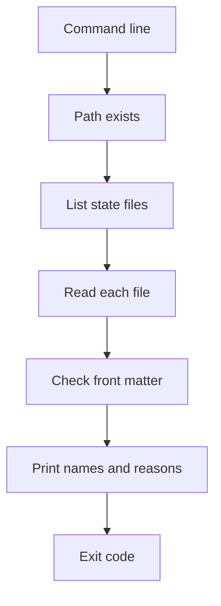
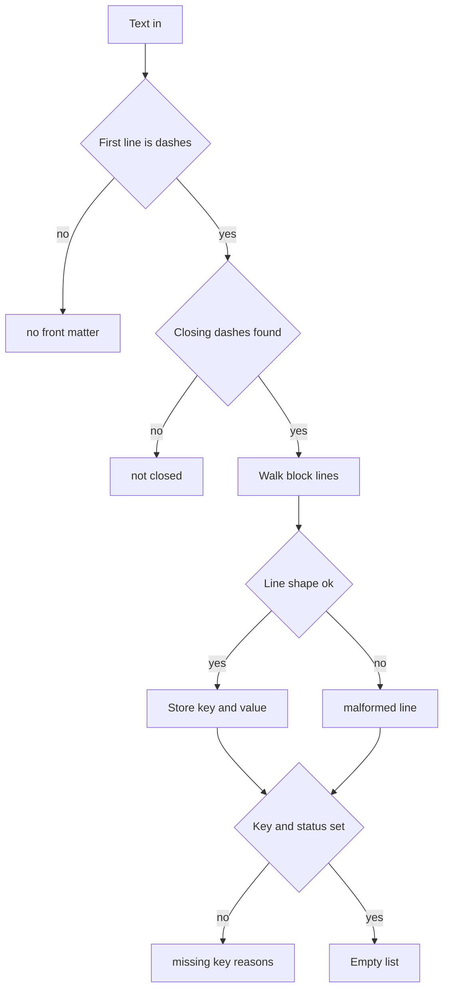

## Purpose

A small command-line checker for ticket state files. Each state file starts with a block of `key: value` lines between two `---` markers. The checker reports a file when that block is missing, not closed, has a badly shaped line, or lacks a ticket key or a status. It prints only file names and reason codes so that no ticket text ends up in logs. It is the only validation helper Tollgate ships.

## Dependencies

**Depends on.** Standard library only: argparse, pathlib, re, sys. No repo modules, no environment variables, no outside programs.

**Used by.**
- Product code: none. Searched with `git grep validate_state_files` over the repo, excluding `docs/` (2026-11-20). The only non-test mention is a description line in `scripts/README.md` {src:scripts/README.md:12}.
- Tests: `tests/scripts/validation/test_validate_state_files.py`, which imports it {src:tests/scripts/validation/test_validate_state_files.py:21} and runs it as a command {src:tests/scripts/validation/test_validate_state_files.py:47}. Page: [[test_validate_state_files]] (no doc yet).

## Behavior

**Checking one text.** `check_text` returns a list of reason codes; an empty list means valid {src:scripts/validation/validate_state_files.py:28} {src:scripts/validation/validate_state_files.py:49}.
- If the first line, trimmed, is not `---` (or the text is empty), the only reason is `no_front_matter` {src:scripts/validation/validate_state_files.py:31} {src:scripts/validation/validate_state_files.py:32}.
- The block ends at the next line that is `---` once trimmed. With no such line the only reason is `front_matter_not_closed` {src:scripts/validation/validate_state_files.py:33} {src:scripts/validation/validate_state_files.py:34} {src:scripts/validation/validate_state_files.py:35}.
- Inside the block, blank lines, lines starting with `#` or `-` (after leading spaces are removed), and lines that start with a space are skipped {src:scripts/validation/validate_state_files.py:38} {src:scripts/validation/validate_state_files.py:39}.
- Every other line must look like `name:` followed by nothing or by whitespace and a value. The name may hold letters, digits and underscores and must not start with a digit {src:scripts/validation/validate_state_files.py:25}. A line that does not fit adds `malformed_line` {src:scripts/validation/validate_state_files.py:40} {src:scripts/validation/validate_state_files.py:41}.
- A line that fits is split at the first colon, and the trimmed value is stored under the name; the last duplicate wins {src:scripts/validation/validate_state_files.py:43} {src:scripts/validation/validate_state_files.py:44}.
- `no_ticket_key` is added unless `ticket` or `ticket_id` has a non-empty value {src:scripts/validation/validate_state_files.py:24} {src:scripts/validation/validate_state_files.py:45} {src:scripts/validation/validate_state_files.py:46}. `no_status` is added when `status` is missing or empty {src:scripts/validation/validate_state_files.py:47} {src:scripts/validation/validate_state_files.py:48}.

**Finding files.** For a file path the list is just that file, with no name filter {src:scripts/validation/validate_state_files.py:53} {src:scripts/validation/validate_state_files.py:54}. For a folder it takes every `.md` file below it whose file name contains `state`, sorted {src:scripts/validation/validate_state_files.py:55}.

**Validating a path.** `validate` reads each file as UTF-8. A file that cannot be read or decoded gets the reason `unreadable` {src:scripts/validation/validate_state_files.py:63} {src:scripts/validation/validate_state_files.py:64} {src:scripts/validation/validate_state_files.py:65}. Only files with at least one reason appear in the returned dictionary {src:scripts/validation/validate_state_files.py:66} {src:scripts/validation/validate_state_files.py:67}.

**Command line.** One argument, the path {src:scripts/validation/validate_state_files.py:73}. A path that does not exist prints `No such path` to standard error and returns 2 {src:scripts/validation/validate_state_files.py:75} {src:scripts/validation/validate_state_files.py:76} {src:scripts/validation/validate_state_files.py:77}. Otherwise it prints one line per bad file, the file name only plus its reasons {src:scripts/validation/validate_state_files.py:79} {src:scripts/validation/validate_state_files.py:80}, and returns 1 if any file was bad, else 0 {src:scripts/validation/validate_state_files.py:81}. The script exits with that value {src:scripts/validation/validate_state_files.py:85}.

## Diagram: module level (L2, required)

## Diagram: function level (L3, optional)

## Notes

**Code and description disagree.**
- The header says it checks for a "well-formed front matter block" {src:scripts/validation/validate_state_files.py:4}. The code checks only the shape of each line, not that the block is valid YAML. A value such as `status: [unclosed` passes {src:scripts/validation/validate_state_files.py:25}.
- The header `date:` field is empty {src:scripts/validation/validate_state_files.py:10}.
- The key pattern allows only letters, digits and underscores {src:scripts/validation/validate_state_files.py:25}. A real front matter key written with a hyphen, such as `doc-type: x`, is reported as `malformed_line`, and so is `status:OPEN` with no space after the colon.

**Behavior worth knowing.**
- Lines starting with `-` are skipped before the shape check {src:scripts/validation/validate_state_files.py:38}, so a line such as `-oops` is never reported.
- `malformed_line` is appended once per bad line, so one file can print the same reason several times {src:scripts/validation/validate_state_files.py:41}.
- A folder with no matching files, or a path that is neither file nor folder, returns 0 with no output {src:scripts/validation/validate_state_files.py:55} {src:scripts/validation/validate_state_files.py:81}.
- A `state` file name is the only selector; a state file named without that word is never checked from a folder {src:scripts/validation/validate_state_files.py:55}.

**Inputs with no check.** The path argument is used for reading only {src:scripts/validation/validate_state_files.py:61} {src:scripts/validation/validate_state_files.py:63}; apart from the existence test {src:scripts/validation/validate_state_files.py:75}, no check exists on its value. It reaches no shell command, network address or outbound text except the file name printed at line 80.

**Writes to shared files.** None. The script only reads files and writes to the console.
