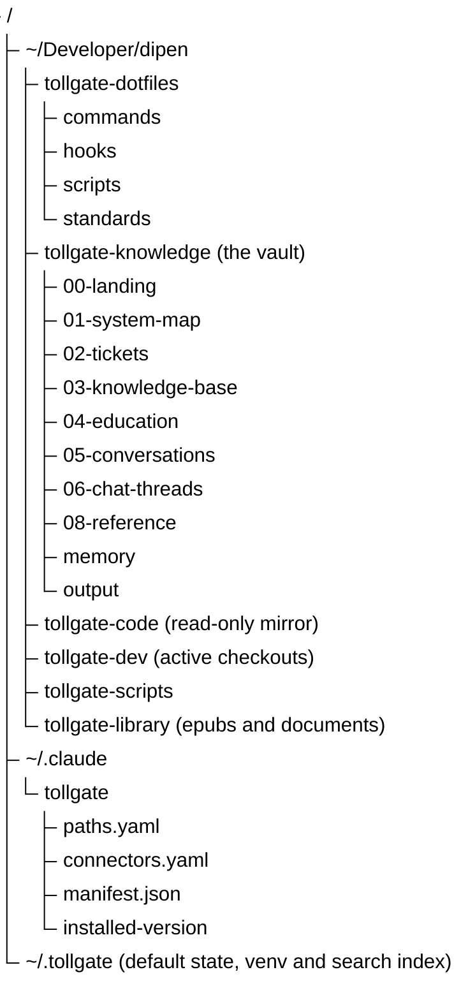

# Setup Guide

Created by Dipen Patel.

This guide takes you from a fresh clone to a working first session. Expected time: 10 minutes after you have completed [Prerequisites](prerequisites.md).

---

## What You Are Setting Up

The installer creates one base folder with several subfolders, each with its own purpose. The folder names come from a stem: `tollgate` for a new install. An older install keeps the stem it saved, so its folders are never renamed. Commands do not depend on the stem: they are always named `/tg-...` and look their folders up when they run.

**Example: base folder `dipen`, stem `tollgate`**

```
~/Developer/dipen/
│
├── tollgate-dotfiles/    ← this repo (commands, hooks, standards, config)
│                            git tracked: edit here, install.sh applies changes
│
├── tollgate-knowledge/   ← your Obsidian vault
│                            commands read and write here every session
│                            saved with git only if you choose local or remote
│
├── tollgate-scripts/     ← reusable scripts Claude generates (git optional)
│                            called by Claude instead of regenerating code
│
├── tollgate-code/        ← read-only mirror of the repos Claude reads
├── tollgate-dev/         ← your active working checkouts
└── tollgate-library/     ← epubs and documents, outside the vault
```

Claude Code runtime reads from `~/.claude/`, which install.sh populates from your dotfiles:

```
tollgate-dotfiles/
      │
      │  install.sh copies commands and config into
      ↓
~/.claude/                ← Claude Code reads from here at runtime
      │
      │  commands write session state, logs, and knowledge to
      ↓
tollgate-knowledge/       ← your Obsidian vault ($TOLLGATE_KNOWLEDGE)
```

---

## Migrating an Existing Claude Code Setup

If you already have Claude Code configured, the installer detects it automatically. You do not need to do anything special before running `install.sh`. The installer handles the rest. The same script also updates an install Tollgate made earlier: run it again and it replaces its own files and keeps yours.

**What it detects:**

- Number of existing command files and memory files in `~/.claude/`
- Any existing knowledge vault path (from `TOLLGATE_KNOWLEDGE` in your shell)
- Your name from the existing `CLAUDE.md`

**What it asks (advanced mode; simple mode asks "keep and update" or "start fresh"):**

```
Existing Claude Code setup found

  Commands found:       18 files
  Memory files:         5 files
  Detected name:        Dipen Patel
  Existing vault:       ~/Developer/dipen/tollgate-knowledge

  What would you like to do?

    m) Migrate   Keep your memory and vault, install new skills alongside them.
    c) Clean     Wipe ~/.claude/ and start completely fresh.

  Either way, your existing ~/.claude/ is backed up first.
```

**Migrate vs Clean:**

| | Migrate | Clean |
|---|---|---|
| Existing memory files | Left where they are. Nothing is copied into the repo. A memory folder at the link path is moved aside as `memory.bak.<time>` | Lost from `~/.claude` (backup only) |
| Custom command files | Left where they are in `~/.claude/commands`. An update never removes them | Lost (backup only) |
| Standard commands | Replaced with the new `tg-*` versions | Installed fresh |
| Knowledge vault | Kept at existing path | Not touched: it lives outside `~/.claude`. The old path is offered as the default |
| Identity (name, title) | Pre-filled from existing setup | Pre-filled too (read before the wipe); change any you like |

An unattended run (`--non-interactive`) always migrates and never cleans.

**The migration analysis (advanced mode):**

When you choose migrate, the installer compares every standard command file:

```
Skill files:
  /tg-ticket  existing 274 lines / new 274 lines  → comparable, use new
  /tg-spec    existing 180 lines / new 220 lines  → new has additions, use new
  /tg-close   existing 320 lines / new 295 lines  → existing was modified, review
  /tg-start   existing 200 lines / new 215 lines  → comparable, use new

Custom skills (always kept):
  my-reporting-skill.md

Memory files:
  5 feedback memory files found, all preserved.

Migration plan:
  - All standard skills: install new versions
  - Modified skills: new installed, old saved to backup for manual review
  - Custom skills: left where they are in ~/.claude/commands
  - Memory files: left where they are (never copied into this repo)
```

You confirm the plan before anything changes.

**The backup:**

On a first install over an existing `~/.claude`, a migration and a clean start, the installer copies your entire `~/.claude/` to `~/.claude.backup.{timestamp}` and checks the file counts match. If anything goes wrong, run:

```bash
cp -r ~/.claude.backup.20260614120000/. ~/.claude/
```

to restore exactly what you had. An update of an install Tollgate made earlier does not copy the whole folder. It backs up each file it replaces as `<name>.bak.<time>`. The installer keeps only the newest 3 full copies and the newest 3 copies of each file, and `settings.json` has its own backups (`./install.sh --restore-settings` puts the newest back).

To remove what Tollgate installed, run `./install.sh --uninstall`. It removes only the command files, hooks, permission rules and settings names that Tollgate recorded in `~/.claude/tollgate/manifest.json`, and leaves your own.

---

## Step 1: Clone the Repo

Clone into your base folder using the naming pattern `{base}/{stem}-dotfiles`:

```bash
# Example: base folder "dipen", stem "tollgate"
mkdir -p ~/Developer/dipen
git clone <repo-url> ~/Developer/dipen/tollgate-dotfiles
cd ~/Developer/dipen/tollgate-dotfiles
```

Python 3.12 or newer must be the `python3` on your `PATH` first: if it is older, the installer stops with exit 1 and prints how to fix it {src:install.sh:148} {src:install.sh:155}. Native Windows is not supported (the hooks need `fcntl`); use WSL {src:hooks/state_file_io.py:14}. See [Prerequisites](prerequisites.md).

Replace `<repo-url>` with the repository URL. If you are on a team, your lead will share it. If the repo is somewhere else, the installer still works and only suggests a `mv` command in advanced mode.

---

## Step 2: Run the Installer

```bash
./install.sh
```

The installer walks you through these prompts in order. Prompts marked advanced appear only if you answer yes to "Advanced setup?".

| Prompt | Example answer | What it controls |
|---|---|---|
| Advanced setup? | n | Simple mode picks folders and paths for you |
| Full name | Dipen Patel | Written into CLAUDE.md so Claude knows who you are |
| Job title | Data Engineering Manager | Written into CLAUDE.md |
| Company | Example Co | Written into CLAUDE.md |
| Industry | Health AI | Tailors PHI guardrails and behavior rules |
| Initials | `DP` | Used in ticket and file names. Letters only |
| Ticket prefix | `T` | A ticket key looks like `T-001`. Letters only |
| Notes folder | `~/Developer/dipen/tollgate-knowledge` | Where your vault lives. Advanced mode asks for a base folder first |
| How should your vault be saved? | `local` | The vault git setting, explained below |
| Track scripts with git (advanced) | y | Sets up git in the scripts folder with a .gitignore |
| Repos to mirror, Cursor rules, code folder (advanced) | skip | Read-only code mirror and the folder the write guards protect |
| Service connections | b / k / s per service | Browser sign-in, API token, or skip for each |
| Set up vault search? | y | Builds a Python environment and a search index. Then offers a local embedding model (default yes) |
| Schedule the nightly search update? (macOS, simple mode) | n | Rebuilds the index every night at 2:00 AM |

There is no prompt for a command prefix. Commands always install as `tg-*.md`.

**The vault git setting.** The question "How should your vault be saved?" takes one of three answers. It is saved as `vault_git:` in `~/.claude/tollgate/paths.yaml`.

| Answer | What it means |
|---|---|
| `none` | The vault is plain files. Commands list the files they wrote and print no git lines. |
| `local` | The vault is a git repo with no remote. Commands print the `git add` and `git commit` lines. |
| `remote` | The vault is a git repo with a remote. Commands also print the `git push` line. |

Commands only print these lines. You run them. Tollgate never commits to your vault, never adds a remote and never pushes. If you choose `local` or `remote` and the vault is not a git repo yet, the installer asks whether to run `git init` on it. For `remote` you add the remote yourself. A missing setting is worked out from the folder: no `.git` means `none`. An unattended install with no mode follows the folder the same way. See [variables](variables.md).

To answer without prompts, pass flags: `./install.sh --non-interactive --vault ~/Developer/dipen/tollgate-knowledge --initials DP --ticket-prefix T --vault-git local`. Run `./install.sh --help` for the full list.

After answering, the installer:

- Creates `tollgate-knowledge/` with all vault subfolders, and `tollgate-scripts/`, `tollgate-code/`, `tollgate-dev/` and `tollgate-library/`
- Saves your vault git setting, and runs `git init` on the vault only if you chose `local` or `remote` and said yes
- Copies the command files into `~/.claude/commands/` as `tg-*.md`, with your name and company filled in. In each installed command it also rewrites every `$TOLLGATE_HOME/` to the absolute path of the repo copy, because Claude Code refuses a command holding an unresolved variable before it reads any permission rule {src:install.sh:1155}. The installer refuses a repo path that contains a space, since the rewritten calls hold the path unquoted {src:install.sh:160-165}. See [Install](install.md) and [Variables](variables.md)
- Writes your identity into `~/.claude/CLAUDE.md`
- Merges Tollgate's hooks, permissions and env block into `~/.claude/settings.json` with `installer/merge_settings.py`. Your own hooks, permissions and env entries are kept. What it added is recorded in `~/.claude/tollgate/manifest.json`
- Stores API tokens in the OS credential store (macOS Keychain, Linux Secret Service, or Windows Credential Manager). On Linux without `secret-tool`, the installer refuses to store a token and prints `sudo apt install libsecret-tools`. It never writes a secrets file.
- Registers MCP servers at user scope with `claude mcp add --scope user` (stored in `~/.claude.json`). The key based servers run through `npx -y` on exact pinned package versions, not on whatever was published last {src:install.sh:1488} {src:install.sh:1468} {src:install.sh:1469} {src:install.sh:1470}. See [Install](install.md)
- Adds `$TOLLGATE_KNOWLEDGE`, `$TOLLGATE_MEETINGS`, `$TOLLGATE_SCRIPTS`, `$CLAUDE_DOTFILES` and the other Tollgate names to your shell profile
- If you chose search: builds the Python environment from `scripts/requirements.txt` (version bounded), offers the local embedding model, builds the index, and can schedule a nightly rebuild {src:install.sh:1616} {src:scripts/requirements.txt:9}. Epub books are indexed only after you install `scripts/requirements-epub.txt` yourself; without it the build skips them with one warning {src:scripts/search/build_index.py:475} {src:scripts/search/build_index.py:478}

The hooks fail closed (`onFailure` block) only on Claude Code 2.1.295 or later. The installer checks your version and warns if it is older. `./install.sh --strict` stops instead of warning.

---

## Step 3: Reload Your Shell

```bash
source ~/.zshrc
```

Verify the env vars are set:

```bash
echo $TOLLGATE_KNOWLEDGE  # → ~/Developer/dipen/tollgate-knowledge
echo $TOLLGATE_SCRIPTS    # → ~/Developer/dipen/tollgate-scripts
echo $CLAUDE_DOTFILES     # → ~/Developer/dipen/tollgate-dotfiles
```

The names are the same on every machine. There is no per-install prefix in a variable name.

---

## Step 4: Connect MCP Servers in Claude Code

MCP servers give Claude Code live access to Jira, Slack, and Notion.

1. Open VSCode
2. Open the Claude Code panel (`Cmd+Shift+P` → "Claude Code: Open")
3. Click the settings icon
4. Go to "MCP Servers"
5. Click "Connect" next to each configured server

**Atlassian:** If you chose MCP browser auth, a browser window opens for OAuth. Complete the flow. The connection persists after that.

**Verify:** In Claude Code, type `@atlassian` or `@slack`. If autocomplete appears, the server is live.

---

## Step 5: Open Your Vault in Obsidian

1. Open Obsidian
2. Click "Open folder as vault"
3. Select your knowledge folder (e.g. `~/Developer/dipen/tollgate-knowledge`)

The vault opens with all subfolders already created. Nothing to configure.

---

## Your Folder Layout After Install

Here is the complete picture with `dipen` as the base and `tollgate` as the stem.

```
~/Developer/dipen/
│
├── tollgate-dotfiles/               git tracked
│   ├── commands/                    the 29 commands, shipped as tg-*.md
│   ├── hooks/                       Claude Code hooks and git hooks
│   ├── scripts/                     path loader, search, sync, connectors, cron
│   ├── installer/                   settings merge and manifest tools
│   ├── standards/                   voice, technical, pipeline, coding, skill rules
│   ├── CLAUDE.md                    behavior rules template
│   ├── settings.json                hook and permission template
│   ├── memory/                      feedback memories
│   ├── install.sh
│   └── docs/
│
├── tollgate-knowledge/              your vault; git only if you chose local or remote
│   ├── 00-landing/
│   ├── 01-system-map/
│   │   ├── clients/
│   │   ├── pipelines/
│   │   ├── architecture/
│   │   ├── data-model/
│   │   └── platform-learning/
│   ├── 02-tickets/
│   │   └── PROJ-200/
│   │       ├── PROJ-200-state.md
│   │       ├── PROJ-200-spec.md
│   │       ├── PROJ-200-design.md
│   │       └── PROJ-200-session-2026-06-14.md
│   ├── 03-knowledge-base/
│   │   ├── decisions/
│   │   ├── learnings/
│   │   ├── patterns/
│   │   └── whiteboard/
│   ├── 04-education/
│   ├── 05-conversations/
│   ├── 06-chat-threads/
│   ├── 08-reference/
│   ├── meetings/                    ← $TOLLGATE_MEETINGS points here, made on first sync
│   ├── memory/
│   └── output/
│
├── tollgate-code/                   read-only mirror of the repos Claude reads
├── tollgate-dev/                    active checkouts
├── tollgate-library/                epubs and documents, outside the vault
│
└── tollgate-scripts/                git optional
    ├── databricks_row_count.py
    └── schema_diff.py
```

The vault folder names come from one table in `scripts/core/paths.py`. A line of the same name in `~/.claude/tollgate/paths.yaml` changes a folder name.

The same layout as a tree:



And what Claude Code reads at runtime:

```
~/.claude/
├── CLAUDE.md                        your identity written in
├── credentials.sh                   reads tokens from Keychain at runtime
├── settings.json
├── tollgate-config                  your saved answers (names and folders only)
├── tollgate/                        paths.yaml, connectors.yaml, manifest.json
└── commands/
    ├── tg-ticket.md                 /tg-ticket
    ├── tg-spec.md                   /tg-spec
    ├── tg-arch.md                   /tg-arch
    ├── tg-dev.md                    /tg-dev
    ├── tg-qa.md                     /tg-qa
    ├── tg-support.md                /tg-support
    ├── tg-start.md                  /tg-start
    ├── tg-close.md                  /tg-close
    ├── tg-draft.md                  /tg-draft
    └── ...                          29 tg-*.md files in all
```

---

## What Each Vault Folder Represents

| Folder | What goes in it | What populates it |
|---|---|---|
| `00-landing/` | Quick captures, rough notes, anything you need to park before organizing | You, manually |
| `01-system-map/clients/` | One file per client: catalog names, contacts, pipeline details, known issues | `/tg-ticket` |
| `01-system-map/pipelines/` | One file per pipeline: layers, notebooks, YAML config, failure modes | `/tg-explore`, `/tg-support` |
| `01-system-map/architecture/` | How your system connects at a high level | You, with `/tg-explore` help |
| `01-system-map/data-model/` | Schemas, layer definitions, Unity Catalog structure | `/tg-explore`, `/tg-spec` |
| `01-system-map/platform-learning/` | Platform concepts explained in context as you work | `/tg-learn`, `/tg-explore` |
| `02-tickets/{KEY}/` | One folder per ticket: state, handoffs, specs, designs, QA findings. The gate also finds `02-tickets/PREFIX/KEY/`, prefix matched without case | Every skill in the chain |
| `02-tickets/{KEY}/{KEY}-state.md` | Live ticket state: known, unknown, assumed, next skill | Every skill reads and updates this |
| `03-knowledge-base/decisions/` | Why a significant decision was made the way it was | `/tg-close` at session end |
| `03-knowledge-base/learnings/` | What was learned during a session and where it applies | `/tg-close` at session end |
| `03-knowledge-base/patterns/` | Patterns promoted from ticket learnings that apply broadly | `/tg-close` with your approval |
| `03-knowledge-base/whiteboard/` | Idea validation notes, by month | `/tg-whiteboard` |
| `04-education/` | Reference material, course notes, documentation worth keeping | You, manually |
| `05-conversations/` | Claude conversation logs and learning session notes | `sync_conversations`, `/tg-learn` |
| `06-chat-threads/` | Saved chat threads (low search weight) | You, or a chat connector |
| `08-reference/` | Doc mirrors of your repos, under `repos/`. `/tg-doc-gen` writes the vault copy only when `08-reference/repos/` already exists, and the installer makes `08-reference/` but not `repos/`, so create `repos/` yourself to turn the mirror on {src:commands/tg-doc-gen.md:237} | `/tg-doc-gen` |
| `meetings/` | Meeting transcripts and summaries (`$TOLLGATE_MEETINGS` points here). Not made at install; the sync script makes it on first run | `/tg-pull-notes` after each meeting |
| `memory/` | Claude feedback memories for this vault context | `/tg-close` with your approval |
| `output/` | Files the scripts write for you | Scripts |

Outside the vault: `tollgate-library/` holds epubs and documents. The installer writes `references: <path to tollgate-library>` into the paths file, only if there is no `references:` line yet, and never changes an existing line. Without that line, the `references` folder defaults to `references/` inside the vault. The search index is not in the vault either: it lives in the `index` folder from the paths file, `~/.tollgate/index` by default.

---

## How a Ticket Folder Gets Built Over Time

A ticket starts empty and accumulates files as you work through the chain. The state file is the thread that connects every session. The gate reads the `Status:` line of each file, not dated approval lines. The exact lines are in [gate-lines](gate-lines.md).

```
02-tickets/PROJ-200/

After /tg-ticket:
  PROJ-200-state.md              Status: ROUTED
                               Known / Unknown / Assuming block written

After /tg-support:
  PROJ-200-state.md              Status: SUPPORT_COMPLETE
  PROJ-200-support-handoff.md    Root cause, evidence, fix recommendation

After /tg-spec:
  PROJ-200-state.md              Status: SPEC_APPROVED
  PROJ-200-spec.md               Requirements, acceptance criteria, success metrics.
                               Its own Status line is set to the approved value

After /tg-arch:
  PROJ-200-state.md              Status: DESIGN_APPROVED
  PROJ-200-design.md             Options, tradeoffs, recommendation. Status is
                               DESIGN_COMPLETE while drafting and becomes
                               DESIGN_APPROVED after your explain-back

After /tg-dev (once per work block):
  PROJ-200-state.md              Status: IN_DEV, then DEV_COMPLETE after the last block
                               last_block_applied: B-01, B-02, ...
  PROJ-200-edge-case-validation.md  Written after the last block with Status: DOCUMENTED

After /tg-qa:
  PROJ-200-state.md              Status: QA_APPROVED (or QA_BLOCKED)
  PROJ-200-edge-case-validation.md  Status flips to VALIDATED once every scenario is resolved
  PROJ-200-qa-findings.md        Findings routed to dev, arch, or spec

After /tg-close:
  PROJ-200-session-2026-06-14.md Done / Decided / Pending summary
```

Any session can pick up any ticket by reading the state file. No recap needed.

---

## Environment Variables Reference

Every name is listed in [variables](variables.md). The installer sets these:

| Variable | Points to | Set by |
|---|---|---|
| `$TOLLGATE_KNOWLEDGE` | `~/Developer/{base}/{stem}-knowledge`. Hooks and the path loader use this fixed name | install.sh (shell profile), and the `env` block of `~/.claude/settings.json` |
| `$TOLLGATE_MEETINGS` | `~/Developer/{base}/{stem}-knowledge/meetings` | install.sh (shell profile) |
| `$TOLLGATE_SCRIPTS` | `~/Developer/{base}/{stem}-scripts` | install.sh (shell profile) |
| `$CLAUDE_DOTFILES` | `~/Developer/{base}/{stem}-dotfiles` | install.sh (shell profile), and the `env` block of settings |
| `$TOLLGATE_HOME` | The Tollgate repo. Command files in the repo call `$TOLLGATE_HOME/scripts/...`; the installer writes the absolute repo path in its place in each installed copy | install.sh (shell profile), and the `env` block of settings |
| `$TOLLGATE_CODE_DIR` | The read only code folder the write guards protect. Empty if you did not set one | install.sh (shell profile), and the `env` block of settings |
| `$TOLLGATE_INITIALS`, `$TOLLGATE_TICKET_PREFIX` | Your initials and ticket prefix | install.sh (shell profile), and the `env` block of settings |
| `$TOLLGATE_PATHS`, `$TOLLGATE_CONNECTORS` | `~/.claude/tollgate/paths.yaml` and `connectors.yaml` | install.sh (shell profile), and the `env` block of settings |
| `$TOLLGATE_PYTHON` | The Python environment the search tools use, when you chose search | `installer/merge_settings.py`, in the `env` block of `~/.claude/settings.json` |

`{base}` is your base folder name and `{stem}` is the folder stem (`tollgate` for a new install). A command looks up a vault folder when it runs, with `$TOLLGATE_HOME/scripts/core/tg_path <name>`, and the vault git mode with `$TOLLGATE_HOME/scripts/core/tg_vault_git`. It runs search only through `$TOLLGATE_HOME/scripts/search/tg-search`. These are the texts in the repo files; in the installed copy each `$TOLLGATE_HOME/` is already the absolute repo path, so the script does not read the variable when it runs. See [tg_vault_git](scripts/core/tg_vault_git.md) and [tg-search](scripts/search/tg-search.md).

---

## Reusable Scripts

`$TOLLGATE_SCRIPTS` is where Claude saves scripts it generates for recurring tasks.

The rule: if Claude writes a Python or bash script and the same task comes up again, Claude runs the saved file instead of regenerating code or making a new API call.

```
tollgate-scripts/
├── databricks_row_count.py    pulled row counts once, saved, reused every time
├── schema_diff.py             compared schemas once, saved, reused
└── null_check.py              null audit, saved, reused
```

Each saved script follows the coding standards: type hints, named constants, file header. Claude checks this folder before writing new code for any task it has done before.

---

## Troubleshooting

| Symptom | Fix |
|---|---|
| Env var not set after install | Run `source ~/.zshrc` |
| A command such as `/dp-ticket` is not found | Commands have the fixed `tg-` prefix: use `/tg-ticket`. Re-run `./install.sh` to remove an old prefixed file |
| MCP server fails to connect | Re-run `./install.sh` to re-enter the token; check `node --version` |
| Atlassian OAuth loop | Disconnect in MCP settings and reconnect |
| Skill commands not found | Run `ls ~/.claude/commands/` and re-run `./install.sh` if no `tg-*.md` files are there |
| Search says `not set up` | Re-run `./install.sh` and answer yes to vault search, or run `./install.sh --with-venv` |
| A command prints the wrong vault git lines | Run `$TOLLGATE_HOME/scripts/core/tg_vault_git`. To change it, edit the `vault_git:` line in `~/.claude/tollgate/paths.yaml` to `none`, `local` or `remote` |
| Installer stops with `Tollgate needs Python 3.12 or newer` | Put a Python 3.12 folder first on `PATH` so `python3 --version` prints 3.12 or newer, then re-run. Steps per system are in [Prerequisites](prerequisites.md) {src:install.sh:151} {src:install.sh:152} |
| Installer warns Claude Code is older than 2.1.295 | Upgrade Claude Code and re-run `./install.sh`. Until then a hook that cannot start lets the action through |
| `settings.local.json` was committed | Run `git rm --cached settings.local.json`, add to `.gitignore`, rotate exposed tokens |
| A bad settings merge | Run `./install.sh --restore-settings` to put the newest settings backup back |

---

## What Is Next

- [Walkthrough](walkthrough.md): a complete ticket worked from Slack message to close, shows exactly how the vault populates
- [Skill Chains](skill-chains.md): which chain to run for which ticket type
- [System Design](system-design.md): architecture and how to customize for your team
