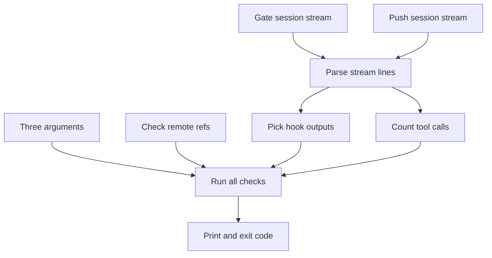

## Purpose

This script is the assertion half of the live gate test. The shell driver `run_gate.sh` runs two real Claude Code sessions and saves their event streams as files; this script reads those files and prints one pass or fail line per check. It exists so the gate hook (blocks a chain command whose earlier step is missing) and the push guard (blocks a push to a protected branch) are proven through a real session, not only through unit tests. The file name does not match the test naming rule (`test_*.py`), so it is documented as a module, not a test.

## Dependencies

**Depends on.**
- Python standard library: `json`, `os`, `subprocess`, `sys` {src:tests/e2e/check_gate.py:15-18}.
- The program `git`, called through `subprocess` {src:tests/e2e/check_gate.py:42}.
- Two input files in the work folder, `streamA.jsonl` and `streamB.jsonl` {src:tests/e2e/check_gate.py:48-49}, written by the driver [[run_gate]] / [run_gate](run_gate.md) {src:tests/e2e/run_gate.sh:57} {src:tests/e2e/run_gate.sh:65}.
- Hook output text produced by `hooks/pre-prompt-expansion-check-gates.py` (the `"decision": "block"` line) {src:hooks/pre-prompt-expansion-check-gates.py:453} and by `hooks/git_ask_before_run.py` (the `permissionDecision` deny line) {src:hooks/git_ask_before_run.py:472-476}.

**Used by.** Searched the whole worktree except `docs/` with `git grep` for `check_gate` (2026-11-20).
- Product code: none.
- Test driver: `tests/e2e/run_gate.sh` runs it as the last step {src:tests/e2e/run_gate.sh:69}. The header comment of `run_gate.sh` also names it {src:tests/e2e/run_gate.sh:16}.

## Behavior

Entry. `main` takes the script arguments, unpacks exactly three values (work folder, bare remote path, ticket key) from `argv[1:4]` {src:tests/e2e/check_gate.py:47}, and the file ends with `sys.exit(main(sys.argv))` {src:tests/e2e/check_gate.py:78}.

Loading. `load` reads a file and keeps only lines that start with `{`, each parsed as JSON {src:tests/e2e/check_gate.py:21-23}. `main` loads `streamA.jsonl` (the gate session) and `streamB.jsonl` (the push session) from the work folder {src:tests/e2e/check_gate.py:48-49}.

Helpers.
- `hook_outputs(events, name_part)` returns, for every event whose `subtype` is `hook_response` and whose `hook_name` contains `name_part`, the `stdout` text joined to the `output` text {src:tests/e2e/check_gate.py:26-28}.
- `tool_calls(events, tool)` returns the `input` dictionary of every assistant `tool_use` block with the given tool name {src:tests/e2e/check_gate.py:31-38}.
- `remote_has_commits(remote)` runs `git -C <remote> for-each-ref`, with `check=False`, and returns true when the output is not empty {src:tests/e2e/check_gate.py:42-43}.

The eight checks, in order {src:tests/e2e/check_gate.py:57-69}:
1. A hook response whose name contains `UserPromptExpansion` exists in stream A {src:tests/e2e/check_gate.py:50} {src:tests/e2e/check_gate.py:58}.
2. Some gate output contains the text `"decision": "block"` {src:tests/e2e/check_gate.py:59}. The hook prints that JSON with `json.dumps`, which writes a space after the colon {src:hooks/pre-prompt-expansion-check-gates.py:453}.
3. Some gate output contains the ticket key and the word `spec` in any letter case {src:tests/e2e/check_gate.py:60-61}.
4. Stream A holds no assistant `tool_use` block at all, meaning the blocked command did not go on to run tools {src:tests/e2e/check_gate.py:52-54} {src:tests/e2e/check_gate.py:62}.
5. Stream B holds a Bash call whose command text contains `push` {src:tests/e2e/check_gate.py:63}.
6. Some `PreToolUse:Bash` output in stream B contains `"permissionDecision": "deny"` and `protected branch` {src:tests/e2e/check_gate.py:51} {src:tests/e2e/check_gate.py:65-66}. The push guard emits both through `json.dumps` and the deny message says "protected branch" {src:hooks/git_ask_before_run.py:448-451} {src:hooks/git_ask_before_run.py:472-476}.
7. The bare remote has no refs {src:tests/e2e/check_gate.py:67}.
8. No hook response in either stream has an `outcome` other than `success` or missing {src:tests/e2e/check_gate.py:55-56} {src:tests/e2e/check_gate.py:68}.

Output and exit. Each check prints `PASS` or `FAIL` with the reason text on failure {src:tests/e2e/check_gate.py:70-71}. It then prints a count and the work folder {src:tests/e2e/check_gate.py:72-73}. It returns 0 only when every check passed, otherwise 1 {src:tests/e2e/check_gate.py:74}.

## Diagram: module level (L2, required)

## Diagram: function level (L3, optional)

None: no function has branching that the signature does not show.

## Notes

Code and description disagree, or a check is weaker than its label:
- The `Usage` line says exit 0 means all pass {src:tests/e2e/check_gate.py:10}. True for the exit code {src:tests/e2e/check_gate.py:74}, but check 7 passes when the remote path is wrong. `git` then fails, `check=False` hides the failure, the output is empty, and `remote_has_commits` returns false {src:tests/e2e/check_gate.py:42-43} {src:tests/e2e/check_gate.py:67}. A mistyped remote path therefore reads as "nothing reached the remote".
- Check 3 is named "reason names the ticket and the missing spec" {src:tests/e2e/check_gate.py:60}. The gate message always ends with "Run /<skill> <key> first." {src:hooks/pre-prompt-expansion-check-gates.py:299}, and for the arch command the skill to run first is `spec` {src:hooks/pre-prompt-expansion-check-gates.py:72}. So the words `spec` and the ticket key appear in every arch block message, whatever the real reason. The check cannot tell a missing spec from another reason.
- Check 5 looks for the substring `push` anywhere in the Bash command {src:tests/e2e/check_gate.py:63}. The driver names the test repo folder `pushrepo` {src:tests/e2e/run_gate.sh:43}, and the prompt gives the model that path inside the command {src:tests/e2e/run_gate.sh:61}. Any Bash call that touches that path would satisfy the check, even without a push verb.
- Check 8 treats a missing `outcome` as success {src:tests/e2e/check_gate.py:56}. Whether a deny or block counts as `success` in the stream is not shown in this repo `[uncertain]`; the run proves it only by passing.
- The header date is empty {src:tests/e2e/check_gate.py:4}.

Unchecked inputs. `work`, `remote` and `ticket` come straight from the command line {src:tests/e2e/check_gate.py:47}. `work` goes into `os.path.join` and `open` {src:tests/e2e/check_gate.py:48-49} {src:tests/e2e/check_gate.py:22}. `remote` goes into a `git -C` argument list, not a shell string {src:tests/e2e/check_gate.py:42}. `ticket` is used only in a substring test {src:tests/e2e/check_gate.py:61}. None is checked for existence or shape; fewer than three arguments raise a `ValueError` at the unpack {src:tests/e2e/check_gate.py:47}, and a missing stream file raises `FileNotFoundError` {src:tests/e2e/check_gate.py:22}. A stream line that starts with `{` but is not valid JSON also raises {src:tests/e2e/check_gate.py:23}. Nothing is sent over a network and nothing is passed to a shell.

Shared file writes: none. The script only reads files and prints to standard output {src:tests/e2e/check_gate.py:70-73}.
