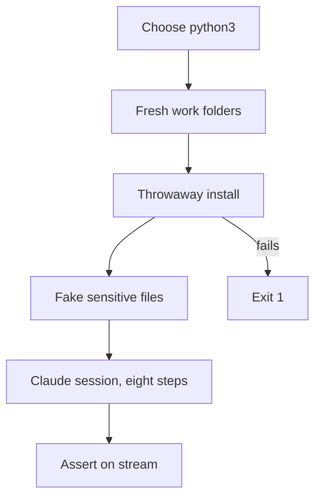

## Purpose

`run.sh` is the live end to end test of the Tollgate hooks that guard against leaking patient-shaped data and writing into the wrong folder. It installs Tollgate into a throwaway home folder, runs one real Claude Code session that tries eight risky steps, and then hands the recorded event stream to `check_stream.py`, which judges each step. It exists because the unit tests call hooks directly and cannot show that a hook fires inside a real session and that its message reaches the model.

## Dependencies

**Depends on.**
- `bash`, run with strict flags `set -euo pipefail` {src:tests/e2e/run.sh:22}.
- `env`, `mktemp`, `rm`, `mkdir`, `python3` {src:tests/e2e/run.sh:40} {src:tests/e2e/run.sh:32} {src:tests/e2e/run.sh:36-37} {src:tests/e2e/run.sh:30}.
- The `claude` command line program, logged in {src:tests/e2e/run.sh:69}, and `databricks` named in the allowed tool list and used by step S7 {src:tests/e2e/run.sh:66} {src:tests/e2e/run.sh:70}.
- `install.sh` at the repo root, called with `--non-interactive` {src:tests/e2e/run.sh:41}. [[install]] / [install](../../install.md).
- `check_stream.py`, the assertion script {src:tests/e2e/run.sh:76}. [[check_stream]] / [check_stream](check_stream.md).
- Environment variable `TOLLGATE_E2E_DIR` (optional work folder) {src:tests/e2e/run.sh:32}.
- Environment variable `TOLLGATE_PYTHON` (optional path to a `python3`; v1 adds it) {src:tests/e2e/run.sh:27}.
- The installed settings file, which must hold `env.TOLLGATE_CODE_DIR` {src:tests/e2e/run.sh:44}. The installer writes that key {src:installer/merge_settings.py:418}.

**Used by.** Searched the whole worktree except `docs/` with `git grep` for `e2e/run` (2026-11-21).
- Product code: none. No installer line, hook or config runs it, and the CI workflow does not run it (searched `.github/workflows/tests.yml`, 2026-11-21).
- Mentions only: the sibling hook test runner prints its path in an echo line {src:tests/hooks/run.sh:207}; the wiring checklist names it as the automated tier {src:tests/hooks/e2e-wiring-checklist.md:3} {src:tests/hooks/e2e-wiring-checklist.md:141}; the header of `check_stream.py` names it {src:tests/e2e/check_stream.py:5}.

## Behavior

Setup. The repo root is worked out from the script location {src:tests/e2e/run.sh:24}.

Python choice. When `TOLLGATE_PYTHON` is set and non-empty, the folder that holds it is put first on `PATH` and exported, so the `python3` found afterwards is the chosen one {src:tests/e2e/run.sh:27} {src:tests/e2e/run.sh:28}. The script then runs `python3` once to test for version 3.12 or newer. If that fails it prints a one line warning with the version found and how to fix it, and the run goes on {src:tests/e2e/run.sh:30} {src:tests/e2e/run.sh:31}. The test is a warning, not a stop. The same folder is also put in front of the fixed `PATH` that the install step receives, so `install.sh` finds the same `python3` {src:tests/e2e/run.sh:40}.

Work folders. The work folder is `$TOLLGATE_E2E_DIR` when set and non-empty, otherwise a fresh `mktemp -d` folder under `/tmp` {src:tests/e2e/run.sh:32}. The fake home is `$WORK/home`, the sandbox is `$WORK/sandbox`, and the model is limited to 30 turns {src:tests/e2e/run.sh:33-35}. Both folders are deleted if they exist and then recreated {src:tests/e2e/run.sh:36-37}.

Step 1, install. It runs `install.sh --non-interactive` under `/bin/bash` with an empty environment (`env -i`) apart from `HOME` (the fake home), a `PATH` made of the optional `TOLLGATE_PYTHON` folder plus fixed system folders, `SHELL` and `TERM`, and writes the output to `install.log` {src:tests/e2e/run.sh:40} {src:tests/e2e/run.sh:41}. A non-zero exit prints a failure line and ends the script with exit 1 {src:tests/e2e/run.sh:42}. It then reads `env.TOLLGATE_CODE_DIR` from the installed `settings.json` and creates that folder {src:tests/e2e/run.sh:43-45}.

Step 2, fixtures. An inline Python block writes two files into the sandbox: `fake_note.txt` and `fake_rows.csv`. The label and the number are built by joining two string pieces so no patient-shaped text sits in the repo {src:tests/e2e/run.sh:49-54}.

Step 3, the session. The prompt lists eight steps S1 to S8 and tells the model to do one tool call per step and not to retry a blocked step {src:tests/e2e/run.sh:59-68}. The steps are: cat the fake note, read it with the Read tool, print a token-shaped string to stderr, write patient-shaped text to a sandbox file, write to the code folder, echo patient-shaped text into a file, run a `databricks fs cat`, and cat the fake CSV {src:tests/e2e/run.sh:60-67}. It then runs `claude -p` from inside the sandbox using the installed settings and `--setting-sources project`, with an allow list of `cat`, `python3`, `echo`, `databricks`, Read and Write, stream-json output and hook events included, and writes the stream to `stream.jsonl` {src:tests/e2e/run.sh:69-72}. A non-zero exit from `claude` only prints a note; the assertions decide {src:tests/e2e/run.sh:73}.

Step 4, assertions. It runs `check_stream.py` on the work folder, sandbox and code folder {src:tests/e2e/run.sh:76}. Because of `set -e` and because this is the last command, the script exit code is the one `check_stream.py` returns {src:tests/e2e/run.sh:22} {src:tests/e2e/run.sh:76}.

## Diagram

## Notes

Code and description disagree:
- The header says the test "Proves each hook fires AND its output is delivered" {src:tests/e2e/run.sh:5}. The eight steps reach the output scanners and write guards only {src:tests/e2e/check_stream.py:27-44}; the companion script says run.sh "does not reach the gate or the push guard" {src:tests/e2e/run_gate.sh:8}. So it covers some hooks, not each.
- The header says the personal `~/.claude/settings.json` hooks do not interfere because of `--setting-sources project` {src:tests/e2e/run.sh:14-15}. The flag is present {src:tests/e2e/run.sh:69}. The session still runs with the real `HOME`, since only the install step receives the fake home {src:tests/e2e/run.sh:40} {src:tests/e2e/run.sh:69}; I did not check what else a real home contributes `[uncertain]`.
- The usage line says artifacts are kept in `$WORK` {src:tests/e2e/run.sh:21}. True, nothing deletes the work folder at the end, so each default run leaves a folder in `/tmp`.
- The header Date is empty {src:tests/e2e/run.sh:3}. The header "Requires" lines do not mention Python 3.12 or `TOLLGATE_PYTHON` {src:tests/e2e/run.sh:19}; the comment above the new block does {src:tests/e2e/run.sh:26}.

Version check is advisory: with a Python older than 3.12 the script warns and continues, and the install step then fails on its own Python check, which ends the run with exit 1 {src:tests/e2e/run.sh:31} {src:tests/e2e/run.sh:42}. `TOLLGATE_PYTHON` has no check that the path exists or that it is a Python: `dirname` of any text is prepended to `PATH` {src:tests/e2e/run.sh:28}.

Unchecked inputs:
- `TOLLGATE_E2E_DIR` becomes `WORK` with no check {src:tests/e2e/run.sh:32}, and `rm -rf "$FAKE_HOME" "$SANDBOX"` then deletes `$WORK/home` and `$WORK/sandbox` {src:tests/e2e/run.sh:33-36}. If the variable points at a real folder that already has a `home` or `sandbox` subfolder, both are deleted. Nothing asks first.
- `TOLLGATE_PYTHON` goes into `PATH` for this script, the install step and the Claude session that inherits it, with no check on its value {src:tests/e2e/run.sh:28} {src:tests/e2e/run.sh:40}.
- `TOLLGATE_CODE_DIR`, read from the settings file, goes to `mkdir -p` and into the prompt text with no check {src:tests/e2e/run.sh:44-45} {src:tests/e2e/run.sh:64}. The prompt text, which carries the sandbox and code folder paths, is sent to the Claude API {src:tests/e2e/run.sh:69}. If the value is empty, `mkdir -p ""` should fail and `set -e` ends the run `[uncertain: not run]`.
- Values passed to Python (`$SETTINGS`, `$SANDBOX`) go as arguments, not into code text {src:tests/e2e/run.sh:44} {src:tests/e2e/run.sh:49}.

Shared file writes: `install.log`, `stream.jsonl`, `debug.log` and `claude.err` are written with plain `>` redirects, so a second run on the same `TOLLGATE_E2E_DIR` overwrites them, and nothing stops two runs at once {src:tests/e2e/run.sh:41} {src:tests/e2e/run.sh:72}. Default runs use a unique `mktemp` folder, so they do not collide {src:tests/e2e/run.sh:32}. Whether the installer writes anywhere outside the fake home was not checked `[uncertain]`.

Cost and time. The header says one session, about 1 to 2 minutes {src:tests/e2e/run.sh:18}. That figure is not checked.
