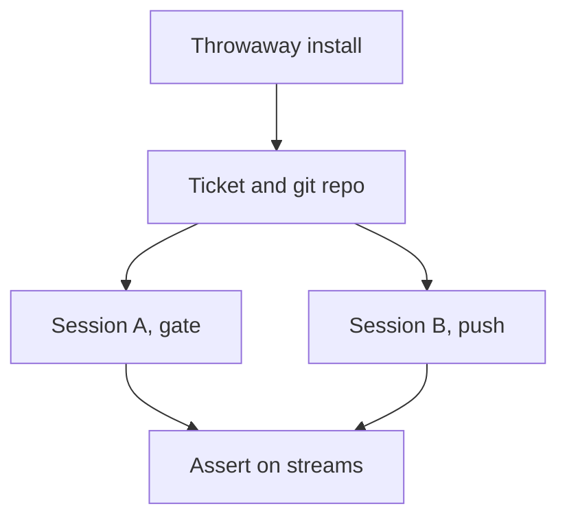

## Purpose

`run_gate.sh` is the live test for two other hooks: the gate that stops a chain command when the earlier step is missing, and the push guard that denies a push to a protected branch. It installs Tollgate into a throwaway home, builds a ticket with no spec and a small git repo with a local bare remote, runs two real Claude Code sessions, and passes both recorded streams to `check_gate.py`. It is the companion of `run.sh`, which does not reach these two hooks {src:tests/e2e/run_gate.sh:8}.

## Dependencies

**Depends on.**
- `bash` with `set -euo pipefail` {src:tests/e2e/run_gate.sh:19}; `env`, `mktemp`, `rm`, `mkdir`, `cp`, `printf`, `python3` {src:tests/e2e/run_gate.sh:22} {src:tests/e2e/run_gate.sh:26-27} {src:tests/e2e/run_gate.sh:30} {src:tests/e2e/run_gate.sh:42} {src:tests/e2e/run_gate.sh:52}.
- `git`, for the throwaway repo and the bare remote {src:tests/e2e/run_gate.sh:44-47}.
- The `claude` program, logged in {src:tests/e2e/run_gate.sh:55} {src:tests/e2e/run_gate.sh:62}.
- `install.sh` called with `--non-interactive` {src:tests/e2e/run_gate.sh:31}. [[install]] / [install](../../install.md).
- `check_gate.py` {src:tests/e2e/run_gate.sh:69}. [[check_gate]] / [check_gate](check_gate.md).
- Installed command files `~/.claude/commands/*.md` in the fake home, copied into the sandbox {src:tests/e2e/run_gate.sh:51-52}. The installer puts `tg-*.md` there {src:install.sh:1145-1146}.
- The installed settings file keys `env.TOLLGATE_KNOWLEDGE` {src:tests/e2e/run_gate.sh:34-35}.
- Environment variable `TOLLGATE_E2E_DIR` (optional work folder) {src:tests/e2e/run_gate.sh:22}.
- The hooks under test: `hooks/pre-prompt-expansion-check-gates.py` and `hooks/git_ask_before_run.py`, named by what `check_gate.py` looks for {src:tests/e2e/check_gate.py:50-51}.

**Used by.** Searched the whole worktree except `docs/` with `git grep` for `run_gate` (2026-11-20).
- Product code: none.
- Mentions only: the header of `check_gate.py` names it {src:tests/e2e/check_gate.py:5}. No installer line, hook, config or other test runs it. Note that `tests/hooks/run.sh` prints the path of `run.sh` but not of this file {src:tests/hooks/run.sh:207}.

## Behavior

Setup. Repo root, work folder (`$TOLLGATE_E2E_DIR`, else a `mktemp -d` folder under `/tmp`), fake home, sandbox and the ticket key `TG-900` are set {src:tests/e2e/run_gate.sh:21-25}. Fake home and sandbox are deleted and recreated {src:tests/e2e/run_gate.sh:26-27}.

Step 1, install. Same pattern as `run.sh`: `install.sh --non-interactive` under `/bin/bash` with an empty environment except `HOME`, `PATH`, `SHELL`, `TERM`; a failure prints a line and exits 1 {src:tests/e2e/run_gate.sh:30-32}. The empty environment also clears `TOLLGATE_KNOWLEDGE`, which the installer would otherwise detect as the vault {src:tests/e2e/run_gate.sh:30} {src:install.sh:570}. A helper `read_env` reads one key of `env` from the installed `settings.json` {src:tests/e2e/run_gate.sh:34}. The vault path comes from it; an empty value prints a failure and exits 1 {src:tests/e2e/run_gate.sh:35-37}. The command name is fixed as `tg-arch` {src:tests/e2e/run_gate.sh:38}.

Step 2, fixtures. A ticket folder `02-tickets/TG-900` is created in the fake vault with a state file holding `Status: NEW` and no spec file {src:tests/e2e/run_gate.sh:41-42}. A repo on branch `main` with one empty commit, a bare repo as `remote.git`, and an `origin` remote pointing to it are created in the sandbox {src:tests/e2e/run_gate.sh:43-47}. The installed command files are copied into the sandbox `.claude/commands` so the session sees them as project commands {src:tests/e2e/run_gate.sh:51-52}.

Step 3, session A. `claude -p "/tg-arch TG-900"` runs from the sandbox with the installed settings and `--setting-sources project`, three turns at most, stream written to `streamA.jsonl` {src:tests/e2e/run_gate.sh:55-57}. A non-zero exit prints a note only {src:tests/e2e/run_gate.sh:58}.

Step 4, session B. The prompt asks for exactly one Bash command, `git -C <repo> push origin main`, and not to retry on a block {src:tests/e2e/run_gate.sh:61}. It runs with `Bash(git:*)` allowed, five turns at most, stream to `streamB.jsonl` {src:tests/e2e/run_gate.sh:62-65}. The deny comes from the push guard when the branch is protected; the default protected list is `main master` {src:hooks/git_ask_before_run.py:40} and the guard skips the deny when `TOLLGATE_ALLOW_PROTECTED_PUSH` equals `1` {src:hooks/git_ask_before_run.py:444}.

Step 5, assertions. It runs `check_gate.py` with the work folder, the bare remote and the ticket key; the script exit code follows that command {src:tests/e2e/run_gate.sh:69}.

## Diagram

## Notes

Code and description disagree:
- The header says "Nothing real is touched; nothing leaves this machine" {src:tests/e2e/run_gate.sh:17}. Both `claude -p` calls send their prompt to the model service {src:tests/e2e/run_gate.sh:55} {src:tests/e2e/run_gate.sh:62}, and they run with the real `HOME`, so the real Claude login is used. The comment at lines 49 and 50 says the same about the real HOME {src:tests/e2e/run_gate.sh:49-50}. The push goes only to the local bare remote {src:tests/e2e/run_gate.sh:46-47}.
- The usage line asks for an empty folder in `TOLLGATE_E2E_DIR` {src:tests/e2e/run_gate.sh:18}. Nothing checks that; only `home` and `sandbox` inside it are deleted {src:tests/e2e/run_gate.sh:26}.
- The header Date is empty {src:tests/e2e/run_gate.sh:3}.
- The header says the gate "must block" session A {src:tests/e2e/run_gate.sh:14}. The test cannot tell a block caused by the missing spec from any other arch block, see the notes in [[check_gate]] / [check_gate](check_gate.md) {src:tests/e2e/check_gate.py:60-61}.

Unchecked inputs:
- `TOLLGATE_E2E_DIR` becomes `WORK` with no check {src:tests/e2e/run_gate.sh:22}, and `rm -rf` deletes `$WORK/home` and `$WORK/sandbox` {src:tests/e2e/run_gate.sh:23-26}. If it points at a real folder that has a `home` or `sandbox` subfolder, both are deleted without asking.
- `VAULT`, read from the installed settings, is used for `mkdir -p` and for a state file write with no check except non-empty {src:tests/e2e/run_gate.sh:35-37} {src:tests/e2e/run_gate.sh:41-42}. Because the install runs with the fake `HOME` and an empty environment, the vault should sit under the fake home {src:tests/e2e/run_gate.sh:30}. I did not trace the installer default base folder `[uncertain]`.
- `TICKET`, `GITREPO` and `CMD` are fixed or derived from the sandbox, and go into the prompt text sent to the model {src:tests/e2e/run_gate.sh:25} {src:tests/e2e/run_gate.sh:43} {src:tests/e2e/run_gate.sh:55} {src:tests/e2e/run_gate.sh:61}.
- The session B result depends on the caller environment. The sessions inherit the shell environment, so a set `TOLLGATE_ALLOW_PROTECTED_PUSH=1` or a changed `TOLLGATE_PROTECTED_BRANCHES` would change the outcome {src:hooks/git_ask_before_run.py:444} {src:hooks/git_ask_before_run.py:252} {src:tests/e2e/run_gate.sh:62}.

Shared file writes: `install.log`, `streamA.jsonl`, `streamB.jsonl`, `debugA.log`, `debugB.log`, `claudeA.err`, `claudeB.err` are written with `>` redirects, not atomic, and nothing stops two runs on the same work folder {src:tests/e2e/run_gate.sh:31} {src:tests/e2e/run_gate.sh:57} {src:tests/e2e/run_gate.sh:65}. The fake vault and sandbox are recreated each run {src:tests/e2e/run_gate.sh:26-27}. The work folder is not removed at the end.
