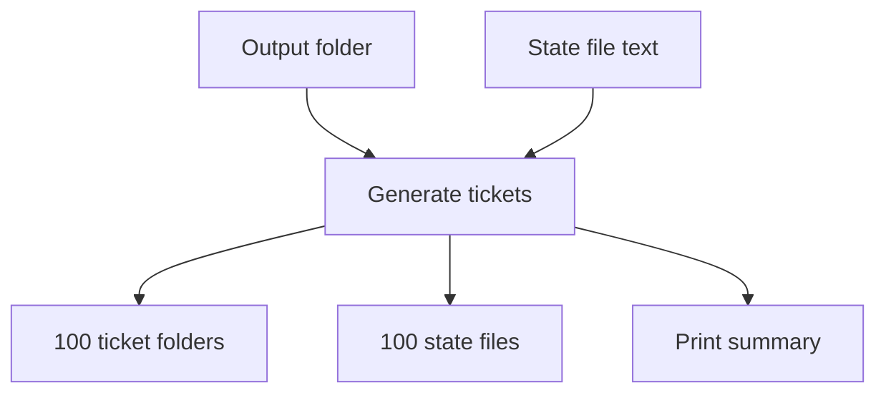

## Purpose

A small generator that builds a fake ticket vault of 100 ticket folders, so a timing test of the ticket tools can run against a larger vault than the hand-made fixtures. The header calls it a fixture for a timing test {src:tests/fixtures/tickets/build_vault_100.py:4}. It lives in `tests/fixtures/tickets/` next to the small fixtures. It is a stand-alone script and is not run by the test suite (see Notes).

## Dependencies

**Depends on.**
- Python standard library: `pathlib` {src:tests/fixtures/tickets/build_vault_100.py:8}.
- No file in the repo is read. It only writes.

**Used by.** Searched the whole worktree except `docs/` with `git grep` for `build_vault_100` and `vault_100` (2026-11-20).
- Product code: none.
- Tests: `tests/scripts/validation/test_validate_state_files.py` opens the file as text and checks two strings; it does not run it {src:tests/scripts/validation/test_validate_state_files.py:62-64}.
- No installer line, hook, config entry or shell script runs the generator, and nothing else mentions `vault_100`.

## Behavior

Paths. The output root is `vault_100/02-tickets` next to the script file, not the current folder {src:tests/fixtures/tickets/build_vault_100.py:10-11}.

`main` {src:tests/fixtures/tickets/build_vault_100.py:22}:
1. Creates the output root with parents, allowing it to exist {src:tests/fixtures/tickets/build_vault_100.py:23}.
2. Loops the numbers 1001 to 1100, which is 100 values {src:tests/fixtures/tickets/build_vault_100.py:24}. The ticket id is `S-<number>` {src:tests/fixtures/tickets/build_vault_100.py:25}.
3. Creates a folder per id, allowing it to exist {src:tests/fixtures/tickets/build_vault_100.py:26-27}.
4. Writes `<id>-state.md` in that folder with `write_text`, UTF-8 {src:tests/fixtures/tickets/build_vault_100.py:28-29}. The content is a front matter block with `ticket_id`, `status: OPEN` and `type: feature` and nothing else {src:tests/fixtures/tickets/build_vault_100.py:13-19}.
5. Prints "Generated 100 ticket folders in <path>" {src:tests/fixtures/tickets/build_vault_100.py:30}. The count in the message is a fixed string, not computed.

The script runs `main` only when executed directly {src:tests/fixtures/tickets/build_vault_100.py:33-34}.

## Diagram: module level (L2, required)

## Diagram: function level (L3, optional)

None: no function has branching that the signature does not show.

## Notes

Code and description disagree:
- The test named `test_build_vault_fixture_script_writes_only_where_asked` never runs the script and never checks where it writes {src:tests/scripts/validation/test_validate_state_files.py:61-64}. It reads the file text and asserts the author line is present and the string `PROJ-174` is absent. It can fail only if someone edits the header or adds that string. The name promises more than the body proves.
- The header says the vault is for a "timing test" {src:tests/fixtures/tickets/build_vault_100.py:4}. No timing test that uses `vault_100` exists in the repo (searched `vault_100`, 2026-11-20).
- The header Date is empty {src:tests/fixtures/tickets/build_vault_100.py:3}.
- The `ticket_id` values use the prefix `S` {src:tests/fixtures/tickets/build_vault_100.py:25}. The other ticket fixtures use `TG`, `EX`, `BAD` and `ABD` prefixes (file list from `git ls-files`, 2026-11-20). The prefix `S` is not one of the standalone prefixes the board tool knows (`T` plus the one in the vault config) {src:scripts/state/vault_query.py:38} {src:scripts/state/vault_query.py:467-470}, so `vault_query.py` run over this vault would mark each ticket `UNRESOLVED` unless a board map covers `S` {src:scripts/state/vault_query.py:200-203}. This is read from the code, not run.

Unchecked inputs: none reach the script. It takes no arguments and no environment variables; the output path comes from the script file location {src:tests/fixtures/tickets/build_vault_100.py:10-11}. Nothing goes to a shell or a network.

Shared file writes: it overwrites any existing `<id>-state.md` in the output folder with `write_text`, which truncates and rewrites in place, not atomically, and nothing stops two runs at once {src:tests/fixtures/tickets/build_vault_100.py:29}. The output folder is under `tests/fixtures/tickets/`, which the state file validator scans for any `*.md` file with `state` in its name {src:scripts/validation/validate_state_files.py:55} and which the test checks as a whole {src:tests/scripts/validation/test_validate_state_files.py:41-43}. Generated files have `ticket_id` and `status`, so they pass the validator {src:scripts/validation/validate_state_files.py:45-48}. The folder `vault_100` is not in `.gitignore` (searched, 2026-11-20), so running the generator leaves 100 untracked files in the repo.
