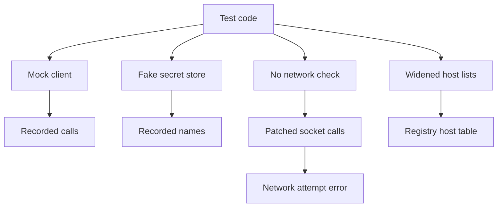
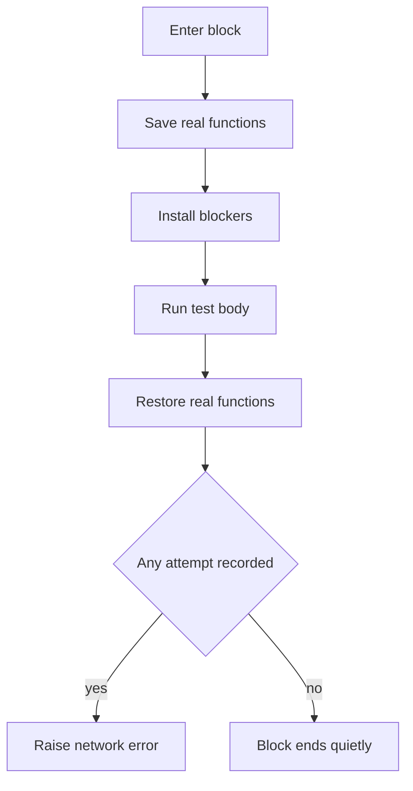

## Purpose

Test support for the connector tests. It gives a test three small stand-ins: a client that records requests and returns canned answers, a secret store that remembers only which names were asked for, and a context manager that fails a test if code tries to reach the network. When it is imported it also widens the connector host lists so that tests can use fake `.invalid` host names, and it keeps a copy of the real lists for the one test file that checks them. Together these let a connector be exercised with no real service and no real secret.

## Dependencies

**Depends on.**
- `contextlib` and `socket` from the standard library {src:tests/harness/connector_helpers.py:3} {src:tests/harness/connector_helpers.py:4}.
- At import time, inside one function: `copy`, `pathlib`, `sys` {src:tests/harness/connector_helpers.py:98} {src:tests/harness/connector_helpers.py:99} {src:tests/harness/connector_helpers.py:100}, and the product module [[registry]] ([registry](../../scripts/connectors/registry.md)) imported as `connectors.registry` {src:tests/harness/connector_helpers.py:102}. To make that import work the function puts the repo `scripts` folder at the front of `sys.path` {src:tests/harness/connector_helpers.py:101}.

**Used by.** Found with `git grep` over the whole repo except `docs/` (searched 2026-11-21). No product code imports this file: every hit is under `tests/`. Test code only:
- Connector tests: `tests/scripts/connectors/comms/comms_base.py` {src:tests/scripts/connectors/comms/comms_base.py:25}, `tests/scripts/connectors/data/test_databricks.py` {src:tests/scripts/connectors/data/test_databricks.py:28}, `tests/scripts/connectors/data/test_secrets_tool.py` {src:tests/scripts/connectors/data/test_secrets_tool.py:25}, `tests/scripts/connectors/plane/plane_sync_test_support.py` {src:tests/scripts/connectors/plane/plane_sync_test_support.py:33}, `tests/scripts/connectors/plane/test_plane_client.py` {src:tests/scripts/connectors/plane/test_plane_client.py:14}, `tests/scripts/connectors/plane/test_plane_connector.py` {src:tests/scripts/connectors/plane/test_plane_connector.py:22}, `tests/scripts/connectors/test_connectors.py` {src:tests/scripts/connectors/test_connectors.py:25}, `tests/scripts/connectors/test_connectors_hardening.py` {src:tests/scripts/connectors/test_connectors_hardening.py:24}, `tests/scripts/connectors/test_redirect_settings.py` {src:tests/scripts/connectors/test_redirect_settings.py:26}, and `tests/scripts/connectors/test_host_allowlist.py` {src:tests/scripts/connectors/test_host_allowlist.py:27}, which reads `REAL_BUILTIN_HOSTS` {src:tests/scripts/connectors/test_host_allowlist.py:87}.
- Other tests: `tests/scripts/search/test_reference.py` imports `assert_no_network` inside a test body {src:tests/scripts/search/test_reference.py:116}, `tests/scripts/sync/test_sweep_path_safety.py` {src:tests/scripts/sync/test_sweep_path_safety.py:24}, `tests/scripts/sync/test_sync_tools.py` {src:tests/scripts/sync/test_sync_tools.py:31}, and the harness's own tests {src:tests/harness/test_harness.py:16}.
- Overview of the harness folder: [[harness]] and [harness](../harness.md).

## Behavior

**MockClient.** Keeps a copy of the canned responses it is given {src:tests/harness/connector_helpers.py:11} and an empty list of calls {src:tests/harness/connector_helpers.py:12}. `request(method, url, **kwargs)` appends one record with the method, url and extra arguments {src:tests/harness/connector_helpers.py:15}, then returns the canned response stored under the exact `(method, url)` pair, or `{"status": 200, "body": {}}` when there is none {src:tests/harness/connector_helpers.py:16}. `get` and `post` only call `request` with the method name filled in {src:tests/harness/connector_helpers.py:19} {src:tests/harness/connector_helpers.py:22}. The class opens no socket: `request` only appends to a list and reads a dict. It never runs the registry's host check, because it is not a `UrlHttp`.

**FakeSecretStore.** Holds values in a plain dict {src:tests/harness/connector_helpers.py:33} and a list of `(action, name)` pairs {src:tests/harness/connector_helpers.py:34}. `set`, `get` and `delete` each append the action and the name, never the value {src:tests/harness/connector_helpers.py:37} {src:tests/harness/connector_helpers.py:41} {src:tests/harness/connector_helpers.py:45}. `get` returns `None` for a missing name {src:tests/harness/connector_helpers.py:42}; `delete` of a missing name does nothing {src:tests/harness/connector_helpers.py:46}. `stored_names()` returns the sorted names currently held {src:tests/harness/connector_helpers.py:49}, and `asked_to_store(name)` is true once `set` was called with that name, even if the name was deleted afterwards {src:tests/harness/connector_helpers.py:52}.

**assert_no_network.** On entry it remembers the real `socket.socket.connect`, `connect_ex` and `socket.getaddrinfo` {src:tests/harness/connector_helpers.py:63} {src:tests/harness/connector_helpers.py:64} {src:tests/harness/connector_helpers.py:65}, and replaces all three with functions that record the attempt and raise `NetworkAttempt` {src:tests/harness/connector_helpers.py:79} {src:tests/harness/connector_helpers.py:80} {src:tests/harness/connector_helpers.py:81}. It yields the list of attempts {src:tests/harness/connector_helpers.py:83}. In a `finally` it puts the real functions back {src:tests/harness/connector_helpers.py:84-87}. After the block, if any attempt was recorded it raises `NetworkAttempt` again {src:tests/harness/connector_helpers.py:88} {src:tests/harness/connector_helpers.py:89}. That last step is what makes the check hold when the code under test catches the first error itself.

**Host list widening (runs on import).** The function `_allow_invalid_test_hosts` is called when the module loads {src:tests/harness/connector_helpers.py:112}. It saves a deep copy of the registry's real built-in host table in `REAL_BUILTIN_HOSTS` {src:tests/harness/connector_helpers.py:104}, then adds the suffix `.invalid` to the entries for `fakeconn`, `jira`, `slack`, `notion`, `calendar`, `databricks` and `plane`, creating the entry when the connector had none {src:tests/harness/connector_helpers.py:105-108}. The effect is that any test using one of those names can turn a connector on with an address such as `https://x.invalid` and pass the host check, while the real hosts stay allowed {src:tests/harness/connector_helpers.py:107} {src:scripts/connectors/registry.py:173-176}. The module constant starts as an empty dict and is filled by that call {src:tests/harness/connector_helpers.py:111}.

## Diagram: module level (L2, required)

## Diagram: function level (L3, optional)

## Notes

- **Import changes product state.** Importing this file edits the registry's host table for the whole test process {src:tests/harness/connector_helpers.py:107}. Any test file that imports it, even only for `MockClient`, therefore runs with `.invalid` allowed for seven connector names. A test of the real host rules must restore the saved copy first, as `test_host_allowlist.py` does {src:tests/scripts/connectors/test_host_allowlist.py:85-87}. A test that never imports this file sees the real table.
- **Docstring versus code.** The docstring says it fails the test "if any code opens a socket connection inside the block" {src:tests/harness/connector_helpers.py:61}. The code replaces only three in-process functions {src:tests/harness/connector_helpers.py:79} {src:tests/harness/connector_helpers.py:80} {src:tests/harness/connector_helpers.py:81}. A child process started by the code under test is not covered, and neither is any socket call that does not go through those three names. The patch is process wide, so other threads are blocked too.
- **Docstring versus code, secret store.** The class docstring says values stay in memory only and `requests` keeps names, never values {src:tests/harness/connector_helpers.py:28} {src:tests/harness/connector_helpers.py:29}. This holds: values go only into `_data` {src:tests/harness/connector_helpers.py:38}. The dict is a normal attribute, so a test can still read a value through `_data`.
- **Only two HTTP verbs.** `MockClient` has `get` and `post` and no `put`, `delete` or `patch` {src:tests/harness/connector_helpers.py:18} {src:tests/harness/connector_helpers.py:21}. A connector that calls another verb on the mock fails with an attribute error. Searched the class body, 2026-11-21.
- **Canned answers are shared.** The stored response dict is returned by reference {src:tests/harness/connector_helpers.py:16}, so a caller that edits it changes later answers for the same key.
- **Exact match only.** The lookup key is the `(method, url)` pair, so the method must match too and the url must match in full, query string included {src:tests/harness/connector_helpers.py:16}. A response stored under a url alone is never found, and a `GET` entry is not returned for a `POST` to the same url.
- **Unchecked inputs.** `MockClient.request` receives a method and url and never uses them to open anything {src:tests/harness/connector_helpers.py:15} {src:tests/harness/connector_helpers.py:16}. The one path built from a value is the `scripts` folder put on `sys.path`, derived from the file's own location, not from input {src:tests/harness/connector_helpers.py:101}. No input reaches a shell command, network address or outbound text, and none needs a check.
- **Shared state.** The file writes to no file. Its shared state is the three socket functions, replaced and restored by `assert_no_network` {src:tests/harness/connector_helpers.py:79-87} with no lock; two overlapping uses, for example from two threads, could leave a blocker in place of the real function, because the second use saves the first use's blocker as the "real" one {src:tests/harness/connector_helpers.py:63}. The other shared state is the registry host table, edited in place on import {src:tests/harness/connector_helpers.py:107-108}, and `sys.path`, which gets one more entry when the module loads {src:tests/harness/connector_helpers.py:101}.
- **Shape.** The file starts with a `#!/usr/bin/env python3` line and is committed with the executable bit (git mode 100755), but it has no entry point and only defines classes, functions and one constant {src:tests/harness/connector_helpers.py:1}.
