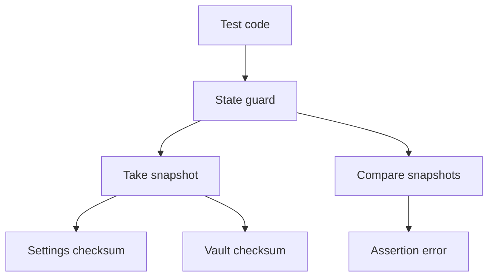

## Purpose

A read-only tripwire for tests. Before a run it takes a fingerprint of the real Claude settings file and, if asked, of a real vault folder. After the run it takes the fingerprint again and fails if either one changed. It exists so a test suite that is meant to work only in a throwaway home can prove it never touched the real files.

## Dependencies

**Depends on.** `hashlib` and `os` from the standard library {src:tests/harness/real_guard.py:8} {src:tests/harness/real_guard.py:9}. No other repo file.

**Used by.** Searched with `git grep` over the whole repo except `docs/` (2026-11-20). No product code imports it. Test code only:
- `tests/scripts/cron/test_cron_tools.py` {src:tests/scripts/cron/test_cron_tools.py:31}
- `tests/scripts/sync/test_sync_tools.py` {src:tests/scripts/sync/test_sync_tools.py:32}
- `tests/system/test_e2e.py`, which also calls `file_checksum` and `folder_checksum` directly {src:tests/system/test_e2e.py:28}
- `tests/harness/test_harness.py` {src:tests/harness/test_harness.py:15}
- Overview of the harness folder: [[harness]] and [harness](../harness.md).

## Behavior

**file_checksum(path).** Returns the string `MISSING` when the path is not a regular file {src:tests/harness/real_guard.py:14} {src:tests/harness/real_guard.py:15}. Otherwise it reads the file in 64 KiB chunks and returns the SHA-256 hex digest {src:tests/harness/real_guard.py:17} {src:tests/harness/real_guard.py:18} {src:tests/harness/real_guard.py:19} {src:tests/harness/real_guard.py:20}.

**folder_checksum(path).** Returns `MISSING` when the path is not a directory {src:tests/harness/real_guard.py:25} {src:tests/harness/real_guard.py:26}. Otherwise it walks the tree with sorted folder and file names {src:tests/harness/real_guard.py:28} {src:tests/harness/real_guard.py:29} {src:tests/harness/real_guard.py:30}. For each file it feeds the relative path, size and modification time in nanoseconds into the hash {src:tests/harness/real_guard.py:35}, then the file's own checksum {src:tests/harness/real_guard.py:36}. A file that cannot be read adds an `unreadable` marker instead of failing the run {src:tests/harness/real_guard.py:37} {src:tests/harness/real_guard.py:38}.

**RealStateGuard.**
1. The constructor takes a settings path and an optional vault path. With no settings path it uses `~/.claude/settings.json`, expanded when the object is built {src:tests/harness/real_guard.py:46} {src:tests/harness/real_guard.py:47}.
2. `snapshot()` returns a dict with the settings checksum, plus a vault checksum only when a vault path was given {src:tests/harness/real_guard.py:52} {src:tests/harness/real_guard.py:53} {src:tests/harness/real_guard.py:54}.
3. `record()` stores a snapshot as the "before" state {src:tests/harness/real_guard.py:58}.
4. `verify()` raises `RuntimeError` if `record()` was never called {src:tests/harness/real_guard.py:63} {src:tests/harness/real_guard.py:64}. Otherwise it takes a new snapshot, compares each key of the old one {src:tests/harness/real_guard.py:65} {src:tests/harness/real_guard.py:66}, and raises `AssertionError` naming the changed keys (`settings`, `vault`) {src:tests/harness/real_guard.py:67} {src:tests/harness/real_guard.py:68}. It returns `True` when nothing changed {src:tests/harness/real_guard.py:69}.
5. As a context manager it records on entry {src:tests/harness/real_guard.py:72} and verifies on exit only when the body raised nothing {src:tests/harness/real_guard.py:76} {src:tests/harness/real_guard.py:77}. It never swallows an exception {src:tests/harness/real_guard.py:78}.

## Diagram: module level (L2, required)

## Diagram: function level (L3, optional)

None: no function has branching that the signature does not show.

## Notes

- **Description versus code.** The `file_checksum` docstring says it returns `MISSING` "if absent" {src:tests/harness/real_guard.py:13}. The code returns it for anything that is not a regular file {src:tests/harness/real_guard.py:14}: a folder, or a link whose target is missing, gives the same answer as a file that does not exist. The same holds for `folder_checksum` and a path that is not a directory {src:tests/harness/real_guard.py:25}.
- **What a change must look like to be caught.** Only file names, sizes, modification times and bytes are hashed {src:tests/harness/real_guard.py:30} {src:tests/harness/real_guard.py:35} {src:tests/harness/real_guard.py:36}. An empty folder created or removed inside the vault changes nothing that is hashed, and neither does a permission change. The walk does not follow links to folders (default behavior of `os.walk`) {src:docs:python-os-walk-followlinks}. Linked files are followed by `os.stat` and `open` {src:tests/harness/real_guard.py:34} {src:tests/harness/real_guard.py:17}.
- **Home folder dependence.** The default settings path comes from `os.path.expanduser("~")` {src:tests/harness/real_guard.py:46} {src:tests/harness/real_guard.py:47}, so it follows the `HOME` of the running process. A test that changes `HOME` in its own process before building the guard would guard the wrong file. The throwaway helpers pass a separate environment dict to child processes and leave the parent's `HOME` alone {src:tests/harness/throwaway_home.py:30} {src:tests/harness/throwaway_home.py:34}.
- **False alarms.** Nothing locks the guarded files. If another program, for example a live Claude session, edits the real settings file or vault during a run, the guard reports a change that the test did not make. No code in the file prevents this.
- **Unchecked inputs.** `settings_path`, `vault_path` and the argument of the two checksum functions go straight into `os.path.isfile`, `open`, `os.path.isdir` and `os.walk` with no validation {src:tests/harness/real_guard.py:14} {src:tests/harness/real_guard.py:17} {src:tests/harness/real_guard.py:25} {src:tests/harness/real_guard.py:28}. All four calls only read. No input reaches a shell command, network address or outbound text.
- **Shared file writes.** None. The module opens files only for reading {src:tests/harness/real_guard.py:17}. Reading a large vault is slow, because every byte is hashed {src:tests/harness/real_guard.py:36}.
- **Test coverage.** The clean run, a settings change, a vault change and the missing-file cases are exercised by HAR-05 to HAR-08 in [[test_harness]] and [test_harness](test_harness.md).
