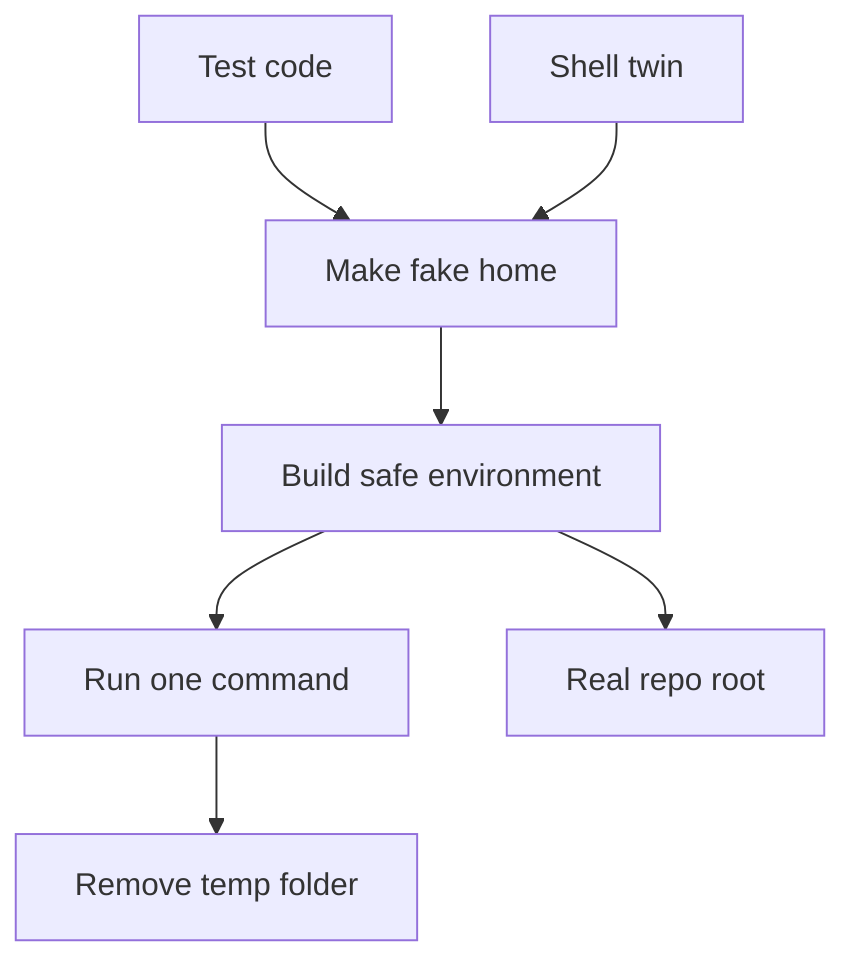

## Purpose

This one page covers two source files that the doc plan mapped to the same page path: the Python helper `tests/harness/throwaway_home.py` (the main subject, used by almost every test) and its shell twin `tests/harness/throwaway_home.sh`. Both build a fake home folder under a fake user name, point `HOME` and the `TOLLGATE_*` variables at it, run one command there, and remove the folder afterwards. Tests use them so that a run never reads or writes the real settings, vault or code folders.

## Dependencies

**Depends on.**
- Python file: `contextlib`, `getpass`, `os`, `shutil`, `subprocess`, `tempfile` from the standard library {src:tests/harness/throwaway_home.py:7} {src:tests/harness/throwaway_home.py:8} {src:tests/harness/throwaway_home.py:9} {src:tests/harness/throwaway_home.py:10} {src:tests/harness/throwaway_home.py:11} {src:tests/harness/throwaway_home.py:12}. No other repo module.
- Shell file: `bash` (it uses `compgen` and arrays), `mktemp`, `id`, `mkdir`, `env`, `grep`, `dirname` and `rm` {src:tests/harness/throwaway_home.sh:19} {src:tests/harness/throwaway_home.sh:11} {src:tests/harness/throwaway_home.sh:10} {src:tests/harness/throwaway_home.sh:13} {src:tests/harness/throwaway_home.sh:20} {src:tests/harness/throwaway_home.sh:26} {src:tests/harness/throwaway_home.sh:35}.
- The meaning of `TOLLGATE_HOME` is described in [[variables]] and [variables](../../variables.md) {src:docs/variables.md:43}.

**Used by.** Searched with `git grep` over the whole repo except `docs/` (2026-11-20). No product code uses either file. Test code only.
- Python helper, imported directly: `tests/scripts/cache/test_cache.py` {src:tests/scripts/cache/test_cache.py:24}, `tests/scripts/chart/test_chart_check.py` {src:tests/scripts/chart/test_chart_check.py:25}, `tests/scripts/connectors/comms/comms_base.py` {src:tests/scripts/connectors/comms/comms_base.py:26}, `tests/scripts/connectors/data/test_databricks.py` {src:tests/scripts/connectors/data/test_databricks.py:29}, `tests/scripts/connectors/data/test_secrets_tool.py` {src:tests/scripts/connectors/data/test_secrets_tool.py:26}, `tests/scripts/connectors/plane/plane_sync_test_support.py` {src:tests/scripts/connectors/plane/plane_sync_test_support.py:39}, `tests/scripts/connectors/plane/test_plane_connector.py` {src:tests/scripts/connectors/plane/test_plane_connector.py:29}, `tests/scripts/connectors/test_connectors.py` {src:tests/scripts/connectors/test_connectors.py:26}, `tests/scripts/connectors/test_connectors_hardening.py` {src:tests/scripts/connectors/test_connectors_hardening.py:25}, `tests/scripts/connectors/test_redirect_settings.py` {src:tests/scripts/connectors/test_redirect_settings.py:27}, `tests/scripts/core/test_bootstrap.py` {src:tests/scripts/core/test_bootstrap.py:22}, `tests/scripts/core/test_paths.py` {src:tests/scripts/core/test_paths.py:20}, `tests/scripts/core/test_vault_git.py` {src:tests/scripts/core/test_vault_git.py:20}, `tests/scripts/cron/test_cron_tools.py` {src:tests/scripts/cron/test_cron_tools.py:29}, `tests/scripts/state/test_state_tools.py` {src:tests/scripts/state/test_state_tools.py:26}, `tests/scripts/sync/test_sweep_path_safety.py` {src:tests/scripts/sync/test_sweep_path_safety.py:23}, `tests/scripts/sync/test_sync_tools.py` {src:tests/scripts/sync/test_sync_tools.py:30}, `tests/scripts/sync/test_sync_vault_scan.py` {src:tests/scripts/sync/test_sync_vault_scan.py:29}, `tests/harness/test_harness.py` {src:tests/harness/test_harness.py:14}.
- Through a shared re-export: `tests/scripts/search/support.py` imports it {src:tests/scripts/search/support.py:25}, and the search tests import the name from `support`, for example `tests/scripts/search/test_golden.py` {src:tests/scripts/search/test_golden.py:15} and `tests/scripts/search/test_ticket_flags.py` {src:tests/scripts/search/test_ticket_flags.py:17}.
- Shell twin: only `test_harness.py` sources it, in HAR-12 {src:tests/harness/test_harness.py:132} {src:tests/harness/test_harness.py:134} and in HAR-13, which is new in the cleanup {src:tests/harness/test_harness.py:149} {src:tests/harness/test_harness.py:150}. No other file calls `tg_make_home`, `tg_run_in_home` or `tg_clean_home` (searched by those names).
- `run_in_home` and `tollgate_env` are used by the harness tests only {src:tests/harness/test_harness.py:35}. No other test calls `run_in_home`, `tollgate_env`, `fake_user_name` or `keep=` (searched 2026-11-20).
- Overview of the harness folder: [[harness]] and [harness](../harness.md). Its tests: [[test_harness]] and [test_harness](test_harness.md).

## Behavior

### Python helper

**fake_user_name().** Starts from `tgtester` {src:tests/harness/throwaway_home.py:14} and adds `x` until the name differs from the real login name {src:tests/harness/throwaway_home.py:21} {src:tests/harness/throwaway_home.py:23} {src:tests/harness/throwaway_home.py:24}.

**tollgate_env(home, base=None).** Copies `base`, or the whole current environment when `base` is `None` {src:tests/harness/throwaway_home.py:30}. It deletes every variable whose name starts with `TOLLGATE_` {src:tests/harness/throwaway_home.py:31} {src:tests/harness/throwaway_home.py:32} {src:tests/harness/throwaway_home.py:33}. It sets `HOME`, and sets `USER` and `LOGNAME` to the last part of the home path, which is the fake user name {src:tests/harness/throwaway_home.py:34} {src:tests/harness/throwaway_home.py:35}. It then sets nine `TOLLGATE_` variables {src:tests/harness/throwaway_home.py:36-44}:
- Pointed inside the home: `TOLLGATE_KNOWLEDGE` (`vault`), `TOLLGATE_CODE_DIR` (`code`), `TOLLGATE_STATE_DIR` (`.tollgate/state`), `TOLLGATE_CONFIG` (`.claude/tollgate-config`), `TOLLGATE_PATHS` (`.tollgate/paths.yaml`), `TOLLGATE_CONNECTORS` (`.tollgate/connectors`), `TOLLGATE_GATE_LOG` (`.tollgate/gate.log`).
- Pointed at the real repo checkout: `TOLLGATE_HOME` {src:tests/harness/throwaway_home.py:40}, whose value is three folder levels above this file {src:tests/harness/throwaway_home.py:16}.
- A flag: `TOLLGATE_NONINTERACTIVE` is `1` {src:tests/harness/throwaway_home.py:44}.

**throwaway_home(keep=False).** A context manager. It makes a unique folder with `tempfile.mkdtemp(prefix="tollgate-test-")` {src:tests/harness/throwaway_home.py:51}, and a home under it named after the fake user {src:tests/harness/throwaway_home.py:52}. It creates four sub-folders: `vault`, `code`, `.claude` and `.tollgate/state` {src:tests/harness/throwaway_home.py:53} {src:tests/harness/throwaway_home.py:54}. It yields `(home, env)` {src:tests/harness/throwaway_home.py:56}. In a `finally` it removes the whole temporary root, errors ignored, unless `keep` is true {src:tests/harness/throwaway_home.py:57} {src:tests/harness/throwaway_home.py:58} {src:tests/harness/throwaway_home.py:59}. Cleanup therefore also runs when the body raises.

**run_in_home(cmd, input_text=None, timeout=60, extra_env=None).** Opens a throwaway home {src:tests/harness/throwaway_home.py:64}, merges `extra_env` over the built environment {src:tests/harness/throwaway_home.py:65} {src:tests/harness/throwaway_home.py:66}, and runs `cmd` as a list (no shell) with captured text output, a 60 second default timeout and the home as working folder {src:tests/harness/throwaway_home.py:67} {src:tests/harness/throwaway_home.py:68}. It returns the finished process and the home path {src:tests/harness/throwaway_home.py:69}.

### Shell twin (throwaway_home.sh)

It is a library to `source`, not a program {src:tests/harness/throwaway_home.sh:2} {src:tests/harness/throwaway_home.sh:3}. It defines three functions and has no entry point of its own.
- `tg_make_home` picks `tgtester`, or `tgtesterx` when that is the real user (from `id -un`) {src:tests/harness/throwaway_home.sh:9} {src:tests/harness/throwaway_home.sh:10}, makes a temp root under `${TMPDIR:-/tmp}` {src:tests/harness/throwaway_home.sh:11}, creates the same four sub-folders {src:tests/harness/throwaway_home.sh:13}, and exports `TG_ROOT` and `TG_HOME` {src:tests/harness/throwaway_home.sh:14}.
- `tg_run_in_home CMD...` builds a list of `-u NAME` options for every exported variable that starts with `TOLLGATE_` {src:tests/harness/throwaway_home.sh:19}, then runs, in a subshell started inside the fake home, `env` with those unsets, `HOME` and the same nine `TOLLGATE_` values {src:tests/harness/throwaway_home.sh:20} {src:tests/harness/throwaway_home.sh:21-30}, followed by the command {src:tests/harness/throwaway_home.sh:31}. The list is expanded with the `${name[@]+"${name[@]}"}` form, which expands to nothing when the list is empty, so a calling shell with `set -u` on bash 3.2 does not stop when no `TOLLGATE_*` variable is exported {src:tests/harness/throwaway_home.sh:20}. `TOLLGATE_HOME` is the repo root found from the library's own location {src:tests/harness/throwaway_home.sh:26}.
- `tg_clean_home` deletes `TG_ROOT` with `rm -rf` when the variable is set and the folder exists, then unsets both variables {src:tests/harness/throwaway_home.sh:35} {src:tests/harness/throwaway_home.sh:36}.

## Diagram: module level (L2, required)

## Diagram: function level (L3, optional)

None: no function has branching that the signature does not show.

## Notes

- **Docstring versus code (Python).** The module docstring says the command runs "with HOME and every TOLLGATE_* variable pointed there" {src:tests/harness/throwaway_home.py:4} {src:tests/harness/throwaway_home.py:5}. The code removes all `TOLLGATE_*` variables and sets nine new ones {src:tests/harness/throwaway_home.py:31} {src:tests/harness/throwaway_home.py:36}. Of those, `TOLLGATE_HOME` points at the real repo {src:tests/harness/throwaway_home.py:40}, as the comment above `REPO_ROOT` says {src:tests/harness/throwaway_home.py:15}, and `TOLLGATE_NONINTERACTIVE` is a flag {src:tests/harness/throwaway_home.py:44}. Any other `TOLLGATE_*` variable is deleted, not pointed.
- **Docstring versus code (Python, return value).** `run_in_home` says it returns `(CompletedProcess, home)` {src:tests/harness/throwaway_home.py:63}. The folder named by `home` is already removed when the function returns, because the `with` block ends at the `return` {src:tests/harness/throwaway_home.py:64} {src:tests/harness/throwaway_home.py:69}. The path is only usable as a string.
- **Docstring versus code (Python, cleanup).** The `throwaway_home` docstring says the home is "Removed on exit" {src:tests/harness/throwaway_home.py:50}; with `keep=True` it is not {src:tests/harness/throwaway_home.py:58}.
- **Partial isolation.** Only `HOME`, `USER`, `LOGNAME` and `TOLLGATE_*` are replaced. The rest of the environment, including `PATH`, is copied from the caller {src:tests/harness/throwaway_home.py:30}. A command that finds the real repo through `TOLLGATE_HOME` {src:tests/harness/throwaway_home.py:40} can read, and if it writes relative to that variable, write the real checkout.
- **Folders that are not created.** The paths for `TOLLGATE_CONFIG`, `TOLLGATE_PATHS`, `TOLLGATE_CONNECTORS` and `TOLLGATE_GATE_LOG` are set {src:tests/harness/throwaway_home.py:39} {src:tests/harness/throwaway_home.py:41} {src:tests/harness/throwaway_home.py:42} {src:tests/harness/throwaway_home.py:43} but only the four folders at line 53 and 54 exist, so those targets are absent until a test creates them.
- **Leftover folders.** If the process is killed, the `finally` does not run and the temp folder stays {src:tests/harness/throwaway_home.py:57}. The shell file has no `trap` (searched the file for `trap`, 2026-11-20).
- **Shell twin differences.** It does not set `USER` or `LOGNAME` {src:tests/harness/throwaway_home.sh:21}, which the Python version does {src:tests/harness/throwaway_home.py:35}. It has no `keep` option and no timeout.
- **Shell bug, fixed in the cleanup: empty unset list under `set -u`.** Before the cleanup, the line was `env "${unset_args[@]}"`. With no `TOLLGATE_*` variable exported and `set -u` in the calling shell, bash 3.2 (the version macOS ships) stopped with "unbound variable" because the array was empty. The line now uses the guarded form {src:tests/harness/throwaway_home.sh:18} {src:tests/harness/throwaway_home.sh:20}. HAR-13 covers it: it runs under `set -u` with every `TOLLGATE_` variable removed from the environment, prefers `/bin/bash`, and expects exit 0 and a `TOLLGATE_KNOWLEDGE` ending in `/vault` {src:tests/harness/test_harness.py:150} {src:tests/harness/test_harness.py:152} {src:tests/harness/test_harness.py:153} {src:tests/harness/test_harness.py:155} {src:tests/harness/test_harness.py:156}.
- **Shell bug, still present: relative `source` path.** `TOLLGATE_HOME` is computed after the subshell has changed into the fake home, from the library's own path {src:tests/harness/throwaway_home.sh:20} {src:tests/harness/throwaway_home.sh:26}. When the file is sourced with a relative path (`source ./throwaway_home.sh`), `dirname` of that relative path is read from inside the fake home, so the result is not the repo root. This was seen by running the file on 2026-11-20 before the cleanup; line 26 has not changed since. The only caller, HAR-12 and HAR-13, use an absolute path {src:tests/harness/test_harness.py:132} {src:tests/harness/test_harness.py:149}, so no test shows it.
- **Unchecked inputs.** `cmd` and `extra_env` go to `subprocess.run` without any check {src:tests/harness/throwaway_home.py:66} {src:tests/harness/throwaway_home.py:67}. There is no shell, so `cmd` is not parsed, but any program named in it runs with the caller's rights. In the shell file, the command arguments are run as given {src:tests/harness/throwaway_home.sh:31}. `tg_clean_home` runs `rm -rf` on `TG_ROOT` after checking only that it is non-empty and a folder {src:tests/harness/throwaway_home.sh:35}. `tg_make_home` overwrites `TG_ROOT` with a fresh `mktemp` folder {src:tests/harness/throwaway_home.sh:11}, but a caller that sets `TG_ROOT` to another folder before calling `tg_clean_home` would have that folder deleted.
- **Shared file writes.** The helpers write only inside their own unique temp folder {src:tests/harness/throwaway_home.py:51} {src:tests/harness/throwaway_home.sh:11}. They write to no shared file, so no locking is involved.
- **Test coverage of the shell twin.** HAR-12 and HAR-13 are the only tests of the shell twin. HAR-12 sets `TOLLGATE_KNOWLEDGE` in the caller {src:tests/harness/test_harness.py:137}, but the helper sets that variable itself, so neither test proves that the unset loop removes a stray variable {src:tests/harness/throwaway_home.sh:19} {src:tests/harness/throwaway_home.sh:22}. See [[test_harness]] and [test_harness](test_harness.md).
- **Shape.** The Python file has a `#!/usr/bin/env python3` line and the executable bit {src:tests/harness/throwaway_home.py:1}; the shell file is committed without the executable bit (git mode 100644), which fits a sourced library.
