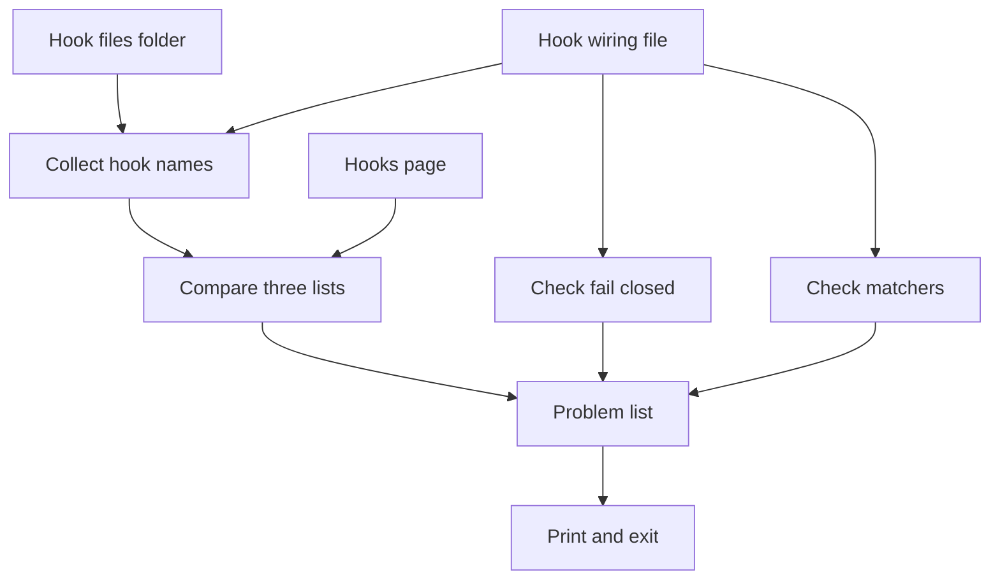
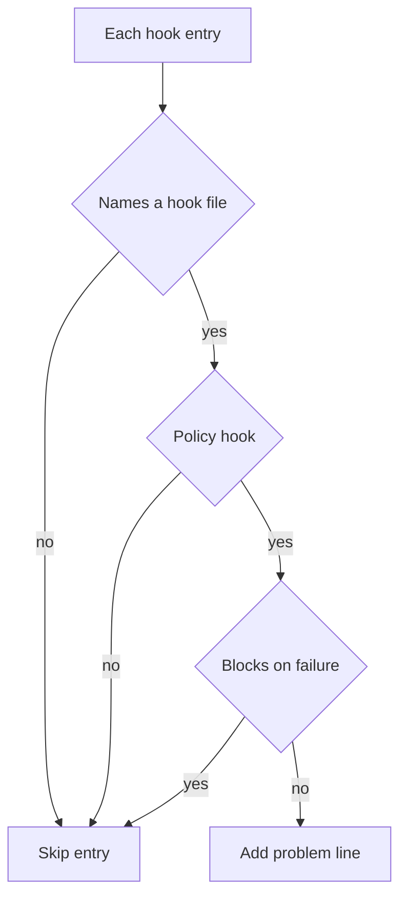

## Purpose

This is a drift check, not a unit test. It fails when the hook files in `hooks/`, the hook entries in `settings.json` and the hook list in `docs/hooks.md` disagree about which hooks exist, and when a few policy rules for those entries are broken {src:tests/hooks/check_hook_inventory.py:5} {src:tests/hooks/check_hook_inventory.py:16-23}. It lives in the test folder but has no `test_` prefix, so the unit test finder does not pick it up; the runner and CI call it as its own step {src:tests/hooks/run.sh:190} {src:.github/workflows/tests.yml:31-32}. It was not run while this page was written.

## Dependencies

**Depends on.**
- Standard library: `json`, `re`, `sys` and `pathlib` {src:tests/hooks/check_hook_inventory.py:30-33}.
- The folder `hooks/`, listed for file names {src:tests/hooks/check_hook_inventory.py:36} {src:tests/hooks/check_hook_inventory.py:109-111}.
- The file `settings.json` at the repo root, read as JSON: [[settings]] and [settings](../../settings.md) {src:tests/hooks/check_hook_inventory.py:37} {src:tests/hooks/check_hook_inventory.py:117}.
- The page `docs/hooks.md`, read as plain text and searched by substring: [[hooks]] (no doc yet) {src:tests/hooks/check_hook_inventory.py:38} {src:tests/hooks/check_hook_inventory.py:119}.
- The name of the gate hook `pre-prompt-expansion-check-gates.py`, held as a constant: [[pre-prompt-expansion-check-gates]] and [pre-prompt-expansion-check-gates](../../hooks/pre-prompt-expansion-check-gates.md) {src:tests/hooks/check_hook_inventory.py:59}.

**Used by.** Product code: none. Tests and automation: the hook runner calls it with `python3` {src:tests/hooks/run.sh:190}, and the CI workflow runs it as a step of its own {src:.github/workflows/tests.yml:32}. Searched 2026-11-20: the whole worktree except `.git`, `docs/`, caches and virtual environments for `check_hook_inventory`; the hits were those two lines and the file's own `Run:` line {src:tests/hooks/check_hook_inventory.py:25}. Its functions are called by nothing else, and no test file imports them (searched for `find_problems`, `hooks_not_blocking`, `skill_gate_missing`, `multiedit_matchers` and `wired_names`, 2026-11-20), so the checking logic itself has no tests.

## Behavior

Run it with `python3 tests/hooks/check_hook_inventory.py`. It prints one `FAIL` line per problem, or one `PASS` line when there are none, and exits 1 on any problem and 0 otherwise {src:tests/hooks/check_hook_inventory.py:133-139}.

**Finding the paths.** The repo root is two folders above this file, and the three inputs sit under it {src:tests/hooks/check_hook_inventory.py:35-38}. A hook name is found by a regular expression `hooks/<name>` searched in each hook command string of `settings.json`; only the first match in a command counts {src:tests/hooks/check_hook_inventory.py:60} {src:tests/hooks/check_hook_inventory.py:63-72}. The listing of `hooks/` keeps regular files whose name does not start with a dot, so folders such as a cache folder are skipped {src:tests/hooks/check_hook_inventory.py:109-111}.

**The six checks**, all run by `find_problems` {src:tests/hooks/check_hook_inventory.py:114-130}:
1. Every file in `hooks/` that is not on the helper list must be wired in `settings.json` {src:tests/hooks/check_hook_inventory.py:124-126}. The helper list holds the shared modules, the two git hook scripts and some data and script files {src:tests/hooks/check_hook_inventory.py:39-52}.
2. Every file in `hooks/`, helpers included, must appear somewhere in `docs/hooks.md` as a plain substring {src:tests/hooks/check_hook_inventory.py:127-129}.
3. Every hook file that `settings.json` names must exist in `hooks/` {src:tests/hooks/check_hook_inventory.py:120}.
4. Every `PreToolUse` and `UserPromptExpansion` entry, and the `PostToolUse` entries for the secret scanner, the PHI scanner and `scrub_secrets.py`, must set `onFailure` to `block` {src:tests/hooks/check_hook_inventory.py:53-58} {src:tests/hooks/check_hook_inventory.py:75-88}.
5. No matcher may contain the text `MultiEdit` {src:tests/hooks/check_hook_inventory.py:91-98}.
6. A `PreToolUse` group with the matcher `Skill` must run the gate hook {src:tests/hooks/check_hook_inventory.py:101-106}.

What a failure means: a hook was added, removed or renamed in one place and not the others, or a policy hook lost its fail closed setting, so a crash in it would let the action through.

## Diagram: module level (L2, required)

## Diagram: function level (L3, optional)

The policy check in `hooks_not_blocking` has three decisions per entry {src:tests/hooks/check_hook_inventory.py:75-88}.

## Notes

**Description against code.** The header text and the six checks listed in it match the code {src:tests/hooks/check_hook_inventory.py:16-23}. No disagreement found between the header and the code.

**Weak spots in the check**
- Check 2 is a substring test, so a file name that sits inside a longer name in `docs/hooks.md` counts as mentioned {src:tests/hooks/check_hook_inventory.py:128}.
- A helper name on the helper list that no longer exists in `hooks/` is not reported; the list is only subtracted {src:tests/hooks/check_hook_inventory.py:124}. The list and the policy hook list are fixed text, so a new helper or policy hook needs an edit here {src:tests/hooks/check_hook_inventory.py:39-58}.
- Only the first `hooks/` reference in a command string is read, so a command that runs two hook files would hide the second one from checks 1 and 3 {src:tests/hooks/check_hook_inventory.py:69-71}.
- The `UserPromptSubmit` and `PostToolUse` entries for other hooks are not required to set `onFailure`; only the names in the policy list are {src:tests/hooks/check_hook_inventory.py:85}.
- The check reads `settings.json` in the repo, not the installed copy that Claude Code uses, so drift between those two is not seen {src:tests/hooks/check_hook_inventory.py:37}.

**Machine and version dependence.** It needs Python 3.7 or newer; the annotations `set[str]` and `list[str]` are not evaluated because of the future import {src:tests/hooks/check_hook_inventory.py:28} {src:tests/hooks/check_hook_inventory.py:63}, which was kept from when the minimum was 3.9 and is not needed on 3.12. It uses no machine path: the root comes from the file's own location {src:tests/hooks/check_hook_inventory.py:35}. A `settings.json` that is not valid JSON raises an uncaught error, which still ends the run with a non zero exit {src:tests/hooks/check_hook_inventory.py:117}.

**Inputs without a check, and shared writes.** The file reads three local files and writes nothing; it takes no command line arguments, no network address and no environment variable {src:tests/hooks/check_hook_inventory.py:114-143}.
