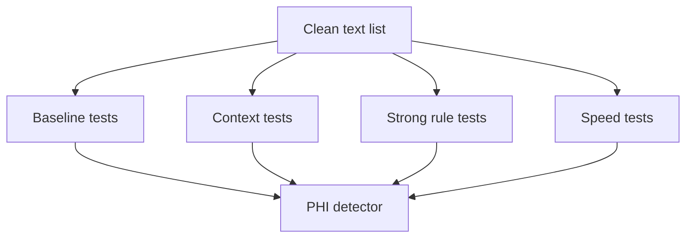

## Purpose

This file is test data, not a test. It holds one tuple of ordinary engineering text that looks a little like patient data but is not, so that the PHI detection tests can assert the detector stays quiet on all of it. Its own header says later detection rules must keep every entry quiet {src:tests/hooks/clean_corpus.py:10-11}. The page is short on purpose: the file has no functions and no logic.

## Dependencies

**Depends on.** Nothing at run time. The only import is `from __future__ import annotations` {src:tests/hooks/clean_corpus.py:16}, which is skipped in the `imports` field by the doc-gen rule.

**Used by.** No product code reads this file (searched with `git grep -n -E "clean_corpus|CLEAN_CORPUS"` outside `docs/`, 2026-11-20). Four test files import it by name:
- Tests: `tests/hooks/test_phi_baseline.py` {src:tests/hooks/test_phi_baseline.py:29}, `tests/hooks/test_phi_context_rules.py` {src:tests/hooks/test_phi_context_rules.py:24}, `tests/hooks/test_phi_safety_speed.py` {src:tests/hooks/test_phi_safety_speed.py:34}, `tests/hooks/test_phi_strong_rules.py` {src:tests/hooks/test_phi_strong_rules.py:24}.

Pages that exist for those tests: [[test_phi_baseline]] and [test_phi_baseline](test_phi_baseline.md), [[test_phi_context_rules]] and [test_phi_context_rules](test_phi_context_rules.md), [[test_phi_safety_speed]] and [test_phi_safety_speed](test_phi_safety_speed.md). The page for `test_phi_strong_rules` is written in the same batch as this one: [[test_phi_strong_rules]] and [test_phi_strong_rules](test_phi_strong_rules.md).

## Behavior

Importing the file builds one module-level constant, `CLEAN_CORPUS`, a tuple of 28 strings {src:tests/hooks/clean_corpus.py:18-47}. Nothing else runs.

What the entries cover, by group:
- Headings, class names and column names with no value attached, such as `# Patient Summary` and `SELECT patient_name FROM staging.people_view` {src:tests/hooks/clean_corpus.py:19-23}.
- Timestamps, ids, a version string, a UUID and an IP address {src:tests/hooks/clean_corpus.py:24-29}.
- A street fragment with no city or zip, and a line that names clinical columns without any value {src:tests/hooks/clean_corpus.py:30-31}.
- Ordinary prose, code, a table, a branch name and an `export` line {src:tests/hooks/clean_corpus.py:32-42}.
- Edge cases for the name and event rules: a patient label followed by a heading word, a title followed by a heading word, a sentence with the words visit and procedure but no date value, and a registry sentence {src:tests/hooks/clean_corpus.py:43-46}.
- Some entries hold a newline inside the string (a class body, a code line, a table), so a scan sees multi line input {src:tests/hooks/clean_corpus.py:21} {src:tests/hooks/clean_corpus.py:33} {src:tests/hooks/clean_corpus.py:40}.

How the tests use it:
- `test_phi_strong_rules.py` asserts `scan_levels` returns an empty list for the whole tuple {src:tests/hooks/test_phi_strong_rules.py:125}.
- `test_phi_baseline.py` asserts the tuple has at least 20 entries {src:tests/hooks/test_phi_baseline.py:84}, scans each entry alone {src:tests/hooks/test_phi_baseline.py:86-88}, and scans all entries joined by newlines as one text {src:tests/hooks/test_phi_baseline.py:90-91}.
- `test_phi_context_rules.py` asserts the same quiet result for the tuple and for each entry {src:tests/hooks/test_phi_context_rules.py:175-178}.
- `test_phi_safety_speed.py` repeats the joined corpus up to one megabyte and times the scan {src:tests/hooks/test_phi_safety_speed.py:129-130}, and sends the same text to the write hook {src:tests/hooks/test_phi_safety_speed.py:181}.

## Diagram: module level (L2, required)

## Diagram: function level (L3, optional)

None: no function has branching that the signature does not show.

## Notes

- Code and description: the header says the file covers "headings, class and column names without values, timestamps, ids, versions, street fragments, clinical word fragments and ordinary prose" {src:tests/hooks/clean_corpus.py:8-11}. The tuple matches that list. The header also lists a `Date:` field that is empty {src:tests/hooks/clean_corpus.py:3}.
- The tuple is only as good as the detector it is checked against: a clean entry proves the current rules stay quiet, not that the text is free of PHI shaped data in general.
- Inputs without a check: none. The file takes no input, opens no file, runs no command and sends no text out.
- Shared file writes: none.
- The Used by list was found by text search of imports and names. The test files that load it also change `sys.path` first, for example {src:tests/hooks/test_phi_strong_rules.py:20}, so the import only works when the test folder is on the path.
