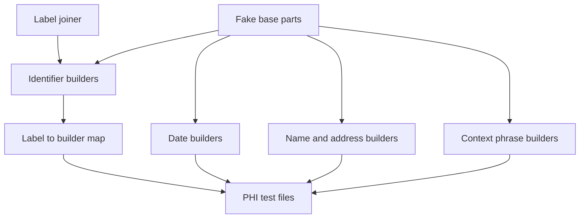

## Purpose

This module builds obviously fake PHI shaped strings for the detector tests. The values are joined from short parts at the moment a function is called, so no PHI shaped literal sits in any source file. Its own header gives the reason: the PHI write hook would block such a literal, correctly {src:tests/hooks/fake_phi.py:11-13}. It is a helper, not a test module {src:tests/hooks/fake_phi.py:17}.

## Dependencies

**Depends on.** Only `typing` from the standard library, for the `Callable` type {src:tests/hooks/fake_phi.py:22}. No repo file, environment variable or outside program is used.

**Used by.** No product code (searched with `git grep -n -E "from fake_phi|import fake_phi"` outside `docs/`, 2026-11-20). Seven test files import it:
- Tests in `tests/hooks/`: `test_phi_baseline.py` {src:tests/hooks/test_phi_baseline.py:28}, `test_phi_context_rules.py` {src:tests/hooks/test_phi_context_rules.py:23}, `test_phi_hook_levels.py` {src:tests/hooks/test_phi_hook_levels.py:22}, `test_phi_qa_regressions.py` {src:tests/hooks/test_phi_qa_regressions.py:25}, `test_phi_safety_speed.py` {src:tests/hooks/test_phi_safety_speed.py:33}, `test_phi_strong_rules.py` {src:tests/hooks/test_phi_strong_rules.py:23}.
- Test outside this folder: `tests/scripts/sync/test_sync_vault_scan.py` {src:tests/scripts/sync/test_sync_vault_scan.py:30}, which first puts `tests/hooks` on `sys.path` {src:tests/scripts/sync/test_sync_vault_scan.py:26}.

Pages that exist for the test files: [[test_phi_baseline]] and [test_phi_baseline](test_phi_baseline.md), [[test_phi_context_rules]] and [test_phi_context_rules](test_phi_context_rules.md), [[test_phi_hook_levels]] and [test_phi_hook_levels](test_phi_hook_levels.md), [[test_phi_qa_regressions]] and [test_phi_qa_regressions](test_phi_qa_regressions.md), [[test_phi_safety_speed]] and [test_phi_safety_speed](test_phi_safety_speed.md), [[test_phi_strong_rules]] and [test_phi_strong_rules](test_phi_strong_rules.md) (same batch as this page). [[test_sync_vault_scan]] (no doc yet).

## Behavior

The module has 12 constants, 33 plain builder functions, one helper `fake_label` and one dictionary. Every builder returns a string and has no side effect.

**Base parts.** The constants spell out the fake identity: first name `Testy` {src:tests/hooks/fake_phi.py:24}, last name `McTestface` {src:tests/hooks/fake_phi.py:25}, birth year 1900 {src:tests/hooks/fake_phi.py:26}, zip `00000` {src:tests/hooks/fake_phi.py:27}, state `CA` {src:tests/hooks/fake_phi.py:28}, a phone line ending in `0100` inside the 555-01xx range {src:tests/hooks/fake_phi.py:31}, street `Example Test Street` {src:tests/hooks/fake_phi.py:33}, city `Faketown` {src:tests/hooks/fake_phi.py:34} and title `Mr` {src:tests/hooks/fake_phi.py:35}.

**Labeled identifiers.** `fake_label` joins label parts so the label word never appears whole in source {src:tests/hooks/fake_phi.py:38-40}. On top of it:
- the record number is seven digits, four zeros then three ones {src:tests/hooks/fake_phi.py:43-44}, and `fake_mrn` puts the MRN label in front {src:tests/hooks/fake_phi.py:47-48};
- the social security number is `000-00-0000` behind its label {src:tests/hooks/fake_phi.py:51-52};
- the patient id is six ones {src:tests/hooks/fake_phi.py:67-68}, the provider number is ten zeros {src:tests/hooks/fake_phi.py:71-72}, the insurance id is `TEST` plus six zeros {src:tests/hooks/fake_phi.py:75-76}.

**Dates.** The ISO date is `1900-01-02` {src:tests/hooks/fake_phi.py:55-56}, the US date is `01/02/1900` {src:tests/hooks/fake_phi.py:59-60}, the month name date is `January 2, 1900` {src:tests/hooks/fake_phi.py:95-96}. `fake_dob`, `fake_born_on` and `fake_birthday` wrap those in a birth label or phrase {src:tests/hooks/fake_phi.py:63-64} {src:tests/hooks/fake_phi.py:99-100} {src:tests/hooks/fake_phi.py:103-104}. `fake_date_parts(order, sep)` builds one date from the letters of `order` (`y`, `m`, `d`) joined by `sep` {src:tests/hooks/fake_phi.py:155-158}.

**Names, address, phone.** `fake_name` is first plus last name {src:tests/hooks/fake_phi.py:79-80}. `fake_address` is street, city, state and zip {src:tests/hooks/fake_phi.py:87-88}. `fake_phone` gives `(555) 555-0100` and `fake_dashed_phone` gives the dashed form {src:tests/hooks/fake_phi.py:91-92} {src:tests/hooks/fake_phi.py:111-112}. `fake_spaced_phone_label(gap)` puts `gap` spaces between a phone label and the number {src:tests/hooks/fake_phi.py:169-170}.

**Context clue builders.** These feed the context rules: a name label with a name {src:tests/hooks/fake_phi.py:115-116}, a last-name-first form {src:tests/hooks/fake_phi.py:119-120}, a titled name {src:tests/hooks/fake_phi.py:123-124}, clinical phrases and the single word `medication` {src:tests/hooks/fake_phi.py:127-128} {src:tests/hooks/fake_phi.py:131-132} {src:tests/hooks/fake_phi.py:147-148}, an age and sex phrase, `58 year old male` {src:tests/hooks/fake_phi.py:135-136}, two shorter age forms {src:tests/hooks/fake_phi.py:139-140} {src:tests/hooks/fake_phi.py:161-162}, and an event date, `admitted on 01/02/1900` {src:tests/hooks/fake_phi.py:143-144}.

**Review fix builders.** A dotted birth label `D.O.B.` {src:tests/hooks/fake_phi.py:151-152}, an accented name {src:tests/hooks/fake_phi.py:165-166} and a spelled out record number label {src:tests/hooks/fake_phi.py:173-174}.

**The baseline map.** `CURRENT_LABELED_BUILDERS` maps six labels (MRN, SSN, DOB, PATIENT_ID, NPI, INSURANCE_ID) to the builder for each {src:tests/hooks/fake_phi.py:179-186}. `test_phi_baseline.py` loops over it and asserts the detector reports each label {src:tests/hooks/test_phi_baseline.py:47-49}.

**Checks the tests make on this file.** The phone matches `(555) 555-01xx`, the ISO and US dates sit in 1900, and the record number has no run of seven nonzero digits {src:tests/hooks/test_phi_baseline.py:104-108}. The source text of this file scans clean, checked from two test files {src:tests/hooks/test_phi_baseline.py:97-101} {src:tests/hooks/test_phi_strong_rules.py:145-148}.

## Diagram: module level (L2, required)

## Diagram: function level (L3, optional)

None: no function has branching that the signature does not show.

## Notes

- **Code and description disagree, fake names.** The header says the names "say they are tests" {src:tests/hooks/fake_phi.py:15}. `fake_accented_name` returns `José García`, two ordinary Spanish name parts, with no test marker {src:tests/hooks/fake_phi.py:165-166}. It is still fake data in the sense that it is not tied to a record, but it is the one value that does not announce itself.
- **Code and description disagree, date helper.** The docstring of `fake_date_parts` says `order` can be `'ymd'`, `'mdy'` or `'mdy8'` (no separator) {src:tests/hooks/fake_phi.py:156}. The code looks up each character of `order` in a three key table of `y`, `m` and `d` {src:tests/hooks/fake_phi.py:157-158}, so `'mdy8'` would raise a `KeyError` on the `8`. The no separator case is reached with `sep=""` instead, which is how the tests call it {src:tests/hooks/test_phi_qa_regressions.py:85}.
- **Code and description disagree, who imports it.** The header says it is imported by test files "in this folder" {src:tests/hooks/fake_phi.py:17}. One importer lives outside the folder {src:tests/scripts/sync/test_sync_vault_scan.py:30}.
- **Count of constants.** There are 12 ALL_CAPS constants plus the map. Three of them (`FAKE_PHONE_AREA`, `FAKE_PHONE_PREFIX`, `FAKE_PHONE_LINE`) {src:tests/hooks/fake_phi.py:29-31} are read only inside this file (no test reads them by attribute, searched 2026-11-20), so they are left out of `exports`.
- **Inputs without a check.** `fake_label` and `fake_date_parts` join whatever strings or letters the caller gives them, with no validation {src:tests/hooks/fake_phi.py:40} {src:tests/hooks/fake_phi.py:158}. The output goes into test strings only. No input reaches a file path, shell command or network address.
- **Shared file writes.** None.
- **Maintenance.** Any new builder must keep every value inside the fake ranges. The only enforcement is the scan of this file's own text, which proves the source holds no flagged literal, not that a built value is fake {src:tests/hooks/test_phi_strong_rules.py:147-148}.
