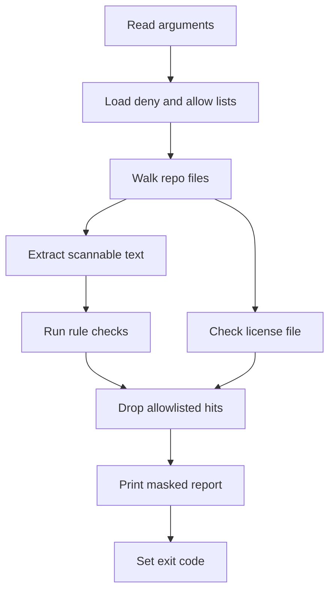

## Purpose

The leak scanner. Before the Tollgate repo is released, it walks a folder and reports anything personal, secret or political: private words from a denylist, personal home-folder paths, key and token patterns, attribution lines, filled-in `Date:` headers, a missing or company-owned license, and (for one command file) analysis of named people. It exists so a public copy of the repo cannot carry the author's private details.

## Dependencies

**Depends on.**
- Standard library only: `argparse`, `fnmatch`, `os`, `re`, `sys` {src:tests/leak/scan_leaks.py:29} {src:tests/leak/scan_leaks.py:30} {src:tests/leak/scan_leaks.py:31} {src:tests/leak/scan_leaks.py:32} {src:tests/leak/scan_leaks.py:33}.
- The allowlist file `tests/leak/allowed_fixtures.txt` ([the list of skipped files](../../../tests/leak/allowed_fixtures.txt)), read by default {src:tests/leak/scan_leaks.py:36} {src:tests/leak/scan_leaks.py:309}.
- The environment variable `TOLLGATE_DENYLIST`, used when `--denylist` is not given {src:tests/leak/scan_leaks.py:315}.

**Used by.** No product code imports or calls it. Searched `git grep scan_leaks` outside `docs/` (2026-11-20). Launcher: `tests/leak/run.sh`, in its `scan` mode ([[run]] and [run](run.md)) {src:tests/leak/run.sh:8}. The CI workflow calls that launcher with `scan .` to scan the whole checkout on every push ([[tests]] and [tests](../../.github/workflows/tests.md)) {src:.github/workflows/tests.yml:44}. Skipped by name by its own allowlist so it does not flag itself {src:tests/leak/allowed_fixtures.txt:6}. Tests: [[test_leak]] and [test_leak](test_leak.md) import it {src:tests/leak/test_leak.py:19}; the command file checks in `tests/commands/test_commands.py` run it as a subprocess for the `influence.md` rule {src:tests/commands/test_commands.py:198}. Area page: [[leak]] and [leak](../leak.md).

## Behavior

**Start up (`main`).** Reads a folder, `--denylist` and `--allowlist` {src:tests/leak/scan_leaks.py:306-310}. A folder that does not exist prints a message and returns 2 {src:tests/leak/scan_leaks.py:312-314}. The denylist path is the flag or `TOLLGATE_DENYLIST` {src:tests/leak/scan_leaks.py:315}; if a path was given and the file is missing it returns 2 {src:tests/leak/scan_leaks.py:318-320}; with no path at all it warns that LEK-01 is skipped and goes on {src:tests/leak/scan_leaks.py:322-323}. The return value is 1 when there is any hit, otherwise 0 {src:tests/leak/scan_leaks.py:327}.

**Reading the lists.** Denylist terms are lower-cased, blank lines and `#` lines skipped {src:tests/leak/scan_leaks.py:116-119}. Allowlist lines drop anything after `#`, and an optional `: RULE, RULE` part limits the skip to those rules {src:tests/leak/scan_leaks.py:130-137}. A missing allowlist file gives an empty list with no message {src:tests/leak/scan_leaks.py:126-127}. An entry with a `/` is matched against the relative path, otherwise against the base name, using `fnmatch` {src:tests/leak/scan_leaks.py:145}; a hit is dropped when the entry has no rule list or lists this rule {src:tests/leak/scan_leaks.py:146-147}. Every hit passes through that filter when it is added {src:tests/leak/scan_leaks.py:178-181}.

**Walking.** The scanner skips folders named `.git` or `__pycache__` {src:tests/leak/scan_leaks.py:37} {src:tests/leak/scan_leaks.py:185}. It also skips a file whose own name is one of those two (a work tree keeps `.git` as a file, which the code comment points out) and every symbolic link {src:tests/leak/scan_leaks.py:188-189}. A file over 64 MiB is not scanned and is recorded as a hit under the pseudo-rule `SCAN` {src:tests/leak/scan_leaks.py:40} {src:tests/leak/scan_leaks.py:196-198}; an unreadable file is also a `SCAN` hit {src:tests/leak/scan_leaks.py:201-203}.

**Turning a file into text.** If the first 8192 bytes hold no zero byte and the whole file decodes as UTF-8, that text is used {src:tests/leak/scan_leaks.py:153-155}. Otherwise the scanner pulls out runs of 4 or more printable ASCII characters and 4 or more UTF-16 little-endian characters, and joins them with newlines {src:tests/leak/scan_leaks.py:158-163}. Line numbers for such files count lines of that extracted text, not the file {src:tests/leak/scan_leaks.py:166-167}.

**Rules.** Each file gets the denylist, path and secret checks, and also the command check when its base name is `influence.md` or `tg-influence.md` {src:tests/leak/scan_leaks.py:205-209}; the license check runs once after the walk {src:tests/leak/scan_leaks.py:210}.

- `LEK-01`: every occurrence of a denylist term in the lower-cased text, and a term in the relative file name {src:tests/leak/scan_leaks.py:213-225}.
- `LEK-02`: a `/Users/<name>` or `/home/<name>` path {src:tests/leak/scan_leaks.py:69}, unless the name is in the generic list (`user`, `you`, `runner`, `tgtester` and others) {src:tests/leak/scan_leaks.py:43-47} {src:tests/leak/scan_leaks.py:230-231}.
- `LEK-03`: key patterns (cloud, GitHub, API-secret, Slack, Google, private-key block, JWT, quoted credential) {src:tests/leak/scan_leaks.py:52-63}; two attribution phrases, built from pieces so this file does not match itself {src:tests/leak/scan_leaks.py:49-51} {src:tests/leak/scan_leaks.py:64-67}; and a `Date:` header with a value, looked for only in the first 30 lines {src:tests/leak/scan_leaks.py:39} {src:tests/leak/scan_leaks.py:243-252}. An empty `Date:` passes because the value must start with a character that is not blank, `>` or `-` {src:tests/leak/scan_leaks.py:68}.
- `LEK-04`: no license file among five accepted names {src:tests/leak/scan_leaks.py:71} {src:tests/leak/scan_leaks.py:256-261}; no copyright line {src:tests/leak/scan_leaks.py:268-270}; a holder with company words {src:tests/leak/scan_leaks.py:272-273}, a one-word holder {src:tests/leak/scan_leaks.py:274-275}, or an address in the holder line {src:tests/leak/scan_leaks.py:276-277}. Only one of those three is reported per holder, because they are an `if` chain.
- `CMD-04` (files named `influence.md` or `tg-influence.md` only): four line-by-line patterns for trust ratings, influence strategy wording, a named person followed by a verb of opinion, and personality words {src:tests/leak/scan_leaks.py:79-97}. A match whose first word is in a short list of sentence starters is ignored {src:tests/leak/scan_leaks.py:99-101} {src:tests/leak/scan_leaks.py:285-288}.

**Masking and report.** `mask` shows only the length for values of 4 characters or fewer, and otherwise the first two characters, six stars and the length {src:tests/leak/scan_leaks.py:104-109}. `report` prints one line per hit as rule, `file:line` and detail, then a total with a count per rule {src:tests/leak/scan_leaks.py:292-301}.

## Diagram: module level (L2, required)

## Diagram: function level (L3, optional)

None: no function has branching that the signature does not show beyond the rule list in Behavior.

## Notes

- **Description and code disagree: "never printed in full".** The header says a matched secret is never printed in full and excerpts are masked {src:tests/leak/scan_leaks.py:27}. For a denylist term found in a file name, the hit text is masked but `report` prints the file path as the location {src:tests/leak/scan_leaks.py:217} {src:tests/leak/scan_leaks.py:296-297}, so the private term itself appears in the output. The test for masking checks only a term inside file content {src:tests/leak/test_leak.py:96-102}.
- **Description and code disagree: LEK-04.** The header says the copyright holder must be a personal name {src:tests/leak/scan_leaks.py:14}. The code only rejects company words, a single word, or an address {src:tests/leak/scan_leaks.py:272-277}; a two-word holder with none of those, such as an open-source project name, passes. The word list also contains `ai`, `team` and `health` {src:tests/leak/scan_leaks.py:72-76}, so a person whose name contains one of them is flagged as an organization.
- **Description and code disagree: rule list and exit code.** The header lists five rules and says exit 1 means a hit {src:tests/leak/scan_leaks.py:5-16}. A file over 64 MiB or unreadable also produces a hit and exit 1, under a rule name (`SCAN`) the header does not list {src:tests/leak/scan_leaks.py:197} {src:tests/leak/scan_leaks.py:202}.
- **Description and code disagree: "scans every file".** The header says every file {src:tests/leak/scan_leaks.py:4}. Symbolic links, and anything named `.git` or `__pycache__`, are skipped {src:tests/leak/scan_leaks.py:185} {src:tests/leak/scan_leaks.py:188-189}.
- **CMD-04 file name (header now matches).** The header says the rule covers "a command file named influence.md or tg-influence.md" {src:tests/leak/scan_leaks.py:15}, and the code checks both names {src:tests/leak/scan_leaks.py:208}. The comment above the rule list says the same {src:tests/leak/scan_leaks.py:78}.
- **Silent allowlist failure.** A mistyped `--allowlist` path is accepted and treated as empty {src:tests/leak/scan_leaks.py:126-127}, unlike a mistyped denylist path, which stops the run {src:tests/leak/scan_leaks.py:318-320}. The tests rely on this by passing `/nonexistent` on purpose {src:tests/leak/test_leak.py:107}.
- **Allowlist parsing limits.** Text after `#` is cut before the `:` split {src:tests/leak/scan_leaks.py:130-134}, so a path holding `:` or `#` is misread. Entries with `/` are matched with `fnmatch` on a path built by `os.path.relpath` {src:tests/leak/scan_leaks.py:190} {src:tests/leak/scan_leaks.py:145}; `*` also matches `/`, and on a system that uses backslashes in paths such entries would not match.
- **Inputs that reach a file path, command, network address or outbound text.** The folder is opened with `os.walk` after an `isdir` check {src:tests/leak/scan_leaks.py:312} {src:tests/leak/scan_leaks.py:184}. The denylist path is checked with `isfile` {src:tests/leak/scan_leaks.py:318}. The allowlist path is checked with `isfile`, with the silent fallback above {src:tests/leak/scan_leaks.py:126}. No value reaches a shell command or network address. Output text: file paths are printed unmasked (see the first note), matched values are masked.
- **Writes to shared files.** None: the scanner only reads and prints to the terminal {src:tests/leak/scan_leaks.py:199-200}. It reads each whole file into memory, up to 64 MiB {src:tests/leak/scan_leaks.py:196} {src:tests/leak/scan_leaks.py:200}.
- **Documentation pages that quote the rules.** A page that quotes the attribution phrases would be flagged by `LEK-03`; the existing leak area page is allowlisted by exact path for that reason {src:tests/leak/allowed_fixtures.txt:13}. A new page under `docs/tests/leak/` has no such entry, so these pages describe the phrases without writing them out.
