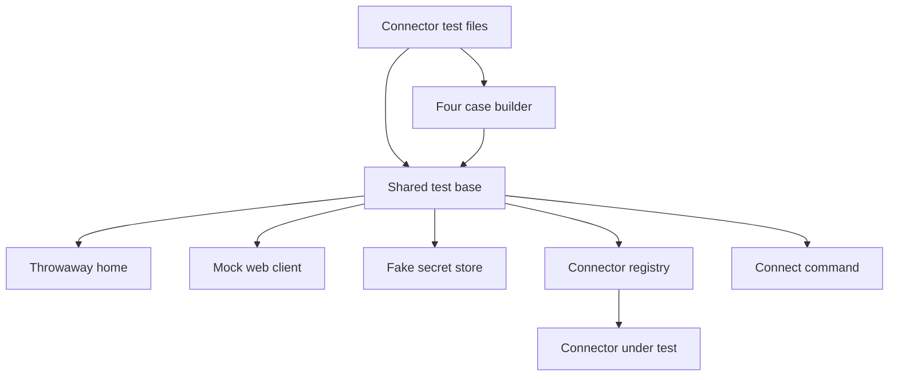

## Purpose

This is the shared starting point for the tests of the comms connectors (chat, tracker, notes, calendar, git history). It gives each connector test the same safe setup: a throwaway home folder, a fake secret store, a fake web client that records calls, and helpers to turn a connector on and run it. It also builds the four standard cases every connector must pass (not set up, first use keeps the secret off disk, on survives a restart, off goes back to not set up). The file holds no test of its own and is not collected by the folder runner.

## Dependencies

Depends on:
- [[connector_helpers]] ([connector_helpers](../../../../tests/harness/connector_helpers.md)) for the mock client, the fake secret store and the no-network guard {src:tests/scripts/connectors/comms/comms_base.py:25}. The link path is from this page's folder.
- [[throwaway_home]] ([throwaway_home](../../../harness/throwaway_home.md)) for the temporary home and its environment {src:tests/scripts/connectors/comms/comms_base.py:26}.
- [[registry]] ([registry](../../../../scripts/connectors/registry.md)) and [[connect]] ([connect](../../../../scripts/connectors/connect.md)), both imported from the `connectors` package {src:tests/scripts/connectors/comms/comms_base.py:27}.
- The connector module a subclass names in `MODULE`, which setUp reloads {src:tests/scripts/connectors/comms/comms_base.py:60} {src:tests/scripts/connectors/comms/comms_base.py:64}.
- Standard library: `contextlib`, `io`, `json`, `os`, `pathlib`, `subprocess`, `sys`, `unittest`, `uuid` {src:tests/scripts/connectors/comms/comms_base.py:10-18}.

Used by:
- Product code: none.
- Tests: the five connector test files import it, `test_calendar.py` {src:tests/scripts/connectors/comms/test_calendar.py:15}, `test_commits.py` {src:tests/scripts/connectors/comms/test_commits.py:16}, `test_jira.py` {src:tests/scripts/connectors/comms/test_jira.py:16-17}, `test_notion.py` {src:tests/scripts/connectors/comms/test_notion.py:14} and `test_slack.py` {src:tests/scripts/connectors/comms/test_slack.py:17}. Searched with `git grep -n comms_base` outside `docs/` on 2026-11-20.

## Behavior

Path setup: `HERE` is this file's folder and `ROOT` is three levels above that, the repo root {src:tests/scripts/connectors/comms/comms_base.py:20-21}. The harness folder and `scripts` are put at the front of the import path {src:tests/scripts/connectors/comms/comms_base.py:22-23}.

`fake_secret()` returns the text `tgfake-` followed by 32 random hex characters {src:tests/scripts/connectors/comms/comms_base.py:32-33}.

`fake_slack_token()` returns a chat token shaped string, `xoxb-` then digits, a dash and letters, joined from pieces so that no token literal sits in the file {src:tests/scripts/connectors/comms/comms_base.py:36-38}. `fake_credential()` returns a keyword style credential, `password=` followed by a fixed mixed string, also joined from pieces {src:tests/scripts/connectors/comms/comms_base.py:41-43}. The connector tests feed these through each connector to prove that secrets are redacted in place. The redaction scan names these two shapes `SLACK_TOKEN` and `CREDENTIAL`, as the tests' expected output lines show {src:tests/scripts/connectors/comms/test_slack.py:126-128}.

`RoutedClient` (a mock web client):
- Its handler defaults to a function returning an empty map {src:tests/scripts/connectors/comms/comms_base.py:51}.
- Each request is recorded with method, address and keyword arguments {src:tests/scripts/connectors/comms/comms_base.py:54}, then answered with status 200 and the handler's answer turned into JSON text {src:tests/scripts/connectors/comms/comms_base.py:55}.
- `get` and `post` come from the parent and call `request`, so they are routed too {src:tests/harness/connector_helpers.py:18-22}.

`Base` (a `unittest.TestCase` subclass; subclasses set `NAME` and `MODULE`):
- `setUp` reloads the connector module, because a restart test may have emptied the registry {src:tests/scripts/connectors/comms/comms_base.py:64}. It opens a throwaway home by calling the context manager's enter by hand {src:tests/scripts/connectors/comms/comms_base.py:65-66}, builds an environment with `TOLLGATE_NONINTERACTIVE=1` {src:tests/scripts/connectors/comms/comms_base.py:67}, makes a fake store and a routed client {src:tests/scripts/connectors/comms/comms_base.py:68-69}, and installs both into the registry {src:tests/scripts/connectors/comms/comms_base.py:70-71}.
- `tearDown` clears the store and client factory in the registry and exits the home {src:tests/scripts/connectors/comms/comms_base.py:75-77}.
- `turn_on` puts the key in the process environment as `TG_TEST_KEY`, calls the connect command with `on NAME --address ... --key-from-env TG_TEST_KEY`, swallows its printed output, and removes the variable in a `finally` {src:tests/scripts/connectors/comms/comms_base.py:80-86}. It returns the command's exit code.
- `run_main` copies the process environment {src:tests/scripts/connectors/comms/comms_base.py:90}, applies the test environment {src:tests/scripts/connectors/comms/comms_base.py:91}, runs the connector's `main` through the registry's `run_cli` {src:tests/scripts/connectors/comms/comms_base.py:96}, catches a `SystemExit` as the exit code {src:tests/scripts/connectors/comms/comms_base.py:97-98}, and restores the environment in a `finally` {src:tests/scripts/connectors/comms/comms_base.py:100-102}. It returns code, output text and error text.
- `read_json` reads a JSON file under the home {src:tests/scripts/connectors/comms/comms_base.py:109-110}; `log_text` reads `.tollgate/logs/run_log.jsonl` in the home or an empty string {src:tests/scripts/connectors/comms/comms_base.py:112-114}; `assert_text_absent` asserts a needle appears in none of a list of texts {src:tests/scripts/connectors/comms/comms_base.py:116-118}.

`make_con_tests(base, argv_fn, extra_fn)` returns a class `Con` with five test methods {src:tests/scripts/connectors/comms/comms_base.py:127-187}. `argv_fn` gives the command line and `extra_fn` gives extra keyword arguments such as a fake process runner {src:tests/scripts/connectors/comms/comms_base.py:129}.

| Test in `Con` | What it proves | Code it exercises |
|---|---|---|
| `test_con01_not_set_up` | Without turning the connector on, and with the network blocked, the run exits non-zero, error text holds "NAME: not set up" and "connect.py on NAME", no client call was made, and the connectors file was not created {src:tests/scripts/connectors/comms/comms_base.py:131-138}. | The message {src:scripts/connectors/registry.py:325-327}; the not-set-up error is printed and the exit code is 2 {src:scripts/connectors/registry.py:430-436}; reading state never creates the file {src:scripts/connectors/registry.py:271-279} |
| `test_con01_subprocess_exit_code` | Running the connector file as its own program gives a non-zero exit and the same message {src:tests/scripts/connectors/comms/comms_base.py:140-145}. | Start-up lines of a connector {src:scripts/connectors/comms/calendar_connector.py:241-242} |
| `test_con02_first_use_secret_nowhere_on_disk` | Turning on exits 0 and asks the store to save the key; the store returns it; no file under the repo (except `.git`) or the home holds the key bytes; the connectors file names the connector and address {src:tests/scripts/connectors/comms/comms_base.py:147-164}. | Key goes to the store first, then the state file {src:scripts/connectors/registry.py:372-380} |
| `test_con03_on_survives_restart_and_reaches_client` | After turning on, clearing the factory table and reloading the module, a run exits 0 or None, the saved entry is exactly the address and `on: true`, and the connector-specific `reached_client` check passes {src:tests/scripts/connectors/comms/comms_base.py:166-176}. | Saved entries leave out an empty settings map {src:scripts/connectors/registry.py:313-314}; reload re-registers the factory {src:scripts/connectors/comms/calendar_connector.py:172} |
| `test_con04_off_returns_to_not_set_up` | After off, the store has no key, a run fails with "not set up", and no client call was made {src:tests/scripts/connectors/comms/comms_base.py:178-187}. | Off marks the entry off and deletes the key {src:scripts/connectors/registry.py:383-390} |

## Diagram: module level (L2, required)

## Diagram: function level (L3, optional)

None: no function has branching that the signature does not show.

## Notes

- Dead code: `self.MODULE_RELOADED = True` is set once and never read {src:tests/scripts/connectors/comms/comms_base.py:171}. `home_files` is defined {src:tests/scripts/connectors/comms/comms_base.py:104} and no test uses it (searched `tests/scripts/connectors/comms` on 2026-11-20).
- `assert_text_absent` is now used by the redaction tests to show that neither the token nor the password value is left in the note, cache file, printed output, error text or run log {src:tests/scripts/connectors/comms/comms_base.py:116-118} {src:tests/scripts/connectors/comms/test_slack.py:129-130}.
- The names `MockClient`, `FakeSecretStore` and `assert_no_network` are imported with an unused-import waiver {src:tests/scripts/connectors/comms/comms_base.py:25}; only `assert_no_network` is used here {src:tests/scripts/connectors/comms/comms_base.py:133}, and no test file imports the other two from this module.
- Hidden contract: `test_con03` calls `self.reached_client()` {src:tests/scripts/connectors/comms/comms_base.py:176}, which `Base` does not define. A subclass that forgets it fails with an attribute error; all five subclasses define it (searched `def reached_client`).
- Code and description: the docstring says CON-01 to CON-04 {src:tests/scripts/connectors/comms/comms_base.py:122}, and the builder makes five methods because case 01 has two {src:tests/scripts/connectors/comms/comms_base.py:131} {src:tests/scripts/connectors/comms/comms_base.py:140}. This is a counting difference, not a behavior one.
- `TOLLGATE_NONINTERACTIVE=1` is set again in `setUp` {src:tests/scripts/connectors/comms/comms_base.py:67} though the home helper already sets it {src:tests/harness/throwaway_home.py:44}.
- Process-wide state: `run_main` clears and refills the whole process environment {src:tests/scripts/connectors/comms/comms_base.py:101-102}, `turn_on` sets and deletes a process variable {src:tests/scripts/connectors/comms/comms_base.py:80} {src:tests/scripts/connectors/comms/comms_base.py:86}, and the registry's store and client factory are module globals {src:scripts/connectors/registry.py:32-33}. This is safe only because tests run one at a time. If `setUp` fails after the home is opened, `tearDown` does not run, so the temporary folder and the installed fake store stay.
- Heavy check: `test_con02` reads every file under the repo root (except `.git`) and the home in full {src:tests/scripts/connectors/comms/comms_base.py:153-161}. That is slow on a large checkout and skips files it cannot open {src:tests/scripts/connectors/comms/comms_base.py:159-160}. The opened files are never closed explicitly {src:tests/scripts/connectors/comms/comms_base.py:158} {src:tests/scripts/connectors/comms/comms_base.py:162}.
- Tests that depend on the machine: none by path. The subprocess test uses the running Python (`sys.executable`) {src:tests/scripts/connectors/comms/comms_base.py:142}. No Python version feature beyond the repo's minimum is used.
- Inputs without a check: the addresses and keys passed to the connect command are test constants and a random value {src:tests/scripts/connectors/comms/comms_base.py:29} {src:tests/scripts/connectors/comms/comms_base.py:33}. The command line for the subprocess comes from `argv_fn` supplied by each test file and is passed as a list, not through a shell {src:tests/scripts/connectors/comms/comms_base.py:142}. No outside input reaches a path, shell, address or outbound text.
- Shared-file writes: the tests write the connectors file and the run log inside the throwaway home only {src:tests/scripts/connectors/comms/comms_base.py:112-114}. The code under test writes the connectors file with a plain `write_text`, not an atomic replace, and nothing locks it {src:scripts/connectors/registry.py:318}. One test process runs at a time, so two writers do not meet here.
