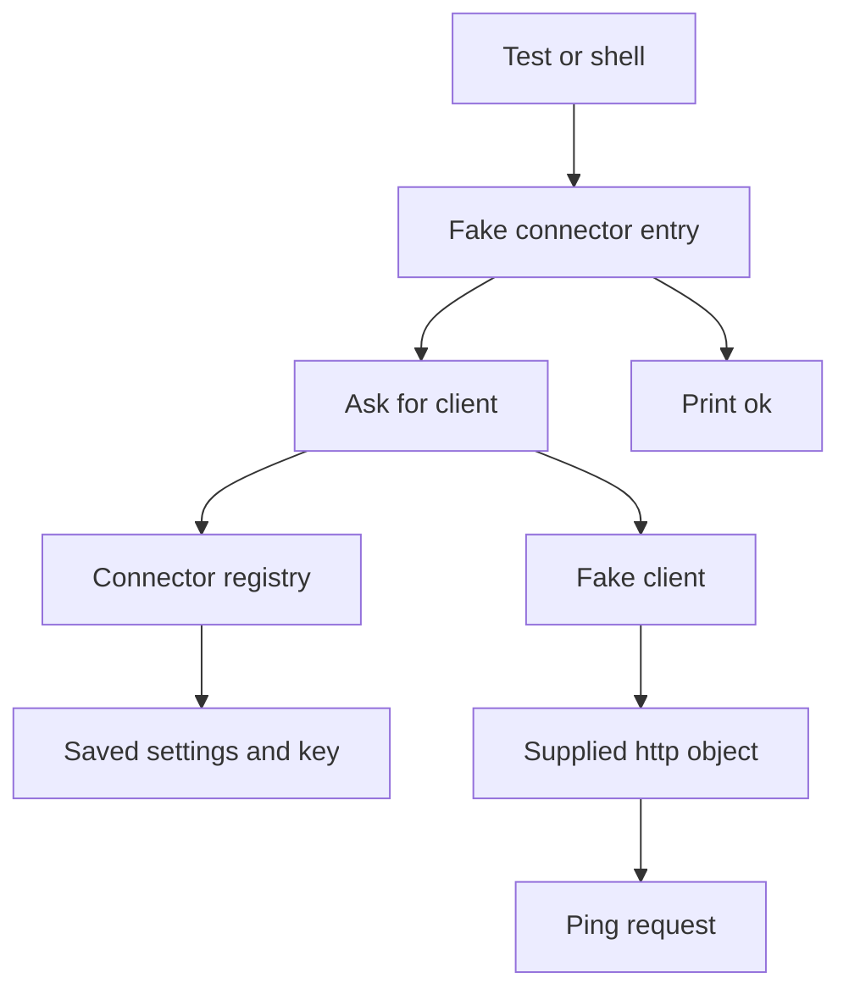

## Purpose

A tiny made-up connector used only by the connector framework tests. It is also a worked example for people who write a real connector: it shows how a connector registers a name, asks the framework for a ready client, and makes its calls through the `http` object the framework hands in. It has no real service behind it.

## Dependencies

**Depends on.**
- [[registry]] / [registry](../../../scripts/connectors/registry.md) for `register`, `ensure` and `run_cli` {src:tests/scripts/connectors/fake_connector.py:15}.
- Standard library: `pathlib` and `sys` {src:tests/scripts/connectors/fake_connector.py:10-11}.
- The folder `scripts/` in the repo, which the file adds to the import path itself {src:tests/scripts/connectors/fake_connector.py:13-14}.

**Used by.**
- Product code: none. Searched the repo with `git grep` for `fake_connector`, excluding `docs/` (2026-11-20); every hit is under `tests/`.
- Tests: [[test_connectors]] (no doc yet) imports it {src:tests/scripts/connectors/test_connectors.py:27}, runs its `main` through `run_cli` {src:tests/scripts/connectors/test_connectors.py:73}, starts the file as a real process {src:tests/scripts/connectors/test_connectors.py:93}, and reloads it to simulate a restart {src:tests/scripts/connectors/test_connectors.py:141}.

## Behavior

- Setting the path. `ROOT` is the third parent folder of the file, which is the repo root, and `ROOT/scripts` is put first on the import path {src:tests/scripts/connectors/fake_connector.py:13-14}.
- Registering. At import time the module registers the name `fakeconn` with a factory that builds a `FakeClient` from the saved address, the key and the http object {src:tests/scripts/connectors/fake_connector.py:27}. This is why a test must reload the module after it clears the registry, to put the name back {src:tests/scripts/connectors/test_connectors.py:141}.
- `FakeClient` keeps the address, key and http object it is given {src:tests/scripts/connectors/fake_connector.py:19-20}. `ping` sends a GET to the address plus `/ping` with an `Authorization: Bearer <key>` header, through the given http object, and returns what it returns {src:tests/scripts/connectors/fake_connector.py:22-24}.
- `main` asks `ensure("fakeconn")` for the client {src:tests/scripts/connectors/fake_connector.py:31}. `ensure` raises `NotSetUp` when the connector is off or has no key and the session is not interactive {src:scripts/connectors/registry.py:397-399} {src:scripts/connectors/registry.py:422-424}. When ready, `main` calls `ping`, prints `fakeconn: ok` and returns 0 {src:tests/scripts/connectors/fake_connector.py:32-34}.
- Running as a script. The last lines run `main` through `run_cli`, which prints a `NotSetUp` message to standard error and exits with code 2 {src:tests/scripts/connectors/fake_connector.py:38} {src:scripts/connectors/registry.py:433-436}. This is the behavior CON-01 checks as a real process {src:tests/scripts/connectors/test_connectors.py:93-96}.

## Diagram: module level (L2, required)

## Diagram: function level (L3, optional)

None: no function has branching that the signature does not show.

## Notes

- **Code and description.** The header says it is "used only by tests" and shows "register, ensure, use the given http" {src:tests/scripts/connectors/fake_connector.py:2-6}. The code does exactly that and nothing else. The `Date:` field is empty {src:tests/scripts/connectors/fake_connector.py:5}.
- **Result of the ping is dropped.** `main` calls `ping` and ignores the return value, then prints `fakeconn: ok` {src:tests/scripts/connectors/fake_connector.py:32-33}. The success line does not depend on what the server said. With the real http client a 4xx or 5xx reply raises an error instead, which `run_cli` does not catch (it handles only `NotSetUp`) {src:scripts/connectors/registry.py:432-436}; with the test mock any reply is accepted. For an example meant for connector authors this is a gap: a real connector should check the reply.
- **Unchecked inputs.** The saved address is joined with `/ping` and sent with the key in a header, with no check in this file {src:tests/scripts/connectors/fake_connector.py:23-24}. The real http client checks the address (https, or http to a loopback host, and no user name or password in it) before the request {src:scripts/connectors/registry.py:230} {src:scripts/connectors/registry.py:91-100}; the test mock does not. No input reaches a file path or a shell command.
- **Writes to shared files.** None. Importing the module changes two shared things in the process: the import path {src:tests/scripts/connectors/fake_connector.py:14} and the registry table {src:tests/scripts/connectors/fake_connector.py:27}.
- **Constants.** One module constant, `ROOT` {src:tests/scripts/connectors/fake_connector.py:13}; it is not read by any other file (searched `fake_connector.ROOT` 2026-11-20).
