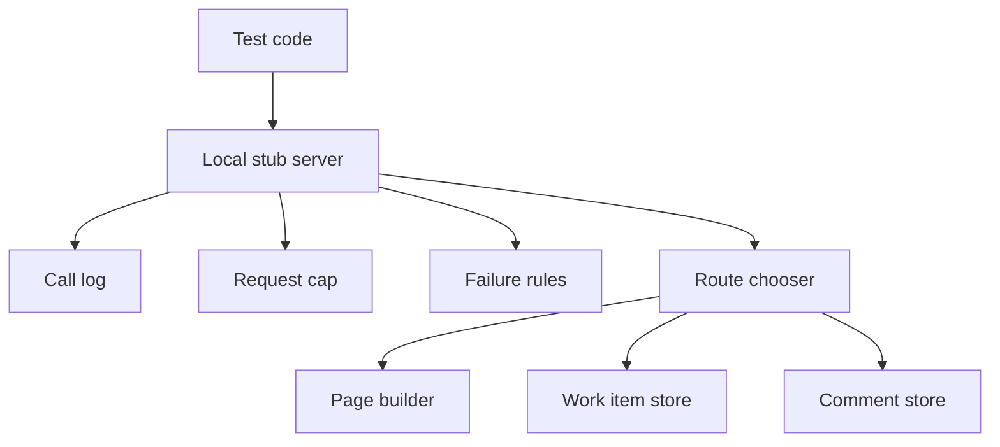

## Purpose

A small fake of the Plane web service, used only by the plane connector tests. It lets the tests exercise the real client code over real HTTP without ever touching a real Plane server. It keeps its data in memory, records every request it receives, and can be told to fail or redirect chosen requests so error handling can be tested.

## Dependencies

**Depends on.** Standard library only: `json`, `threading`, `dataclasses`, `http.server`, `typing`, `urllib.parse` {src:tests/scripts/connectors/plane/plane_stub_server.py:12-17}. No repo file, no environment variable, no outside program.

**Used by.** Found with `git grep` for `plane_stub_server` across the repo, excluding `docs/` (searched 2026-11-20). No product code under `scripts/` imports it. Only tests import it:
- Tests: [[plane_sync_test_support]] / [plane_sync_test_support](plane_sync_test_support.md) {src:tests/scripts/connectors/plane/plane_sync_test_support.py:40}
- Tests: `test_plane_cli.py` {src:tests/scripts/connectors/plane/test_plane_cli.py:23}, `test_plane_client.py` {src:tests/scripts/connectors/plane/test_plane_client.py:16}, `test_plane_connector.py` {src:tests/scripts/connectors/plane/test_plane_connector.py:25}, `test_plane_create.py` {src:tests/scripts/connectors/plane/test_plane_create.py:19}, `test_plane_sync.py` {src:tests/scripts/connectors/plane/test_plane_sync.py:21}

## Behavior

**Start and stop.** `PlaneStubServer` is a threaded HTTP server bound to `127.0.0.1` on port 0, so the operating system picks a free port {src:tests/scripts/connectors/plane/plane_stub_server.py:177}. `base_url` builds the address from that port {src:tests/scripts/connectors/plane/plane_stub_server.py:183}. `start` launches `serve_forever` on a daemon thread {src:tests/scripts/connectors/plane/plane_stub_server.py:179} and `stop` calls `shutdown` then `server_close` {src:tests/scripts/connectors/plane/plane_stub_server.py:189-191}. Handler threads are also daemons {src:tests/scripts/connectors/plane/plane_stub_server.py:174}. Request logging is switched off {src:tests/scripts/connectors/plane/plane_stub_server.py:78-79}.

**Every request, in order** {src:tests/scripts/connectors/plane/plane_stub_server.py:90-106}:
1. The body is read using `Content-Length` and parsed as JSON when present {src:tests/scripts/connectors/plane/plane_stub_server.py:92-94}.
2. The call is appended to `state.calls` before anything else is decided, so rejected and failed requests are recorded too {src:tests/scripts/connectors/plane/plane_stub_server.py:96-97}.
3. If the number of recorded calls is above `request_cap` (default 2000) the reply is a 500 {src:tests/scripts/connectors/plane/plane_stub_server.py:98-100} {src:tests/scripts/connectors/plane/plane_stub_server.py:20} {src:tests/scripts/connectors/plane/plane_stub_server.py:64}. The cap stops a paging loop that never ends.
4. The first fail rule whose method matches, whose path ends with the rule suffix, and which still has uses left, is consumed and answers with its status. A `Location` header is added only when the rule has one {src:tests/scripts/connectors/plane/plane_stub_server.py:101-105} {src:tests/scripts/connectors/plane/plane_stub_server.py:84-85}. A rule has a million uses by default, so it acts as permanent unless `remaining` is lowered {src:tests/scripts/connectors/plane/plane_stub_server.py:43}.
5. Otherwise the request is routed.

**Routes.** All routes sit under `/api/v1/workspaces/ws-test/`; anything outside that prefix returns 404 {src:tests/scripts/connectors/plane/plane_stub_server.py:109-112} {src:tests/scripts/connectors/plane/plane_stub_server.py:19}.
- `projects/` returns one project, id `proj-t`, identifier `T` {src:tests/scripts/connectors/plane/plane_stub_server.py:113-114}.
- `projects/proj-t/states/` returns the eight fixed state names and ids {src:tests/scripts/connectors/plane/plane_stub_server.py:115-117} {src:tests/scripts/connectors/plane/plane_stub_server.py:22-25}.
- `projects/proj-t/work-items/` with GET lists all items; any other method is treated as a create {src:tests/scripts/connectors/plane/plane_stub_server.py:139-147}. A create first runs the optional `on_create` hook {src:tests/scripts/connectors/plane/plane_stub_server.py:142-143}, numbers the item as highest plus one {src:tests/scripts/connectors/plane/plane_stub_server.py:144}, takes `name` and `state` from the body {src:tests/scripts/connectors/plane/plane_stub_server.py:145}, and replies 201 {src:tests/scripts/connectors/plane/plane_stub_server.py:147}. New items have no `external_id` and no description {src:tests/scripts/connectors/plane/plane_stub_server.py:145}.
- `projects/proj-t/work-items/<id>/` finds the item by the fourth path part {src:tests/scripts/connectors/plane/plane_stub_server.py:151}. An unknown id is a 404 {src:tests/scripts/connectors/plane/plane_stub_server.py:152-153}. A path with `comments` stores the body plus the item id and replies 201 with id `cm-N` {src:tests/scripts/connectors/plane/plane_stub_server.py:154-156}. A PATCH updates `external_id`, `description_html`, `name` and `state` when present {src:tests/scripts/connectors/plane/plane_stub_server.py:157-162}. Anything else returns the item {src:tests/scripts/connectors/plane/plane_stub_server.py:163-164}.

**Paging.** Lists honour `per_page` (default 100) and a numeric `cursor` (default 0) {src:tests/scripts/connectors/plane/plane_stub_server.py:126-128}. `next_page_results` is true while more rows remain, or always when `stuck_cursor` is set {src:tests/scripts/connectors/plane/plane_stub_server.py:129} {src:tests/scripts/connectors/plane/plane_stub_server.py:133}. With `stuck_cursor` the reply hands back the same cursor it was given, which is how the tests provoke the client's "cursor did not advance" error {src:tests/scripts/connectors/plane/plane_stub_server.py:130}.

**Item shape.** An item is sent as `id`, `sequence_id`, `name`, `state`, `external_id`, `description_html` {src:tests/scripts/connectors/plane/plane_stub_server.py:67-72}. The `fields` query that the client sends is not read anywhere in the stub, so description text is returned in list replies too (searched the file for `fields`, 2026-11-20).

**Helper.** `calls_matching(method, suffix)` returns recorded calls with that method whose path ends with the suffix {src:tests/scripts/connectors/plane/plane_stub_server.py:193-194}.

## Diagram: module level (L2, required)

## Diagram: function level (L3, optional)

None: no function has branching that the signature does not show.

## Notes

- **Code and description.** The header says the stub "records every call, can fail or redirect chosen calls" {src:tests/scripts/connectors/plane/plane_stub_server.py:2} {src:tests/scripts/connectors/plane/plane_stub_server.py:5}. The code agrees: calls are recorded first {src:tests/scripts/connectors/plane/plane_stub_server.py:97} and rules can set a status and a `Location` {src:tests/scripts/connectors/plane/plane_stub_server.py:104}. No disagreement found. The `Date:` header field is empty {src:tests/scripts/connectors/plane/plane_stub_server.py:4}.
- **Unchecked inputs.** The stub never opens a file, runs a command or contacts another address. Its own request inputs have no checks: `Content-Length` is converted with `int` {src:tests/scripts/connectors/plane/plane_stub_server.py:92}, the body goes straight to `json.loads` {src:tests/scripts/connectors/plane/plane_stub_server.py:94}, `per_page` and `cursor` go straight to `int` {src:tests/scripts/connectors/plane/plane_stub_server.py:126-127}, and a create reads `call.body["name"]` and `call.body["state"]` without a check {src:tests/scripts/connectors/plane/plane_stub_server.py:145}. A bad value raises inside the handler thread and the client sees a dropped connection, not a tidy error. Test callers send well-formed values.
- **Any non-GET on the item list creates an item**, including PATCH or DELETE-like methods, because only GET is tested {src:tests/scripts/connectors/plane/plane_stub_server.py:139-147}. Only GET, POST and PATCH are bound at all {src:tests/scripts/connectors/plane/plane_stub_server.py:166-168}.
- **Shared state, no lock.** There is no file write. The in-memory `state` is changed from handler threads {src:tests/scripts/connectors/plane/plane_stub_server.py:97} {src:tests/scripts/connectors/plane/plane_stub_server.py:144-146} on a threaded server {src:tests/scripts/connectors/plane/plane_stub_server.py:171}, and nothing stops two requests at once, so two parallel creates could take the same number. The tests send one request at a time.
- **Port reuse.** The "unreachable server" test in `test_plane_client.py` stops a stub and then calls its old port {src:tests/scripts/connectors/plane/test_plane_client.py:88-94}. Another process could in principle take that port in between; the stub gives no guard for this.
