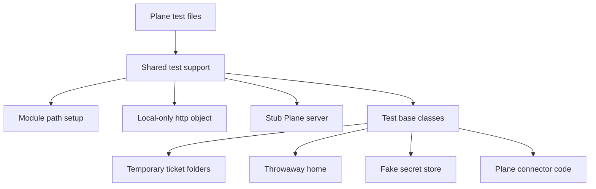

## Purpose

Shared setup code for every plane connector test file. Importing it puts the scripts folder and the test harness folder on the module path, and it offers ready-made pieces: fake settings, an http object that only talks to the local stub, a stub-backed client, and three test base classes that build temporary ticket folders, a throwaway home and a fake secret store.

## Dependencies

**Depends on.**
- Repo product code: [[plane_sync_settings]] / [plane_sync_settings](../../../../scripts/connectors/plane/plane_sync_settings.md) {src:tests/scripts/connectors/plane/plane_sync_test_support.py:36}; [[plane_ticket_syncer]] / [plane_ticket_syncer](../../../../scripts/connectors/plane/plane_ticket_syncer.md) {src:tests/scripts/connectors/plane/plane_sync_test_support.py:37}; [[plane_work_item_client]] / [plane_work_item_client](../../../../scripts/connectors/plane/plane_work_item_client.md) {src:tests/scripts/connectors/plane/plane_sync_test_support.py:38}; [[cli]] / [cli](../../../../scripts/connectors/plane/cli.md) {src:tests/scripts/connectors/plane/plane_sync_test_support.py:35}; [[registry]] / [registry](../../../../scripts/connectors/registry.md) and [[connect]] / [connect](../../../../scripts/connectors/connect.md) {src:tests/scripts/connectors/plane/plane_sync_test_support.py:34}.
- Repo test helpers: [[connector_helpers]] / [connector_helpers](../../../harness/connector_helpers.md) {src:tests/scripts/connectors/plane/plane_sync_test_support.py:33}; [[throwaway_home]] / [throwaway_home](../../../harness/throwaway_home.md) {src:tests/scripts/connectors/plane/plane_sync_test_support.py:39}; [[plane_stub_server]] / [plane_stub_server](plane_stub_server.md) {src:tests/scripts/connectors/plane/plane_sync_test_support.py:40}.
- Files: `scripts/connectors/plane/plane_sync_settings.example.json` {src:tests/scripts/connectors/plane/plane_sync_test_support.py:42} and `scripts/connectors/plane/plane_ticket_state_template.md` {src:tests/scripts/connectors/plane/plane_sync_test_support.py:43}.
- Standard library: `contextlib`, `dataclasses`, `io`, `os`, `sys`, `tempfile`, `unittest`, `urllib`, `uuid`, `pathlib` {src:tests/scripts/connectors/plane/plane_sync_test_support.py:12-24}.
- Environment variables set by the helper: `TOLLGATE_NONINTERACTIVE` {src:tests/scripts/connectors/plane/plane_sync_test_support.py:184} and `TG_TEST_KEY` {src:tests/scripts/connectors/plane/plane_sync_test_support.py:193}.

**Used by.** `git grep` for `plane_sync_test_support` outside `docs/` (searched 2026-11-20). No product code imports it. Tests that import it, each first for the side effect on the module path and then for names:
- Tests: `test_plane_cli.py` {src:tests/scripts/connectors/plane/test_plane_cli.py:24}, `test_plane_client.py` {src:tests/scripts/connectors/plane/test_plane_client.py:17}, `test_plane_comment_builder.py` {src:tests/scripts/connectors/plane/test_plane_comment_builder.py:26}, `test_plane_connector.py` {src:tests/scripts/connectors/plane/test_plane_connector.py:26-28}, `test_plane_create.py` {src:tests/scripts/connectors/plane/test_plane_create.py:20}, `test_plane_drift.py` {src:tests/scripts/connectors/plane/test_plane_drift.py:15}, `test_plane_fixes.py` {src:tests/scripts/connectors/plane/test_plane_fixes.py:33}, `test_plane_settings.py` {src:tests/scripts/connectors/plane/test_plane_settings.py:21}, `test_plane_standards.py` {src:tests/scripts/connectors/plane/test_plane_standards.py:15}, `test_plane_sync.py` {src:tests/scripts/connectors/plane/test_plane_sync.py:22}, `test_plane_vault_files.py` {src:tests/scripts/connectors/plane/test_plane_vault_files.py:23}.
- Tests that import it only for the module-path side effect: `test_plane_markdown.py` {src:tests/scripts/connectors/plane/test_plane_markdown.py:10}, `test_plane_secret_shapes.py` {src:tests/scripts/connectors/plane/test_plane_secret_shapes.py:10}.

## Behavior

**Module path.** `ROOT` is the fourth parent of this file's folder, that is the repo root {src:tests/scripts/connectors/plane/plane_sync_test_support.py:26-27}. The folder itself, `scripts/` and `tests/harness` are inserted at the front of `sys.path` when not already there {src:tests/scripts/connectors/plane/plane_sync_test_support.py:28-31}. This is why the product and harness imports below it work {src:tests/scripts/connectors/plane/plane_sync_test_support.py:33-40}.

**Fake key.** `fake_key` returns `"Fk9"` plus 32 hex characters plus `"Zq"`, built fresh at import {src:tests/scripts/connectors/plane/plane_sync_test_support.py:47-49} {src:tests/scripts/connectors/plane/plane_sync_test_support.py:52}. The fixed parts guarantee an upper-case letter, a lower-case letter and a digit, which is what the `long_mixed_token` secret pattern needs {src:scripts/connectors/plane/plane_sync_settings.py:40-43}. The docstring claim ("the scanner treats it as a secret") therefore holds.

**`StubHttp`.** An http object with one method, `request`. It builds an opener with an empty proxy map, so environment proxies are ignored, and a redirect handler that refuses to follow redirects {src:tests/scripts/connectors/plane/plane_sync_test_support.py:55-57} {src:tests/scripts/connectors/plane/plane_sync_test_support.py:64}. It raises `AssertionError` for any host other than `127.0.0.1` {src:tests/scripts/connectors/plane/plane_sync_test_support.py:68-69}. A string body is encoded to bytes {src:tests/scripts/connectors/plane/plane_sync_test_support.py:70}. On success it returns `{"status", "body"}` {src:tests/scripts/connectors/plane/plane_sync_test_support.py:73-74}; on an HTTP error it closes the error and re-raises it {src:tests/scripts/connectors/plane/plane_sync_test_support.py:75-77}.

**`make_settings`.** Loads the shipped example settings with an empty environment, then replaces the workspace with the stub's, sets pacing to zero and sets a one-row prefix table `T` {src:tests/scripts/connectors/plane/plane_sync_test_support.py:80-84}. The pattern is `^T-(\d+)$` and the number width is the argument (default 1) {src:tests/scripts/connectors/plane/plane_sync_test_support.py:83}. The example file itself uses width 3 {src:scripts/connectors/plane/plane_sync_settings.example.json:6}, so the helper changes a shipped default.

**`make_client`.** Builds a `PlaneWorkItemClient` with `StubHttp`, no pacing, a 5 second timeout and `allow_insecure_http=True`, because the stub address starts with `http://` {src:tests/scripts/connectors/plane/plane_sync_test_support.py:87-94} {src:scripts/connectors/plane/plane_work_item_client.py:129-130}.

**`StubTestCase`.** `setUp` starts a stub and stops it on cleanup {src:tests/scripts/connectors/plane/plane_sync_test_support.py:107-108}. It makes a temp folder with `tickets` and `state` paths; only the tickets folders are created {src:tests/scripts/connectors/plane/plane_sync_test_support.py:109-114}. For each number 1 to `local_highest` (5) it creates a ticket folder `T-n` and a stub card `wi-n` named `old n` with external id `T-n` {src:tests/scripts/connectors/plane/plane_sync_test_support.py:104} {src:tests/scripts/connectors/plane/plane_sync_test_support.py:113-115}. It then builds settings and a client against the stub {src:tests/scripts/connectors/plane/plane_sync_test_support.py:116-117}. `create_args` returns fixed create arguments {src:tests/scripts/connectors/plane/plane_sync_test_support.py:120-122} and `folder_names` lists the ticket folders sorted {src:tests/scripts/connectors/plane/plane_sync_test_support.py:124-125}.

**`SyncTestCase`.** Adds a state file for ticket `T-5` in `setUp` {src:tests/scripts/connectors/plane/plane_sync_test_support.py:128} {src:tests/scripts/connectors/plane/plane_sync_test_support.py:139-142}. The state text has frontmatter with a title and a status plus a body {src:tests/scripts/connectors/plane/plane_sync_test_support.py:132-133}; its default status is an approved-spec word from the example status map {src:tests/scripts/connectors/plane/plane_sync_test_support.py:132}. Helpers: `write_state` rewrites the state file {src:tests/scripts/connectors/plane/plane_sync_test_support.py:144-145}; `write_file` and `append_session` write into the ticket folder {src:tests/scripts/connectors/plane/plane_sync_test_support.py:147-155}; `sync` clears `lines` and calls `run_sync` for `T-5`, collecting output lines {src:tests/scripts/connectors/plane/plane_sync_test_support.py:157-163}; `patches` returns bodies of PATCH calls to `/work-items/wi-5/`, optionally only those holding a key {src:tests/scripts/connectors/plane/plane_sync_test_support.py:165-167}; `comments` returns the stub's stored comments {src:tests/scripts/connectors/plane/plane_sync_test_support.py:169-170}; `card` returns the stub item numbered 5 {src:tests/scripts/connectors/plane/plane_sync_test_support.py:172-173}.

**`CliCase`.** Enters `throwaway_home` by hand and leaves it on cleanup {src:tests/scripts/connectors/plane/plane_sync_test_support.py:181-183}, sets `TOLLGATE_NONINTERACTIVE=1` in the child env {src:tests/scripts/connectors/plane/plane_sync_test_support.py:184}, installs a `FakeSecretStore` and `StubHttp` in the connector registry and resets both to `None` on cleanup {src:tests/scripts/connectors/plane/plane_sync_test_support.py:185-189}, then switches the connector on {src:tests/scripts/connectors/plane/plane_sync_test_support.py:190}. `turn_on` puts the key in the process environment under `TG_TEST_KEY` {src:tests/scripts/connectors/plane/plane_sync_test_support.py:193}, reads the host and port out of the stub address {src:tests/scripts/connectors/plane/plane_sync_test_support.py:195}, and runs `connect.main(["on","plane",...])` with output hidden {src:tests/scripts/connectors/plane/plane_sync_test_support.py:196} and `registry.interactive` patched to return true {src:tests/scripts/connectors/plane/plane_sync_test_support.py:197}. The call passes `--allow-host host:port` for the stub {src:tests/scripts/connectors/plane/plane_sync_test_support.py:199}, because Plane has no built-in host and the stub is on a non-standard port; the allow step is refused without a terminal, which is why `interactive` is patched {src:scripts/connectors/connect.py:80-82}. It removes the variable in a `finally` {src:tests/scripts/connectors/plane/plane_sync_test_support.py:201-202} and checks the exit code is 0 {src:tests/scripts/connectors/plane/plane_sync_test_support.py:203}. `turn_off` runs `connect.main(["off","plane"])` and checks 0 {src:tests/scripts/connectors/plane/plane_sync_test_support.py:205-207}. `run_cli` calls `cli.main` with the temp roots, the stub-friendly flag and `lines.append` as output, letting callers override any option {src:tests/scripts/connectors/plane/plane_sync_test_support.py:209-214}.

## Diagram: module level (L2, required)

## Diagram: function level (L3, optional)

None: no function has branching that the signature does not show.

## Notes

- **Code and description.** The header scope says real HTTP goes to the local stub "and nowhere else" {src:tests/scripts/connectors/plane/plane_sync_test_support.py:5}. This holds for `StubHttp`, which refuses other hosts {src:tests/scripts/connectors/plane/plane_sync_test_support.py:68-69}, but the refusal is an `AssertionError` raised inside the http object, and the client catches every `Exception` and turns it into a `PlaneApiError` with the reason `AssertionError` {src:scripts/connectors/plane/plane_work_item_client.py:163-166}. A test that reaches a foreign host through the client therefore sees a Plane error, not an assertion failure. Only a direct call on `StubHttp` raises the bare assertion, as the test in `test_plane_connector.py` does {src:tests/scripts/connectors/plane/test_plane_connector.py:179-182}.
- **Hard-coded card.** `patches` and `card` assume the sync ticket is number 5 and card id `wi-5` {src:tests/scripts/connectors/plane/plane_sync_test_support.py:165-166} {src:tests/scripts/connectors/plane/plane_sync_test_support.py:172-173}, while `SYNC_TICKET` is a separate constant {src:tests/scripts/connectors/plane/plane_sync_test_support.py:128}. Changing one without the other breaks them silently.
- **Unchecked inputs.** `write_file` and `append_session` join the caller's `name` onto the ticket folder without a check {src:tests/scripts/connectors/plane/plane_sync_test_support.py:148} {src:tests/scripts/connectors/plane/plane_sync_test_support.py:153}. Callers are test code with fixed names. The helper sends no shell command and contacts only the loopback address. The key in `TG_TEST_KEY` is written to the process environment, visible to every thread, until the `finally` {src:tests/scripts/connectors/plane/plane_sync_test_support.py:192-198}.
- **Writes to shared files.** `sys.path` is changed for the whole test process {src:tests/scripts/connectors/plane/plane_sync_test_support.py:29-31}. The registry store and http factory are module-level globals, set per test and reset on cleanup, with no lock {src:tests/scripts/connectors/plane/plane_sync_test_support.py:186-189} {src:scripts/connectors/registry.py:31-33}. `turn_on` makes `connect.main` write the connectors state file inside the throwaway home; that write is a plain `write_text`, not atomic, with no guard against two writers {src:scripts/connectors/registry.py:307-318}. All other files are written under temp folders {src:tests/scripts/connectors/plane/plane_sync_test_support.py:109-112}.
- **Cleanup order.** Cleanups run last-in first-out, so the registry resets run before the throwaway home is removed {src:tests/scripts/connectors/plane/plane_sync_test_support.py:183} {src:tests/scripts/connectors/plane/plane_sync_test_support.py:188-189}.
- **Maintenance.** Importing the module generates `FAKE_TOKEN` once per process {src:tests/scripts/connectors/plane/plane_sync_test_support.py:52}, so a value found in a failing log differs from run to run.
