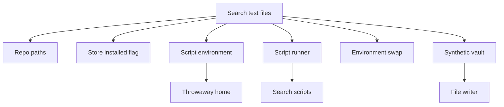

## Purpose

This is the shared helper module for the search tests. It gives each test file the repo paths, a way to run code or a script inside a throwaway environment, a flag that says whether the search packages are installed, a small file writer, and a tiny synthetic vault to index.

## Dependencies

**Depends on.**
- Standard library: `contextlib`, `json`, `os`, `pathlib`, `shutil`, `subprocess`, `sys` {src:tests/scripts/search/support.py:10-16}.
- Throwaway home factory: [[throwaway_home]] and [throwaway_home](../../harness/throwaway_home.md), imported by name {src:tests/scripts/search/support.py:25}.
- Optional outside packages `chromadb` and `yaml` (PyYAML), probed with a try-import {src:tests/scripts/search/support.py:27-32}.
- Folders it adds to `sys.path`: `tests/harness`, `scripts` and `scripts/search` {src:tests/scripts/search/support.py:22-24}. The scripts under `scripts/search` are the code the tests run, for example [[ground]] and [ground](../../../scripts/search/ground.md), [[build_index]] and [build_index](../../../scripts/search/build_index.md).
- Data folders: `tests/rag_eval/corpus` and `tests/rag_eval/golden_questions.json` {src:tests/scripts/search/support.py:20-21}.

**Used by.** Searched with `git grep` for `import support` and `from support` outside `docs/` on 2026-11-20. No product code imports it. Tests only: `test_embedder_profile.py`, `test_golden.py`, `test_ground.py`, `test_index_health.py`, `test_internals.py`, `test_reference.py`, `test_review_fixes.py`, `test_ticket_flags.py`, all in this folder. `test_tg_search.py` does not import it.

## Behavior

- **Paths.** `ROOT` is the repo root, worked out with `parents[3]` of this file's resolved path (search, scripts, tests, then the root) {src:tests/scripts/search/support.py:18}. `SEARCH`, `CORPUS` and `GOLDEN` hang off it {src:tests/scripts/search/support.py:19-21}. The three `sys.path.insert(0, ...)` lines put those folders first on the import path, which is what lets the tests write `import build_index` and `import ground` {src:tests/scripts/search/support.py:22-24}.
- **Store flag.** `HAVE_STORE` is true when both `chromadb` and `yaml` import, false when either raises `ImportError` {src:tests/scripts/search/support.py:27-32}. `NOTE` is the skip message tests show {src:tests/scripts/search/support.py:34}.
- **`script_env(env, **extra)`** copies the env dict, forces `TOLLGATE_EMBEDDER=hash` and `PYTHONDONTWRITEBYTECODE=1`, then applies `extra`, so a caller can override both {src:tests/scripts/search/support.py:38-42}.
- **`run_script(name, args, env, input_text=None, timeout=300)`** runs `python -B <SEARCH>/<name> <args>` with the current interpreter, captures output as text, passes the given env and optional stdin, and returns the `CompletedProcess` {src:tests/scripts/search/support.py:46-47}. It does not use a shell, and it does not check the return code, so each test checks it.
- **`in_env(env)`** is a context manager. It saves a copy of `os.environ`, clears it, loads `env`, runs the body, and in a `finally` clears it and restores the saved copy {src:tests/scripts/search/support.py:53-60}.
- **`write(path, text)`** makes the parent folders, writes UTF-8 text and returns the path {src:tests/scripts/search/support.py:64-67}.
- **`make_vault(vault)`** writes three files: `notes/alpha.md` (the retry note with a `[[beta]]` link), `notes/beta.md` (with the dead link `[[missing-note-one]]` twice) and `02-tickets/T-001/T-001-state.md` {src:tests/scripts/search/support.py:73-81}. It returns the vault path {src:tests/scripts/search/support.py:82}.
- `throwaway_home` is re-exported with `noqa: F401`, so tests can import it from here {src:tests/scripts/search/support.py:25}.

## Diagram: module level (L2, required)

## Diagram: function level (L3, optional)

None: no function has branching that the signature does not show.

## Notes

- Code and description disagree: the docstring of `make_vault` says "two notes, one ticket, one conversation note with a dead link" {src:tests/scripts/search/support.py:71}. The code writes two plain notes and one ticket; the dead link sits in `beta.md`, an ordinary note, and no conversation note is written {src:tests/scripts/search/support.py:73-81}.
- `json` and `shutil` are imported {src:tests/scripts/search/support.py:11} {src:tests/scripts/search/support.py:14} but no line in the file uses them (searched the file 2026-11-20).
- The header gives an empty `date:` {src:tests/scripts/search/support.py:5}.
- Inputs that reach a path, command or write without a check: `run_script` joins `name` onto `SEARCH` and runs it with no check on the value {src:tests/scripts/search/support.py:46}, and passes `args` straight to the program {src:tests/scripts/search/support.py:46}. `write` writes to any `path` it is given, creating parents {src:tests/scripts/search/support.py:64-66}. All callers are tests passing literals or paths under a temp folder, so this is local trust, not an outside input.
- Shared-state risk: `in_env` changes the process-wide `os.environ` {src:tests/scripts/search/support.py:54-55}. There is no lock, so it is unsafe if two threads use it at once. The restore in `finally` runs even on error {src:tests/scripts/search/support.py:58-60}.
- Writes to a shared file: `write` is not atomic (a plain `write_text`) {src:tests/scripts/search/support.py:66}, and nothing stops two writers. In practice the targets are files under a per-test temp folder.
- `run_script` has a 300 second default timeout and does not catch the `TimeoutExpired` error {src:tests/scripts/search/support.py:45-47}.
